# LLM 推理的不确定性，是可以消除的（全文翻译）

> **原文**：Defeating Nondeterminism in LLM Inference
> **作者**：Horace He，与 Thinking Machines 的同事合作
> **发布**：2025 年 9 月 10 日，Thinking Machines Lab：Connectionism
> **原文链接**：<https://thinkingmachines.ai/blog/defeating-nondeterminism-in-llm-inference/>
> **译文与核实日期**：2026-10-13
>
> **这份是什么**：原文的完整中文翻译（不是摘要）。小节层级、代码块、脚注、外链、图注全部对应原文，没有增删论点。术语第一次出现时保留英文原词，便于回查。
>
> **配图说明**：全文 19 张图。图 1、2、3、4、5、12、17、18、19 是按原文事实自绘的中文示意图；图 6 到 11、13 到 16 用的是原文自带的 SVG（图内标签是英文，图注已译成中文）。图 12 和图 19 的曲线由原文公布在 `thinkingmachines.ai/data/` 下的实验数据重绘，横纵坐标口径与原图一致。
>
> **有一处口径需要留意**：原文正文说批不变 kernel「只损失了约 20% 的性能」，但从它自己公布的性能曲线数据算，全区间平均是 16.8%、大 batch 段（batch ≥ 2048）是 13.1%。20% 更接近全区间口径，不算写错，只是没交代是哪个区间。详见同目录的《总结与分析》。

---

可复现性是科学进步的基石。可是要从大语言模型里拿到可复现的结果，出奇地难。

比如说，同一个问题问 ChatGPT 很多遍，答案并不一样。这本身不奇怪：从语言模型里取结果是靠「采样」（sampling），也就是把模型的输出变成一个概率分布，再按概率挑一个 token。

更让人意外的是：哪怕把温度调到 0¹，让采样在理论上变成确定的，LLM 的 API 在实际中**依然**不是确定的（过去有过一些讨论，见 [这里](https://152334h.github.io/blog/non-determinism-in-gpt-4/)、[这里](https://community.openai.com/t/a-question-on-determinism/8185/2) 或 [这里](https://cookbook.openai.com/examples/reproducible_outputs_with_the_seed_parameter)）。哪怕你在自己的硬件上跑，用 vLLM、SGLang 这类开源推理库，采样照样不确定（见 [这里](https://docs.vllm.ai/en/v0.7.0/getting_started/faq.html) 或 [这里](https://docs.sglang.ai/references/faq.html)）。

那 LLM 推理引擎为什么不确定？有一个流行说法是：浮点运算的不可结合性，加上并发执行，导致结果取决于哪个并发核心先跑完。我们把这个说法叫做 LLM 推理不确定性的「并发＋浮点」假说。比如一篇较新的 arXiv 预印本这样写：

> GPU 上的浮点运算不满足结合律，即 (a+b)+c ≠ a+(b+c)，这是有限精度和舍入误差造成的。这一性质直接影响 transformer 里 attention 分数和 logits 的计算——多线程并行运算会因执行顺序不同而给出不同结果。
> —— [arXiv:2506.09501](https://arxiv.org/abs/2506.09501)

这个「并发＋浮点」的说法在别处也能看到。比如[这里](https://community.openai.com/t/a-question-on-determinism/8185)：「这里有权衡速度的问题——为了让接口快，就得用 GPU，而 GPU 会做并行的［非确定性］计算。现在任何 GPU 上的神经网络计算都逃不掉这一条。」再比如[这里](https://x.com/hosseeb/status/1773146428594090473)：「因为 GPU 高度并行，每次执行时加法和乘法的顺序可能都不一样，这会级联成输出上的细微差异。」

这个假说不能算全错，但它没讲出全貌。举个例子：即便在 GPU 上，对同一批数据反复做同一个矩阵乘，结果永远逐位相同。我们用的确实是浮点数，GPU 也确实有大量并发。那为什么这个测试里看不到不确定性？

```python
A = torch.randn(2048, 2048, device='cuda', dtype=torch.bfloat16)
B = torch.randn(2048, 2048, device='cuda', dtype=torch.bfloat16)
ref = torch.mm(A, B)
for _ in range(1000):
    assert (torch.mm(A, B) - ref).abs().max().item() == 0
```

要弄清 LLM 推理不确定性的真正成因，得再往下挖一层。

麻烦的是，连「LLM 推理是确定的」这句话到底指什么都没那么容易说清。下面这几句话听着互相矛盾，但可以同时成立：

- GPU 上确实有一些 kernel 是不确定的。
- 但语言模型前向计算里用到的所有 kernel 都是确定的。
- 而且，LLM 推理服务（比如 vLLM）的前向计算，也可以说是确定的。
- 可是，从任何使用这个推理服务的人的角度看，结果就是不确定的。

这篇文章要讲清三件事：为什么「并发＋浮点」这个假说没说到点子上；LLM 推理不确定性的真凶究竟是谁；以及怎么消除不确定性、拿到真正可复现的结果。

## 原罪：浮点数的不可结合性

在谈不确定性之前，先解释数值差异从哪来。毕竟我们习惯把机器学习模型当成数学函数，认为它满足交换律、结合律这类结构规则。那是不是应该存在一个「数学上正确」的结果，等着机器学习库去给出？

罪魁祸首是浮点数的不可结合性。也就是说，对浮点数而言：

(a+b)+c ≠ a+(b+c)

```python
(0.1 + 1e20) - 1e20
>>> 0
0.1 + (1e20 - 1e20)
>>> 0.1
```

有点讽刺：正是因为破坏了结合律，浮点数才有用。

浮点数有用，是因为它能做到「动态」的精度。为了讲得直观，下面用十进制（不用二进制），浮点数的形式是「尾数 × 10^指数」，尾数取 3 位、指数取 1 位。

例如 3450 可以精确写成 3.45 × 10³；小得多的 0.486 可以写成 4.86 × 10⁻¹。这样一来，浮点既能表示很小的数，也能表示很大的数。用科学记数法的话说，浮点让「有效数字」的位数保持恒定。

两个指数相同的浮点数相加，看起来就像整数加法。比如 123（1.23 × 10²）加 456（4.56 × 10²）得 579（5.79 × 10²）。

那指数不同的时候呢？比如 1230 加 23.4。精确结果是 1253.4，但我们一次只能维持 3 位精度。于是浮点加法会把最后两位丢掉，得到 1.25 × 10³，也就是 1250。

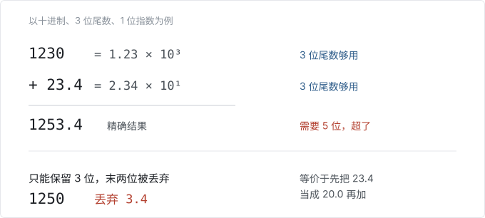

到这里，信息已经被破坏掉了。注意，只要两个浮点数的「量级」（也就是指数）不同，相加时都可能发生这种事，而这在现实中随时都在发生。事实上，如果我们能保证永远不需要不同的指数，直接用整数就行了！

换句话说，只要相加顺序变了，结果就可能完全不同。举个极端的例子：下面这个数组，光是按不同顺序求和，就能有 102 种不同的结果。

```python
import random

vals = [1e-10, 1e-5, 1e-2, 1]
vals = vals + [-v for v in vals]

results = []
random.seed(42)
for _ in range(10000):
    random.shuffle(vals)
    results.append(sum(vals))

results = sorted(set(results))
print(f"There are {len(results)} unique results: {results}")

# Output:
# There are 102 unique results: [-8.326672684688674e-17, -7.45931094670027e-17, ..., 8.326672684688674e-17]
```

虽然这是「输出不完全一致」的根本原因，但它没有直接回答不确定性从哪来：它没告诉我们浮点值为什么会以不同顺序相加、什么情况下会这样、又该怎么避免。

答案在 kernel 的实现方式里。

## 为什么 kernel 不总是按同一个顺序加数？

前面提到，对「kernel 为什么顺序不一」的一个常见解释就是「并发＋浮点」假说。这个假说认为：如果并发线程的完成顺序是不确定的，而累加顺序又取决于完成顺序（比如用 atomic add），那么累加顺序也就不确定了。

耐人寻味的地方在于：虽然这确实能让某些 kernel 变得不确定，但并发（以及 atomic add）跟 LLM 推理的不确定性**完全没关系**。要解释真凶是谁，得先弄清为什么现代 GPU kernel 很少需要 atomic add。

## 什么时候需要 atomic add？

GPU 通常会把一个程序并发地跑在很多「核心」（也就是 SM）上。这些核心之间没有天然的同步，所以一旦核心之间要通信就成了问题。比如所有核心都得往同一个元素上累加，这时可以用「atomic add」（有时也叫「fetch-and-add」）。atomic add 是「不确定的」——结果累加的顺序完全取决于哪个核心先跑完。

具体一点：假设你要用 100 个核心对一个 100 元素的向量做归约（比如 `torch.sum()`）。虽然 100 个元素可以并行读入，但最终必须归约成一个元素。一种做法是借助某种「atomic add」原语：硬件保证每一次加都会被处理，但不保证顺序。

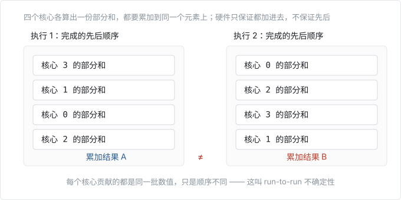

这通常就是大家说「不确定性」时指的东西：同一个 kernel、同样的输入，跑两遍得到不同结果。这叫 run-to-run 不确定性——同一个 Python 脚本、同样的依赖，跑两遍结果不同。

并发原子加确实能让 kernel 变得不确定，但对绝大多数 kernel 来说，atomic add 并不是必需的。事实上，LLM 一次典型的前向计算里，通常连一个 atomic add 都没有。

考虑到归约的并行化本来是能靠 atomic add 获益的，这听上去有点意外。atomic add 之所以最终用不上，主要有两个原因。

- **batch 这个维度上通常已经有足够的并行度**，不需要再沿着归约维度并行。比如你要归约的不是 1 个 100 维向量，而是 500 个向量并行归约。这时可以让每个核心完整归约一个向量，每个核心处理不同的向量就行。
- **这些年各家神经网络库都摸索出了不牺牲性能也能保证确定性的办法**。比如可以做「拆分式」（或者说树形）归约：把 100 个元素的归约切成 5 组各 20 个元素（于是有 5 路并行），剩下 5 个元素再合并时，要么单独做一次「收尾」归约（不并行，但元素少、开销低），要么用信号量（semaphore，保证每个并发 thread block 按确定顺序累加）²。

有了这两条，对绝大多数神经网络算子来说，避开 atomic add 的性能代价可以忽略不计。

确实还有少数常见算子，避开 atomic 会带来明显性能损失。比如 PyTorch 里的 `scatter_add`（`a[b] += c`）。但 LLM 里真正常用的只有一个，就是 FlashAttention 的反向传播³。

不过，LLM 的前向计算不包含任何需要 atomic add 的算子。因此 LLM 的前向计算实际上是「run-to-run 确定的」。

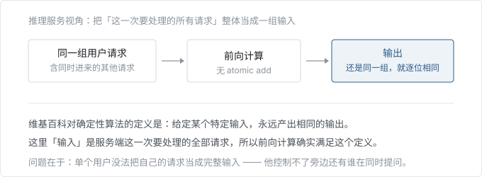

维基百科对确定性算法的定义是：「给定某个特定输入，永远产出相同的输出。」在这里，给定完全相同的输入（也就是推理服务正在处理的那批请求），前向计算永远产出完全相同的输出。

但前向计算本身「确定」，并不足以保证包含它的整个系统也确定。举个例子：如果我们的输出取决于并行的其他用户请求（比如 batch norm 那种），那会怎样？单个请求无从知道并行的请求是什么，从它的视角看，整个 LLM 推理也就是不确定的了！

而事实正是如此：请求的输出确实取决于并行的其他请求。倒不是因为什么跨 batch 的信息泄漏，而是因为前向计算缺少「批不变性」（batch invariance），导致请求的输出依赖于前向计算时的 batch 大小。

### 批不变性与「确定性」

为了讲清批不变性，先把系统简化，只看矩阵乘。你可以假定所有矩阵乘实现都是「run-to-run 确定的」⁴。但是它们并不「批不变」。换句话说，当 batch 大小变化时，batch 里的每个元素都可能得到不同结果。

从数学角度看，这是个相当反常的性质。矩阵乘本应沿着 batch 的每个元素「相互独立」——batch 里别的元素是谁、batch 有多大，都不该影响某个特定元素的计算结果。

但实测下来并非如此。

```python
import torch
torch.set_default_device('cuda')

B = 2048
D = 4096
a = torch.linspace(-1000, 1000, B*D).reshape(B, D)
b = torch.linspace(-1000, 1000, D*D).reshape(D, D)
# Doing a matrix vector multiplication by taking
# the first element of the batch
out1 = torch.mm(a[:1], b)
# Doing a matrix matrix multiplication and then taking
# the first element of the batch
out2 = torch.mm(a, b)[:1]
print((out1 - out2).abs().max()) # tensor(1669.2500, device='cuda:0')
```

注意，这个结果是「run-to-run 确定的」：脚本跑多少遍，都会确定地返回同一个结果。它只是不「对硬件/软件版本不变」——换一块 GPU 或换一个 PyTorch 版本可能返回别的值，但同一个环境下确定地返回同一个值⁵。

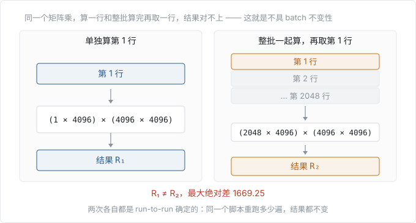

然而，当这样一个不具批不变性的 kernel 被放进更大的推理系统里，整个系统就可能变得不确定。你向推理接口发一个请求时，「服务器当时负载有多大」从用户视角看本身就是不确定的。负载决定了 kernel 在什么 batch 大小下运行，于是也就改变了每个单独请求的最终结果！

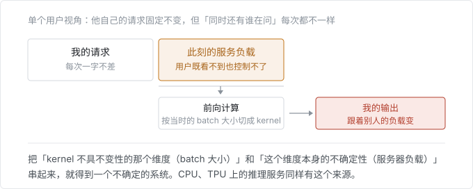

把「kernel 在其中不具不变性的某个属性（也就是 batch 大小）」和「这个属性本身的不确定性（也就是服务器负载）」组合起来，你就得到一个不确定的系统。

换句话说，**几乎所有 LLM 推理接口都不确定的头号原因，就是负载（进而 batch 大小）在不确定地变化！** 这个不确定性不是 GPU 独有的——跑在 CPU 或 TPU 上的 LLM 推理服务，同样有这个来源。

所以，如果想避免推理服务里的不确定性，就必须让 kernel 具备批不变性。要理解这怎么做到，先得看看 kernel 为什么一开始就不具备批不变性。

## 怎么让 kernel 具备批不变性？

要让一个 transformer 实现具备批不变性，就必须让每一个 kernel 都具备批不变性。所幸，我们可以假定所有逐元素（pointwise）运算都是批不变的⁶。于是，只需要操心涉及归约的 3 个运算：RMSNorm、矩阵乘、attention⁷。

方便的是，这三者的难度恰好是递增的。每一个都需要额外考虑一些东西，才能在合理性能下做到批不变。先说 RMSNorm。

### 批不变的 RMSNorm

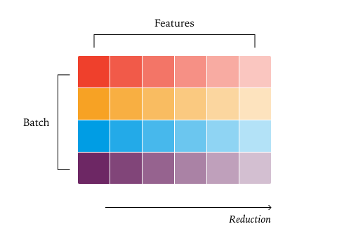

RMSNorm 可以这样实现：

```python
# x: [batch_size, hidden_dim]
# weight: [hidden_dim]
def rms_norm(x, weight):
    return x * torch.rsqrt(torch.mean(x ** 2, dim=-1, keepdim=True)) * weight
```

要做到批不变，要求是：不管 kernel 的 batch 大小是多少，每个元素的归约顺序都必须固定。这不意味着必须永远用同一种归约策略。比如归约的元素个数变了，即便归约策略跟着变，仍然可以是批不变的⁸。

所以，只有当 batch 大小影响了归约策略时，批不变性才会被破坏。

先看 RMSNorm 的标准并行策略。一般来说，并行算法都受益于尽量减少核心之间的通信⁹。那么一个可以拿来起步的策略就是：每个 batch 元素分配一个核心，也就是上图那样。

增大 batch 大小不影响归约策略：如果 batch 取 200 时并行度已经够用，那 batch 取 2000 时肯定更够用。

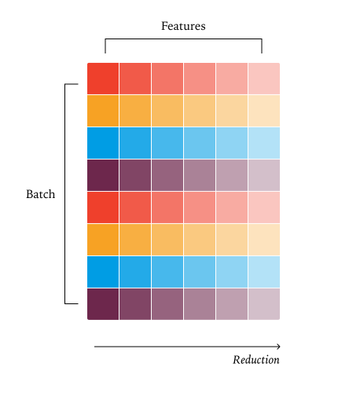

反过来，减小 batch 大小会带来麻烦。因为我们是一个 batch 元素配一个核心，batch 一小，核心数就会多于 batch 元素数，有些核心就闲下来了。

碰上这种情况，一个「称职」的 kernel 工程师会去拿上一节提到的方案（atomic add 或者拆分式归约），保住并行度，也就保住了性能。可惜这改变了归约策略，这个 kernel 就不再是批不变的。

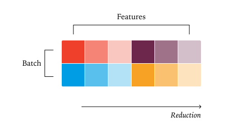

最省事的办法是干脆不管这种情况。这也不算太离谱——batch 小意味着这个 kernel 本来就跑得快，慢一点未必是灾难。

非要优化这个场景的话，一种做法是固定使用一种即使 batch 很小也还有足够并行度的归约策略。这样的策略在 batch 大时会产生多余的并行度，但能让整个尺寸区间都拿到还行（而非峰值）的性能。

### 批不变的矩阵乘

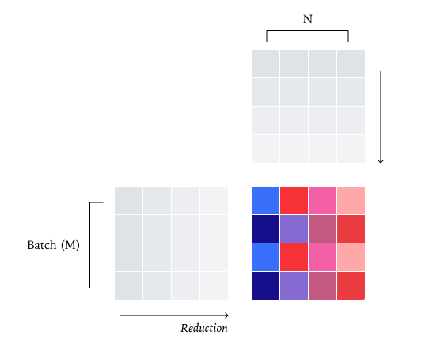

从本质上看，矩阵乘不过是一次逐元素运算后面跟一次归约。那么，只要把矩阵乘按输出分块来并行，就得到了一个与之类似的「数据并行」策略：每次归约留在单个核心内。

也和 RMSNorm 一样，矩阵乘的「batch」维度（M 和 N）有可能小到必须沿着归约维度（K）切。而且，尽管有两个「batch」维度，矩阵乘为了有效利用 tensor core，还要求每个核心上有大得多的「工作量」。举例来说，一个 [1024, K] × [K, 1024] 的矩阵乘，配上标准的 [128, 128] 二维 tile，数据并行策略只能把它切到 64 个核心上，不足以喂饱 GPU。

矩阵乘里沿归约维度切被称为 Split-K Matmul（见 CUTLASS 的[并行归约说明](https://github.com/NVIDIA/cutlass/blob/main/media/docs/cpp/efficient_gemm.md#parallelized-reductions)）。和 RMSNorm 一样，用了这个策略就破坏了批不变性。

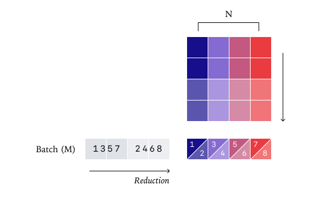

矩阵乘还有一层额外的复杂性：tensor core 指令。归约的时候我们可以一次只操作一行，但高效的矩阵乘 kernel 必须一次操作整个「tile」。

每一条 tensor core 指令（比如 `wgmma.mma_async.sync.aligned.m64n128k16`）内部的归约顺序都可能不同。需要换用不同 tensor core 指令的一个原因，可能是 batch 非常小。比如用一条处理长度 256 的 tile 的 tensor core PTX 指令，而 batch 只有 32，那几乎整个算力都被浪费了！到 batch 为 1 时，最快的 kernel 通常干脆不用 tensor core。

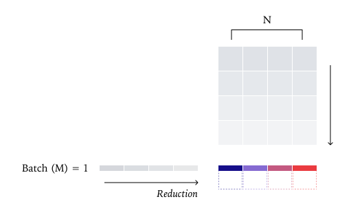

所以，保证矩阵乘批不变最省事的办法是：只编译一种 kernel 配置，所有形状都用它。虽然会损失一些性能，但在 LLM 推理里通常不算灾难。尤其是 split-k 最需要用的场合是 M 和 N 都小，而我们这里 N（也就是模型维度）通常还挺大！

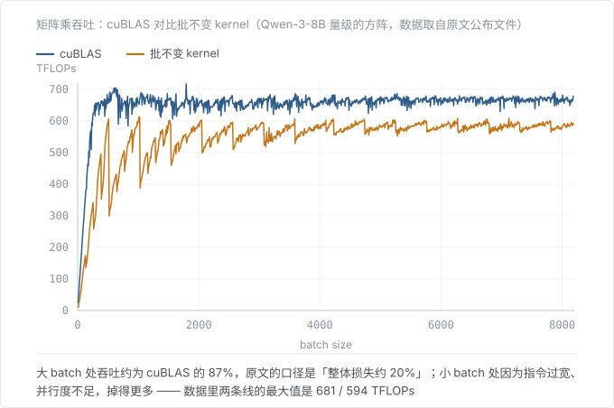

在拿到批不变性的前提下，相比 cuBLAS 只损失了约 20% 的性能。注意这还不是一个优化过的 Triton kernel（比如没用 TMA）。不过性能曲线里的一些形状，恰好能说明批不变的要求在哪里损失了性能。第一，batch 很小时会损失相当多性能，原因是指令过宽、并行度不足。第二，batch 增大时会出现「拼图」状的锯齿，这是 tile 和 wave 的量化效应造成的，通常靠调整 tile 尺寸来缓解（关于这些量化效应，可以看[这篇](https://www.thonking.ai/p/what-shapes-do-matrix-multiplications)）。

### 批不变的 attention

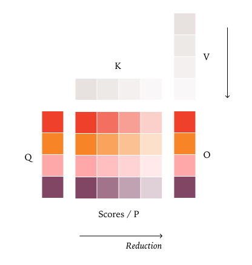

在矩阵乘拿到批不变性之后，attention 又带来两处额外的麻烦——很贴切，因为它里面有两个矩阵乘。

- 矩阵乘和 RMSNorm 都只在特征维度上做归约，attention 则同时在特征维度和序列维度上做归约。
- 正因为如此，attention 还得应付一堆会影响序列处理方式的推理优化（chunked prefill、prefix caching 等等）。

因此，要让 LLM 推理确定，我们的数值就必须同时对两件事不变：一次处理多少个请求，以及每个请求在推理引擎里被切成几段。

先走一遍 attention 的标准并行策略，也就是 FlashAttention2 最先提出的那套。和 RMSNorm、矩阵乘类似，默认策略也是「数据并行」。由于归约是沿着 key/value 张量做的，数据并行策略只能沿着 query 张量并行。

比如说，取决于推理引擎的选择，一个序列可能被分成好几段处理（比如 chunked prefill），也可能一次处理完（如果 prefill 没被切开）。要做到「批不变」，有个必要条件：给定 token 的归约顺序，不能取决于它所在序列里同时还有多少个别的 token 在处理。如果你把 KV cache 里的 K/V 值和当前正在处理的 token 的 K/V 值分开归约（比如 [vLLM 的 Triton attention kernel](https://github.com/vllm-project/vllm/blob/0ae43dbf8cb28a299ae724fc742b0c5bcddea868/vllm/attention/ops/prefix_prefill.py#L36) 那样），这一点就做不到。举例来说：处理序列里第 1000 个 query token 时，无论 KV cache 里是 0 个 token（prefill）还是 999 个 token（decoding），归约顺序都必须完全一致。


要解决这个问题，可以在调 attention kernel 之前先把 KV cache 和 page table 更新好，保证 key 和 value 的排布始终一致，不受当前处理多少 token 影响。

补上这个细节（再加上上一节提到的那些事，比如统一的 tile 尺寸），我们就能做到一个批不变的 attention 实现了！

但这里有个大问题。和矩阵乘不同，LLM 推理里遇到的 attention 形状经常确实需要拆分式归约 kernel，也就是常说的 Split-KV 或 FlashDecoding。原因在于：如果不沿归约维度并行，能并行的就只剩 batch 维度、head 维度和「query 长度」维度。而在 attention 的 decode 阶段，query 长度非常小，所以除非 batch 特别大，否则常常喂不饱 GPU。

遗憾的是，这种情况不像 RMSNorm 和矩阵乘那样可以一放了之。比如 KV cache 特别长时，哪怕只处理一个请求，attention kernel 也可能跑很久。

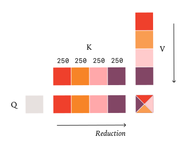

此外，attention 常用的那些拆分式归约策略本身也给批不变性出难题。比如 FlashInfer 的「均衡调度算法」会挑一个仍然能喂饱全部核心的最大切分尺寸，这就让归约策略不再「批不变」。但与 RMSNorm／矩阵乘不同的是：这里光固定切分**数量**、不管 batch 多大都切那么多份，是不够的。

要做到批不变，必须改用「固定切分**尺寸**」的策略。也就是说，不固定切分的份数，而是固定每一份的大小，份数随之变化。这样就能保证：无论当前处理多少 token，执行的归约顺序始终完全相同。这需要在 FlexAttention 内部做一些改动，这些改动没有包含在我们的代码发布里，会尽快推到上游¹¹。

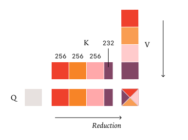

## 实现

我们在 vLLM 之上做了一套确定性推理的演示，借助它的 FlexAttention 后端和 `torch.Library`。通过 `torch.Library`，我们能以不侵入的方式替换掉大部分相关的 PyTorch 算子。批不变 kernel 的代码库在 [thinking-machines-lab/batch_invariant_ops](https://github.com/thinking-machines-lab/batch_invariant_ops)，里面也有以「deterministic」模式运行 vLLM 的示例。

## 实验

### 温度 0 下补全能有多不确定？

我们用 `Qwen/Qwen3-235B-A22B-Instruct-2507`，在温度 0 下、以「Tell me about Richard Feynman」为 prompt（非 thinking 模式）采样 1000 条补全，每条生成 1000 个 token。出乎意料的是，我们得到了 80 种不同的补全，其中出现最多的一种出现了 78 次。

再看这些补全从哪里开始不同：前 102 个 token 其实完全一致！第一批分道扬镳的补全出现在第 103 个 token。所有补全都生成了「Feynman was born on May 11, 1918, in」，但其中 992 条接着生成「Queens, New York」，另外 8 条生成「New York City」。

另一方面，当我们启用批不变 kernel 后，1000 条补全全部一模一样。这正是采样器在数学上应该给出的结果，但不用批不变 kernel，我们就拿不到确定的结果。

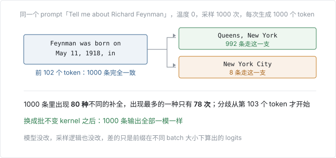

### 性能

我们并没有花太多力气去优化批不变 kernel 的性能。不过还是跑几个实验，确认性能仍然可用。

我们用一块 GPU 起了一个 API 服务跑 Qwen-3-8B，请求 1000 条序列，输出长度在 90 到 110 之间。

| 配置 | 耗时（秒） |
| --- | --- |
| vLLM 默认 | 26 |
| 未优化的确定性 vLLM | 55 |
| ＋改进后的 attention kernel | 42 |

很大一部分变慢来自 vLLM 里 FlexAttention 的集成还没有经过重度优化。即便如此，性能也不算**灾难性**的。

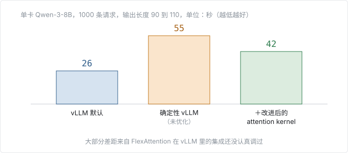

### 真正的 on-policy RL

正如[有研究者指出](https://fengyao.notion.site/off-policy-rl)的那样，训练和推理之间的数值差异，实际上把我们的 on-policy RL 变成了 off-policy RL。

当然，如果两个一模一样的推理请求都拿不到逐位一致的结果，那训练和推理之间要逐位一致更不可能。而确定性推理让我们可以顺手改造训练栈，让采样和训练产出逐位一致的结果，从而得到真正的 on-policy RL。

我们在 BigMath 上跑了一套 RLVR 实验，RL 策略从 Qwen 2.5-VL instruct 8B 初始化，最大 rollout 长度 4096。

如果不做 off-policy 修正（也就是不加重要性权重），训练到一半奖励就会崩掉；加上 off-policy 修正项之后训练就能平稳进行。而如果采样器和训练器之间做到逐位一致，我们就完全 on-policy（KL 散度为 0），训练同样能平稳进行。

我们也可以把采样器和训练器之间 logprobs 的 KL 散度画出来，三组实验的行为明显不同。加了重要性权重时，KL 散度大致维持在 0.001 附近、偶尔有尖峰。不加重要性权重时，KL 散度最终会在奖励崩掉的同一时间点出现尖峰。而当跑「真正的 on-policy RL」时，KL 散度一直平在 0，说明训练策略和采样策略之间没有任何偏离。

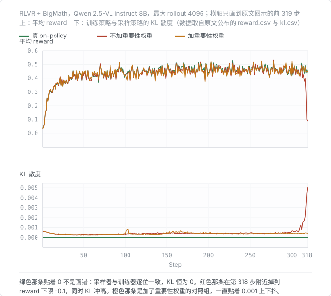

注意，不加重要性权重的那一组在第 318 步附近出现了明显的 loss 尖峰，同时 logprobs 的 KL 散度也跟着出现尖峰。而无论改用 off-policy 修正，还是跑「真 on-policy」，训练都能平稳继续。显示「True On-Policy」的那条线不是 bug——它就是一条平在 0 上的直线。（原文图注把这条线称作「蓝线」。）

> 译注：原文图注说的蓝线，在原文图表的实际配色里是橙色；原文图表用的是橙／青／绿三色，跟图注对不上。上图按本项目配色重画，绿＝真 on-policy、橙＝加重要性权重、红＝不加重要性权重，以图注里的语义为准。

## 结语

现代软件系统里叠着很多层抽象。在机器学习里，当我们撞上不确定性和细微的数值差异时，往往很容易想糊过去。毕竟我们的系统本来就「带概率」，再多一点不确定性又何妨？把失败的单元测试里那个 atol/rtol 调大一点又何妨？训练器和采样器之间的 logprobs 差异，多半也不是真的 bug 吧？

我们拒绝这种认命。只要肯花一点功夫，我们就能搞清楚不确定性的根本原因，甚至把它解决掉！希望这篇文章能帮社区扎扎实实地理解怎么解决推理系统里的不确定性，也希望它能带动更多人去把自己的系统彻底搞明白。

## 引用

引用方式：

> He, Horace and Thinking Machines Lab, "Defeating Nondeterminism in LLM Inference", Thinking Machines Lab: Connectionism, Sep 2025.

或使用 BibTeX：

```bibtex
@article{he2025nondeterminism,
  author = {Horace He and Thinking Machines Lab},
  title = {Defeating Nondeterminism in LLM Inference},
  journal = {Thinking Machines Lab: Connectionism},
  year = {2025},
  note = {https://thinkingmachines.ai/blog/defeating-nondeterminism-in-llm-inference/},
  doi = {10.64434/tml.20250910}
}
```

## 原文脚注

1. 指模型永远选概率最高的那个 token，这叫贪心采样（greedy sampling）。
2. 信号量这一策略在 [NVIDIA CUTLASS 的这个 issue](https://github.com/NVIDIA/cutlass/issues/1421#issuecomment-2016942675) 里有描述。
3. 顺带一提：你知道被广泛使用的 Triton 版 FlashAttention 反向实现，在算法上其实和 Tri Dao 的 [FlashAttention-2 论文](https://arxiv.org/abs/2307.08691)不一样吗？标准的 Triton 实现在反向传播里做了额外的重算，避免用 atomic，代价是多花 40% 的 FLOPs！
4. 这并不完全成立，但大多数常见的矩阵乘实现都有这个性质。
5. 它不「对硬件/软件版本不变」——换 GPU 或换 PyTorch 版本可能返回别的值，但在同一环境下会确定地返回同一个值。
6. 这在 PyTorch 之类的库里对所有 kernel 都成立，但并非天然如此。比如有些 CPU 上的 kernel 实现，会在数组的一部分用向量化指令、另一部分用非向量化指令，而这些指令的数值不保证逐位相同。
7. 与并行相关的归约不在本文讨论范围内，但原理相通。有个可能有用的小知识：NVLink-Sharp 的交换机内归约在 Blackwell 上，以及 CUDA 12.8+ 的 Hopper 上，都是确定的。和很多事情一样，这条信息来自 [NCCL 的 GitHub issue](https://github.com/NVIDIA/nccl/issues/1497#issuecomment-3210819243)。
8. [Quack 这篇博客](https://github.com/Dao-AILab/quack/blob/main/media/2025-07-10-membound-sol.md)里有不少好例子，展示了各种归约策略的层级（线程内归约、warp 内归约、block 内归约、cluster 内归约等）。
9. 本文讨论中，说到「核心」都指 SM。这里真正重要的性质是：kernel 启动的 thread block 数大于 SM 数。
10. 矩阵乘还有一种有意思的并行策略叫 stream-k。它的特别之处在于，不变性比普通矩阵乘还要差。前面说过，大多数矩阵乘库虽然不批不变，但至少可以说是「批位置不变」（也就是改变元素在 batch 中的位置不影响数值）。而 stream-k 连批位置不变都不满足！它的核心思路是：对不同输出 tile 用不同的 k 方向切法，可以换来更干净的负载均衡；但一旦这么用，kernel 也就失去了批位置不变性。
11. 这需要 FlexAttention 内部做一些改动，这些改动没有包含在我们的代码发布里，会尽快推到上游！
