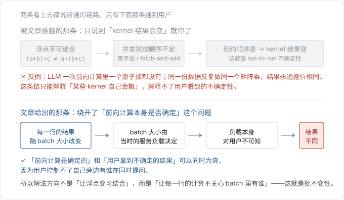
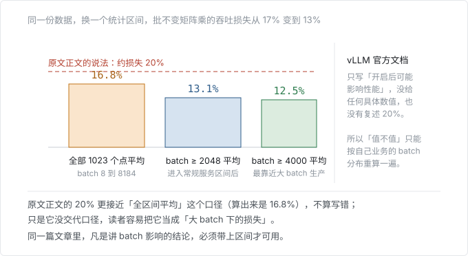
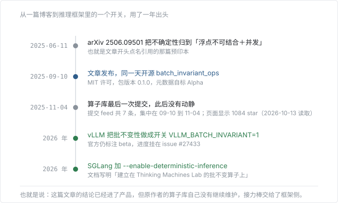
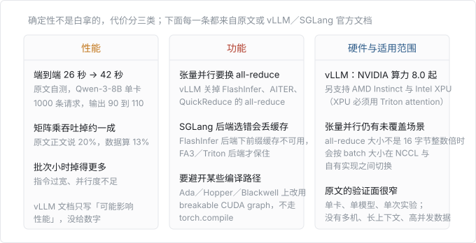

# LLM 推理不确定性：这篇文章讲了什么、哪些已经落地

> **分析对象**：Thinking Machines Lab《Defeating Nondeterminism in LLM Inference》，2025-09-10 发布
> **中文全文**：同目录《2026-10-13-LLM推理不确定性-全文翻译》
> **核实日期**：2026-10-13
> **用到的材料**：原文及其公布在 `thinkingmachines.ai/data/` 的实验数据、原文配套的开源算子库、vLLM 与 SGLang 的官方文档（读取日期均为 2026-10-13）
> **数据留存**：矩阵乘吞吐的原始数据 1023 行留在 `assets/2026-10-13-llm-nondeterminism/data-batch-vs-cublas.txt`，第五节那几种口径就是从它算出来的，可以自己复算
> **边界**：下面所有判断都只到「原文和官方文档写明」的范围，我没有跑过实验，也没在生产环境验过。

## 一、先把结论说了

**最大的启发是：这篇文章真正改掉的不是现象，是归因，而且它顺手证明了这个归因可以变成一条硬验收标准。**

三个判断：

1. **不确定性早就被观察到，「并发＋浮点」也早就被当成解释。** 文章的价值在于用两个反例把这条解释拆掉：LLM 一次前向计算里根本没有原子加；同一份数据反复做同一个矩阵乘，结果永远逐位相同。真正该被指责的是**批不变性缺失**——同一个元素在 batch 变大的时候算出了不同结果。
2. **它的解法是可以验收的工程改动，不是玄学。** 判据很硬：同一行元素在 batch = 1 和 batch = N 下必须逐位相同。三个做归约的算子（RMSNorm、矩阵乘、attention）逐个按这个标准改，attention 之外的两类都给了代码。
3. **一年多之后，这件事已经从博客变成了推理框架里的开关。** vLLM 有 `VLLM_BATCH_INVARIANT=1`（官方标 beta），SGLang 有 `--enable-deterministic-inference`，文档里明确写着是建立在 TML 这套批不变算子上的。但两边都还没到「打开就完事」的程度。

## 二、它到底推翻了什么

| 常见说法 | 文章的反驳 | 反驳的判据 |
| --- | --- | --- |
| GPU 浮点不可结合，所以结果会飘 | 不可结合是真的，但它不是用户看到不确定的原因 | 同一份数据反复做同一个矩阵乘，1000 次断言全部通过，逐位相同 |
| 并发执行让累加顺序不定 | 并发确实能让**某些** kernel 不定，但 LLM 前向计算里一个原子加都没有 | 前向计算不含需要 atomic add 的算子；只在 FlashAttention 反向里才用到 |
| 所以 LLM 推理引擎本质上就是不确定的 | 推理引擎本身可以同时是「确定的」和「用户拿到不确定结果的」 | 两者不矛盾：确定性是相对「这一批请求」而言的，而用户控制不了这一批里还有谁 |
| 要确定就得关掉精度、退回 FP32 | 不需要。改的是归约顺序，不是精度 | 三个算子改成「归约顺序与 batch 无关」后，数值仍是 bf16 |

第三条是最容易被忽略的：**「确定性」在这篇文章里不是一个绝对属性，而是相对于输入集合的。** 推理服务的输入是「这一次要处理的所有请求」，所以服务是确定的；用户的输入只是「我这一条」，所以用户看到的是不确定的。这个区分一旦立住，后面所有工程手段才有落点。

## 三、三个算子分别怎么改、各付什么代价

| 算子 | 标准并行策略 | 什么情况会破坏批不变性 | 文章的解法 | 代价 |
| --- | --- | --- | --- | --- |
| RMSNorm | 一个 batch 元素配一个核心（数据并行） | batch 变小、核心用不满，工程师自然改用拆分式归约或原子加 | 小 batch 干脆不管（本来就跑得快）；或固定使用一种即使很小 batch 也够并行的归约策略 | 小 batch 放弃峰值性能 |
| 矩阵乘 | 输出切二维 tile，每次归约留在单个核心内 | M、N 都小时用 Split-K；batch 太小要换更窄的 tensor core 指令或不用 tensor core | 只编译一种 kernel 配置，所有形状都用它 | 吞吐损失（口径见第五节） |
| attention | 沿 Q 并行，同时沿 K/V 归约（FlashAttention2） | KV cache 里的 K/V 与当前 token 的 K/V 分开归约，块边界对不上；Split-KV 按「份数」而不是按「尺寸」切 | 调 attention kernel 前先更新 KV cache 和 page table；改用固定切分**尺寸** | 需要 FlexAttention 内部改动，这部分**没有**随代码放出，原文说会尽快推到上游 |

三者的难度是递增的，这也解释了为什么配套代码库只覆盖了其中一部分：仓库里被替换掉的算子只有 `torch.mm`、`torch.addmm`、`torch.log_softmax`、`torch.mean` 四个。attention 那一环要等 FlexAttention 的上游改动。

**attention 这一节是全文最值钱的部分。** 它指出了一个真实的两难：KV cache 长、query 短（也就是 decoding 阶段）时，不沿归约维度切就喂不饱 GPU；一旦沿归约维度切，切法又会跟着「这次处理多少 token」变。文章给出的出路是「切分尺寸固定、份数随 batch 变」，而不是反过来。

## 四、这批实验能证明什么、不能证明什么

| 结论 | 证据 | 边界 |
| --- | --- | --- |
| 温度 0 下补全确实不唯一 | Qwen3-235B，1000 次采样得到 80 种补全，最多的一种出现 78 次；分歧从第 103 个 token 才开始 | 单模型、单 prompt、单机；没有跨模型的横向对照 |
| 批不变 kernel 能消掉这个不唯一 | 打开后 1000 条输出全部一致 | 同上；这是同一次实验的对照，不是独立复现 |
| 端到端性能没有崩 | 26 秒（vLLM 默认）→ 55 秒（未优化确定性）→ 42 秒（换 attention kernel） | 单卡 Qwen-3-8B、1000 条请求、输出 90–110 token。原文自己说大部分差距来自 FlexAttention 集成没调过 |
| 矩阵乘吞吐可以只掉一成多 | 原文公布的 batch 对 TFLOPs 曲线 | 见下一节的口径问题；且原文说明这不是优化过的 Triton kernel（比如没用 TMA） |
| 确定性推理能让 RL 变成真 on-policy | 三组对照：不加重要性权重会崩、加了能跑、逐位一致时 KL 恒为 0 | KL 恒为 0 是「采样器和训练器逐位一致」的**同义反复**，不是独立发现；能跑通的价值在于证明了这条路可行 |

最后一条值得单独说：图里那条贴着 0 的线（文章图注称它「蓝线」）不是意外收获，它是构造出来的。真正的信息量在于**另外两组**——不加重要性权重会在第 318 步附近崩掉并伴随 KL 尖峰，说明训练和推理的数值差是会实际伤到训练的。这部分才是能给 RL 团队带走的结论。

## 五、一处口径需要自己算

原文正文说批不变矩阵乘「只损失了约 20% 的性能」，但从它自己公布的 `batch-vs-cublas` 数据算，取不同的统计区间会得到不同答案：

| 口径 | 损失 |
| --- | --- |
| 全部 1023 个点平均（batch 8 到 8184） | 16.8% |
| 只统计 batch ≥ 2048 | 13.1% |
| 只统计 batch ≥ 4000 | 12.5% |
| 单点 batch 8184 | 12.7% |
| 两条线各自取最大值相比 | 14.4% |

也就是说正文的「约 20%」更接近全区间口径（算出来 16.8%），**不能算写错，但它没交代口径**。读的人很容易把它当成「大 batch 下的损失」，而大 batch 才是生产里的常态，那里的损失其实只有 13% 左右。

顺带记一处小对不上：原文 RL 那张图的图注把「真 on-policy」那条线称作蓝线，但图表实际用的配色是橙／青／绿。译文里按本项目配色重画并标了译注，语义以图注为准。

## 六、一年多之后：落地到哪一步了

| 对象 | 现在什么状态 | 核实来源 |
| --- | --- | --- |
| `batch_invariant_ops`（原文配套库） | MIT 许可，包版本 0.1.0，元数据自标 Alpha。提交 feed 共 7 条，从 2025-09-10 到 2025-11-04 为止，之后没有再动；仓库页面显示 1084 star | 仓库页面与 raw 文件，2026-10-13 读取 |
| 该库覆盖的算子 | 只有 `torch.mm`、`torch.addmm`、`torch.log_softmax`、`torch.mean` 四个 | 仓库 README 的 Supported Operations |
| vLLM | 环境变量 `VLLM_BATCH_INVARIANT=1` 开启批不变性。官方**仍标注 beta**，进度挂在 issue #27433。支持 NVIDIA 算力 8.0 及以上、AMD Instinct（gfx90a／gfx942／gfx950）、Intel XPU（必须配 Triton attention 后端）。已列出的验证模型覆盖 DeepSeek V3／R1、Qwen3 稠密与 MoE、Qwen3-VL、Qwen2.5、Llama 3、GPT-OSS、Mistral、GLM-4、Phi、Granite、EXAONE 4.0、OLMo 2、ERNIE 4.5、SmolLM2、PLaMo3 | vLLM 官方文档 `features/batch_invariance`，2026-10-13 读取 |
| SGLang | 启动参数 `--enable-deterministic-inference`。文档明写「建立在 Thinking Machines Lab 的批不变算子上」 | SGLang 官方文档 `advanced_features/deterministic_inference`，2026-10-13 读取 |

一件事值得注意：**原作者团队没有继续维护那个库，接力棒交给了框架侧。** 而框架侧接过去之后，做法和原文已经不太一样了——vLLM 自己另写了一套常驻 Triton kernel，并且把「哪些优化必须让位」列得很细：张量并行下要保留固定归约顺序的 all-reduce，关掉 FlashInfer、AITER、QuickReduce 的 all-reduce；在 Ada／Hopper／Blackwell 上要用 breakable CUDA graph 而不是 `torch.compile`，让 tile 配置跟着运行时的 batch 走；LoRA 的 shrink 归约拆成 8 个固定 K 分块按固定顺序求和，代替原子加。这些都是原文里没有的工程细节。

## 七、真要用，代价是什么

几个具体的取舍，按「会不会让你放弃某个优化」分：

| 优化 | 和确定性的关系 | 现在怎么办 |
| --- | --- | --- |
| chunked prefill | 不冲突 | vLLM、SGLang 开启确定性后都还支持 |
| 前缀缓存／radix cache | 取决于后端 | SGLang 选 FlashInfer 后端会**失去** radix cache；选 FA3 或 Triton 后端可以保住 |
| CUDA Graph | 不冲突 | 两边都支持；vLLM 在部分架构上改用 breakable CUDA graph 以跟随运行时 batch |
| 张量并行 | 冲突最集中 | vLLM 保留固定归约顺序的 all-reduce、关掉几种融合 all-reduce；all-reduce 大小不是 16 字节整数倍时，仍可能在 NCCL 与自有实现之间按 batch 切换 |
| Split-KV／FlashDecoding | 直接冲突 | 解法是「切分尺寸固定、份数随 batch 变」，但 attention 侧的实现要等 FlexAttention 上游改动 |
| 贪心采样（temperature = 0） | 不冲突，但不够 | 温度 0 只是让采样本身确定，前缀的 logits 还是会随 batch 变。非贪心采样还需要固定 seed |

## 八、对「跨端渲染 + AI 工作流编排」这条线的人意味着什么

1. **可复现的智能体回放与评测，现在有条件做了。** 以前要复现一次 agent 运行的结果，只能靠固定 seed 加运气；现在可以在自建推理上把确定性打开，把「同一输入必得同一输出」当成验收条件。这跟前端做金丝雀对比、做快照测试是同一类工程要求。
2. **推理优化和确定性是天然对立的，得先想清楚要哪个。** 前缀缓存、chunked prefill、Split-KV、张量并行下的融合 all-reduce，这些都在「让每一行算得一样」这件事上捅刀子。这不是 bug，是优化本身就在利用「batch 里还有别人」这个信息。所以选型的顺序应该是：先定哪个环节需要可复现（评测、训练 rollout、回归测试），只在那条链路上开确定性，生产主流量继续用默认模式。
3. **`torch.Library` 那套「不侵入地替换底层算子」的做法可以直接搬。** 原文的库就是靠它把 PyTorch 的算子换掉，模型代码一行不改。这跟前端用中间层替换组件实现、用 transform 改编译产物是同一种思路：**要改行为，先别改业务代码，改中间那一层。**

## 九、待核实

- **批不变 kernel 在长上下文和高并发下的实际开销。** 原文给的是单卡、输出 90 到 110 token 的场景；vLLM 官方文档也只写「可能影响性能」，没有数字。这条空着。
- **attention 那部分是否已经推到上游。** 原文说「会尽快推到上游」，配套库也没有 attention 算子。要确认只能去翻 FlexAttention 和 vLLM 的改动记录，本次没查。
- **`VLLM_BATCH_INVARIANT` 的生产稳定性。** 官方标注 beta，进度挂在 issue #27433，本次没有读该 issue 的当前状态。
- **跨硬件的一致性边界。** 原文说结果「对硬件／软件版本不变」不成立（换 GPU 或换 PyTorch 版本可能得到不同值）。也就是说确定性是「同一环境内可复现」，换机器就可能不成立。这一条对做跨机对比评测的人是硬约束，但原文没有展开。
- **量化路径下的结论。** vLLM 已把 AWQ 量化模型列进验证名单（Qwen3-4B-AWQ、Qwen3-8B-AWQ），也有 FP8 的 MoE 模型，但 int8／fp8 的归约顺序是否同样可控，原文没有讨论。
- **20% 这个数字的来源。** 已按数据算出多种口径（见第五节），但原文没有说明它用的是哪一个，也没有说明是否包含除矩阵乘之外的算子。
