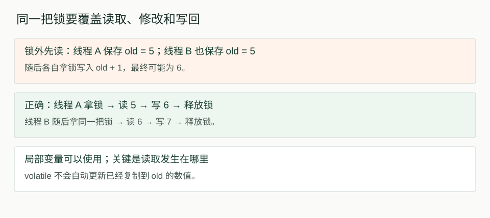
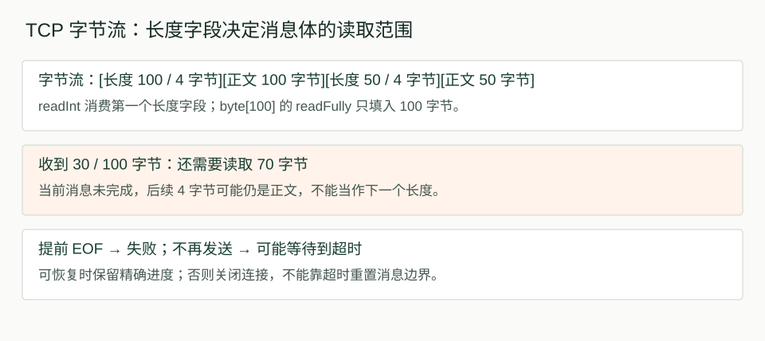
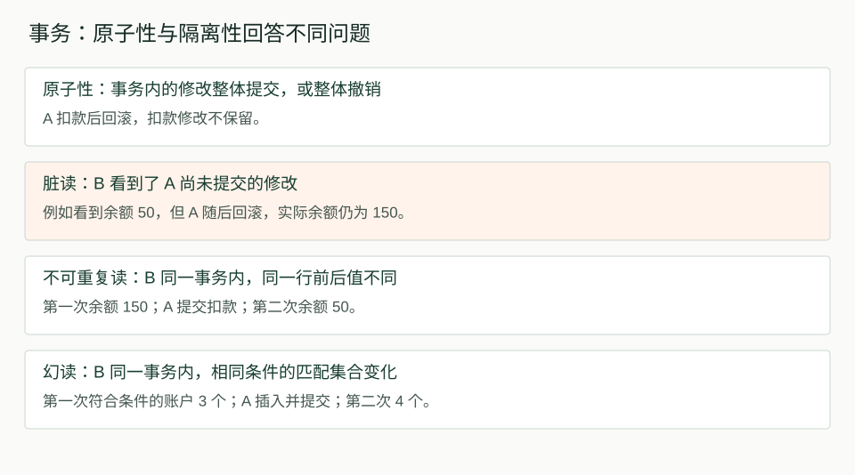

# 2026-10-16 计算机基础复习：并发、TCP、幂等与事务

今天从并发复测接续 TCP 消息读取，随后扩展到请求幂等和数据库事务。重点是分清每一种机制保证什么，以及哪些问题仍需要上一层处理。

- 学习日期：2026-10-16，Asia/Shanghai。
- 内容来源：本次学习聊天；承接 10/15 未完成的并发与 TCP 训练。
- 计划：并发复测 5 分钟、TCP 接续 20 分钟、卡点整理 5 分钟；后来按用户要求增加新知识。实际未计时，不宣称完成固定时长。
- 核实日期：2026-10-16。Java 规则按 Java SE 25 官方资料核对；数据库并发示例按 PostgreSQL 18 文档说明，不能直接推广到所有数据库和隔离级别。
- 学习状态：能够口述的结论与讲解后尚未复测的结论分别记录；未运行 Java、网络或数据库实验。

## 一、今天的纠错总表

| 起初的理解 | 校准后的结论 | 本次状态 |
| --- | --- | --- |
| 所有读写加同一把锁，可能还要 volatile | 完整读改写都在同一把锁内，不必仅为可见性再加 volatile | 能解释锁外旧值问题；完整口述待复测 |
| 局部变量 old 不受可见性保证，所以算错 | old 保存的是此前读出的数值；它不会随 a 更新，不是局部变量可见性问题 | 已在引导下澄清 |
| join 只是等待线程结束 | 成功等待结束还建立可见性保证，但不能修复丢失更新 | 等待部分能答出，可见性待复测 |
| volatile ready 发布还需要 synchronized | B 读到 A 写入的 true 后，能看到 A 在该写入前完成的 result 写入 | 待脱稿复测 |
| 长度字段占 4 字节，消息体可能要 length × 4 | 本协议 length 的单位是字节，消息体数组长度就是 length | 能独立解释 |
| readFully 会把连接中的数据全部读完 | 它只填满指定数组；不识别业务消息边界 | 能解释边界和错读后果 |
| 把读取放子线程就是异步 I/O | 只是转移阻塞位置，仍可能是同步阻塞 I/O | 讲解后待复测 |
| TCP 收到 ACK 就表示业务成功 | ACK 不证明应用已处理；响应超时也不能证明业务失败 | 能解释结果未知与同号重试 |
| 加 synchronized 就能跨服务实例防重复 | 仅协调同一进程内使用同一把锁的线程 | 已讲解，待复测 |
| 事务原子性让不同事务自动排队 | 原子性保证全做或全撤；并发相互影响由隔离机制处理 | 本次重点卡点 |
| 两次查询就是两个事务 | BEGIN 到 COMMIT 可以有多条 SQL、多次查询 | 已经引导确认，待独立判断 |

## 二、Java 并发：锁、volatile、局部值与 join

### 2.1 同一把锁必须覆盖完整的读改写

初始 a = 5，两个线程各执行一次下面的代码，并使用同一个 lock：

```java
synchronized (lock) {
    int old = a;
    a = old + 1;
}
```

第一个线程读 5、写 6、释放锁；第二个线程取得同一把锁后读到 6、写 7。局部变量可以使用，关键是读取也在锁内。前一个线程释放监视器 happens-before 后续线程获取同一监视器。[JLS happens-before](https://docs.oracle.com/javase/specs/jls/se25/html/jls-17.html#jls-17.4.5)

错误变体是先在锁外读取：

```java
int old = a;
synchronized (lock) {
    a = old + 1;
}
```

两个线程都可能先保存 old = 5，随后各写 6。即使 a 是 volatile，也不能改变已经读出的 old。基本类型赋值复制数值；对象变量赋值复制引用值，不能概括为“所有局部变量都不持有引用”。



### 2.2 volatile 发布不要求两个线程整体排队

```java
int result = 0;
volatile boolean ready = false;

// A
result = 42;
ready = true;

// B
if (ready) {
    System.out.println(result);
}
```

仅 A 写这些变量、没有其他写入时，B 读到这次 ready = true 后，后续读取 result 保证得到 42。链路是：写 result → 写 volatile ready → 读到 ready → 读 result。A、B 可以并发，不必另外加 synchronized。若 B 读到 false，就不进入分支；若 A 先写 ready 再写 result，则该发布关系不能覆盖后面的 result 写入，B 可能读到 0。[JLS happens-before](https://docs.oracle.com/javase/specs/jls/se25/html/jls-17.html#jls-17.4.5)

### 2.3 join 能等待和提供可见性，不能补回丢失更新

两个线程各执行一万次 count++，在没有正确同步时不保证得到两万；volatile 也不能把整个读改写变为原子操作。对两个线程成功 join、等待它们终止后，主线程可以看到相应操作的效果，但工作线程之间已经发生的丢失更新不会被修复。[JLS happens-before](https://docs.oracle.com/javase/specs/jls/se25/html/jls-17.html#jls-17.4.5)

## 三、TCP：字节流如何成为完整消息

### 3.1 长度字段的宽度与数值是两回事

本次协议：前 4 字节保存一个整数，整数值表示后续消息体的字节数。示例采用 DataInputStream.readInt 的大端、有符号 32 位整数解析方式；不是所有协议都采用此编码。

```text
[长度 100：4 字节][消息体：100 字节]
[长度  50：4 字节][消息体： 50 字节]
```

第一条总长 104 字节。readInt 已消费前 4 字节，接下来读取 100 字节，不乘 4。TCP 提供有序字节流，不保留应用 write 的边界：发送两次，接收端可能一次读到，也可能多次读到。[RFC 9293 §3.7](https://www.rfc-editor.org/rfc/rfc9293.html#section-3.7)

### 3.2 一次 read 不保证填满数组

length = 100 时，一次 read 可能只返回 30。应检查实际读取数量并循环，或使用 readFully。原因不必是拥塞；API 本身就允许部分读取。

```java
int length = in.readInt();
if (length < 0 || length > MAX_BODY_BYTES) {
    throw new ProtocolException("非法消息体长度");
}
byte[] body = new byte[length];
in.readFully(body);
processMessage(body);
```

这是接收片段，MAX_BODY_BYTES、超时、异常捕获和连接清理需由外围代码提供。readFully(body) 只填满 body，不会因为第二条数据已经到达就超出数组。若长度字段谎报 120，而第一条实际只有 100，它可能继续吞入下一条的长度字段与正文，因为 API 不认识业务边界。[DataInputStream API](https://docs.oracle.com/en/java/javase/25/docs/api/java.base/java/io/DataInputStream.html)



### 3.3 不完整读取、超时和长度校验

| 情况 | 正确理解与处理 |
| --- | --- |
| 只收到 30/100 字节，对方有序关闭发送方向 | readFully 遇到提前 EOF，抛 EOFException；不能处理为完整消息。连接重置等情况也可能产生其他 IOException |
| 对方没关闭，也不再发送 | 没配置超时可能一直等待；Socket 读取超时需显式设置，0 表示无限等待 |
| 把读取移到工作线程 | 主线程不被该读取阻塞，但工作线程仍可能阻塞，不等于真正异步 I/O |
| 对方持续慢速发送 | 单次底层读取超时不等于整条消息的总时限；可另设消息接收截止时间 |
| 已收 30 字节就超时 | 超时不会重置消息边界；应保留精确解析进度继续接收，或关闭连接 |
| 长度为负或巨大 | 分配数组之前拒绝非法长度，避免异常和资源耗尽 |
| 长度等于 0 | 是否有效由协议定义，不能一概认定无效 |

readFully 抛出超时异常时，调用者未必知道内部已经消费了多少字节。想恢复必须自行维护可恢复的读取进度；做不到时关闭连接更简单。单条长度上限也不能替代总连接数、并发分配量等资源限制。[DataInputStream API](https://docs.oracle.com/en/java/javase/25/docs/api/java.base/java/io/DataInputStream.html)、[Socket.setSoTimeout](https://docs.oracle.com/en/java/javase/25/docs/api/java.base/java/net/Socket.html#setSoTimeout%28int%29)

### 3.4 TCP 可靠不等于业务处理成功

write 成功通常只说明数据被本地网络栈接受；TCP ACK 确认相应字节被对端 TCP 接收，不证明应用已读取或处理。ACK 可以累计确认，不是每个报文都必须单独确认。TCP 会重传丢失数据，但断网、连接失败或响应延迟仍可能让应用超时。不能把“响应包丢了”理解为 TCP 永远不重传。[RFC 9293](https://www.rfc-editor.org/rfc/rfc9293.html)

应用超时后可能是：请求未到达、仍在处理、处理失败但结果未收到、处理成功但结果未收到。需要业务查询或安全重试机制，而不是直接认定失败。

## 四、业务幂等：同一次扣款重试不应再次扣钱

本节是聊天案例的应用设计推导，不是完成支付系统实现或验证。

### 4.1 同一个编号只是入口，服务端必须落实幂等

同一次扣款重试复用 requestId，服务端核对账户、金额等参数。编号相同但金额从 100 改成 200，应拒绝冲突，不能返回“200 扣款成功”。操作号应标识一次具体扣款，一个订单允许多次支付时，订单号未必够用。

下面的检查和执行分离，会让两个并发请求同时通过检查：

```java
if (!exists(requestId)) {
    deductMoney(100);
    saveResult(requestId, "success");
}
```

synchronized 只有在同一进程、使用同一把锁且覆盖完整流程时才能解决这类线程竞争；不同实例各有自己的锁，不能靠它跨实例互斥。

### 4.2 唯一约束和同库事务共同保证

假设幂等记录、账户余额、业务结果都在同一个支持事务的数据库内：

```text
开始事务
  插入操作记录，requestId 有唯一约束
  只有获得该操作处理资格的请求继续扣款
  保存结果
提交事务
```

冲突处理应按数据库能力实现，不是出现唯一约束异常后仍在已失败的事务里随意继续执行。并发重复请求要等待已提交结果或按协议返回处理中。唯一约束保护操作号竞争，事务把相关数据库修改作为一个整体。

| 故障位置 | 对应处理 |
| --- | --- |
| 不用事务，插入编号后、扣款前崩溃 | 编号存在不能证明扣款成功，直接返回成功会误报 |
| 同库事务提交前失败 | 未提交的操作记录、扣款与结果一起回滚 |
| 提交成功，返回响应前崩溃 | 重试查询已提交结果，返回原成功结果，不再扣款 |
| 请求仍在处理中 | 不冒充成功，按协议等待或返回处理中 |

如果扣款发生在外部支付服务，本地事务不能把外部动作一起回滚；今天没有展开这类跨系统问题。

## 五、余额约束与事务隔离

### 5.1 不同 requestId 仍会竞争同一个余额

余额 150，两个不同操作各扣 100，幂等不会阻止它们各执行一次。应原子地判断余额并扣减，而不是普通查询后无条件更新：

```sql
UPDATE accounts
SET balance = balance - :amount
WHERE id = :account_id
  AND balance >= :amount;
```

amount 必须先校验为正数，金额应使用合适的精确表示。更新 1 行表示本次扣减执行成功，但仍需最终提交；更新 0 行表示没有扣减，原因可能是账户不存在或余额不足。恰好扣至 0 合法。

以 PostgreSQL 18 的 Read Committed 为例：同一行的另一个更新等待前者结束；前者提交后，后者会对更新版本重新检查 WHERE 条件。因此第一个扣完剩 50，第二个条件不成立，不会扣成负数。更高隔离级别可能报序列化失败并要求重试，不能把所有数据库行为一概说成等待后重查。[PostgreSQL 事务隔离](https://www.postgresql.org/docs/18/transaction-iso.html)

### 5.2 业务失败可以作为结果提交

余额不足时，条件 UPDATE 没改余额。可以在同一事务里把该 requestId 记为 FAILED 并提交，保留这次业务失败结果；也可以选择整体回滚，不保留记录。两种策略影响后续同号重试的语义，必须预先约定。

数据库事务成功提交，不代表业务扣款成功；它也可以可靠地保存“扣款失败”。数据库异常通常要求回滚并按异常策略处理，不能随意伪装成确定的余额不足。

### 5.3 原子性不保证不同事务排队

| 性质 | 本次要记住的含义 |
| --- | --- |
| 原子性 | 一个事务的修改整体生效或撤销，不留下已提交的部分修改 |
| 隔离性 | 限制并发事务之间如何观察、影响彼此；保证程度由隔离级别与具体操作决定 |

两个事务都可以先用普通 SELECT 读到 150，再判断足够。某些隔离级别下，如果之后无条件执行 balance = balance - 100，可能先扣到 50，再扣到 -50。两个事务都完整提交，原子性仍成立，业务余额约束却被破坏。[PostgreSQL 事务基础](https://www.postgresql.org/docs/18/tutorial-transactions.html)、[事务隔离](https://www.postgresql.org/docs/18/transaction-iso.html)

要实现“对同一账户先等待再判断”，可采用行锁：

```sql
BEGIN;
SELECT balance FROM accounts
WHERE id = :account_id
FOR UPDATE;
-- 取得行锁后判断，执行扣减与记录结果
COMMIT;
```

数据库本来就提供隔离机制，可结合锁与 MVCC 等实现；不是只有手动加锁才有隔离性。应选能保护业务规则的操作方式与隔离级别，并处理必要的重试。



### 5.4 脏读、不可重复读与幻读

| 现象 | 场景 | 关键区别 |
| --- | --- | --- |
| 脏读 | A 将 150 改成 50 未提交，B 读到 50，随后 A 回滚 | B 读到了别人未提交的数据 |
| 不可重复读 | B 同一事务先读余额 150，A 更新并提交，B 再读为 50 | 同一记录前后值不同，读到的是已提交修改 |
| 幻读 | B 同一事务按余额大于 100 查询得 3 条，A 插入匹配账户并提交，B 再查得 4 条 | 相同条件匹配的记录集合发生变化 |

A 回滚后不保留其扣款，体现原子性；B 曾读到 A 未提交值，涉及隔离性。两件事可以同时成立。

BEGIN → 查询 → 查询 → COMMIT 是一个事务。若两次查询属于两个不同事务，看到别人期间提交的新数据通常正常。注意自动提交模式下每条语句可能各成事务，不能只数查询次数。

这些是现象定义，不是所有隔离级别都会发生。以 PostgreSQL 为例，Read Committed 不允许脏读，但允许不可重复读和幻读；它的 Repeatable Read 比 SQL 标准最低要求更强，不允许幻读。今天未展开隔离级别矩阵与 MVCC 原理。[PostgreSQL 隔离级别](https://www.postgresql.org/docs/18/transaction-iso.html)

## 六、下次复测清单

| 主题 | 下次先不提示，独立回答 |
| --- | --- |
| 锁与局部值 | 为什么 volatile a 不能修复锁外 old = a；局部变量能否放在锁内使用？ |
| join | 它除了等待，还保证什么；为什么不能修复 count++ 的丢失更新？ |
| volatile 发布 | B 读到 ready = true 后为什么能看到 result = 42；交换写入顺序为何不同？ |
| TCP | 用一段话解释长度字段、循环读取、超时和长度上限各解决什么 |
| I/O | 工作线程里阻塞读取与真正异步 I/O 有何区别？ |
| 幂等 | 提交成功但响应丢失如何重试；同号不同金额如何处理？ |
| 原子性与隔离性 | 为什么事务全做或全撤不意味着两个事务自动排队？ |
| 读取异常 | 在同一事务的前提下区分脏读、不可重复读与幻读 |

数据库部分到此暂停，不标记已掌握。最后一轮已能在提示下确认两次查询可以属于同一个事务；不可重复读和幻读仍需下一次独立判断。以上为聊天表现记录，不是考试测评。

## 附录：开场偏离计划的硬件入门

最初未读取昨天计划，误给了硬件入门内容，之后已纠正。为完整保存本次讨论，保留简要索引，不计入实际复习完成项。

| 概念 | 入门理解 |
| --- | --- |
| CPU | 执行指令、进行计算 |
| RAM | 保存运行中的指令和数据，通常断电丢失 |
| SSD / 硬盘 | 持久保存程序与文件；容量与内存容量不同 |
| 操作系统 | 管理进程、内存、文件、设备与调度 |
| 程序与进程 | 程序是保存的指令资源，进程是运行实例；一个应用可能有多个进程 |
| 性能观察 | 任务管理器可观察 CPU、内存和磁盘；磁盘活动时间 100% 不表示容量已满 |

当时建议用 Ctrl + Shift + Esc 观察任务管理器，没有要求结束进程；也没有证据表明实际完成了这些操作。硬件部分只是基础概念摘要，本次主要核实范围为并发、TCP 和数据库规则。

## 来源与核实边界

本笔记基于当日问答整理，已将误解与后续纠正合并，不将错误说法作为结论。图均为根据正文绘制的示意图，没有运行数据。

- Java SE 25：《JLS §17.4.5 Happens-before Order》，支持监视器、volatile、线程终止及 join 的保证。
- [DataInputStream API](https://docs.oracle.com/en/java/javase/25/docs/api/java.base/java/io/DataInputStream.html)：readInt、readFully、提前 EOF。
- [Socket API](https://docs.oracle.com/en/java/javase/25/docs/api/java.base/java/net/Socket.html#setSoTimeout%28int%29)：读取超时及 0 表示无限等待。
- [RFC 9293](https://www.rfc-editor.org/rfc/rfc9293.html)：TCP 字节流、确认与传输边界。
- [PostgreSQL 18 事务基础](https://www.postgresql.org/docs/18/tutorial-transactions.html)：事务的整体提交与回滚。
- [PostgreSQL 18 事务隔离](https://www.postgresql.org/docs/18/transaction-iso.html)：并发更新、隔离级别和读取现象。

幂等处理流程是基于聊天假设的设计推导，未做数据库唯一约束竞争、崩溃恢复或支付端到端测试；外部扣款与本地数据库不在同一个事务里的情况不适用本节简化方案。
