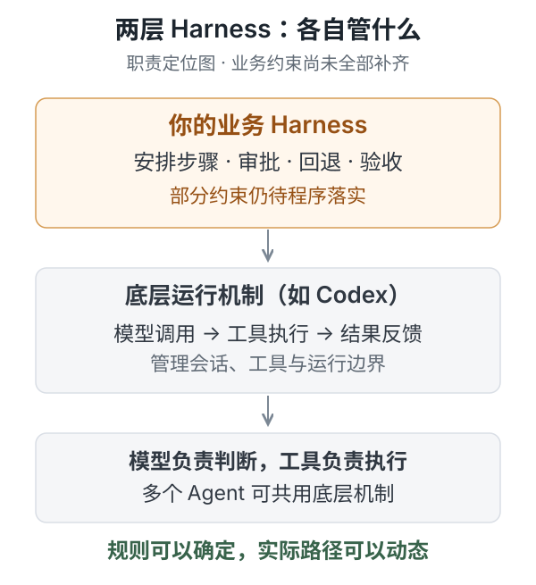
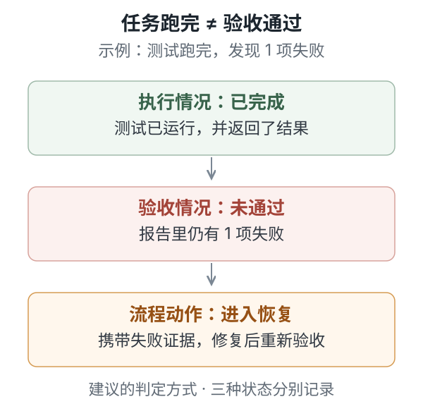
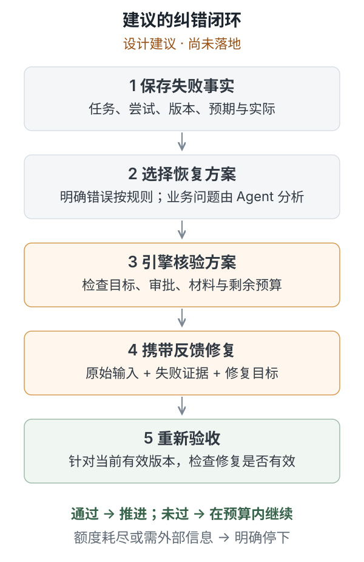

# dsh-workflow 实践复盘：让 Agent 做判断，让程序管流程

核实日期：2026-10-15。

**这个工程最值得带走的经验：承认 Agent 会犯错，把能明确检查的条件交给程序；需要理解和分析的事情继续交给 Agent。** 失败以后，系统要把证据交给合适的修复步骤，再重新验收。

本文提炼了一次围绕 dsh-workflow 的工程讨论：从「Harness 是什么」，一路追问到「流程为什么可信、失败以后怎么修」。讨论确认了设计原则，也通过源码和临时流程复现了一些问题。**修复方案仍在讨论，本文不代表这些问题已经解决。**

## 一、先把几个词说清楚

| 名称 | 大白话 | 在这个工程里的对应 |
| --- | --- | --- |
| 大模型 | 分析问题，判断下一步，生成方案和代码 | planner、coder、verifier 执行任务时使用的模型能力 |
| 工具 | 真正读取文件、执行命令、修改代码的能力 | Agent 通过宿主调用的工具 |
| 底层 Harness | 把模型调用、工具执行、结果反馈组织成持续工作的过程 | Codex 等宿主提供的 Agent 运行机制 |
| Workflow | 这件事有哪些步骤，步骤怎样衔接 | 需求澄清、设计、编码、审查、测试和判定 |
| 业务 Harness | 让业务流程实际运行，并管理状态、审批、回退和记录 | 工作流声明、单步引擎、调度约定及相关规则共同组成的这一层 |

「底层 Harness / 业务 Harness」是本次讨论采用的职责划分，用来解释工程，不作为统一的行业术语分类。多个 Agent 可以共用一套底层运行机制；各自的任务和会话仍可独立。

OpenAI 的官方说明将模型周围的执行系统称为 Harness，并描述了应用掌管业务上下文与规则、Codex 提供通用执行能力的组合方式。以上定位与这份说明相符。[官方说明](https://developers.openai.com/blog/codex-as-a-platform)

## 二、核心边界：模型判断什么，程序管住什么

假设测试失败，需要先搞清楚：实现错了、设计有问题，还是测试误解了需求。这个分析可以交给 Agent。随后，引擎检查恢复方案是否合法，并执行流程变更。

| 事情 | 由谁负责 | 负责到什么程度 |
| --- | --- | --- |
| 分析失败原因、选择修复位置 | Agent | 提供理由和证据，允许保留「原因未知」 |
| 检查目标任务、材料、审批与预算 | 引擎 | 按明确规则接受或拒绝，不靠模型口头保证 |
| 改变流程状态、保存历史、使旧结果失效 | 引擎 | 留下可核查记录，并按规则调度 |
| 判断修复是否有效 | 对应的验证过程 | 重新执行检查；需要语义判断的部分仍由 Agent 或人审查 |

**流程规则可以确定，实际执行路径可以动态变化。** 工作流中可以有一个「请 Agent 分析该回到哪一步」的节点；它的答案不固定，但可选范围、请求格式、审批要求和次数限制仍然明确。

引擎能证明「这次回退符合规则」，不能仅凭一段 JSON 就证明「Agent 对根因的判断正确」。修复后仍要验证。

本次讨论中已经确认的原则是：Agent 的不可靠性需要作为设计前提；引擎核验推进条件，条件缺失或不符合预期时，要明确反馈，并进入相应处理路径。

## 三、把设计承诺拿到代码面前核对

以下结论限定于本次核实的源码快照。前三项已通过临时流程复现，后两项由源码确认，其中固定回退优先的行为也做了最小复现。

| 要核对的承诺 | 实际发现 | 证据位置 |
| --- | --- | --- |
| 编码前必须完成审批 | 引擎先返回 `NEED_APPROVAL`；不批准，直接回填 `--output`，编码任务仍可记为成功，审批状态仍是 `null` | `loop.js`：1432、1482、1492 行；规则 R001 |
| 收到的结果属于刚才派发的任务 | 连续提交两次 design 的同一份结果，第二次会被记到 code；code 未经派发也可被记为成功 | `loop.js`：1341、1452、1492 行 |
| 验收失败就无法成功结束 | 在默认七步模板中，审查报告有 blocker、测试报告记录 1 项失败，最后判定漏填顶层 `passed`；引擎仍报告工作流成功 | 模板未配置任务输出 schema；`loop.js`：582、827、1473、1492 行 |
| 失败回退能让 coder 有针对性地修复 | code 的结构化输入只有技术设计和测试用例设计，没有保证送达本轮失败报告；coder 仍可能主动查文件 | `workflow_template.json`：60 行；`gatherInput`：550 行 |
| Agent 可以选择验证失败后回到哪一步 | 已有 `request_backtrack`，但固定 loop 先执行；默认「判定失败 → code」会盖过 Agent 提出的其他回退目标 | `checkRequestBacktrack`：894 行；`postTaskSettlement`：1189 行 |

这些问题集中指向一件事：**规则写得很严格，不等于程序已经检查了所有入口。** 审批检查、结果接收、验收判定和恢复调度需要共同维护同一组约束。

尤其要分清下面三种状态。一个测试完全可能正常运行、发现失败，然后等待修复；它不应因此被描述为整个任务通过。

## 四、重试机制：先说清楚谁来修什么

重试次数只能限制花费。要让下一轮有针对性，还需要明确失败原因、修复对象、输入材料和重新验收的条件。下面是基于本次讨论提出的设计建议，尚未全部确认或实现。

### 1. 能明确识别的错误直接处理，需要分析的错误交给 Agent

| 失败情况 | 建议处理方式 |
| --- | --- |
| 结果缺字段、类型不对 | 引擎返回具体校验错误，要求当前 Agent 修正提交 |
| 读取或查询遇到可识别的临时失败 | 按配置等待后有限重试 |
| 测试失败、设计矛盾、实现不符合需求 | Agent 基于证据提出恢复方案，包括回到哪一步、修改什么 |
| 缺少用户才能提供的信息 | 说明缺口，进入等待输入的状态 |
| 暂时无法确定原因 | 先诊断、补证据，保留「未知」 |

这与 LangGraph 官方说明中区分临时错误、模型可恢复错误和需要用户补充信息的思路相通；这里采用的是针对本项目的设计建议。[错误处理说明](https://docs.langchain.com/oss/javascript/langgraph/thinking-in-langgraph#handle-errors-appropriately)

### 2. 每次恢复都要拿到一份明确的材料

保留正常的 `depends_on` 输入，再由引擎动态附加恢复材料：

- 本次失败属于哪次运行、哪个任务、哪次尝试。
- 当时使用的需求、设计、代码和测试版本。
- 预期结果、实际结果、日志与失败报告路径。
- 前面试过什么，得到什么结果。
- 本轮修复目标，以及修完后必须重新通过哪些检查。

材料应交给实际负责修复的步骤。失败文档可以作为证据，但要标明它是待修复的旧版本；不能直接把它当成后续任务的有效设计。

报告路径也要指向具体那次尝试。若一个文件名不断被新结果覆盖，修复者可能读到不同轮次的内容。

### 3. Agent 选方案，引擎核验后执行，再重新验收

恢复方案可以先只表达几种动作：重试当前任务、回退修复、等待信息、停止并报告。引擎检查请求身份、有效版本、允许目标、审批与剩余额度。

方案不合法时，应把拒绝原因交回，让 Agent 有限次修正方案；未解决的失败不能因为恢复请求被拒绝而自动放行。

### 4. 重试需要预算，也需要检查已经发生的动作

建议同时设置「同一个问题的恢复预算」和「整次工作流的总预算」，避免通过切换任务不断重置额度。具体次数与时间上限仍需用真实任务确定。

改文件、启动服务、调用外部写接口以后，恢复前还要检查当前状态。超时可能只代表没有收到结果，动作本身可能已经发生。能够安全重复的操作才直接重试；其他操作先核对结果或提供去重机制。AWS 的安全重试说明也讨论了重复执行与幂等请求标识的问题。[安全重试说明](https://aws.amazon.com/builders-library/making-retries-safe-with-idempotent-APIs/)

## 五、这次实践真正带走的经验

**第一，用反例检查可靠性承诺。** 对「必须审批」「不能跳步」「失败就回退」这类表述，逐条找对应代码，再尝试漏做、重复做、乱序做。正常路径能跑通，只覆盖了一部分承诺。

**第二，把事实、判断和动作分开。** 日志记录了什么是事实，为什么出错是判断，回到哪一步是动作。将三者分开保存，才有机会检查判断是否有依据、动作是否有效。

**第三，纠错闭环同时需要控制流和数据流。** 修复步骤既要被重新调度，也要收到对应证据；重新验收还必须针对当前有效版本。路径、材料和版本需要一起管理。

这个工程的价值，正在于把「希望 Agent 按流程做事」逐渐拆成可检查的条件。确定性能够覆盖的部分由程序承担，模型继续负责需要理解、探索和权衡的部分。

## 六、已经确认、仍属建议、尚未决定

| 状态 | 本次讨论的真实进展 |
| --- | --- |
| 已确认 | Agent 会犯错；由引擎核验推进条件，缺失或不满足条件时必须明确反馈 |
| 已确认的问题 | 固定重试路径缺乏灵活性，修复步骤的失败输入配置不足 |
| 设计建议 | Agent 在允许范围内选恢复方案，引擎核验后执行；补恢复材料、身份绑定、验收检查及预算 |
| 待确认 | 修改用户需求、放宽验收条件是否必须人工确认；现有审批规则如何与自动恢复衔接 |
| 待验证 | 恢复次数与总预算；语义诊断的质量；真实宿主中的会话恢复和权限边界 |
| 本次未完成 | 没有修改 dsh-workflow 业务代码，没有运行完整的真实需求开发与验证闭环 |

## 七、来源与核实边界

- 来源工程：`/Users/dudongxu/Desktop/dsh-workflow`。核实时 HEAD 为 `96588aef23a70c3137577b67780319af27f74ece`，工作区无未提交改动。本文所有实现结论均限定于这一快照。
- 本地直接证据：[工作流入口说明](/Users/dudongxu/Desktop/dsh-workflow/verification-workflow-v1/SKILL.md)、[默认模板](/Users/dudongxu/Desktop/dsh-workflow/verification-workflow-v1/templates/workflow_template.json)、[单步引擎](/Users/dudongxu/Desktop/dsh-workflow/verification-workflow-v1/engine/loop.js)、[规则文件](/Users/dudongxu/Desktop/dsh-workflow/verification-workflow-v1/rules.json)。具体函数和行号见第三节。
- 最小复现使用临时流程与模拟任务输出，验证的是协议和调度行为，没有证明真实 Agent 一定会触发这些错误，也没有测量生产发生率。临时文件位置记入本知识库的维护记录。
- Harness 概念来源：OpenAI《Codex as a platform: build on the open agent harness》，发布于 2026-08-19，本次核实于 2026-10-15。
- 错误处理与安全重试的两份官方资料于 2026-10-15 读取；本次未核实它们的原始发布日期。
- 本文依据对话提炼需求与已确认原则，依据源码和复现说明实现行为；对话中的设计建议没有被写成已实现能力。
- 本地证据链接仅供本机复查。通用概念另见知识库已有笔记《Agent Harness：底层运行机制与业务工作流》，本文集中记录工程里遇到的问题与讨论结果。
