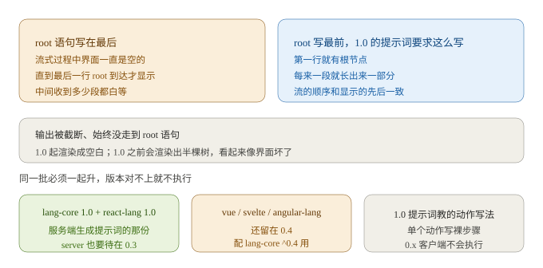
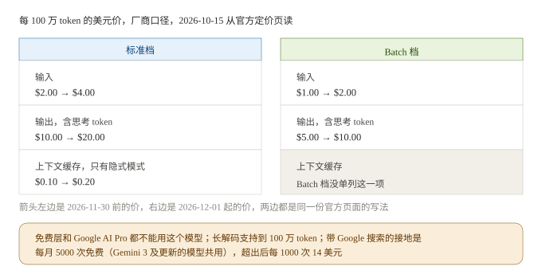
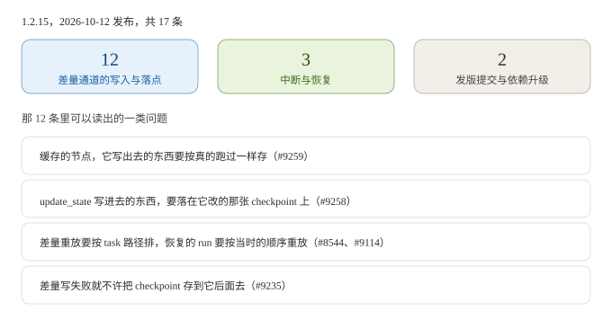
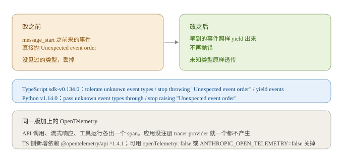
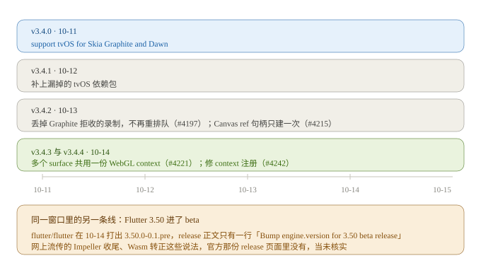
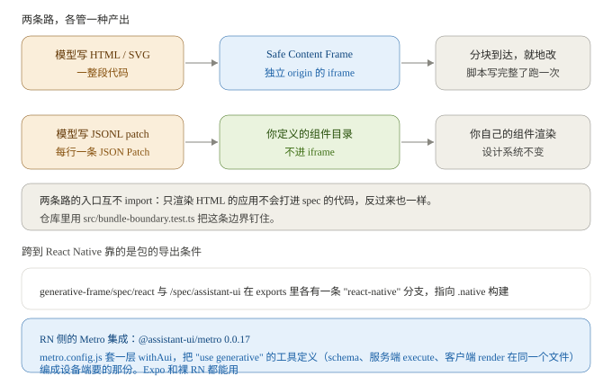

# AI 日报 · 2026-10-15

> 给谁看：做跨端渲染和 AI 工作流编排，正在往 AI 方向转的人。
> 生成时间：2026-10-15 17:0x（GMT+8）。检索窗口 2026-10-11 到 2026-10-15。
> 关于真假：这期的数字基本都回了一手页面，GitHub 的 release feed 与 CHANGELOG、Google 的官方定价页和 release notes、npm registry。哪条是厂商自己给的、哪条没核实，正文里都单独写了。仓库那部分是拉 tarball 全库直读（README、CHANGELOG、`package.json`、`LICENSE`、源码目录）。star 数从仓库页面读到，fork 数和最近提交时间没取到，留空。插图 6 张全自绘，画的都是正文里已经写过的数字和关系。

---

## 一、今日要闻

### 1. OpenUI Lang 升到 1.0，写界面的程序换了写法，流式期间的行为也跟着换

10 月 12 日 Thesys 的 openui 发 `@openuidev/lang-core` 1.0.0。今天出了一个 1.0.1，只改了 README 和文档链接。

1.0 里跟流式有关的两条写得很直接：

- 根语句写在最后，流式过程中界面一直是空的，直到根那一行到达才显示。所以 1.0 的提示词要求把根节点写在最前面。
- 输出被截断、始终没走到根语句（或任何调用根组件的语句），现在渲染成空白。1.0 之前会渲染出半棵树。

升级这件事这版卡得比较死：

- `lang-core` 和 `react-lang` 必须一起升，服务端生成系统提示词的那份也要跟着升。1.0 的提示词教模型写裸步骤，也就是 `@ToAssistant("Hi")` 不带 `Action([...])`，0.x 的客户端不会执行这种写法。
- `react-ui` 0.18 要求 `react-lang` 1.0，peer 范围是 `>=1.0.0 <2.0.0`。
- `server` 0.3 用 lang-core 1.0 做 autofix，0.x 客户端就配 server 0.2。
- vue-lang、svelte-lang、angular-lang 还留在 0.4，配 `lang-core` ^0.4 用。
- 动作写法也变了：每个步骤调用现在算成一个单步 plan，单步不用包 `Action([...])`，多步才要包；无效步骤算空 plan、不执行，不是 null。另加了 `defineAction({ name, description, params })` 定义自定义动作，点下去以 `{ type, params }` 交给宿主的 `onAction`。
- 删了 9 个没人用的导出，`isASTNode`、`RuntimeExprNode`、`Statement` 这些。



跟你的关系：把「模型写界面」当成一门要长期维护的语言，就会碰上这种版本必须成套升的问题。可以直接抄的两个动作，一是把根节点要求写进提示词的最前面，让流式期间有东西可显示；二是截断时宁可渲染空白也不要渲染半棵树，半棵树看起来像界面坏了，空白至少还读得懂是「还没出来」。

来源：[`@openuidev/lang-core` 1.0.0 release（2026-10-12）](https://github.com/thesysdev/openui/releases/tag/%40openuidev%2Flang-core%401.0.0)，逐条正文读的是仓库里的 [lang-core CHANGELOG](https://github.com/thesysdev/openui/blob/main/packages/lang-core/CHANGELOG.md)，1.0.1 的发布时间从 [releases feed](https://github.com/thesysdev/openui/releases.atom) 读（2026-10-15）

### 2. Gemini 4 Argon 转正式版，价目表里有一件得提前算的事：12 月 1 日起翻倍

10 月 13 日 Google 的 Gemini API release notes 写了 `Gemini 4 Argon (gemini-4-argon) generally available (GA)`。定位是旗舰推理模型，面向复杂软件工程、数学与科学、自主多步 agent，长解码支持到 100 万 token。

价格是官方定价页上的原话，每 100 万 token（厂商口径）：

| 项目 | 标准档 | Batch 档 |
| --- | --- | --- |
| 输入 | $2.00（到 2026-11-30）→ $4.00（2026-12-01 起） | $1.00 → $2.00 |
| 输出（含思考 token） | $10.00 → $20.00 | $5.00 → $10.00 |
| 上下文缓存 | $0.10 → $0.20，只有隐式缓存 | 没单列这一项 |

另外两条写在页面上的限制：这个模型在免费层和 Google AI Pro 上都用不了；带 Google 搜索的接地是每月 5000 次免费（Gemini 3 及更新的模型共用），之后每 1000 次 $14。



跟你的关系：编排成本模型里最容易漏的两项，这一页都摆出来了。促销价有期限，12 月 1 日翻倍，照现在的价写进预算，跨过那天就要重算。缓存只有隐式模式，命中率不由你控制，省不省钱取决于请求前缀能不能对上，而不是调一个开关。Batch 半价是唯一确定可控的一档，不着急的批处理该挪过去。

来源：[Gemini API release notes（2026-10-13）](https://ai.google.dev/gemini-api/docs/changelog) 与 [Gemini Developer API pricing（2026-10-15 抓取）](https://ai.google.dev/gemini-api/docs/pricing)，价格是厂商口径，没有第三方复测

### 3. LangGraph 1.2.15 这一版几乎全在修一件事：差量写在哪、按什么顺序重放

10 月 12 日发的 1.2.15 一共列了 17 条，除一条发版提交和一条依赖升级，剩下 15 条是修复。其中 12 条精确到差量通道的写入落点。几条读起来是这样的：

- `save a cached node's writes like a node that ran`（#9259）：节点这次命中缓存没真跑，它写出去的东西也要按「真跑过」一样存。
- `store an update_state input's writes on the checkpoint it updates`（#9258）：外部写进来的状态，要落在它改的那张 checkpoint 上。
- `order delta channel replay by task path`（#8544）与 `replay a resumed exit-mode run's delta writes in live order`（#9114）：重放要按原来那次执行的真实顺序。
- `don't save a checkpoint past a failed DeltaChannel write`（#9235）：差量写失败，就不许把 checkpoint 存到它后面去。
- `never store exit-mode delta writes under the null task id`（#9229）与 `give each bulk_update_state update its own task id`（#9128）：写入要挂在正确的 task id 上。
- `keep a fork's DeltaChannel snapshot from starting nodes that never ran`（#9264）：fork 出来的快照不能把没跑过的节点带起来。

另外 3 条是中断与恢复：drain 在 interrupt_before 之前被请求时要停在断点（#9281）、ToolNode 不该吞掉无效的 resume 值（#9232）、`astream_events` 在 v1/v2 上丢控制与中断事件（#9219）。



跟你的关系：这版的主题跟你做渲染时最熟的那件事是同一件，状态该落在哪一帧、重放按什么顺序、写失败要不要提交，只是它落在 checkpoint 和差量通道上。你在自研工作流引擎的话，这 12 条基本是一份现成的「差量状态设计容易错在哪」清单。

来源：[langgraph 1.2.15 release（2026-10-12，feed 时间戳 `2026-10-12T22:38:26Z`）](https://github.com/langchain-ai/langgraph/releases)，条目号与原文从 [releases feed](https://github.com/langchain-ai/langgraph/releases.atom) 直读

### 4. Anthropic 两个 SDK 同日放宽流式事件顺序，顺手把 tracing 默认打开

10 月 14 日 `anthropic-sdk-typescript` 0.134.0 和 `anthropic-sdk-python` 1.14.0 同日发版，改的是同一处：

- TypeScript：`tolerate unknown event types in MessageStream and BetaMessageStream`、`stop throwing "Unexpected event order" for an event before message_start`、`yield events that arrive before message_start when iterating MessageStream and BetaMessageStream`。
- Python：`pass unknown event types through the message stream helpers`、`stop raising "Unexpected event order" for an event before message_start`。

也就是 `message_start` 之前到达的事件不再抛错，没见过的类型不再丢掉，原样交给调用方。

同一版把 OpenTelemetry 加上了：API 调用、流式响应、工具运行各出一个 span。这个默认是开的，但只有应用自己注册过 tracer provider 才会产生，没注册就一个都不产生。TS 侧因此新增依赖 `@opentelemetry/api` `^1.4.1`，可以整体关掉（`openTelemetry: false` 或 `ANTHROPIC_OPEN_TELEMETRY=false`），也可以只留 span 不发 trace 头（`openTelemetry: { propagation: false }`）。

顺带一提，同一天 `openai-python` 发了 3.30.0 和 3.31.0，其中 3.31.0 的头条是 `add browser and computer toolsets (1/4)`（#4073）。标着 1/4，说明是一组里的第一篇，现在看不出全貌。



跟你的关系：自己写过 SSE 解析、又在事件顺序上做过强断言的话，这次改动说明上游协议事实上是宽松的，客户端写死顺序会把自己写脆。增量拼装该按 index 和内容本身容错，别 fail-fast。另外 tracing 默认开这件事，上生产前值得确认一下有没有意外多出来的依赖和 trace 头。

来源：[anthropic-sdk-typescript 0.134.0 CHANGELOG（2026-10-14）](https://github.com/anthropics/anthropic-sdk-typescript/blob/main/CHANGELOG.md) 与 [release 页](https://github.com/anthropics/anthropic-sdk-typescript/releases/tag/sdk-v0.134.0)；[anthropic-sdk-python 1.14.0 CHANGELOG（2026-10-14）](https://github.com/anthropics/anthropic-sdk-python/blob/main/CHANGELOG.md)；[openai-python CHANGELOG（2026-10-14）](https://github.com/openai/openai-python/blob/main/CHANGELOG.md)

### 5. RN Skia 五天连发五版，Graphite 和 Dawn 扩到了 tvOS

`wcandillon/react-native-skia` 在 10 月 11 日到 14 日连发 5 个版本，节奏是发一版修一版：

- 10-11 v3.4.0：`support tvOS for Skia Graphite and Dawn`。
- 10-12 v3.4.1：补上漏掉的 tvOS 依赖包。
- 10-13 v3.4.2：`drop recordings Graphite rejects instead of requeueing them`（#4197）、Canvas 的 ref 句柄只建一次（#4215）。
- 10-14 v3.4.3：`share WebGL context between surfaces`（#4221）。
- 10-14 v3.4.4：修 context 注册（#4242）。

同一窗口里 Flutter 也有动静。`flutter/flutter` 在 10-14 打出 `3.50.0-0.1.pre` 的 tag，release 正文只有一行 `Bump engine.version for 3.50 beta release (#194327)`，也就是从 main 切到 beta 通道。网上传的 Impeller 在 Android 收尾、Skia 路径退役、Wasm lazy loading 转正这些，官方那份 release 页面里没有，当未核实。



跟你的关系：这条线跟 AI 的关系在「模型或服务端吐结构化数据、端上实时画出来」这类界面。绘制后端现在明确压在 Graphite 上，v3.4.0 到 v3.4.4 修的几乎都是 Graphite 和 context 相关的问题，覆盖面又扩了一格 tvOS。你的图表、粒子、贴纸如果还在旧后端上，值得对一下版本；但也别急着跟，一周发五版说明还在收尾。Flutter 那条线只记一件事就行：3.50 是今年最后一个 stable 的方向，渲染层的大动作会跟它一起落地，官方目前只放了 beta tag，没有说明。

来源：[react-native-skia v3.4.0 release（2026-10-11）](https://github.com/wcandillon/react-native-skia/releases/tag/v3.4.0) 与 [v3.4.2](https://github.com/wcandillon/react-native-skia/releases/tag/v3.4.2)，五个版本的时间戳与正文从 [releases feed](https://github.com/wcandillon/react-native-skia/releases.atom) 直读；[flutter 3.50.0-0.1.pre（2026-10-14）](https://github.com/flutter/flutter/releases/tag/3.50.0-0.1.pre)

---

## 二、今日精选仓库：`assistant-ui/assistant-ui`

为什么选它：前几期分别停在「一份描述怎么变成界面」（json-render）、「后端到前端的事件怎么流」（ag-ui）、「智能体怎么看见并操作真应用」（agent-device）。这期落到交叉带的正中间：一个把模型产出渲染成界面、同时接住跨端渲染和工具编排两侧的仓库。它一边管模型写出来的 HTML 和 SVG 怎么安全地流进页面，一边给 React Native、Vue、Svelte 提供同一套运行时，另一侧的适配是 LangGraph、AG-UI、A2A、Google ADK、MCP 这些编排栈。你熟的两件事在这个仓库里是同一个 monorepo 的两端，不是两个项目拼起来。

### 基本信息（直接用仓库文件核实）

| 项 | 值 |
| --- | --- |
| 仓库 | `https://github.com/assistant-ui/assistant-ui` |
| 维护方 | assistant-ui（`LICENSE` 里的版权方是 AgentbaseAI Inc.） |
| 许可证 | MIT，读 `LICENSE` 确认，`Copyright (c) 2026 AgentbaseAI Inc.` |
| 语言 / 工程形态 | TypeScript，pnpm 工作区（`packageManager` 是 `pnpm@12.4.2`），`pnpm-workspace.yaml` 收 `packages/*`、`examples/*`、`apps/*`、`templates/*` 等。`packages/` 下 **56** 个包 |
| 本轮关注的包 | `generative-frame` 0.0.5、`safe-content-frame` 0.0.34、`assistant-stream` 0.3.51、`@assistant-ui/react-native` 0.1.47、`@assistant-ui/metro` 0.0.17、`@assistant-ui/react-langgraph` 0.14.35、`@assistant-ui/react-generative-ui` 0.1.3 |
| 最近一批发布 | 2026-10-13，同批至少 8 个包，时间戳从 releases feed 读（`generative-frame@0.0.5`、`@assistant-ui/store@0.3.20`、`@assistant-ui/react-langgraph@0.14.35`、`@assistant-ui/react-google-adk@0.0.38` 等） |
| 仓库自述 | `generative-frame` 的包描述原话：`Stream model-generated HTML and SVG widgets into Safe Content Frames, with a host bridge, theming, diagnostics, screenshots, tools, and prompts` |
| 复核说明 | star 数 **12554**（2026-10-15 从仓库页面读到）。fork 数页面里没有内联，最近提交时间没取到，留空不猜 |

### 它解决什么问题

模型能写出一段界面，这件事不新。麻烦在它写的东西同时是不完整的、又是不受信的：流到一半的 HTML 直接塞进页面会抖，写完的代码直接执行等于让模型在你页面里跑脚本。

这个仓库把它们拆成两条路，各自回答一半问题：

- 模型写 HTML 或 SVG 时，代码流进一个独立 origin 的 iframe，新内容到达时改已有 DOM 而不是整块重挂，脚本先攒着、等代码完整了再按顺序跑一次。
- 模型改的是你自家组件时，不写 HTML，写一份对组件目录的补丁流，从头到尾不经过 iframe。



### 核心机制

**流的方式是改已有节点，不是重挂。** `packages/generative-frame/src/runtime/morph.ts` 里比对新旧两棵树，判定两个节点是不是同一个的条件是 `localName`、`namespaceURI`、`id` 三项都相同，属性逐个同步，新加进来的节点有回调通知。写渲染的主循环把 `write(chunk)` 合并到动画帧上，不是每个 chunk 画一次。还有一处细节：源码里专门有个 `stripUnclosedStyle()`，遇到还没闭合的 `<style>` 就把尾部丢掉，注释写得很直白，免得半截 CSS 先生效、写完整了再跳一下。

**脚本攒着最后跑。** 解析时把 `<script>` 换成占位注释，脚本按文档顺序收起来；`end()` 标记代码完整之后，再按顺序跑一次。

**执行边界是分层的。** 默认 CSP 禁掉 `fetch`、XHR、WebSocket（`connect-src 'none'`），脚本、样式、图片、字体只允许 cdnjs、jsDelivr、unpkg、esm.sh 四家，禁表单提交和 `eval`。每个 widget 可以有一个固定的 origin，`id` 由宿主决定，README 明确说不能拿模型输出来当这个 id，这样它的 localStorage 和 IndexedDB 能跨刷新留下来。0.0.5 起外部字体要显式开，Google Fonts 得自己加 `fontStyleOrigins` 和 `fontOrigins`。

**另一条路用 JSONL 打补丁。** spec 模式里模型的产出是一份扁平结构（`{ root, elements: { id: { type, props, children } }, state }`）加每行一条 RFC 6902 JSON Patch。组件目录自己定义（`defineCatalog`），props 是 JSON Schema，`catalog.prompt()` 把这些连同补丁协议一起生成给模型看的说明。0.0.5 加了 `$calc` 公式，自己写的有界解释器、不是 `eval`，函数声明了参数个数上下限，算不出来给 `null` 而不抛错。

**UI 能把用户的选择送回模型，但有上限。** 0.0.5 给 spec 加了两个内置动作 `sendMessage` 和 `updateModelContext`。用户在选择器里选了什么，会进后面请求的 system prompt，标明是数据，截到 4000 字符；`sendMessage` 只在用户的事件里跑，`watch` 里不许跑，动作处理函数可以通过第二个参数的 `kind` 区分。

**跨端是导出条件，不是另写一套。** `generative-frame/spec/react` 和 `/spec/assistant-ui` 在 `package.json` 的 `exports` 里各有两条分支，`"react-native"` 那条指向 `.native` 构建，`react-native` 和 `@assistant-ui/react-native` 是可选 peer。RN 侧还有 `@assistant-ui/metro`，在 `metro.config.js` 上套一层 `withAui`，把 `"use generative"` 的工具定义编成设备端要的那份，Expo 和裸 RN 都支持。同一份 `defineToolkit` 里 schema、服务端 `execute`、客户端 `render` 放在一个文件。

### 五个可以直接抄的做法

1. **把「模型直接写标记」和「模型改自家组件」做成两条互不 import 的路。** 仓库里有 `src/bundle-boundary.test.ts` 专门钉这条边界，只渲染 HTML 的应用不会打进 spec 的代码，反过来也不会。做生成式 UI 最常见的浪费就是把两套运行时全打进包，体积和心智都翻倍。
2. **流式增量渲染的四个小手法。** 合并到动画帧、未闭合的 `<style>` 丢尾部、脚本换占位注释最后跑一次、节点同一性按 `localName` 加 `namespaceURI` 加 `id` 判。这四条换成别的场景也成立。
3. **句柄和存储的命名权归宿主。** widget 的持久化 origin 由宿主给 id，README 写明不能从模型输出里取。你的组件树里如果有缓存键、storage key、路由路径，同理别让模型决定。
4. **表达式自己解释，不用 `eval`。** `$calc` 走自写的分词加有界求值，函数带参数个数上下限，失败给 `null`。模型给的公式要执行时，这比塞进 `new Function` 省心得多。
5. **UI 回灌进上下文要有上限和来源约束。** 4000 字符的截断、标明是数据、只在用户事件里触发，这三样缺一样都会出问题。

### 跟你现在会的对一下

| 你已经会的 | 这里对应什么 | 迁移成本 |
| --- | --- | --- |
| 虚拟 DOM 的 diff 与节点复用 | `morph.ts` 手写 DOM 比对，判同一个节点看 localName、namespaceURI、id 三项 | 低 |
| 按帧合并、按帧节流 | `write(chunk)` 合并到动画帧，不是每个块重绘 | 低 |
| WebView 沙箱与安全策略 | Safe Content Frame：独立 origin 的 iframe、默认 CSP、id 由宿主给 | 中 |
| 平台后缀与打包条件 | `package.json` 的 `exports` 里加 `"react-native"` 条件，配 Metro 的 `withAui` | 中 |
| 一份描述对上多端渲染器 | 同一份 `defineToolkit`，schema、execute、render 同文件，编成两端的产物 | 中 |
| 自己的流式 JSON 解析 | JSONL 每行一条 RFC 6902 patch，补丁打在扁平结构上 | 低 |
| 组件注册表与组件协议 | `defineCatalog` 定义组件、props、槽位、事件，`prompt()` 生成给模型的说明 | 低 |
| 状态回灌与上下文预算 | `sendMessage` 与 `updateModelContext`，截 4000 字符、标为数据、只在用户事件里跑 | 低 |

### 怎么上手

```bash
npm install generative-frame
```

- 先看 spec 那条路。`examples/` 下有 `with-generative-ui`、`with-ai-sdk-v7`、`with-langgraph`、`with-ag-ui`、`with-a2a`、`with-google-adk`、`with-mcp`、`with-openui` 这些现成例子，挑跟现在编排栈对得上的那个。
- 想跑 RN：装 `@assistant-ui/react-native` 和 `@assistant-ui/metro`，`metro.config.js` 里用 `withAui(getDefaultConfig(__dirname))` 包一层，例子是 `with-expo`。
- 想先看效果、不动自己的代码：`previewWidget(code, { width, appearance })` 能在隐藏的 iframe 里渲染一段完整代码，回调给 `{ ok, kind, width, height, blank, errors, console, screenshot }`。改提示词的循环可以用 `repairLoop` 接起来，它把错误、控制台片段、空白标记和截图当反馈喂回去，最多重试几轮自己定。
- 想跟别的框架：`generative-frame/spec/vue` 有 Vue 渲染器，仓库里另有 `with-svelte` 和 `with-sveltekit`。

### 要注意的

- **版本号还是 0.0.x。** `generative-frame` 0.0.5、`@assistant-ui/generative-ui` 0.0.4、`@assistant-ui/metro` 0.0.17。要接进生产就锁死版本，别跟 latest。
- **默认的隔离依赖一个外部域。** shim 默认从 `scf.auiusercontent.com` 加载。`unsafeShimDomain` 的文档注释写得很清楚：只有传进去的域是公共后缀表上的公共后缀时，各 frame 之间以及 frame 和你的应用之间才真正隔离，否则同一个注册域下的 frame 会共用 cookie 和浏览器进程。要自托管 shim 得先把这条想清楚。
- **CDN 白名单就是模型能用外部资源的范围。** 默认只有四家，把 `cdnOrigins` 设成空数组就全挡掉，字体要单独开。这个白名单和提示词里那份说明是两件事，说明只告诉模型规矩、不改权限，两边要手动对上。
- **每个 widget 一个 iframe 是有成本的。** README 里写了 `screenshot()` 是尽力而为，也会出现 `blank`；一个页面塞很多 widget 时，渲染和内存要自己算。
- **模型写的代码永远当不可信输入。** CSP 是默认值不是保险，`allowEval`、`unsafeDocumentWrite`、`unsafeShimDomain` 这几个选项的字面意思就是风险。

### 还没搞清楚的

1. RN 这条路上 spec 的组件目录是不是跟 web 共用同一份 `defineCatalog`。README 和 `exports` 都指向 `.native` 构建，两行导出条件我也读到了，但没有在 RN 环境里跑过。
2. `@assistant-ui/x-generative-compiler` 0.0.21 自述是「框架无关的 use generative 编译器，把同文件的工具拆成按目标构建，给 next 和 vite 用」，它跟 `@assistant-ui/metro` 的 transformer 是不是同一套逻辑，我只看了包描述，没读实现。
3. `generative-frame` 和 `generative-ui` 两个包名字很像，版本分别是 0.0.5 和 0.0.4，各自管什么、边界在哪，这次没读完，别当成同一件事。
4. 0.0.5 里「spec 状态跨刷新保留」是给 assistant-ui 的 toolkit 做的，配别的运行时（比如直接用 AI SDK）时这份状态存哪，README 没写条件。

---

## 三、今天可以动手的三件事

1. **给生成式 UI 加一条「根节点先写」的约束，并故意截断测一次。** OpenUI Lang 1.0 的经验是根节点写最后整个流式期间什么都看不见，截断时宁可空白也别半棵树。改一行提示词，把根节点要求提到最前面，然后截断一次看界面是什么样。顺手量一个数：从第一个 chunk 到界面出现第一块东西隔了多少毫秒。
2. **按「什么时候调价」把编排的成本模型重算一遍。** Gemini 4 Argon 的输入输出价 12 月 1 日翻倍（$2→$4、$10→$20），缓存只有隐式模式、命中率不由你控制，Batch 是确定可控的半价档。拿你现在最贵的那条链路，按这三档各算一遍月成本，把跨过 12 月 1 日之后的数字单独标出来。
3. **把差量状态的落点列成一张自查表。** LangGraph 1.2.15 那 12 条基本是现成清单：命中缓存的节点写出去的算不算数、外部写进来的状态落在哪张快照上、重放按什么顺序、写入失败要不要提交。拿你自研的编排层或状态层对着问一遍，能找出几处「大概没问题但没验证过」。

---

## 四、来源清单

| # | 主题 | 来源 | 链接 | 日期 |
| --- | --- | --- | --- | --- |
| 1 | OpenUI Lang 1.0 的写法变化与流式行为 | GitHub release 与仓库 CHANGELOG（`lang-core`、`react-lang`、`server`） | [lang-core@1.0.0](https://github.com/thesysdev/openui/releases/tag/%40openuidev%2Flang-core%401.0.0) · [CHANGELOG](https://github.com/thesysdev/openui/blob/main/packages/lang-core/CHANGELOG.md) | 2026-10-12（1.0.1 为 2026-10-15） |
| 2 | Gemini 4 Argon 转正式版 | Google 官方 release notes | [ai.google.dev](https://ai.google.dev/gemini-api/docs/changelog) | 2026-10-13 |
| 2 | 标准价与 Batch 价、缓存与接地限制 | Google 官方定价页（厂商口径） | [ai.google.dev](https://ai.google.dev/gemini-api/docs/pricing) | 2026-10-15 抓取 |
| 3 | LangGraph 1.2.15 的 17 条改动与条目号 | GitHub releases feed（一手发布记录） | [releases](https://github.com/langchain-ai/langgraph/releases) · [feed](https://github.com/langchain-ai/langgraph/releases.atom) | 2026-10-12 |
| 4 | Anthropic TS SDK 0.134.0 的流式与 OTel 改动 | GitHub CHANGELOG 与 release 页 | [CHANGELOG](https://github.com/anthropics/anthropic-sdk-typescript/blob/main/CHANGELOG.md) · [release](https://github.com/anthropics/anthropic-sdk-typescript/releases/tag/sdk-v0.134.0) | 2026-10-14 |
| 4 | Anthropic Python SDK 1.14.0 同一处改动 | GitHub CHANGELOG | [CHANGELOG](https://github.com/anthropics/anthropic-sdk-python/blob/main/CHANGELOG.md) | 2026-10-14 |
| 4 | openai-python 3.30.0 / 3.31.0 | GitHub CHANGELOG | [CHANGELOG](https://github.com/openai/openai-python/blob/main/CHANGELOG.md) | 2026-10-14 |
| 5 | RN Skia 3.4.x 五个版本的时间与正文 | GitHub releases feed | [v3.4.0](https://github.com/wcandillon/react-native-skia/releases/tag/v3.4.0) · [feed](https://github.com/wcandillon/react-native-skia/releases.atom) | 2026-10-11 到 2026-10-14 |
| 5 | Flutter 3.50 进 beta 的官方记录 | GitHub release 页 | [3.50.0-0.1.pre](https://github.com/flutter/flutter/releases/tag/3.50.0-0.1.pre) | 2026-10-14 |
| 二 | assistant-ui 全部结论 | GitHub 源码 tarball 直读（`LICENSE`、`package.json`、`pnpm-workspace.yaml`、`packages/*/package.json`、`packages/*/CHANGELOG.md`、`packages/generative-frame/README.md`、`packages/generative-frame/src/runtime/morph.ts`、`packages/generative-frame/src/spec/calc.ts`、`packages/safe-content-frame/src/index.ts`、`packages/metro/README.md`） | [github.com/assistant-ui/assistant-ui](https://github.com/assistant-ui/assistant-ui) | 2026-10-15 直读 |
| 二 | 最近一批发布时间与 star 数 12554 | GitHub releases feed 与仓库页面 | 同上 | 2026-10-15 |
