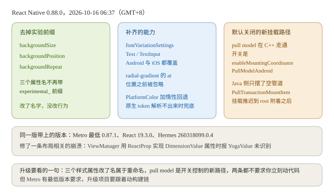
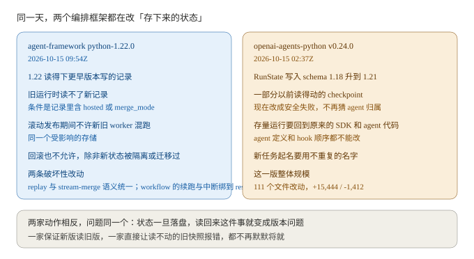
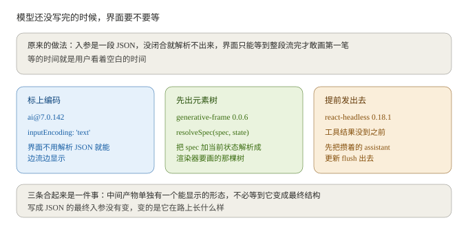
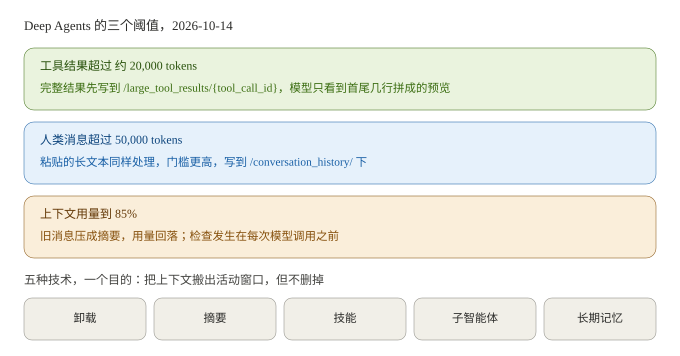
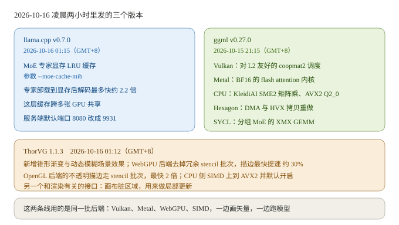
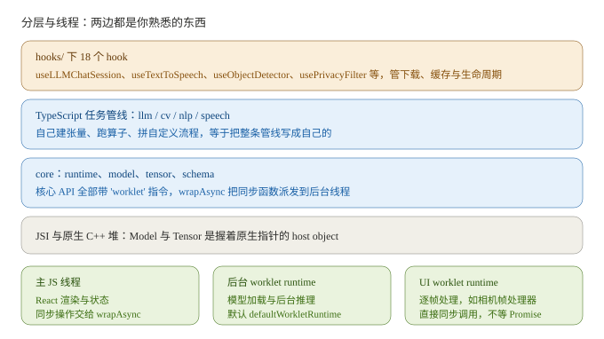

# AI 日报 · 2026-10-16

> 给谁看：做跨端渲染和 AI 工作流编排，正在往 AI 方向转的人。
> 生成时间：2026-10-16 09:2x（GMT+8）。检索窗口 2026-10-14 到 2026-10-16。
> 关于真假：这期的数字都回了一手来源，GitHub 的 release feed 与 CHANGELOG、LangChain 官方博客、OpenRouter 的模型接口、仓库自带文档。厂商自己测的数都单独标了口径。仓库那部分是下 tarball 全库直读（README、`LICENSE`、各包 `package.json`、`docs/docs/` 下的文档、基准数据 `imported.json`、`LEGACY_REMOVAL.md`、`RELEASE.md`）。star 数从仓库页面读到，fork 数没取到，留空。插图 6 张全自绘，画的都是正文里已经写过的数字和关系。

---

## 一、今日要闻

### 1. React Native 0.88.0 正式版：三个样式属性摘掉实验前缀，新的挂载路径先关着

10 月 16 日 06:37（GMT+8）`react-native` 发了 v0.88.0。跟渲染有关的改动可以分三类。

第一类是改名。`backgroundSize`、`backgroundPosition`、`backgroundRepeat` 三个属性去掉了 `experimental_` 前缀。行为没变，但样式名要跟着改。

第二类是补能力。`fontVariationSettings` 这版补全了，`<Text>` 和 `TextInput` 都支持，Android、iOS 都在内，还加了对象写法的语法。渐变修了两处：`radial-gradient` 里的 `at <position>` 之前被忽略而且会把尺寸也弄坏，现在修好了；圆形径向渐变的百分比半径改成按 web 的行为拒绝。

第三类是新东西，但先关着。Android 的 pull model 挂载路径在 C++ 里走通了，开关是 `enableMountingCoordinatorPullModelAndroid`。Java 侧这一版只摆了空管道：`PullTransactionMountItem` 和 `FabricUIManager.onTransactionAvailable`。同版还修了一条跟挂载时机有关的，pull model 的挂载推迟到 root 附着之后。

同一版带上的版本：Metro 最低要求提到 0.87.1，目的是让升级项目和新项目解析到同一个 Metro；同步 React 19.3.0；Hermes 到 260318099.0.4。另有一条布局相关崩溃的修复，`ViewManager` 用 `ReactProp` 实现 `DimensionValue` 属性时会报 `Unrecognized type: class com.facebook.yoga.YogaValue`。



跟你的关系：三个改名是这版里唯一必须动自己代码的地方，其余两条都不用急着跟。pull model 值得知道方向，挂载这件事从 push 往 pull 挪，说的就是"什么时候把一棵树交给平台"由谁决定，跟你在自研渲染管线里管这件事是同一个问题。Metro 最低版本这条要留意，升级项目如果锁了旧 Metro 会直接报错。

来源：[react-native v0.88.0 release（2026-10-15T22:37:17Z）](https://github.com/react/react-native/releases/tag/v0.88.0)，逐条正文读的是仓库 [CHANGELOG.md](https://raw.githubusercontent.com/facebook/react-native/main/CHANGELOG.md) 的 `## v0.88.0` 段

### 2. 两个编排框架同一天收紧"存下来的状态"

`microsoft/agent-framework` 的 `python-1.22.0`（2026-10-15T09:54:16Z）在发布说明里专门放了一个警告块，标题就是 persisted-state compatibility。它划的范围是"带序列化内容或流式更新记录的持久化产物"，包括聊天与消息历史、内嵌了这些记录的 session store 与协议快照，以及状态里含这些记录的 workflow checkpoint。两句原文：

- `The 1.22 runtime can read records written by earlier releases`
- `pre-1.22 runtimes cannot read new records containing hosted or merge_mode`

配套的操作要求也写在警告块里：滚动发布期间不要拿新旧 worker 对着同一个受影响的存储跑；1.22 写过这些记录之后不要降级，除非新状态被隔离或者迁移过。同一版还有两条标着 `[BREAKING]`：一条把内容身份、托管执行、协议元数据、replay 与 stream-merge 的语义跨各家 provider 统一了一遍，另一条把 workflow 的续跑和中断绑到 resolved thread ID 上，并禁止客户端 Shared State 和存下来的 Thread Snapshot 覆盖掉工具审批状态。

`openai/openai-agents-python` 的 `v0.24.0`（2026-10-15T02:37:43Z）做的是同一件事的另一半。这份发布说明里带了一份自动生成的发布就绪报告，排在第一位的风险标题是 `Route affected saved runs to their original SDK and agent code`，正文写：

- `Some previously readable checkpoints now fail safely instead of risking incorrect agent ownership`
- 判据是 `the writer advances from schema 1.18 to 1.21`

处理方式写得很具体：受影响的存量运行要用原来的 SDK、原来的 agent 定义、写快照时的 hook 顺序跑完；新任务起名要唯一；不许靠改名字或者改 schema 标签硬迁。报告给的规模是 111 个文件改动、`+15,444/-1,412`。



跟你的关系：两家的动作方向相反，问题是一个。状态一旦落盘，能不能读回来就不再是"数据"的问题而是"版本"的问题。你自研编排层或者状态层的话，这两份说明可以直接当模板抄：新版读不读得下旧数据、旧版读不读得下新数据、跨版本共存或回滚时要注意什么，这三句话现在不写清，出问题的时候只能翻代码推。

来源：[agent-framework python-1.22.0（2026-10-15）](https://github.com/microsoft/agent-framework/releases/tag/python-1.22.0)，正文从 [releases feed](https://github.com/microsoft/agent-framework/releases.atom) 直读；[openai-agents-python v0.24.0（2026-10-15）](https://github.com/openai/openai-agents-python/releases/tag/v0.24.0)，正文从 [releases feed](https://github.com/openai/openai-agents-python/releases.atom) 直读

### 3. 模型还没写完的入参，开始有能显示的形态了

`vercel/ai` 的 `ai@7.0.142`（2026-10-15T18:11:40Z，commit `130e871`）加了一条：

> `Mark streamed input with inputEncoding: 'text' so UI clients can display it progressively without JSON parsing.`

同一条改动还带两件配套的事：把 OpenAI 自定义工具的原始入参增量恢复出来，给要转发给 Responses API 的调用方用；以及把这套编码在部分 UI 消息存下来再恢复时保持不变。最后一句是关键：`Final provider tool-call inputs remain JSON-encoded.` 发给模型的仍然是 JSON，变的只是它在路上长什么样。

`assistant-ui/assistant-ui` 的 `generative-frame@0.0.6`（2026-10-15T20:06Z）加了 `resolveSpec(spec, { state })`，把一份 spec 加当前状态解析成渲染器真正要画的那棵元素树。同一批里 `assistant-stream@0.3.52` 保留 server-abort 情况下 UI 消息的不完整状态，并把没写完的工具入参缓冲丢掉。

`thesysdev/openui` 的 `@openuidev/react-headless@0.18.1`（2026-10-15T04:23Z）改的是顺序：`Publish a tool call before its result`，工具结果还没到，先把攒着的 assistant 更新 flush 出去。



跟你的关系：这三条是同一个决定在三个不同位置的做法，决定的内容是"一段还没成形的数据什么时候允许上屏"。AI SDK 选择标一个编码让下游自己判断，assistant-ui 选择先算出一棵能画的树，openui 选择提前把待发的更新推出去。你写"边下边拼"的逻辑时也是这个取舍，能不能不等最终结构、只给中间产物一个可显示的形态。

来源：[ai@7.0.142 CHANGELOG（2026-10-15）](https://raw.githubusercontent.com/vercel/ai/main/packages/ai/CHANGELOG.md) 与 [release 页](https://github.com/vercel/ai/releases/tag/ai%407.0.142)；[generative-frame@0.0.6（2026-10-15）](https://github.com/assistant-ui/assistant-ui/releases/tag/generative-frame%400.0.6)；[@openuidev/react-headless@0.18.1（2026-10-15）](https://github.com/thesysdev/openui/releases/tag/%40openuidev%2Freact-headless%400.18.1)

### 4. Deep Agents 把"上下文什么时候该搬走"写成了三个数字

LangChain 10 月 14 日发了一篇讲 Deep Agents 怎么记住东西的文章（页面 `datePublished` 是 2026-10-14T17:00:00Z）。三个数字都在正文里：

| 什么时候 | 做什么 | 落到哪 |
| --- | --- | --- |
| 工具结果超过约 20,000 tokens | 完整结果先出窗，模型只看到首尾几行拼成的预览 | `/large_tool_results/{tool_call_id}` |
| 人类消息超过 50,000 tokens | 同样的处理，门槛更高 | `/conversation_history/` |
| 上下文用量到 85% | 旧消息压成摘要，用量回落 | `/conversation_history/{session_id}.md` |

文章点名的五种技术是卸载、摘要、技能、子智能体、长期记忆。有一句值得单独记下来，讲子智能体为什么便宜：因为它的任务通常小、边界清楚，`can often run on a cheaper model and in parallel`。记忆在这一套里存成你自己存储里的纯文件，所以换模型或者换供应商，学到的东西还在。

顺带一条跟成本有关的观测。这两天的 OpenRouter 目录里上了两个 1,048,576 上下文（约 1.05M）的模型：Meta 的 `meta/muse-spark-open` 报 $1.25 / $4.25 每百万 token，NVIDIA 的 `nvidia/nemotron-3.5-super-vl` 报 $0.15 / $0.50 并且另有一个 $0 的免费变体。这两个价格是 OpenRouter 目录上的报价，不是厂商官方定价；目录里的上架时间（10-15）也不等于厂商发布日。



跟你的关系：三个阈值里最值得借的不是具体数字，是"卸载"和"摘要"分工的思路。卸载处理的是突然冒出来的一大块，换成一个短预览，成本是常数；摘要处理的是慢慢涨上来的那部分，是一次有损压缩，会丢东西。两件事混在一起做，你分不清哪次变慢是因为哪次。另外子智能体那句给了成本优化的一个方向：不一定要把主链路换便宜模型，能把一部分活划出去给便宜模型并行做，效果一样。

来源：[Context Engineering with Deep Agents: How To Remember Without Keeping Everything In Context（2026-10-14，作者 Jess Weng）](https://blog.langchain.com/context-engineering-deep-agents-remember/)；两个模型的报价与上下文长度读自 [OpenRouter 模型接口](https://openrouter.ai/api/v1/models)（2026-10-16 抓取）

### 5. 端侧推理和矢量渲染，在同一天改同一批 GPU 后端

三个版本挤在 10 月 15 日晚上到 16 日凌晨这两个小时里。

`ggml-org/llama.cpp` v0.7.0（2026-10-16T01:15:35Z，即 GMT+8 01:15）：给留在主机内存里的 MoE 专家加了一层显存 LRU 缓存，参数是 `--moe-cache-mib`，官方口径是 `up to 2.2x faster decode`，这是厂商自己测的数。这层缓存现在跨多张 GPU 共享。同一版把服务端默认端口从 8080 改成 9931（Docker 镜像里仍是 8080），chat 输出从单个字符串改成 part 数组。另外它这版新支持的模型里有一类叫 decision model：LiquidAI d1-3B、d1-omni-600M、vLLM decision 2、vLLM d3、pplx-decider。

`ggml-org/ggml` v0.27.0（2026-10-15T13:15:17Z，即 GMT+8 21:15）：给每个后端补快速路径。Vulkan 上做对 L2 友好的 coopmat2 调度和 bf16 激活；Metal 上加 tensor API 与更宽 head dim 的 flash attention；CPU 上加 KleidiAI SME2 的 k-quant 矩阵乘和 AVX2 的 Q2_0 点积；Hexagon 上重做 DMA 与 HVX 拷贝并补 pooling 与 3D im2col；SYCL 上加分组 MoE 的 XMX GEMM。

`thorvg/thorvg` 1.1.3（2026-10-15T17:12:13Z，即 GMT+8 10-16 01:12）：加锥形渐变和动态模糊场景效果。WebGPU 后端去掉冗余的 stencil 批次，描边最快提速约 30%；OpenGL 后端的不透明描边走 stencil 批次，最快 2 倍；CPU 侧 SIMD 上到 AVX2 并默认开启。另外新增一个跟渲染直接相关的接口：画布脏区域，用来做局部更新。



跟你的关系：这两条线用的是同一批后端，Vulkan、Metal、WebGPU、SIMD，一边画矢量一边跑模型。你在渲染侧攒的那套后端选择和性能调优经验，换到端侧模型上大半还管用。另外 llama.cpp 把"专家留在主机内存、按 LRU 往显存里换"做成一个参数这件事，思路跟你做图片或者字形缓存是一样的，都是拿一层缓存换掉重复的搬运。

来源：[llama.cpp v0.7.0（2026-10-16T01:15:35Z）](https://github.com/ggml-org/llama.cpp/releases/tag/v0.7.0)；[ggml v0.27.0（2026-10-15T13:15:17Z）](https://github.com/ggml-org/ggml/releases/tag/v0.27.0)；[ThorVG 1.1.3（2026-10-15T17:12:13Z）](https://github.com/thorvg/thorvg/releases/tag/v1.1.3)，三条正文都从各自的 releases feed 直读

---

## 二、今日精选仓库：`software-mansion/react-native-executorch`

为什么选它：前几期的仓库分别停在"一份描述怎么变成界面"（json-render）、"后端到前端的事件怎么流"（ag-ui）、"智能体怎么操作真应用"（agent-device）、"应用框架怎么把模型产出渲染出来"（assistant-ui）。这期换到你的主场：一个把端侧模型推理做成 React Native 包的仓库，维护方是写 reanimated 和 screens 的那家 Software Mansion。它做的两件事你都熟，一套"低层运行时 + 上层任务管线 + React hook"的分层，和一套跨线程传句柄的办法。而且今天要闻第 5 条里 llama.cpp 和 ggml 正在给移动端 GPU 和 NPU 补后端，两边刚好对得上。

### 基本信息（直接用仓库文件核实）

| 项 | 值 |
| --- | --- |
| 仓库 | `https://github.com/software-mansion/react-native-executorch` |
| 维护方 | Software Mansion |
| 许可证 | MIT，`LICENSE` 里版权方写 `Copyright (c) 2024 Software Mansion` |
| 语言 / 工程形态 | TypeScript 加 C++（JSI）。yarn 4.1.1 工作区，`packages/` 下 4 个已发布包：`react-native-executorch`、`bare-resource-fetcher`、`expo-resource-fetcher`、`react-native-executorch-webrtc`，另有 `apps/` 与 `apps/legacy/` |
| 版本 | 主包 `version` 是 0.11.0，同时带一个 `nativeLibsVersion` 0.10.4 |
| 最近一次发布 | `v0.10.6-libs`（2026-10-08）、`v0.10.5`（2026-10-06）；main 分支最近一次提交 2026-10-15T21:27:19Z |
| 依赖里跟"模型输出"有关的三件 | `@huggingface/jinja` 渲染模型的 Jinja2 聊天模板；`jsonrepair` 修破损 JSON；`jsonschema` 与 `zod` 做校验 |
| 基准数据 | 文档自带 `imported.json`，772 行，5 台真机，15 个任务 |
| 复核说明 | star 数 **1764**（2026-10-16 从仓库页面读到）。fork 数页面里没有内联，最近提交时间取自 commits feed，其余留空不猜 |

### 它解决什么问题

ExecuTorch 是 Meta 的端侧推理运行时，能力在，但那是 C++ 和 Python 的世界。这个仓库要做的是把模型加载、张量分配、前后处理、多轮对话状态这一整套，包成 React Native 开发者习惯的 hook 和 TypeScript API，同时把"推理不能卡住渲染线程"这件事一起处理掉。模型本身也替你挑过：一份预导出的模型目录，放在 Software Mansion 的 Hugging Face 仓库里，也可以带自己的 `.pte` 进来。

### 核心机制

**两层结构，上面那层是方便，下面那层是控制权。** 上层是 `hooks/` 下的 18 个 hook，大部分是 `use<Task>` 形式（`useLLMChatSession`、`useTextToSpeech`、`useObjectDetector`、`usePrivacyFilter` 等），外加 `useModel`、`useResourceDownload` 这类工具 hook，负责下载、缓存和生命周期。下层是 `core/` 里的 `runtime.ts`、`model.ts`、`tensor.ts`、`schema.ts`，加上 `llm`、`cv`、`nlp`、`speech`、`math` 几个扩展命名空间，可以直接建张量、跑算子、自己拼管线。README 把这层叫 Lower-level Runtime and Custom Orchestration。

**三个执行上下文。** 主 JS 线程跑 React 的渲染和状态；后台 worklet runtime 跑模型加载与后台推理；UI worklet runtime 跑逐帧的事，比如相机帧处理器。核心 API 全部带 `'worklet'` 指令，所以能直接放进 worklet；`wrapAsync(fn, runtime?)` 把一个同步函数派发到后台线程并包成 Promise。管线因此常给一套 dual API，同步版进 frame processor，`wrapAsync` 版给 JS 线程。

**跨线程传的是句柄，不是数据。** `Model` 和 `Tensor` 是 JSI host object，握的是原生 C++ 分配的指针，数据不在 JS 堆里，所以句柄在多个 runtime 之间传是零拷贝。同时并发跑同一个模型不会悄悄写坏内存，原生互斥量会直接抛 `RESOURCE_BUSY`。

**多轮对话只补新 token。** `createChatPreprocessor` 用模型自带的 Jinja2 模板把消息数组渲染成提示词。为了不每轮重编历史，它做增量 diff：先确认已提交轮次渲染出来的前缀是新对话的精确子串，匹配就把新增的尾巴切出来，只把这一段交给 `runner.prefill()`，原生内存里的 KV cache 留着不动，生成直接开始。如果自定义模型的模板会在新消息到达时回头改写之前的轮次，也就是破坏了前缀单调性，要给 `resetOnTurn: true` 强制整轮重编。

**KV cache 能倒带。** 低层 `runner.reset(targetPos)` 把 KV cache 退回到某个精确的 token 位置。用途是推测分支：同一个前缀采样出几条不同的续写，不用重新编码前缀。

**模型要在装之前过一遍体检。** `validateSpec` 拿模型导出的 schema 跟管线声明的 allowed spec 比。导出的那侧用 `ConcreteDim`，每个维度都是常量、范围或枚举；你写的那侧用 `SymbolicDim`，在具体域上加命名符号，可以声明多个变体，中一个就算过。它比的是域不是运行时真实值，尺寸之间的关系另外用 runtime constraint 表达。不符合就在加载期报错，而不是等到推理时崩。

**原生库不进 npm 包。** 核心运行时、四个后端（XNNPACK、Core ML、MLX、Vulkan）和第三方库（OpenCV、phonemis）都是从 GitHub Release 下载的独立产物。postinstall 脚本读你 `package.json` 里的 `react-native-executorch` 块，算出 `rne-build-config.json`，只下用到的，校验 checksum，缓存在 `~/.cache/react-native-executorch/<version>/`。默认全都下。

**后端按平台分。** XNNPACK 走 CPU，全平台通用；Core ML 吃苹果的 NPU 和 GPU；MLX 用苹果的统一内存；Vulkan 走 Android GPU。



### 五个可以直接抄的做法

1. **大改架构的时候，留一条原地能用的旧 API。** 0.10 是彻底重写，新 API 跟 0.9 不兼容。他们的做法是把整套 0.9 的实现在 `react-native-executorch/legacy` 子路径下原样保留，老代码只改 import 就能先升版本，之后按屏幕、按管线慢慢迁。更值得抄的是配套那份 `LEGACY_REMOVAL.md`，把"什么时候可以删旧代码"逐文件列成清单，要删的目录、文件、配置项、连 `.gitattributes` 里的 linguist 标记都写全了。这种"旧路径能用 + 一份删除清单"的组合，比写一段迁移说明实在得多。
2. **把不变量写成可校验的 schema，不写成文档。** `validateSpec` 那套是：模型声明自己导出什么，管线声明自己接受什么，配不上就在加载期报错。你手里如果有"这个组件只接受这几种 props"这类约束，位置是一样的。
3. **增量只补尾巴，但要先验证前提。** 聊天模板那套 diff 的前提是前缀精确子串匹配，而且它真的去检查。任何"只更新变化的部分"的做法都要有前提检查，不能假设历史不会被回头改写；发现假设不成立就给一个显式开关退回全量，也就是那个 `resetOnTurn`。
4. **跨线程只传句柄，并且给出确定的失败语义。** 原生内存里的对象跨 runtime 传指针零拷贝，同时用一个明确的错误码 `RESOURCE_BUSY` 代替"并发写坏内存"。你在管理跨线程的渲染对象时，第二条比第一条更重要。
5. **模型给的 JSON 不能只靠 `JSON.parse`。** 依赖里那三个包说明他们把"修"和"验"分成了两步：`jsonrepair` 先把破损的 JSON 补成一个能解析的形状，`jsonschema` 和 `zod` 再校验结构。写成两步比写一个宽松到什么都收的解析器好排查得多。

### 跟你现在会的对一下

| 你已经会的 | 这里对应什么 | 迁移成本 |
| --- | --- | --- |
| 原生模块与 JSI host object | `Model` 和 `Tensor` 是 host object，握原生指针，跨 runtime 零拷贝传句柄 | 低 |
| worklet、UI 线程与渲染线程分离 | 三个执行上下文；核心 API 全部带 `'worklet'`，`wrapAsync` 负责派发 | 低 |
| 逐帧处理（frame processor） | dual API 模式，同步版进 frame processor，`wrapAsync` 版给 JS 线程 | 低 |
| 增量更新与 diff | 聊天模板的前缀子串校验加只 prefill 新增 token，`resetOnTurn` 是退回开关 | 低 |
| 缓存与失效策略 | KV cache 留在原生内存，`reset(targetPos)` 倒带到精确位置做分支 | 中 |
| 组件 props 的协议与校验 | allowed spec 用 `SymbolicDim` 声明，`validateSpec` 在加载期比对导出的 `ConcreteDim` | 中 |
| 只打包用到的资源（字体、图标子集化） | 后端与原生库按 `features`/`backends`/`libs` 声明，postinstall 只下用到的 | 低 |
| 大版本迁移的经验 | 旧 API 留在 `/legacy` 子路径，配一份 `LEGACY_REMOVAL.md` 删除清单 | 中 |
| 端侧设备分档与降级 | 基准按 5 台真机分档：S26 Ultra、Pixel 10、S20+、iPhone 17、iPhone SE 3 | 低 |

### 怎么上手

```bash
yarn add react-native-executorch
```

- 只支持 React Native 的新架构（Fabric），这条写在兼容性文档的第一句。
- 先跑一个最小的：`useLLMChatSession(models.llm.LFM2_5_1_2B.DEFAULT, {...})`，模型会自动下载并缓存。
- 装完有两个坑。pnpm 10 及以上、npm 12 及以上默认不跑依赖的安装脚本，原生库不会下载，构建会在后面某处因为缺文件失败；要跑一次 `pnpm approve-builds react-native-executorch` 或者 `npm approve-scripts react-native-executorch`。monorepo 里那个配置块要放在根 `package.json`，实际解析结果会记在 `node_modules/react-native-executorch/rne-build-config.json`。
- 想直接跳过低层：`packages/react-native-executorch/src/core/` 下的 `tensor.ts`、`model.ts`、`schema.ts` 就是入口。文档在 `docs/docs/03-core-and-advanced/`，其中 `06-worklets-and-threading.md` 讲线程模型，`02-models-and-tensors.md` 讲内存与生命周期，`08-native-libraries.md` 讲后端怎么裁。

### 要注意的

- **性能数字全部是厂商自测。** 仓库写明：数字来自 React Native ExecuTorch 0.11.0-dev（v0.10.0 之后不久的 main），2026 年 9 月测，跑在 5 台真机上。同一份文档也提醒物理设备上的轮次差异和热管理会造成波动，量化模型还要自己拿数据集验准确率。这批数不能当成正式版的性能承诺。
- **LLM 吞吐掉得很快。** 同一台 S26 Ultra 上（XNNPACK，`imported.json` 里 LLM 只有这一台）从 135M 的 **55.9 tok/s**（峰值内存 597MB）掉到 4B 的 **7.4 tok/s**（峰值 3374MB）。口径也窄：提示词是 `List three uses for a paperclip.`，解 64 个 token，忽略 EOS，温度 0 走贪心解码。
- **内存按峰值算，不按模型体积。** 文档写明参数超 2GB 的模型驻留内存在 2.4 到 3.5GB 之间。风格迁移那条更极端：权重文件只有 2MB 左右，中间激活张量让峰值内存经常超过 1.1GB。
- **有的基准输入本身不代表性，而且他们自己说了。** 语音转文字用的是合成的类人声音频，没有语义内容，Whisper 只吐很少 token，解码轮数偏低，所以那个数基本是编码器的时间，真实连续语音会更慢。这种对基准本身的说明比数字更值得看。
- **版本号有两套。** npm 包版本是 0.11.0，原生库版本是 `nativeLibsVersion` 0.10.4，另有 `v0.10.6-libs` 这种只发原生产物的 tag。对着文档抄版本号很容易抄错。
- **模型 URL 由两个常量拼出来，改错会波及线上。** `VERSION_TAG` 是已发布标签，`NEXT_VERSION_TAG` 是开发中的标签。`RELEASE.md` 专门写了警告：这两个常量的名字和含义在 v0.10 被改过，照旧文档的类比去改 `VERSION_TAG`，会把所有已经发出去的模型 URL 一起指偏。

### 还没搞清楚的

1. 新版 `/legacy` 和新 API 能不能在同一个 app 里同时跑同一类任务，比如旧的 `LLMModule` 和新的 `useLLMChatSession` 各加载一份模型。文档说两套 API 可以共存于同一个项目，但没说资源占用会不会翻倍。
2. `bare-resource-fetcher` 和 `expo-resource-fetcher` 在 `LEGACY_REMOVAL.md` 里被列为"只服务于旧示例应用、可以整体删除"，但 `RELEASE.md` 的发布清单里仍然列着它们，两处说法不一致，实际状态没核实。
3. 那三个包（`jsonrepair`、`jsonschema`、`zod`）具体在哪一层用、是不是用在工具调用的输出解析上，这次只看了依赖声明，没读实现。
4. `packages/react-native-executorch-webrtc` 0.11.0 是给 Fishjam 的 WebRTC 应用做实时背景虚化，用的是分割模型。它跟主包的关系，比如是否复用同一套后端和原生产物，没读。
5. 0.11.0 的正式发布日没找到。releases feed 里只读到 `-libs` 那条和 0.10.5，主包 0.11.0 的对应 release 没进去看。
6. Vulkan 与 Core ML、MLX 在同一台设备同一任务上的对照数字，我只抽查了 LLM 这一项，而且 LLM 只有 S26 Ultra 的 XNNPACK 行。其他任务的多后端对比没有逐条读。

---

## 三、今天可以动手的三件事

1. **拿 RN 0.88.0 的三个改名过一遍自己的样式清单。** `backgroundSize`、`backgroundPosition`、`backgroundRepeat` 去掉了 `experimental_` 前缀，改完顺手确认一下 `fontVariationSettings` 能不能替掉你现在手写的那套可变字体方案，这版三端都补齐了。
2. **给自己那边的"落盘状态"写一页兼容说明。** 照着 agent-framework 和 openai-agents 的写法，至少写清三件：新版能不能读旧数据、旧版能不能读新数据、跨版本共存或回滚时要注意什么。再补一句"怎么判断动到了存量数据"，比如 agent-framework 说清了"只有 checkpoint 状态里含序列化内容的那种才算受影响"。
3. **量一个数：界面从第一个 chunk 到出现第一块东西隔了多少毫秒。** 然后按 AI SDK 那条思路试一次，把还没成形的入参标成文本形态先渲染出来，看这个数字能降到多少。顺手确认你现在的做法在输出被截断时表现是什么样，是留着一个半成品界面还是留白。

---

## 四、来源清单

| # | 主题 | 来源 | 链接 | 日期 |
| --- | --- | --- | --- | --- |
| 1 | RN 0.88.0 全部条目（样式改名、fontVariationSettings、pull model、Metro 最低版本） | GitHub release 页与仓库 CHANGELOG | [v0.88.0](https://github.com/react/react-native/releases/tag/v0.88.0) · [CHANGELOG](https://raw.githubusercontent.com/facebook/react-native/main/CHANGELOG.md) | 2026-10-15T22:37:17Z |
| 2 | agent-framework 持久化状态兼容窗口与两条破坏性改动 | GitHub releases feed 直读 | [python-1.22.0](https://github.com/microsoft/agent-framework/releases/tag/python-1.22.0) · [feed](https://github.com/microsoft/agent-framework/releases.atom) | 2026-10-15T09:54:16Z |
| 2 | openai-agents-python 的 RunState schema 与安全失败策略 | GitHub releases feed 直读 | [v0.24.0](https://github.com/openai/openai-agents-python/releases/tag/v0.24.0) · [feed](https://github.com/openai/openai-agents-python/releases.atom) | 2026-10-15T02:37:43Z |
| 3 | AI SDK 流式入参编码 | 仓库 CHANGELOG 与 release 页 | [CHANGELOG](https://raw.githubusercontent.com/vercel/ai/main/packages/ai/CHANGELOG.md) · [ai@7.0.142](https://github.com/vercel/ai/releases/tag/ai%407.0.142) | 2026-10-15T18:11:40Z |
| 3 | assistant-ui 的 resolveSpec | GitHub release 页 | [generative-frame@0.0.6](https://github.com/assistant-ui/assistant-ui/releases/tag/generative-frame%400.0.6) | 2026-10-15T20:06Z |
| 3 | openui 在工具结果到达前 flush | GitHub release 页 | [react-headless@0.18.1](https://github.com/thesysdev/openui/releases/tag/%40openuidev%2Freact-headless%400.18.1) | 2026-10-15T04:23Z |
| 4 | Deep Agents 的三个阈值与五种技术 | LangChain 官方博客 | [blog.langchain.com](https://blog.langchain.com/context-engineering-deep-agents-remember/) | 2026-10-14T17:00:00Z |
| 4 | 两个 1.05M 上下文模型的目录报价 | OpenRouter 模型接口 | [openrouter.ai/api/v1/models](https://openrouter.ai/api/v1/models) | 2026-10-16 抓取（目录上架时间 10-15） |
| 5 | llama.cpp v0.7.0 的 MoE 显存缓存与新端口 | GitHub releases feed 直读 | [v0.7.0](https://github.com/ggml-org/llama.cpp/releases/tag/v0.7.0) | 2026-10-16T01:15:35Z |
| 5 | ggml v0.27.0 的各后端快速路径 | GitHub releases feed 直读 | [v0.27.0](https://github.com/ggml-org/ggml/releases/tag/v0.27.0) | 2026-10-15T13:15:17Z |
| 5 | ThorVG 1.1.3 的锥形渐变、动态模糊与 stencil 优化 | GitHub releases feed 直读 | [v1.1.3](https://github.com/thorvg/thorvg/releases/tag/v1.1.3) | 2026-10-15T17:12:13Z |
| 二 | react-native-executorch 全部结论 | 仓库 tarball 全库直读（`LICENSE`、各包 `package.json`、`README.md`、`LEGACY_REMOVAL.md`、`RELEASE.md`、`docs/docs/03-core-and-advanced/06-worklets-and-threading.md`、`docs/docs/03-core-and-advanced/03-schema-validation.md`、`docs/docs/03-core-and-advanced/08-native-libraries.md`、`docs/docs/02-extensions/natural-language/02-llm-chat-and-generation.md`、`docs/docs/04-benchmarks/01-benchmarks.mdx`、`docs/docs/04-benchmarks/imported.json`、`docs/docs/05-other/01-compatibility.mdx`） | [github.com/software-mansion/react-native-executorch](https://github.com/software-mansion/react-native-executorch) | 2026-10-16 直读（main 最新提交 2026-10-15T21:27:19Z） |
| 二 | star 数 1764 与最近一次发布 | 仓库页面与 releases feed | 同上 | 2026-10-16 |
