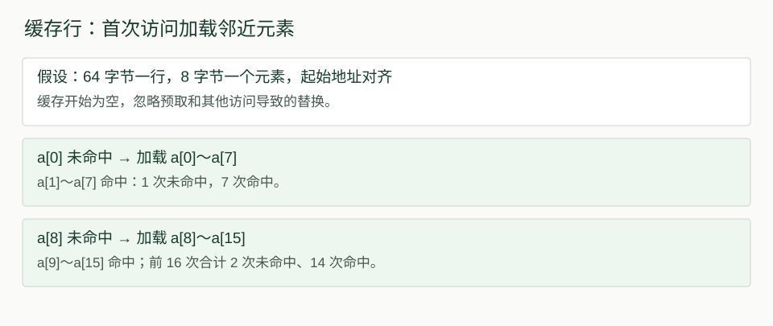
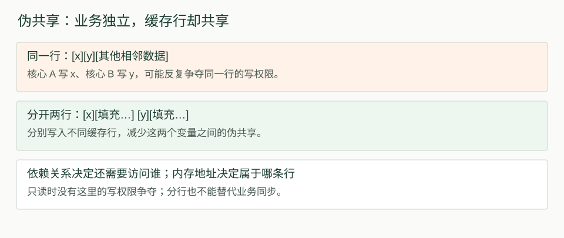
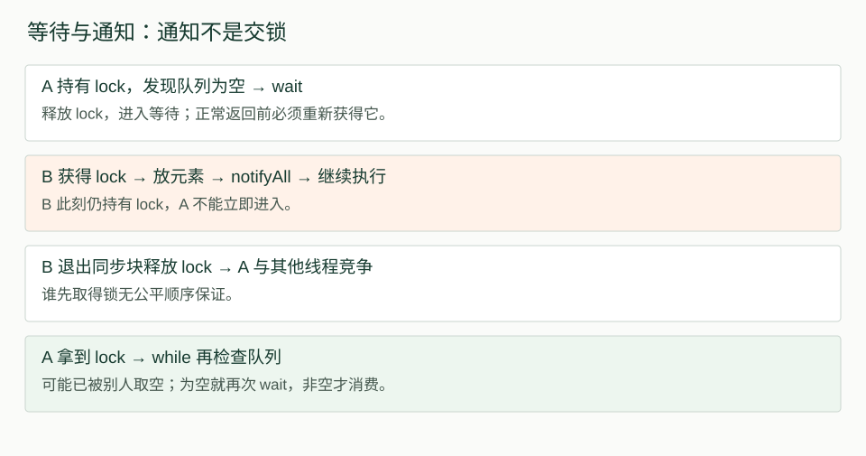
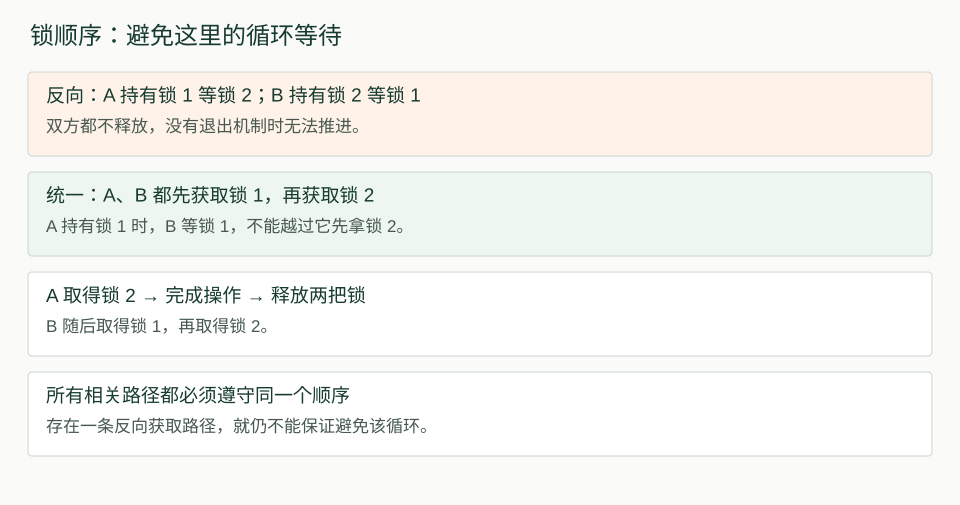
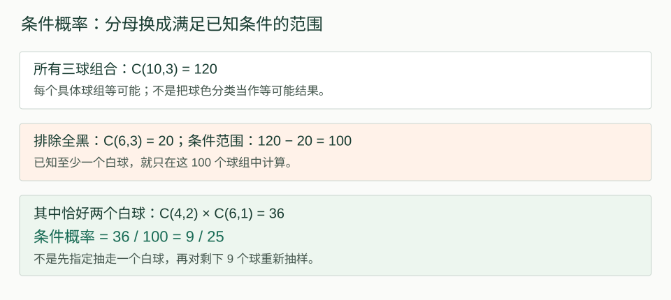

# 2026-10-17 计算机基础复习：缓存、线程调度与锁

今天先复测昨天的并发、TCP 和幂等，再沿着缓存局部性、线程调度、等待通知、死锁与活锁继续学习。主要收获是分清“数据是否正确”“线程是否能推进”和“执行是否高效”。

- 学习日期与核实日期：2026-10-17，Asia/Shanghai。
- 来源：今天的逐题口述、追问与纠错；Java 语义对照 Java SE 25，伪共享对照 Linux 内核文档。
- 原计划：周六混合笔试摸底。先完成计算机基础互动复习，随后提交混合试卷；概率批改与公式总结追加在第十节。
- 互动复习未计时，未运行 Java、网络或性能基准实验。后续混合试卷的导出用时为 37 分 42 秒，不含交卷后重交与讲解；示意图不是测量结果。
- 本文是当日学习记录；“本轮能回答”与“讲解后待复测”分别记录，不把提示下答对视为长期掌握。

## 一、开场五题：旧知识复测

| 题目 | 本次回答与纠正 | 下次检查 |
| --- | --- | --- |
| volatile count++，两个线程各加一万次，再 join | 能解释两次读取同一个旧值导致丢失更新；结果不保证两万。join 不只等待终止，还建立相应可见性保证 | 脱稿说清 volatile 与 join 各自保证什么 |
| TCP 长度 100，收到 30 字节后超时 | 知道不能直接 readInt 解析下一条；但发“不完整”通知不能自动恢复流边界 | 准确保留接收进度继续，或关闭连接；readFully 异常后未必知道消费字节数 |
| 同进程线程的资源 | 堆和地址空间共享，调用栈与寄存器执行状态各自独立 | 共享只读数据不一定需要加锁，冲突访问才要分析同步 |
| 按行连续存储的二维数组遍历 | 起初把下标层次与内存顺序混淆，后自行改为逐行更有利 | 根据相邻地址与缓存行推导，不能只看下标写法 |
| 同号扣款重试 | 相同参数时返回已有结果，不重复扣款；修改金额后曾提出重新扣款或回滚旧交易 | 同号不同参数应拒绝冲突；超时不能推断失败，已提交事务不能再用原 ROLLBACK 撤销 |

volatile 读写、监视器解锁后再加锁、线程终止与 join 的 happens-before 规则见 [JLS §17.4.5](https://docs.oracle.com/javase/specs/jls/se25/html/jls-17.html#jls-17.4.5)。扣款题沿用昨天“记录、余额与结果位于同一数据库事务”的简化假设；本次没有实现支付系统或扩展数据库专题。

## 二、缓存局部性：重复访问与相邻访问

### 2.1 时间局部性与空间局部性

| 类型 | 访问特点 | 例子 |
| --- | --- | --- |
| 时间局部性 | 刚访问过的数据，很快再次访问 | 循环反复使用同一个值 |
| 空间局部性 | 访问一个地址后，很快访问附近地址 | 顺序扫描连续数组 |

```java
for (int i = 0; i < a.length; i++) {
    sum += a[i];
}
```

sum 的重复使用体现时间局部性，实际可能一直在寄存器中；连续数组的 a[i]、a[i+1] 体现空间局部性。只扫描一遍、每个元素只访问一次时，对数组元素本身没有明显的时间局部性，但仍可利用空间局部性。

数组大于缓存，不等于缓存没有用。程序可以一条缓存行一条缓存行地使用数据，无须整个数组同时留在缓存里。缓存模型与局部性可参照 [OSTEP 内存访问与缓存讨论](https://pages.cs.wisc.edu/~remzi/OSTEP/vm-beyondphys-policy.pdf)。

### 2.2 一次未命中加载整条缓存行

练习假设：元素 8 字节、缓存行 64 字节、起始地址对齐、缓存开始为空、忽略预取，期间没有其他访问造成相关行被替换。64 字节是本题参数，不是所有处理器的统一常量。

一条行装 64 ÷ 8 = 8 个元素。顺序读前 16 个：

| 读取位置 | 过程 | 结果 |
| --- | --- | --- |
| a[0] | 加载包含 a[0]～a[7] 的行 | 未命中 |
| a[1]～a[7] | 数据已一起带入 | 7 次命中 |
| a[8] | 加载包含 a[8]～a[15] 的行 | 未命中 |
| a[9]～a[15] | 数据已一起带入 | 7 次命中 |

总计 2 次未命中、14 次命中；只读前 8 个则是 1 次未命中、7 次命中。起初回答“8 次命中、8 次未命中”，纠正点是第一次未命中就把邻近 7 个元素一起带入。



若只读 a[0]、a[8]、a[16]、a[24]，四次访问落在不同的行，在上述冷缓存模型中都未命中。四条行仍保留时，再次读取 a[0] 会命中，体现时间局部性。

### 2.3 缓存行对应内存地址，不按变量依赖拼装

起初疑问：x 计算需要 z，加载 z 会不会把同一行中的 y 覆盖？

缓存行对应一段固定、连续、对齐的内存地址范围。x、y 是否同一行由地址决定，不由业务依赖决定。若 z 位于远处另一段内存，它属于另一条行；不会因为 x 依赖 z，就把 z 拼进 x、y 的这条行中。

缓存空间有限，加载新行可能替换旧行，但这是缓存副本的替换，不是任意改写变量 y 的值。脏数据按一致性和写回等机制处理；具体行为取决于缓存架构。计算依赖与地址相邻是两件事。

## 三、伪共享：不同变量也可能争夺同一条缓存行

假设线程 A 只写 x、线程 B 只写 y，彼此没有业务依赖，分别运行在不同核心上，但 x、y 位于同一条缓存行。频繁交替写入可能引起缓存行所有权迁移与副本失效，增加开销。

```text
核心 A 写 x → 获得所在行的写权限
核心 B 写 y → 又需要同一行的写权限
核心 A 再写 x → 可能再次发生一致性协调
```

这叫伪共享。它主要是性能问题，并不自动等同于程序数据竞争；若业务上也有冲突访问，则还需另行处理正确性。所有线程只读、没有写入时，不存在这里由交替写入导致的伪共享开销。[Linux 内核：False Sharing](https://docs.kernel.org/kernel-hacking/false-sharing.html)



缓存里“以前有这个数据”不代表现在仍可直接使用，副本还必须有效，写入还需所需权限。把 x、y 分散到不同缓存行，可以缓解这两个变量之间的伪共享，但不能替代业务同步。该布局也可能增加占用，应以实际性能验证为依据。

本轮表现：能够解释独立变量分行后减少写权限争夺；缓存内容、缓存槽位与变量内存值的区分仍建议间隔复测。

## 四、线程调度：就绪、运行与阻塞

### 4.1 并发不等于并行

并发是在一段时间内多个任务交替或重叠推进；并行是同一时刻确实执行多个任务。讨论单 CPU 调度时，采用“一个逻辑 CPU”的前提。支持 SMT 的一个物理核心可能暴露多个逻辑 CPU，不能把物理核心和逻辑 CPU 混为一谈。

线程与进程一样，能用运行、就绪、阻塞等抽象状态理解调度；它们不是 Java Thread.State 枚举的逐项对应。尤其 Java RUNNABLE 包含运行及等待处理器资源等情况。[OSTEP 线程入门](https://pages.cs.wisc.edu/~remzi/OSTEP/threads-intro.pdf)、[Java Thread.State](https://docs.oracle.com/en/java/javase/25/docs/api/java.base/java/lang/Thread.State.html)

| 状态 | 含义 |
| --- | --- |
| 运行 | 正在 CPU 上执行 |
| 就绪 | 已具备运行条件，等待调度 |
| 阻塞／等待 | 等待 I/O、锁或条件等，暂不能继续相应执行 |

```text
A 运行 → 等网络，进入阻塞
B 已就绪 → 调度执行 B
A 数据到达 → A 就绪
调度器选中 A → A 运行
```

数据到达不意味着马上运行。调度策略可能让 A 继续等待，也可能发生抢占；不能单凭 B 的时间片未耗尽断言 A 绝不会抢占。

### 4.2 阻塞等待不等于 CPU 空转

A 阻塞等网络时，不占着逻辑 CPU 执行，系统可以运行 B。没有可运行工作时，CPU 才可能空闲。反复执行循环检查“数据到了没有”则属于忙等，会消耗 CPU。

A 此刻等待 I/O，不足以证明整个任务是 I/O 密集型；B 就绪也不等于它必然是 CPU 密集型。分类要看主要时间花在计算还是等待。

### 4.3 上下文切换保存执行现场

从 B 切换到 A，需要保存 B、恢复 A 的相关执行状态，包括程序计数器、栈指针和通用寄存器等。局部值可能位于寄存器或栈中；调用栈通常保留在内存，无须每次复制整份栈。

切换还可能影响缓存命中表现，但不是每次都必须重新加载全部缓存。上下文与线程资源共享的基础说明见 [OSTEP 线程入门](https://pages.cs.wisc.edu/~remzi/OSTEP/threads-intro.pdf)。

## 五、多线程为什么不一定更快

| 条件 | 可能表现 |
| --- | --- |
| 一个逻辑 CPU，纯计算任务从 2 线程增至 100 | 无法凭空增加计算资源，可能增加调度、切换与管理开销 |
| 多线程争用共享资源 | 可能等待、阻塞、重试或发生缓存一致性开销，不一定每个线程都阻塞 |
| 多个独立任务主要在等 I/O | 请求等待可以重叠，缩短总体完成时间 |
| 多个可用核心，可拆分计算任务 | 可能通过并行计算加速，收益受串行部分与协调开销限制 |

I/O 场景不要求固定“一个线程请求、一个线程计算”。每个线程都可以执行请求、等待、处理结果，多个请求的等待阶段重叠。I/O 完成后的线程仍需调度，不保证立即处理。

这些是条件化判断，不是性能测试结论。今天最后能独立说明上下文切换、资源竞争和 I/O 等待重叠；多核计算的并行收益由辅导补充，下次再复测。

## 六、sleep、wait 与通知：让出 CPU 不等于释放锁

### 6.1 三类操作的区别

| 操作 | 监视器锁行为 | 继续执行的条件 |
| --- | --- | --- |
| Thread.sleep | 不释放已经持有的监视器锁 | 休眠结束／被中断后按相应语义继续，还受调度影响 |
| lock.wait | 释放 lock 的监视器；不会自动释放其他对象的锁 | 正常返回前必须重新获得 lock |
| lock.notify / notifyAll | 通知等待线程，不释放当前持有的 lock | 当前持有者释放后，被通知线程才有机会重新取得锁 |

wait、notify、notifyAll 要由拥有对应监视器的线程调用，否则会出现 IllegalMonitorStateException；wait 还可能被中断，需要处理 InterruptedException。[Object API](https://docs.oracle.com/en/java/javase/25/docs/api/java.base/java/lang/Object.html)、[Thread API](https://docs.oracle.com/en/java/javase/25/docs/api/java.base/java/lang/Thread.html)



### 6.2 通知不等于立即运行，也不保证公平

B 在 synchronized(lock) 内 notify 后，仍可以继续执行自己的代码；A 不能立即进入同一个监视器保护的区域。notify 选择哪个等待线程，Java 不保证按等待时长或优先级；notifyAll 通知所有，也不保证等待最久者先拿锁。

必须区分“从等待集中被选中”“竞争监视器”“获得执行机会”，不是 CPU 硬件根据 Java 业务规则选择通知对象。[Object.notify / notifyAll](https://docs.oracle.com/en/java/javase/25/docs/api/java.base/java/lang/Object.html)

### 6.3 为什么条件等待使用 while

下面是演示片段：queue 与 lock 已安全交给线程，所有队列访问使用同一把锁；方法把中断继续向上抛。实际业务中的消费处理是否放锁内，应按一致性和持锁成本另行设计。

```java
void consumeOne() throws InterruptedException {
    synchronized (lock) {
        while (queue.isEmpty()) {
            lock.wait();
        }
        consume(queue.remove());
    }
}
```

wait 返回时，队列可能已被另一个消费者取空；也可能发生虚假唤醒。while 会重新检查条件，if 则不会回头判断，可能直接从空队列取数据。三个消费者被通知、只有一个元素时，先拿锁者取走，后续消费者拿锁发现空，再次 wait 并释放锁。[JLS §17.2](https://docs.oracle.com/javase/specs/jls/se25/html/jls-17.html#jls-17.2)

### 6.4 同一把锁提供互斥与可见性

全部队列读写遵守同一把 lock 时，不必仅为这些访问的可见性给 queue 引用额外加 volatile。前一个线程解锁前的写入，对随后获取同一把锁的线程可见。引用加 volatile 不会自动让队列内部 add/remove 线程安全。[JLS §17.4.5](https://docs.oracle.com/javase/specs/jls/se25/html/jls-17.html#jls-17.4.5)

两段代码各自有 synchronized，但用的是不同锁，不能据此保证同一个 count++ 互斥，也不能依靠同一监视器的解锁／加锁规则建立相应可见性。某次结果碰巧正确，不等于实现有正确性保证。

本轮最后能够独立说出“互斥＋可见性”，并明确不同锁无法保护同一计数器的完整读改写；等待通知的公平性与虚假唤醒仍需间隔复测。

## 七、死锁、活锁与饥饿

| 现象 | 核心表现 | 本次示例 |
| --- | --- | --- |
| 死锁 | 相关线程互相等待，无法推进 | A 持锁 1 等锁 2，B 持锁 2 等锁 1 |
| 活锁 | 线程持续动作、退让或重试，但没有实际进展 | 各拿一把锁，另一把拿不到便释放，反复同步重试 |
| 饥饿 | 系统中其他线程在推进，个别线程长期得不到服务 | 某线程持续参与竞争，却总拿不到资源 |

发生几次重试、最终完成，属于正常竞争，不能只凭重试认定活锁。死锁也不能等同于所有线程都处于 Java BLOCKED，具体等待状态取决于机制。

活锁中的随机退避可以降低同步碰撞概率，但不自动提供严格进展保证。三种现象的概念对照见 [Oracle 并发教程：Liveness](https://docs.oracle.com/javase/tutorial/essential/concurrency/liveness.html)。



统一顺序的推导：A 拿到锁 1 时，B 在锁 1 上等待，还没有拿到锁 2；A 可以继续取得锁 2，完成后释放。这里假设 A 持有锁 1，直到相关两锁操作完成，不是 A、B 同时持有同一把锁 1 后再竞争锁 2。

只要一条可能并发执行的相关路径仍按锁 2 → 锁 1 获取，就不能保证避开该循环。统一顺序针对这些锁消除这类循环，不证明整个复杂程序绝无其他死锁。

## 八、本轮掌握记录与下一次复测

| 内容 | 本轮证据 | 后续安排 |
| --- | --- | --- |
| 时间／空间局部性 | 能判断扫描一次无明显元素复用；再次读取 a0 属于时间局部性 | 独立解释两者区别 |
| 缓存行计算 | 经讲解后能答 8 元素为 1 未命中＋7 命中、跨 4 行均未命中 | 换元素大小与访问步长再算 |
| 伪共享 | 经讲解后能说明分行减少写权限干扰 | 检查是否仍混淆依赖关系与内存布局 |
| 就绪与运行 | 能解释 I/O 完成不意味着立即运行 | 区分 OS 抽象状态与 Java 枚举 |
| 上下文切换 | 独立指出寄存器保存恢复，补充栈指针后能复述 | 不把缓存影响说成必然全部重载 |
| wait / notify | 综合题能解释未释放锁不能取元素、需要重新竞争 | 独立画执行顺序与 while 条件循环 |
| 死锁／活锁／饥饿 | 能区分等待、持续无效重试、个别线程缺机会 | 换程序场景辨认，不只背比喻 |
| 同一把锁的作用 | 最后能独立说出互斥与可见性，能否定不同锁保护 | 保留为间隔复测，不连续重复追问 |
| 多线程效率 | 最后能独立讲切换、争用、I/O 重叠 | 补多核计算，并检查调度与“立即处理”的边界 |
| 旧题卡点 | join 可见性、超时后的流恢复、同号不同金额仍需收紧 | 下次开场先复测，不重新展开数据库大专题 |

建议下一次先用旧题检查保持程度，再决定新主题；不把今天所有内容机械叠加到明天，不因未计时而编造完成时长。

## 九、来源与适用范围

本文把口述误区与后续纠正合并展示，不逐字保存语音转写错误。缓存示例采用明确的简化模型；线程调度讲解不代表所有平台实现完全相同；Java API 的具体保证以规范为准。

- [Java SE 25 JLS §17](https://docs.oracle.com/javase/specs/jls/se25/html/jls-17.html)：监视器、等待集、通知与 happens-before。
- [Object API](https://docs.oracle.com/en/java/javase/25/docs/api/java.base/java/lang/Object.html)：wait、notify、notifyAll 的调用条件、重新竞争和虚假唤醒。
- [Thread API](https://docs.oracle.com/en/java/javase/25/docs/api/java.base/java/lang/Thread.html)：sleep 的监视器行为。
- [Thread.State](https://docs.oracle.com/en/java/javase/25/docs/api/java.base/java/lang/Thread.State.html)：Java 状态枚举与 OS 抽象状态的边界。
- [Linux 内核 False Sharing](https://docs.kernel.org/kernel-hacking/false-sharing.html)：缓存行级共享、写入与伪共享。
- [OSTEP 线程入门](https://pages.cs.wisc.edu/~remzi/OSTEP/threads-intro.pdf)：线程共享地址空间、独立执行状态与切换。
- [OSTEP 缓存与替换](https://pages.cs.wisc.edu/~remzi/OSTEP/vm-beyondphys-policy.pdf)：局部性与缓存讨论。
- [Oracle Liveness](https://docs.oracle.com/javase/tutorial/essential/concurrency/liveness.html)：死锁、饥饿、活锁；该教程面向 JDK 8，这里只用于基本概念。

核实方式为阅读一手资料、检查示例推导与页面构建；没有并发运行、硬件计数器或性能测量，因此不提供加速倍数、吞吐量或“已验证无死锁”等实验结论。

## 十、补充复盘：组合数、联合概率与条件概率

补充日期：2026-10-17。来源是本次混合笔试答卷与交卷后的讲解。重点是先数清等可能情况，再确定已知条件缩小了哪个范围。以下数值由题设直接推导，不是外部测量数据。

### 10.1 组合数：不计顺序地选取

从 n 个不同对象中选 k 个，不计选取顺序，写作 C(n,k)，也常记作上下排列的组合符号。0 ≤ k ≤ n。

```text
C(n,k) = n! / [k! × (n-k)!]

n! = n × (n-1) × … × 1
0! = 1
```

先数有顺序的取法，再除掉同一组内部重复的排列：

```text
C(4,2)  = (4 × 3) / (2 × 1) = 6
C(5,3)  = (5 × 4 × 3) / (3 × 2 × 1) = 10
C(10,3) = (10 × 9 × 8) / (3 × 2 × 1) = 120
```

白球 1、2 与白球 2、1 是同一组球，只计一次。虽然颜色相同，每个球仍是不同实体，可以临时编号辅助计数。

“1 白 2 黑、2 白 1 黑、3 白”是颜色分类，不是三个等可能结果；每一类包含的具体球组数量不同。只有确定基本结果等可能时，才能直接用有利结果数除以总结果数。

### 10.2 联合概率：A 和 B 同时发生

P(A ∩ B) 表示 A、B 同时发生。乘法公式为：

```text
P(A ∩ B) = P(A) × P(B ∣ A)    当 P(A) > 0
         = P(B) × P(A ∣ B)    当 P(B) > 0

若 A、B 独立：
P(A ∩ B) = P(A) × P(B)
```

不能看到“同时发生”就直接把边缘概率相乘，独立性必须有依据。不放回抽样通常存在依赖：抽走一个白球后，下一次抽白球的概率会变化。

例如，独立尝试每次成功概率 1/2，S 表示成功、F 表示失败：

```text
P(FFS) = 1/2 × 1/2 × 1/2 = 1/8
```

这里数的是“前两次失败且第三次成功”这一完整过程。

### 10.3 条件概率：已知 B，再问 A

```text
P(A ∣ B) = P(A ∩ B) / P(B)    要求 P(B) > 0
```

分母是所有满足 B 的情况；分子是在这个范围内还满足 A 的情况。联合概率与条件概率问的是不同问题：

| 问法 | 含义 |
| --- | --- |
| A 和 B 同时发生 | 在原样本空间中找交集 |
| 已知 B 发生，再问 A | 先把范围缩小到 B，再看其中有多少属于 A |

若 A 一定蕴含 B，则 A ∩ B = A，此时可写成 P(A) / P(B)。一般情况下不能直接如此简化。

### 10.4 抽球题：至少一个白球，不是先抽走一个白球

题设：6 黑、4 白，等机会不放回抽取 3 个。设 A 为恰好 2 白，B 为至少 1 白。

先数总球组，再按条件筛选：

```text
所有三球组合：
C(10,3) = 120

不符合 B 的全黑组合：
C(6,3) = 20

符合 B 的组合：
120 - 20 = 100

恰好 2 白 1 黑：
C(4,2) × C(6,1) = 6 × 6 = 36

P(A ∣ B) = 36 / 100 = 9/25
```

每一种白球二元组合都能搭配 6 个黑球，所以目标组合数是乘法。已经按不计顺序的球组计数，不再乘“白白黑、白黑白、黑白白”的顺序数，否则会重复计算。



原答卷的 4/9 不成立。把条件“至少 1 白”改成“已经取出 1 白，再从 9 个球中抽”改变了抽样过程；后面固定使用 2/3 和 1/3 相乘，也忽略了不放回抽样中数量会继续变化。

### 10.5 有限次尝试：到第三次不等于第三次成功

每次独立成功概率 1/2，首次成功即停止，最多尝试 3 次。T 表示实际尝试次数。

| T | 对应完整路径 | 概率 |
| --- | --- | --- |
| 1 | S | 1/2 |
| 2 | FS | 1/4 |
| 3 | FFS 或 FFF | 1/8 + 1/8 = 1/4 |

第三次无论成功还是失败，都会停止。因此 P(T=3) 只要求前两次失败，不必再乘一次成功概率。

```text
P(第三次成功且尝试三次) = P(FFS) = 1/8

P(最终成功 ∣ T=3)
  = P(FFS) / [P(FFS) + P(FFF)]
  = (1/8) / (1/4)
  = 1/2
```

原答卷把两个问题都写成 1/8。口述已能指出第三次可能成功或失败，但公式没有把这两条路径都算进分母。优先练习“联合概率”和“给定条件后的概率”的区分。

### 10.6 离散期望与概率自检

离散随机变量的期望，是各个可能取值乘以对应概率，再求和：

```text
E[X] = Σ x × P(X=x)

E[T] = 1 × 1/2 + 2 × 1/4 + 3 × 1/4
     = 7/4
     = 1.75 次
```

原答卷漏答期望小问。计算前后检查：

- 所有互斥、穷尽的取值概率之和应为 1；本题 1/2 + 1/4 + 1/4 = 1。
- 概率应在 0 到 1 之间；条件分母必须非零。
- 本题 1 ≤ T ≤ 3，所以期望也应在 1 到 3 之间。
- “第三次达到上限仍失败”不能漏算。
- 网页显示每题有填写，不代表每个小问都已作答完整。

### 10.7 下一次怎么复测

| 本次卡点 | 下一次先独立做什么 |
| --- | --- |
| 组合数的除法 | 手列从 5 个不同球中选 2 个的组合，解释为何要除以 2 |
| 条件事件的分母 | 先写 A、B 分别是什么，再数 B 和 A ∩ B |
| 不放回与独立 | 判断下一次概率是否因前一次结果改变，不能默认独立相乘 |
| 停止规则 | 列出 S、FS、FFS、FFF，再归类 T |
| 联合与条件 | 对照问“FFS 的概率”和“已知 T=3 后成功的概率” |
| 漏答检查 | 最后逐小问核对，不依赖“已作答题数” |

本轮已完成公式讲解，用户表示理解；尚未完成一组新的独立概率题，不能因此标记概率已掌握。下一次优先复测条件事件与样本空间，不继续堆叠新公式。
