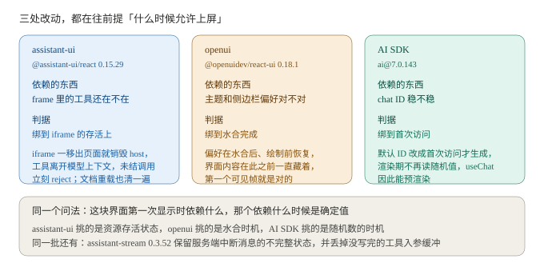
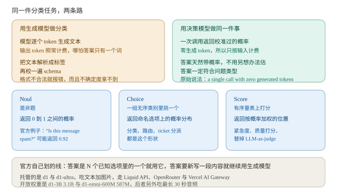

# AI 日报 · 2026-10-17

> 给谁看：做跨端渲染和 AI 工作流编排，正在往 AI 方向转的人。
> 生成时间：2026-10-17 09:5x（GMT+8）。检索窗口 2026-10-15 到 2026-10-17。
> 关于真假：这期的原文都回了一手来源，GitHub 的 release feed、commit 正文、仓库 CHANGELOG、Liquid AI 的官方文档页、OpenRouter 的模型接口、Moondream 的定价页。仓库那部分是下 tarball 全库直读（`LICENSE`、`README.md`、目录树、`catalogs/`、`conformance/`、`eval/`、`docs/public/guides/`）。作者自测的数字单独标了口径。取不到的（fork 数、d1 的具体价格）留空并写明，不猜。插图 6 张全自绘，画的都是正文里已经写过的数字和关系。

---

## 一、今日要闻

### 1. AutoGen 归档了，但 GitHub 上那个归档开关还没打开

`microsoft/autogen` 的 README 顶部现在挂着 `status-archived` 徽章，下面是一段警告块，原文：

> `Project archived and no longer maintained`
> `This project has been archived and is no longer actively maintained by Microsoft.`
> `Microsoft is not providing bug fixes, security fixes, new features, or support for this project.`
> `New users should start with Microsoft Agent Framework. Existing users are encouraged to migrate using the AutoGen → Microsoft Agent Framework migration guide.`

同一段里还有一句值得留意：`AutoGen was developed for research and experimentation and as it transitions to archived, we continue to advise against production use.`

这里有个容易看漏的地方。我去翻了仓库页面本身的数据，`isArchived` 仍然是 `false`，页面上也没有 GitHub 那个 "Public archive" 标识。也就是说，**GitHub 层面的只读归档还没做，目前归档这件事只写在 README 和那条 commit 里**。仓库现在 61442 star。

时间线也要说清：README 里指向 Agent Framework 的"维护模式"横幅不是这周加的，2026-04-06 就有一条 `Update maintenance mode banner in readme (#7521)`，说明是 `Updating maintenance banner and redirect new users to Microsoft Agent Framework`。这周的改动是把措辞从"维护模式"改成明确的"已归档、不再维护"，commit 是 2026-10-16T16:14:36Z 的 `docs: clarify AutoGen is archived and no longer maintained (#8366)`。

跟你的关系：这条消息的实际影响比标题小。它改变的不是代码，是"要不要继续在它上面加东西"这个判断。真要动的只有一类项目：把 AutoGen 当长期底座用的。判断顺序建议反过来，先数清自己这套编排里有多少是 AutoGen 的能力、多少是自己写的状态层和工具层，因为官方迁移手册能覆盖的多半是前者，后者搬起来跟换框架关系不大。

来源：[microsoft/autogen README（`Project archived`）](https://github.com/microsoft/autogen/blob/main/README.md) 与 [PR #8366（2026-10-16T16:14:36Z）](https://github.com/microsoft/autogen/pull/8366)，正文从 [commits feed](https://github.com/microsoft/autogen/commits/main.atom) 直读；归档状态读自仓库页面数据（`isArchived: false`，2026-10-17 抓取）

### 2. LangGraph 把编排状态做成了四个前端框架各自的包

10-16 20:54Z（GMT+8 是 10-17 凌晨 04:54），langgraphjs 一版发了九个包，时间戳挤在两分钟里：

| 包 | 版本 | 发布时间（GMT+8） |
| --- | --- | --- |
| `@langchain/langgraph` | 1.5.1 | 04:54:25 |
| `@langchain/langgraph-sdk` | 1.12.5 | 04:54:22 |
| `@langchain/react` | 1.2.5 | 04:54:31 |
| `@langchain/svelte` | 1.2.5 | 04:54:34 |
| `@langchain/vue` | 1.2.5 | 04:54:37 |
| `@langchain/angular` | 1.2.5 | 04:54:28 |
| `@langchain/langgraph-cli` | 1.5.4 | 04:54:43 |
| `@langchain/langgraph-api` | 1.5.4 | 04:54:40 |
| `@langchain/langgraph-ui` | 1.5.4 | 04:54:19（`No changes in this release.`） |

四个前端包这一版唯一的改动就是把 `@langchain/langgraph-sdk` 升到 1.12.5，所以真正动的是 SDK，而且三处修的是同一件事：前端拿到的那份状态，别在你看不见的地方被改。

第一条，被 `stop()` 截断的回复不再赖在 `useStream` 的 messages 里。原文是 `a reply cut off mid-stream, for example by stop(), no longer lingers in useStream messages after its run ends`，后半句把边界说全了：run 一结束就丢掉、刷新页面后不会又冒出来、同一个线程的其它 tab 也一起丢。为输入暂停期间已经流完的回复保持可见，恢复时是替换而不是重复。被截断消息的流句柄现在以 aborted 错误结算，不再永远挂着不 resolve。

第二条，打开一个有近期活动的线程不再重放它。原文：`The controller now skips events produced before the checkpoint it loaded`。以前控制器把订阅收到的历史事件又盖到刚加载的状态上，于是 messages、values、toolCalls 倒回上几轮再自己重建，旧工具调用还会闪一下 running 再 finished。子智能体那种作用域视图（`useMessages`）仍然收完整历史。同一版顺手修了另一个：打开线程之后立刻 `submit()`，不再被上一轮的重放结束信号提前终止。

第三条在线程暂停这一侧：一个线程因为多个 interrupt 暂停时，`run.start` 带 input 现在直接返回 `invalid_argument` 并保持暂停，而不是起一个注定失败的 run。原文：`instead of starting a run that fails because one input can't say which interrupt it answers`。

`@langchain/langgraph@1.5.1` 里另有一条跟存储直接相关：一个字段从 `DeltaChannel` 换成普通 reducer（比如换成 `MessagesAnnotation`），旧线程上已经存下的值要保住，读的时候从存下来的 writes 重建，下一次 run 是往上加而不是覆盖。

跟你的关系：前端看到的状态和真实状态差一拍，是流式界面最常见的 bug 来源，而且这类 bug 只在"刚好在某个时刻刷新"或者"开了两个 tab"时才复现。这版给的判据值得抄：把"这条回复还算不算数"绑到 run 的生命周期上，而不是绑到"最后一次收到消息的时间"。第二条也一样，别让订阅到的历史事件去覆盖刚加载的状态。

来源：[langgraph-sdk 1.12.5（2026-10-16T20:54:22Z）](https://github.com/langchain-ai/langgraphjs/releases/tag/%40langchain%2Flanggraph-sdk%401.12.5) 与 [langgraph 1.5.1（2026-10-16T20:54:25Z）](https://github.com/langchain-ai/langgraphjs/releases/tag/%40langchain%2Flanggraph%401.5.1)，九个包的版本与时间戳读自 [releases feed](https://github.com/langchain-ai/langgraphjs/releases.atom)

### 3. 三处改动，都在往前提"什么时候允许上屏"

三条来自三个不同项目，改的却是同一个决定：一段内容什么时候可以显示出来。

`assistant-ui/assistant-ui` 的 `@assistant-ui/react@0.15.29` 让 `useAssistantFrameHost` 在 iframe 被移出页面时销毁 host。原文：`useAssistantFrameHost disposes the host when its iframe is removed from the page, so the frame's tools leave the model context and its pending calls reject right away`。同一版配套一条 `Clear frame tools and pending calls when the iframe document changes or reloads.`，以及 `Handle sparse MCP Apps message content without scanning array holes.`。`assistant-stream@0.3.52` 做的是另一半：`preserve incomplete status for server-aborted UI-message responses and discard buffered unfinished tool input`，同时 `Preserve explicit model content on settled tool results`。

`thesysdev/openui` 的 `@openuidev/react-ui@0.18.1` 原文写的是 `server-rendering support: the saved sidebar and theme preferences are restored just after hydration, before paint, with the interface's contents hidden until then so the first visible frame is already correct`。就是先恢复偏好、内容先藏着，让第一个可见帧直接是对的，中间不闪一下旧主题。

`vercel/ai` 的 `ai@7.0.143`（同批 `@ai-sdk/workflow@2.0.75` 与 `@ai-sdk/vue@4.0.143` 的时间戳是 2026-10-16T20:15:52Z~53Z）把默认 chat ID 改成首次访问时才生成，原文：`so useChat() can prerender without reading a random value when the ID is not used during rendering`。同版给 `streamText` 加了 `experimental_lowMemory: true`：单消费者流式，不要 replay buffer、也不保留最终内容，用来降内存。

跟你的关系：这三条都可以套同一个问法，你这块界面第一次显示出来的时候依赖什么，那个依赖什么时候是确定值。assistant-ui 挑的是资源的存活状态，openui 挑的是水合时机，AI SDK 挑的是随机数的时机。你手里的首帧闪烁、加载态闪一下、骨架屏跳一下，基本都是这一问没问清楚。

来源：[@assistant-ui/react 0.15.29 CHANGELOG](https://raw.githubusercontent.com/assistant-ui/assistant-ui/main/packages/react/CHANGELOG.md) 与 [assistant-stream 0.3.52 CHANGELOG](https://raw.githubusercontent.com/assistant-ui/assistant-ui/main/packages/assistant-stream/CHANGELOG.md)；[@openuidev/react-ui 0.18.1（2026-10-15T04:24:07Z）](https://github.com/thesysdev/openui/releases/tag/%40openuidev%2Freact-ui%400.18.1)；[ai@7.0.143 CHANGELOG](https://raw.githubusercontent.com/vercel/ai/main/packages/ai/CHANGELOG.md)

### 4. `display: none` 的脏标记不再往上传，作者自测每帧省 0.9 毫秒

10-16 合入 main 的一条改动，标题就是 `Don't dirty display: none nodes because of their children (#59113)`。这条跟渲染侧的关系最直接，把它的机制完整抄下来。

问题的起点在 `YogaLayoutableShadowNode::updateYogaChildren`：只要有一个子节点是脏的，它就把克隆出来的节点标脏。对 `display: none` 的节点来说这一条从来不需要，因为不管子节点什么样，Yoga 都把它的尺寸算成 0。不光不需要，还很贵。commit 正文写得很清楚：

> `zeroOutLayoutRecursively` resets the hidden subtree and the hidden node is marked clean, but its descendants keep their dirty flags. Fabric's `layout()` doesn't recurse into `display: none` nodes either. So a child that was created or changed while its parent was hidden stays dirty until the parent is shown. Every later commit that clones the hidden node sees that child, dirties the hidden node and every ancestor up to the root, and `RootShadowNode::layoutIfNeeded` re-runs `layoutTree`, including `roundLayoutResultsToPixelGrid` over every node in the surface.

换成白话：隐藏的时候子树被归零了，但子节点身上还留着脏标记。之后**每一次克隆隐藏节点的 commit 都会把这个脏标记往上带，一直到根**，然后整屏重跑一遍布局。正文还点出这一条贵的不是 React 的 commit，恰恰是不走 React 的那类：`setNativeProps`、JS 驱动的 `Animated`（Fabric 上就是走 `setNativeProps`）、原生状态更新，以及往 ShadowTree 提交的动画库。核心代码里最清楚的例子是 `display: 'none'` 容器里的 view 上跑 JS 驱动的 `Animated.loop`，每帧重排整个 surface。被 `<Activity mode="hidden">` 藏起来的内容是同一个状态，因为渲染器就是靠给顶层 host 节点克隆一份带 `display: 'none'` 的副本来隐藏它。

改法是跳过 `display: none` 节点的子节点比较，保留节点自己的脏检查和子节点数量检查。重新显示会改样式，在 `updateYogaProps` 里标脏，隐藏期间变过的子节点那时才布局。

数字是作者在 PR 正文里给的，属于自测，环境也窄：RN 0.87.1 从源码编译，iOS 26.5 模拟器，Release，屏幕上 1000 行，120 个 commit 跑 9 次，取中位数 / p90，单位毫秒。

| 场景 | 改前 | 改后 |
| --- | --- | --- |
| `setNativeProps` 打在 `display:'none'` 父节点里创建的 view 上 | 1.06 / 2.02 | 0.15 / 0.21 |
| …父节点隐藏期间 React 重渲染过一个兄弟节点之后 | 1.01 / 2.06 | 0.16 / 0.20 |
| …在隐藏的 `<Activity>` 里，隐藏期间重渲染过 | 1.18 / 2.03 | 0.16 / 0.21 |
| `display:'none'` 父节点里的 view 上跑 JS 驱动的 `Animated.loop` | 1.09 / 1.95 | 0.13 / 0.17 |
| 对照：`setNativeProps` 打在可见父节点里的 view 上 | 0.19 / 0.23 | 0.19 / 0.24 |

对照那一行值得单独看：改完之后的 0.13 到 0.17 毫秒，跟本来就正常的 0.19 毫秒一个量级，也就是说隐藏容器里的操作不再比可见容器贵。这条修复的来源是 Bluesky 上的真实案例，profile header 里一个隐藏的 spinner 上挂了 Reanimated 的 `useAnimatedStyle`，每次滚动帧都 commit，每次都重排整屏，他们先在 App 层绕过去了。

同一批还有两条渲染侧的。

Yoga 那条是 `Fix Style::operator== ignoring boxSizing (#2029)`。`Style::operator==` 比了所有字段就是没比 `boxSizing_`，于是只有 box sizing 不同的两份样式被判成相等，`YGNodeCopyStyle` 跳过拷贝、目标节点留着旧值，靠比样式决定要不要重排的调用方也就漏掉这次变化。配套一条 `Update box-sizing invalidation regression coverage (#59137)` 补了回归测试。

Taffy 这两天在补 Float 与 Block 的布局语义。`Block: apply relative inset to floated boxes (#1305)` 修的是 `position: relative` 的浮动元素：以前它按浮动位置放好了，但 `top`/`left` 偏移从来没生效，现在在布局完成后把偏移加上，而且浮动上下文不受影响，后面的内容和浮动元素还是按"这个盒子没被偏移"来排（正文注明依据 CSS 2.2 9.4.3）。同一批把浮动和常规流盒子的相对偏移解析合并进一个 `resolve_relative_offset`，避免百分比基准和 inset 优先级两处各写一遍、日后走岔。Flexbox 那一侧在做单遍化：`Flexbox: compute used space and flex factor sums in one pass`、`Allocate the flex items Vec once, sized for the child count (#1327)`。Servo 10-16 补的是几个布局 quirk，`layout: Implement the percentage height calculation quirk (#39869)`、`layout: Implement the stretch quirks for <html> and <body> (#48942)`，另有一条 `layout: Reuse one glyph buffer across text fragments (#48969)`，让一段文本的多个 fragment 共用一份字形缓冲。

跟你的关系：这条跟你以前查过的那个 `display:none` 是同一个位置，结论能直接接上。按 Yoga 的语义，`display:none` 就是"自身加整棵子树归零"，Android 那边展开到全部子视图是标准行为，iOS 只改自身才是偏差。这次补的是归零之后的另一半：子树的脏标记该不该往上冒。答案是不该，除了节点自身的脏检查和子节点数量，别的都不该冒。你自研管线里如果也有"隐藏子树照样参与脏值传播"的设计，这就是现成的对照实验。另外注意这条跟以前那个 1.06 毫秒是两回事，一个是屏幕上有多少节点要重排，一个是这次 commit 要不要触发重排，后者不解决的话前者会一直重来。

来源：[react-native PR #59113（2026-10-16T10:49:07Z）](https://github.com/react/react-native/pull/59113)、[PR #59137](https://github.com/react/react-native/pull/59137)，以及随 RN 一起进来的 yoga 修复 `Fix Style::operator== ignoring boxSizing (#2029)`（2026-10-16T15:46:32Z），这三条正文从 [commits feed](https://github.com/facebook/react-native/commits/main.atom) 直读；[taffy #1305（2026-10-16T12:49:54Z）](https://github.com/DioxusLabs/taffy/pull/1305)、[#1327（2026-10-16T22:47:26Z）](https://github.com/DioxusLabs/taffy/pull/1327)；[servo #39869（2026-10-16T13:01:04Z）](https://github.com/servo/servo/pull/39869)、[#48942（2026-10-16T10:56:32Z）](https://github.com/servo/servo/pull/48942)、[#48969（2026-10-16T20:44:09Z）](https://github.com/servo/servo/pull/48969)。这条修复合入 main 的时间晚于 v0.88.0 的发布（10-15 22:37Z），有没有回灌到 0.88 分支我没核实。

### 5. 分类、路由、打分这类调用，开始有专门的模型了

Liquid AI 的文档里有一类叫 decision model（决策模型），定位写在第一句：

> `Instead of generating text token by token, a decision model evaluates a situation and returns calibrated probabilities across a fixed set of outcomes in a single call with zero generated tokens.`

问法只有三种：`Noul` 是是非题，返回 0 到 1 之间的概率，官方举的例子是 `"Is this message spam?" might return 0.92`；`Choice` 是在一组无序类别里挑一个，返回命名选项上的概率分布；`Score` 是在一个有序量表上打分，返回按概率加权的位置。

计费方式比价格更值得看：`Both models are billed on input tokens only, and output is free.`，每个问题按它自己的文本和所有图片算输入。托管的有两个，`d1` 和 `d1-ultra`（基于更大的开放权重模型加 Liquid 自己的改动），都吃文本加图片，走 Liquid API、OpenRouter 和 Vercel AI Gateway。开放的权重是两个小模型：`d1-3B`（3.1B）和 `d1-omni-600M`（587M，另外吃最长 30 秒音频），走 LFM Open License。

官方还给了迁移指南，对照表把任务分成六类：分类、路由、二值判断、打分、重排、多个问题一次问。它自己划的边界是一句话：答案是"N 个已知选项里的一个"就用决策模型，答案是"模型得新写一段内容"就继续用 LLM。价格具体多少文档里没写、指向定价页，本轮没取到。另外官方文档说这两个模型在 OpenRouter 上有，我抓的目录 JSON（468 条）里却没有 `liquid/d1` 或 `liquid/d1-ultra` 这两个 id，原因未核实。

顺带一条跟成本有关的观测。10-14 之后 OpenRouter 目录一共只多了 7 条（4 个模型加它们的免费变体，另有一条重复）。除前一期写过的两个长上下文模型外，新的是这三个：

| 目录 id | 上架时间 | 上下文 | 目录报价（输入 / 输出，每百万 token） |
| --- | --- | --- | --- |
| `reflection/beam-1.0-501b-a23b` | 2026-10-16 | 1,048,576 | $1 / $3 |
| `moondream/moondream3.1-9b-a2b` | 2026-10-15 | 32,000 | $0.30 / $2.50 |
| `moondream/moondream3-preview` | 2026-10-15 | 32,000 | $0.30 / $2.50 |
| `xingchen-agi/xing4.0-29b-a4b:free` | 2026-10-16 | 262,144 | $0 / $0 |

Moondream 这一行两个口径对不上，都写在这里：厂商定价页写 Moondream 3.1 9B A2B 实时档 `$0.30 / 1M input tokens`、`$1.00 / 1M output tokens`，批量档 `$0.15 / $0.50`；OpenRouter 目录给的是 $0.30 / $2.50。差在哪没查。另外提醒一句，目录里的 `created` 是上架时间，不等于厂商发布日。

跟你的关系：决策模型解决的浪费很具体。用生成模型做分类，你付的是生成文本的钱，拿回来一个词，然后还得解析 JSON、校 schema、处理"这次它没按格式回"。把这类调用单独摘出来，省下来的不只是钱，还有一整类报错。编排里所有 guardrail、工具调用审批、意图识别、模型路由都是这个形状。反过来，别把需要写内容的地方挪过去，官方自己划了这条线。这条跟前一期那条 llama.cpp 支持 d1 系列是两件事：那条讲的是推理侧认不认这类模型，这条讲的是它作为一项服务怎么计费、怎么用。

来源：[Liquid AI Decision Models 文档](https://docs.liquid.ai/lfm/models/decision-models) 与 [d1 模型页](https://docs.liquid.ai/lfm/models/d1)（2026-10-17 抓取；文档未标发布日期）、[Decision Model Guide](https://docs.liquid.ai/guides/decision-model-guide.md)；目录报价读自 [OpenRouter 模型接口](https://openrouter.ai/api/v1/models)（2026-10-17 抓取）；Moondream 两个口径读自 [moondream.ai/pricing](https://moondream.ai/pricing)（2026-10-17 抓取）

---

## 二、今日精选仓库：`a2ui-project/a2ui`

为什么选它：前五期分别停在"一份描述怎么变成界面"（json-render）、"后端到前端的事件怎么流"（ag-ui）、"智能体怎么操作真应用"（agent-device）、"应用框架怎么把模型产出渲染出来"（assistant-ui）、"端侧推理怎么做成 RN 包"（react-native-executorch）。这期落在交叉带里最像你本职的那一侧：一份声明式的界面载荷，配一份可信组件清单，然后在 React、Lit、Angular、Flutter、SwiftUI 上各自渲染出来。10-17 凌晨 00:12Z（GMT+8 08:12）它一口气发了四个包，其中一句改动很说明问题：agent SDK 不再依赖任何 agent 框架，ADK 和 A2A 的接入被拆成了独立的包。

### 基本信息（直接用仓库文件核实）

| 项 | 值 |
| --- | --- |
| 仓库 | `https://github.com/a2ui-project/a2ui`（`github.com/google/a2ui` 302 到这里） |
| 维护方 | Google 主导的开放规范项目，命名空间 `com.google.a2ui`，官方 ADK 与 A2A 有接入 |
| 许可证 | Apache-2.0，`LICENSE` 首行 `Apache License Version 2.0, January 2004`，没有附加条款 |
| 语言 / 工程形态 | 多语言 monorepo，每端自带构建体系：根 `package.json` + `yarn.lock`（TS）、`pubspec.yaml`（Dart）、`Package.swift` + `swift.code-workspace`（Swift SPM）、`kotlin/`（Gradle）、`pyproject.toml` + `uv.lock`（Python）、`mkdocs.yaml`（文档站） |
| 顶层目录 | `typescript/`、`dart/`、`swift/`、`kotlin/`、`python/`、`specification/`、`catalogs/`、`conformance/`、`eval/`、`tools/`、`samples/`、`docs/`、`blueprints/`、`scripts/` |
| 规范版本 | `specification/` 下并列 `v0_8`、`v0_9`、`v0_9_1`、`v1_0`，另有 `proposals/` 与 `inference_formats/` |
| 本次发布 | `a2ui-core 0.4.0`、`a2ui-agent-sdk 0.9.0`、`a2ui-adk 0.1.0`、`a2ui-a2a 0.1.0`，全部 2026-10-17T00:12Z |
| 规模 | tarball 138,192,992 字节（约 132MB）；`conformance/` 178 个文件；`docs/public/guides/` 11 篇 |
| 复核说明 | star 数 **16723**（2026-10-17 从仓库页面读到）。fork 数页面里没内联，留空。最近一次提交 2026-10-17T00:14:58Z（commits feed 首条）。`a2ui-adk` 和 `a2ui-a2a` 的 release 正文里都写着 `Publishing to PyPI has not completed yet.` |

### 它解决什么问题

模型生成的界面有三个绕不开的问题：能不能直接执行、换个端还能不能渲染、界面已经在屏幕上了怎么改。A2UI 的选择是不执行代码。界面写成一份声明式的 JSON 载荷，客户端维护一份自己信得过的组件清单，模型只能请求清单里有的组件。README 把这句话写成 `safe like data, but expressive like code`。

### 核心机制

**载荷是一份扁平的组件列表加 ID 引用。** README 原句：`The UI is represented as a flat list of components with ID references which is easy for LLMs to generate incrementally, allowing for progressive rendering`。扁平和 ID 引用这两个约束是给模型省 token 的，也是给渲染留余地的：模型可以一次只写变化的那几个组件，客户端可以边收边画，不用等整棵树写完。

**可信组件清单，加一层按端的实现映射。** 组件清单落在 `catalogs/basic/v1/catalog.json`，`tools/build_catalog` 从这份清单生成各端代码。同一份载荷到客户端要落到原生控件上，所以 `typescript/renderers/` 下有 `react`、`lit`、`angular`、`markdown-it` 四个，`dart/a2ui_flutter/` 是 Flutter widget，`swift/swiftui/` 是 SwiftUI view，`kotlin/` 目前只有 `agent_sdk_legacy`。README 把这层叫框架无关与可移植：同一份载荷可以渲染在基于不同框架的不同客户端上。

**注册表能接任何组件，包括 iframe 沙箱。** README 提到 open registry pattern 和一个叫 "Smart Wrapper" 的东西：任何现成组件，包括装历史内容的 iframe 容器，都能接上 A2UI 的数据绑定和事件系统。关键是它把安全交回给开发者：沙箱策略和"信任阶梯"写在你自己组件的逻辑里，而不是全靠核心去管。

**这一版把编排框架解耦了。** `a2ui-agent-sdk 0.9.0` 的发布说明开头就写 `The agent SDK no longer depends on an agent framework`：`a2ui.a2a` 搬到新的 `a2ui-a2a`，`a2ui.adk` 搬到新的 `a2ui-adk`，`a2a-sdk`、`google-adk`、`google-genai` 都不再是 agent SDK 的依赖。同一版还把整个 `a2ui.schema` 包删掉了，常量去 `a2ui.constants`，工具函数去 `a2ui.utils`，`VERSION_0_8` 这类版本常量换成 `a2ui.core.schema` 里的 `ProtocolVersion` 成员。

**catalog 之间可以互相引用。** `a2ui-core 0.4.0` 让 catalog 能引用别的 catalog 里的组件、属性 schema 和函数，写法是 `simplified_catalog_v1_0.json#/components/Text` 这类外部 `$ref`。`Catalog.with_peer_catalogs(peers)` 返回一个链接到 peers 的新副本、不改被调用的那个原对象，`MessageProcessor` 也只链接传进来的副本，所以 basic catalog 这种大家共用的目录不会被改脏。原句是 `so shared catalogs such as the basic catalog stay unchanged`。

### 四个可以直接抄的做法

1. **把"可信"写成一份组件清单，不写成文档。** 模型能用的组件由 `catalogs/basic/v1/catalog.json` 定义，越界就渲染不出来。位置跟你熟悉的 props 校验一样，只是校验的对象从"组件收到什么"变成了"模型能请求什么"。
2. **一份清单生成各端代码。** 组件清单是唯一事实来源，`tools/build_catalog` 从它产出各端绑定。你要同时维护 RN、Flutter、自研管线三套组件的话，这个结构省掉的是"三端的组件名和属性对不上"这类对账。配合 `docs/public/guides/authoring-universal-components.md`（怎么写出各端都能用的组件）和 `renderer-development.md`（怎么给新端写渲染器），这一块是成套的。
3. **规范、一致性用例和评测数据放在同一个仓库。** `conformance/` 有 178 个文件，含 `test_data/catalogs/streaming_catalog_v0_9.json` 和 `streaming_parser.yaml`；`eval/datasets/` 有 `core_v0_9_1.yaml`、`core_v1_0.yaml`、`multi_turn_conversation_dataset.yaml`，配一份 `dataset_schema.json`，跑在 Inspect AI 上。自己写渲染管线的时候，这等于别人给你备好了验收标准。
4. **编排接入做成可选依赖。** agent SDK 不依赖任何框架，ADK 和 A2A 各自成包，而且 `a2ui.adk` 对 A2A 相关的转换器是惰性导入，核心的 `SendA2uiToClientToolset` 不需要装那个 extra 就能用。这种"核心零框架依赖、接入层各自成包"的切法，比在核心里堆 if 判断好维护得多。

可借鉴的做法里有一条要单独说：增量这件事它不靠 diff 算法，靠的是载荷格式本身。组件是扁平的、每个带 ID，所以"改一个组件"和"加一个组件"在载荷上就是一条语句，客户端不需要算差量。`catalogs/basic/v1/examples/00_incremental.json` 和 `31_incremental-dashboard.json` 是两个现成用例，各端 renderer 里都有对应的测试（`typescript/renderers/{react,lit,angular}/a2ui_explorer/tests/v0_9/00_incremental.*`）。

### 跟你现在会的对一下

| 你已经会的 | 这里对应什么 | 迁移成本 |
| --- | --- | --- |
| 组件白名单与 props 校验 | `catalogs/basic/v1/catalog.json` 定义模型能请求的组件，`tools/build_catalog` 生成各端代码 | 低 |
| 增量更新与差量 patch | 扁平组件列表加 ID 引用，`catalogs/basic/v1/examples/00_incremental.json` 与 `31_incremental-dashboard.json` 是现成用例 | 低 |
| 多端组件对齐 | `typescript/renderers/{react,lit,angular,markdown-it}`、`dart/a2ui_flutter`、`swift/swiftui` 是同一份载荷的四类落点 | 中 |
| 主题与设计 token | `docs/public/guides/theming.md`，加一份 `catalogs/basic/v1/basic_catalog_implementation_guide.md` | 低 |
| iframe 沙箱与信任分级 | open registry 加 "Smart Wrapper"，沙箱策略写在开发者的组件逻辑里 | 中 |
| 跟着协议版本迁移 | `specification/` 下 v0_8 到 v1_0 四个版本并列，同一份规范逐版可比 | 中 |
| 把编排框架当依赖还是当接入层 | agent SDK 去掉框架依赖，ADK 与 A2A 各自成包，A2A 部分惰性导入 | 低 |
| 布局与渲染的验收用例 | `conformance/` 178 个文件加 `eval/datasets/` 三份 YAML | 中 |

### 怎么上手

- 先看片，不动代码。README 里挂了一个在线 theater（`a2ui-composer.ag-ui.com/theater`），可以在 Lit、React、Angular 三套渲染器之间切同一个场景，不用装东西。
- 在本地跑的入口是两个工具：`tools/inspector` 是逐块检查载荷的，`tools/composer` 是拼界面的。
- 读源码的顺序建议：先 `specification/v0_9_1/`（README 说这是生产版本）看载荷长什么样，再看 `typescript/renderers/react/` 的渲染实现，最后看 `python/a2ui_agent/` 怎么把载荷发给前端。
- 想接自己的 agent 框架，看 `docs/public/guides/a2ui-with-any-agent-framework.md`；走 MCP 或 MCP Apps 的话，`a2ui_over_mcp.md`、`mcp-apps-in-a2ui.md`、`a2ui-in-mcp-apps.md` 三篇都在。
- 装 Python 包之前先确认版本在不在 PyPI 上，见下面"要注意的"。

### 要注意的

- **规范还在滚动，别照最老的写。** 四个版本并列，README 说 v0.9.1 是生产版本、v1.0 还是 release candidate、v0.8 已经 legacy。0.4.0 和 0.9.0 两版都带 `BREAKING`，`a2ui.schema` 整个包被删掉是最直接的破坏。
- **PyPI 上可能还没上。** `a2ui-adk 0.1.0` 和 `a2ui-a2a 0.1.0` 的 release 正文都写着 `Publishing to PyPI has not completed yet.`，还带一句 `The scheduled release-verify-pypi workflow will update this release once the version is live.`。装之前先确认。
- **仓库体积大，五个语言各一套构建。** 132MB 的 tarball，根目录同时有 `package.json`、`pubspec.yaml`、`Package.swift`、`pyproject.toml`。只想读规范的话不用全 clone。
- **它不是传输协议。** A2UI 管的是载荷长什么样、各端怎么把它变成控件，事件怎么流是另一层的事，仓库里 `transports.md` 和 `a2ui-with-any-agent-framework.md` 就是讲"载荷可以挂在任意传输之上"。别把它跟事件协议当成同一件事。
- **别把 `conformance/` 和 `eval/` 当成性能基准。** 这两套数据的作用是验收和评测，仓库里没有渲染性能对比。

### 还没搞清楚的

1. `tools/build_catalog` 具体生成哪几端的代码、产物是什么形态（是绑定、类型定义，还是完整的 renderer 骨架），我只看了目录名和相关文档标题，没读实现。
2. `a2ui-core 0.4.0` 里那几处 `BREAKING` 对已经在用 0.3.0 的项目要改多少代码，迁移说明只给了"改用 `Catalog.resolved_component_schema(name)`"这一条，影响面没估。
3. `conformance/` 的 178 个文件里真正会跑的有多少、跑在什么 runner 上，没核实。
4. `eval/` 那两份 dataset 在 Inspect AI 上跑需要什么条件、有没有公开的跑分，没看到。
5. `kotlin/` 下只有 `agent_sdk_legacy` 一个目录，Kotlin 的渲染器是还没开始还是放在别处，没核实。
6. 10-17 那四个包里 `a2ui-core 0.4.0` 和 `a2ui-agent-sdk 0.9.0` 的时间戳只差 2 秒，是不是一次流水线统一发的、有没有跨版本的兼容矩阵，没去追发布流水线。

---

## 三、今天可以动手的三件事

1. **翻一遍自己代码里"隐藏容器里挂动画"的地方。** RN 0.87 及更早版本上，`display:'none'` 容器里的 view 只要在隐藏期间被创建或改过，之后每次 `setNativeProps` 或 JS 驱动的 `Animated` commit 都会重排整个 surface。作者在模拟器上量到的中位数是从 1.06 毫秒降到 0.15 毫秒，而且改后跟可见容器一个量级。重点查 `Animated.loop`、Reanimated 的 `useAnimatedStyle`，以及被 `<Activity mode="hidden">` 藏起来的内容。这条改动还没进正式版，先按它给的判据自查。
2. **把编排里"分类、路由、打分"的调用列一张表。** 数清楚有多少次 LLM 调用其实只是在 N 个已知选项里选一个，顺便看每次是不是还在解析 JSON、校 schema、处理格式不合法。这类调用现在的替代品是决策模型（Liquid AI 的 d1 系列，只收输入的钱、输出不计费）。先列表再决定动哪些，比直接换模型稳。
3. **给自己的流式界面定一条"什么时候丢弃"。** LangGraph 这次的判据值得直接抄：把"这条回复还算不算数"绑到 run 的生命周期上，run 一结束就丢，刷新和别的 tab 保持一致。你现在的实现如果靠"最后一条消息"或者"最后一次收到数据"来判断，换成 run 状态试一下，特别是 `stop()` 和断线重连这两个场景。

---

## 四、来源清单

| # | 主题 | 来源 | 链接 | 日期 |
| --- | --- | --- | --- | --- |
| 1 | AutoGen README 的归档警告与迁移指引 | 仓库文件直读 | [README.md](https://github.com/microsoft/autogen/blob/main/README.md) | 2026-10-17 抓取 |
| 1 | 归档措辞的 PR 与 4 月的维护模式横幅 | commits feed 直读 | [PR #8366](https://github.com/microsoft/autogen/pull/8366) · [feed](https://github.com/microsoft/autogen/commits/main.atom) | 2026-10-16T16:14:36Z（横幅 2026-04-06） |
| 1 | `isArchived` 仍为 false（GitHub 层面未归档） | 仓库页面数据 | [microsoft/autogen](https://github.com/microsoft/autogen) | 2026-10-17 抓取 |
| 2 | langgraph-sdk 1.12.5 三处前端状态修复 | releases feed 直读 | [sdk@1.12.5](https://github.com/langchain-ai/langgraphjs/releases/tag/%40langchain%2Flanggraph-sdk%401.12.5) | 2026-10-16T20:54:22Z |
| 2 | langgraph 1.5.1 的 DeltaChannel 与 durability 修复 | releases feed 直读 | [langgraph@1.5.1](https://github.com/langchain-ai/langgraphjs/releases/tag/%40langchain%2Flanggraph%401.5.1) | 2026-10-16T20:54:25Z |
| 2 | 四个前端包与 api/cli 的版本时间戳 | releases feed 直读 | [feed](https://github.com/langchain-ai/langgraphjs/releases.atom) | 2026-10-16T20:54:19Z~43Z |
| 3 | assistant-ui 的 frame host 与 assistant-stream | 仓库 CHANGELOG 直读 | [react CHANGELOG](https://raw.githubusercontent.com/assistant-ui/assistant-ui/main/packages/react/CHANGELOG.md) · [assistant-stream CHANGELOG](https://raw.githubusercontent.com/assistant-ui/assistant-ui/main/packages/assistant-stream/CHANGELOG.md) | 0.15.29 / 0.3.52 |
| 3 | openui 的服务端渲染与水合前隐藏 | 仓库 CHANGELOG 直读 | [react-ui CHANGELOG](https://raw.githubusercontent.com/thesysdev/openui/main/packages/react-ui/CHANGELOG.md) | 2026-10-15T04:24:07Z |
| 3 | AI SDK 的 useChat 预渲染与低内存流式 | 仓库 CHANGELOG 直读 | [ai CHANGELOG](https://raw.githubusercontent.com/vercel/ai/main/packages/ai/CHANGELOG.md) | 2026-10-16 同批（20:15:52Z~53Z） |
| 4 | `display: none` 脏标记修复的机制与自测数据 | PR 正文从 commits feed 直读 | [PR #59113](https://github.com/react/react-native/pull/59113) | 2026-10-16T10:49:07Z |
| 4 | `Style::operator==` 漏比 `boxSizing` 与回归测试 | commits feed 直读 | [PR #59137](https://github.com/react/react-native/pull/59137) · [feed](https://github.com/facebook/react-native/commits/main.atom) | 2026-10-16T15:46:32Z |
| 4 | Taffy 的浮动相对偏移、Flexbox 单遍化 | commits feed 与 PR 正文 | [PR #1305](https://github.com/DioxusLabs/taffy/pull/1305) · [PR #1327](https://github.com/DioxusLabs/taffy/pull/1327) | 2026-10-16T12:49:54Z / 22:47:26Z |
| 4 | Servo 的百分比高度 quirk 与字形缓冲复用 | commits feed 直读 | [PR #39869](https://github.com/servo/servo/pull/39869) · [PR #48942](https://github.com/servo/servo/pull/48942) · [PR #48969](https://github.com/servo/servo/pull/48969) | 2026-10-16T13:01:04Z / 10:56:32Z / 20:44:09Z |
| 5 | 决策模型的三种原语、计费方式与迁移边界 | Liquid AI 官方文档 | [Decision Models](https://docs.liquid.ai/lfm/models/decision-models) · [d1](https://docs.liquid.ai/lfm/models/d1) · [迁移指南](https://docs.liquid.ai/guides/decision-model-guide.md) | 2026-10-17 抓取（文档未标发布日期） |
| 5 | 目录新增模型的报价与上架时间 | OpenRouter 模型接口 | [api/v1/models](https://openrouter.ai/api/v1/models) | 2026-10-17 抓取 |
| 5 | Moondream 3.1 与 3 Preview 的厂商定价（与目录口径不一致） | 厂商定价页 | [moondream.ai/pricing](https://moondream.ai/pricing) | 2026-10-17 抓取 |
| 二 | a2ui 的全部结论 | 仓库 tarball 全库直读（`LICENSE`、`README.md`、目录树、`catalogs/basic/v1/catalog.json`、`catalogs/basic/v1/examples/00_incremental.json`、`conformance/`、`eval/datasets/`、`docs/public/guides/`、`specification/`） | [a2ui-project/a2ui](https://github.com/a2ui-project/a2ui) | 2026-10-17 直读（main 最新提交 2026-10-17T00:14:58Z） |
| 二 | 四个包的版本、时间与发布正文 | releases feed 直读 | [a2ui-core 0.4.0](https://github.com/a2ui-project/a2ui/releases/tag/python%2Fa2ui-core%2Fv0.4.0) · [agent-sdk 0.9.0](https://github.com/a2ui-project/a2ui/releases/tag/python%2Fa2ui-agent-sdk%2Fv0.9.0) · [adk 0.1.0](https://github.com/a2ui-project/a2ui/releases/tag/python%2Fa2ui-adk%2Fv0.1.0) · [a2a 0.1.0](https://github.com/a2ui-project/a2ui/releases/tag/python%2Fa2ui-a2a%2Fv0.1.0) | 2026-10-17T00:12Z |
| 二 | star 数 16723 | 仓库页面 | 同上 | 2026-10-17 抓取 |
