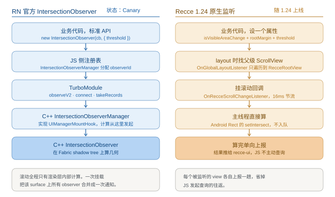
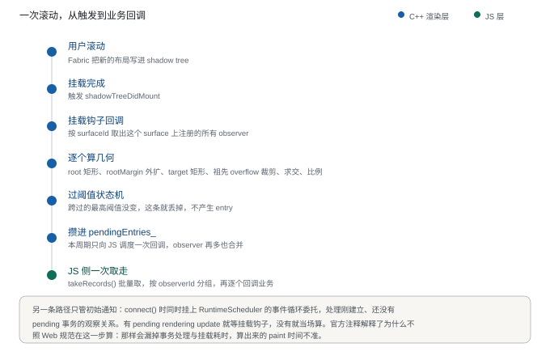
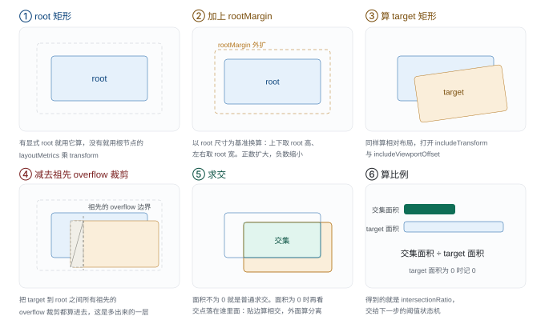
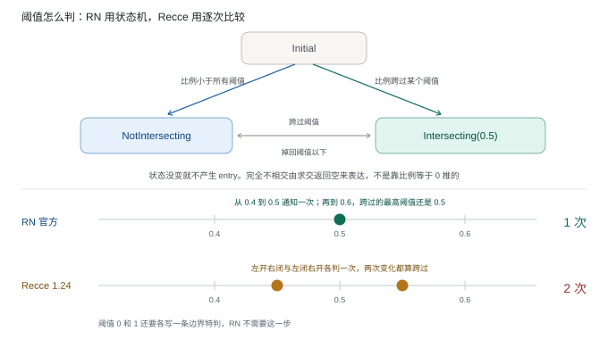
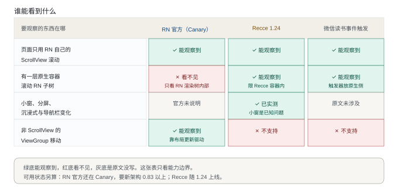
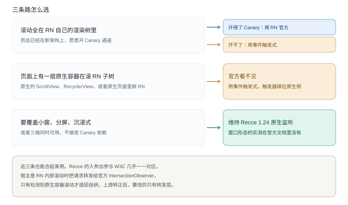

# React Native IntersectionObserver 与 Recce 曝光方案对照

核实日期：2026-10-13

曝光检测要回答的问题只有一个：某个组件当前露出多少。团队现在的做法是 Recce 1.24 的原生监听，React Native 上游在同一时期也把官方的 IntersectionObserver 加进了新架构。这份文档把两边的实现拆开，对照各自的能力边界，给出该用哪个的判断。

对照的三份材料：

- React Native 官方 IntersectionObserver，`main` 分支源码与本机抓取当日（2026-10-13）的 `__docs__/README.md`，以及官方文档站 `reactnative.dev/docs/global-intersectionobserver`。
- Recce 1.24《Recce 1.24 View 的重叠区域变化技术方案》，2026-10-13 读取。
- 微信读书《一种适用于复杂场景下 React Native 组件曝光检测的方案》，tech.weread.qq.com，2021-04-20 发布。

三份材料的版本不齐：RN 是当前 `main` 分支，Recce 是排期中的 1.24 方案，微信读书是 2021 年的第三方库说明。比能力边界时带着这一点看。

## 结论

实现层次上 RN 官方更靠底层。几何计算全部发生在 C++ 渲染层的 shadow tree 上，触发靠 Fabric 的挂载钩子，滚动这一路上不产生任何 JS 与原生之间的往返。Recce 把计算放在 Android 原生 View 坐标上，靠 `onScroll` 触发，算完单向上报。

可用性是另一回事，RN 官方现在还不能直接上生产。文档站仍标注 Canary，需要启用新架构的 RN 0.83 及以上，从 0.83 到 0.87 的发布说明里再也没提过它。

Recce 反过来有官方盖不到的场景。它比的是 Android 窗口与 Recce 容器，小窗、分屏、状态栏与导航栏都做过实测；RN 官方只能观察 RN 自身渲染树内部的滚动，外部原生容器滚动 RN 子树时它看不见。

两边的强弱各落在不同维度，结论要按场景分，见第六节。

## 读之前把几个词说清楚

后面会反复用到这几个词，先给一句白话解释。

| 词 | 指的是什么 |
| --- | --- |
| shadow tree | 新架构下 C++ 侧维护的一份跨平台布局树，和各端真实控件一一对应。滚动位置随 state 更新在这里维护 |
| 挂载钩子（mount hook） | 布局树挂到屏幕这一步的回调入口。RN 把曝光计算挂在这里，Web 是挂在事件循环上 |
| root 与 target | root 是参照区域，一般是屏幕或某个容器；target 是要观察的那个组件。两者相交的面积占 target 的比例就是曝光比例 |
| rootMargin | 把 root 往外扩一圈再看相交。做「提前 100px 就算露头」这类需求用它 |
| threshold | 比例要跨过的门槛。跨过了才通知 |
| isIntersecting | 三份材料里同名不同义，第四节和第五节专门说 |

## 一、RN 官方是怎么做的

### 1.1 从业务代码到几何计算，中间隔了四层

业务侧 `new IntersectionObserver(cb, { threshold })` 拿到的是一个 JS 类。观察关系先记在 JS 侧的 `IntersectionObserverManager` 里并分配 `observerId`，再经 `NativeIntersectionObserver` TurboModule 转成 C++ 调用。TurboModule 只有五个方法：`observeV2`、`unobserveV2`、`connect`、`disconnect`、`takeRecords`。真正干活的是 C++ 的 `IntersectionObserverManager`，它同时实现 `UIManagerMountHook` 与 `RuntimeSchedulerIntersectionObserverDelegate` 两个接口。

`observeV2` 的入参是 `intersectionObserverId`、`rootShadowNode`、`targetShadowNode`、`thresholds`、`rootThresholds`、`rootMargin`。传的是 shadow node 的引用，不是平台的原生 view。

这一点决定了后面所有差异。滚动位置在 Fabric 的 shadow tree 里随 state 更新维护，几何信息因此有一份跨平台、持续最新的来源，iOS 与 Android 共用同一套计算代码。

### 1.2 什么时候算

有两条触发路径。

mount hook 是主路径。`connect()` 里执行 `uiManager.registerMountHook(*this)`，此后每次 shadow tree 挂载完成（`shadowTreeDidMount`）就把该 surface 上注册的所有 observer 全部重算一遍。observer 按 `surfaceId` 分桶存放，一次挂载只需要关心一个 surface。

事件循环步负责初始通知。`connect()` 里同时执行 `runtimeScheduler.setIntersectionObserverDelegate(this)`，`updateIntersectionObservations` 在这个时机处理刚建立、还没有 pending 事务的观察关系：该 surface 有 pending rendering update 就等 mount hook，没有就当场算。

`IntersectionObserverManager.cpp` 的注释解释了为什么不照搬 Web 规范在这一步算：Web 那样做会漏掉事务处理与挂载耗时，算出来的 paint 时间不准。这是 RN 对 Web 规范的有意偏离。

surface 卸载时 `shadowTreeDidUnmount` 会给该 surface 上所有 observer 补一条不相交的通知。

### 1.3 怎么算

核心在 `IntersectionObserver::updateIntersectionObservation`。图 3 把六步一格格画了出来。

root 矩形。有显式 root 时用 `computeRelativeLayoutMetrics` 算，没有就用根节点的 `layoutMetrics` 乘以 transform。

rootMargin。以 root 尺寸为基准换算，上下取高度的百分比、左右取宽度的百分比，再用 `outsetBy` 展开 root 矩形。正数扩大，负数缩小，与 Recce 的处理方向一致。

target 矩形。同样走 `computeRelativeLayoutMetrics`，打开 `includeTransform` 与 `includeViewportOffset`。

裁剪。`getClippedTargetBoundingRect` 打开 `enableOverflowClipping`，把 target 到 root 之间所有祖先的 overflow 裁剪都算进去。这是 RN 比只比两个矩形多出来的一层。

相交。`intersectOrNull` 先做 `Rect::intersect`，再专门处理面积为 0 的情况：检查交点是否同时落在两个矩形内，落在里面算贴边相交，落在外面算分离。这一步决定了「刚好滚出屏幕」到底要不要报。

比例。交集面积除以 target 面积，target 面积为 0 时记 0。

### 1.4 什么时候通知

阈值判定用的不是逐条阈值比较，而是「已跨过的最高阈值」状态机。

状态有三种：`Initial`、`NotIntersecting`、`Intersecting(threshold, rootThreshold)`。`getHighestThresholdCrossed` 取所有小于等于当前比例的阈值里最大的那个，状态没变就不产生 entry。

这个模型顺手解决了 Recce 文档里手工处理的那个问题：阈值 0.5，比例从 0.4 到 0.5 触发一次、从 0.5 到 0.6 又触发一次。在 RN 里后者跨过的最高阈值仍是 0.5，状态没变，不会重复通知。

它也不需要为阈值 0 和 1 写边界特判，因为「完全不相交」由 `intersectOrNull` 返回 `nullopt` 表达，不是靠比例等于 0 推出来的。

通知合并是另一件事。entry 先攒进 `pendingEntries_`，`notifiedIntersectionObservers_` 标志位保证一个事件循环周期内只向 JS 调度一次回调。JS 收到后调 `takeRecords()` 一次性取走全部 entry，按 `intersectionObserverId` 分组，再逐个 observer 回调。一次滚动里无论有多少个 observer，原生到 JS 只走一趟。

### 1.5 交给 JS 的结果

`IntersectionObserverEntry` 暴露 `boundingClientRect`、`intersectionRect`、`intersectionRatio`、`rnRootIntersectionRatio`、`rootBounds`、`isIntersecting`、`target`、`time`。

原生侧只回传 `targetRect`、`rootRect`、`intersectionRect`、`isIntersectingAboveThresholds`、`time` 五项，`DOMRectReadOnly` 与各个比例都在 JS 侧懒计算。

`isIntersecting` 用的是 W3C 语义：target 是否与 root 相交、是否高于阈值。

### 1.6 现状与已知限制

状态是 Canary。官方文档页顶部写着这段 API 目前只在 Canary 与 Experimental 通道提供，需要在应用里启用 Canary 通道。它在 0.83（2025-12-10）随新架构引入，之后 0.84（2026-02-11）、0.85（2026-04-07）、0.86（2026-06-11）、0.87（2026-08-11）的发布说明都没有再提，到 2026-10-13 仍未转正。

原始提交 #37853 的说明里承认了滚动时间戳的延迟：常规渲染先更新 shadow tree 再挂载，时间戳准；state 更新先更新 UI 再更新 shadow tree，上报的时间戳是处理更新的时刻，不是滚动事件本身的时刻。

同一份说明还承认初始通知不可靠。挂载早于观察建立时，初始通知报的是观察时刻而不是首帧时刻。Android 用推送模型下发 mutation，事务在 commit 之后才被消费，这段逻辑被破坏。

观察范围限于 RN 自身的 shadow tree。这一点不在官方限制列表里，是从实现推出来的：外部原生容器滚动 RN 子树时，shadow tree 内的相对布局没有变化，`includeViewportOffset` 也涉及不到外层原生容器，所以观察不到。

`rnRootThreshold` 是 RN 私有扩展，不是标准。

## 二、Recce 1.24 是怎么做的

对外是一个 `isVisibleAreaChange` 属性。入参 `root`、`rootMargin`、`threshold`，出参 `boundingClientRect`、`intersectionRect`、`intersectionRatio`、`isIntersecting`。

触发采用路线二。view 初始化时用 `OnGlobalLayoutListener` 一次性拿到父级 ScrollView 引用，只遍历到 RecceRootView，然后在这些 ScrollView 上注册 `OnRecceScrollChangeListener`，滚动回调里算重叠。代价是要改 RecceScrollView 和 RecceHorizontalView。

被放弃的路线一是直接给 view 挂 `OnGlobalLayoutListener` 加 `OnScrollChangedListener`。实现闭环在单独模块里、改动最小，但嵌在 mrn 或原生页面里时外层容器滚动也会触发，而且同样要改那两个 ScrollView 类。

计算用 Android `Rect` 的 `setIntersect`，文档特别强调必须判返回值。rootMargin 施加到 Rect 上是 left 与 top 做减法、right 与 bottom 做加法。阈值走手工的左开右闭与左闭右开，并对 0 和 1 两个边界单独特判。

性能取舍是：`onScroll` 回调按 16ms 节流、主线程直接算、不用入队也不扔子线程。父级 ScrollView 引用用 `WeakReference` 持有。

窗口形态实测覆盖全屏、沉浸式、隐藏或展示导航栏、小窗、分屏，逐项列出了 `DisplayMetrics` 与 `decorRect` 的差异。小窗模式的两行标记为不符合预期，写进了 TODO。

## 三、原方案调研表（复刻 Recce 文档 §3.1）

原表有合并单元格，下表是按简化版渲染读出的内容。微信读书那一行的「优点」「缺点」在原文档里是合并单元格，本次没有逐字读出，表中的对应内容取自微信读书原文，不是 Recce 文档的表述。

| 方案 | 实现原理 | 优点 | 缺点 | 得分 |
| --- | --- | --- | --- | --- |
| 社区方案 react-native-intersection-observer | native 侧提供 `measure`/`measureInWindow`；recce-ui 侧在 ScrollView 的 `onScroll` 里主动调用 `measureInWindow`，不断计算两个 view 的重叠 | 可参考现有实现，native 只需提供接口，三端改动成本低，主要成本在 recce-ui 侧，后续维护成本低 | native 获取 view 在窗口上的位置是异步的，recce-ui 与 native 的通信开销不可忽视，每次计算至少两次双向通信，频繁滚动下开销猛增 | ★ |
| 微信读书方案（原文表述） | 基于 `measureInWindow` 封装 Intersection Observer API，触发方式为事件触发，触发器可绑在原生侧 | 兼容原生 View 嵌套 RN 子元素、多个 ScrollView 嵌套、自定义触发时机 | 需要业务侧显式发出检测事件；未给出与另两方案的同条件性能对照 | ★★ |
| Recce Native 侧监听 | native 侧主动监听计算，不断对滚动中的 ScrollView 与目标 view 计算，把符合条件的结果返回给 recce-ui | 每次计算完成只需单次单向传递给 recce-ui，性能开销预估低于前两种 | 三端成本较高；计算需要知道当前滚动的是哪个 ScrollView，参数或逻辑变动时三端都要改，维护成本高 | ★★★ |

## 四、逐维度对照

`rootMargin` 与 `threshold` 的名字在三套方案里都能对上，差别在几何来源、触发方式和状态语义。

| 维度 | RN 官方（Canary） | Recce 1.24 原生监听 | 微信读书事件触发 |
| --- | --- | --- | --- |
| 几何来源 | Fabric shadow tree，`computeRelativeLayoutMetrics` 带 transform、viewport offset、overflow 裁剪 | Android View 坐标，`Rect` 与 `setIntersect` | `measureInWindow`，原生窗口坐标 |
| 触发 | Fabric mount hook；初始通知走 RuntimeScheduler 事件循环步 | `onScroll` 按 16ms 节流，加布局完成时的一次注册 | 业务侧主动 `emitEvent`，可绑任意滚动事件 |
| 通信形态 | 一次挂载把该 surface 上所有 observer 合并为一次原生到 JS 通知，JS 侧 `takeRecords` 批量取 | 每个被监听 view 各自单向上报 | 每次 emit 触发该 scope 下所有 observer 的检测 |
| 阈值语义 | 最高已跨阈值状态机，无重复通知，不需要 0/1 特判 | 手工半开半闭，0 与 1 单独特判 | 与上次检测比例比较，越过阈值即回调 |
| `isIntersecting` 含义 | 是否与 root 相交、是否高于阈值（W3C 语义） | 可见面积在增加还是减少 | 是否大于任意一个相交阈值 |
| `rootMargin` | 支持，px 与百分比；百分比上下取 root 高、左右取 root 宽 | 支持，4 个浮点数，只影响 root 虚拟边界 | 支持，`{top,left,bottom,right}` |
| 跨平台 | 一份 C++，各平台共用 | 一份 Android 实现 | JS 库跨平台，原文只给出 Android 的原生触发示例 |
| 原生容器滚动 RN 子树 | 观察不到 | 可观察（限 Recce 容器内） | 可观察，触发器放在原生侧 |
| 小窗 / 分屏 / 状态栏 | 官方文档未单独说明 | 已实测并列出 `decorRect` 差异，小窗是已知问题 | 原文未涉及 |
| 非 ScrollView 的 ViewGroup 移动 | 由 shadow tree 布局更新驱动 | 不支持 | 不支持 |
| 业务代码侵入 | 标准 API，与 Web 同构 | 设置属性 | 业务侧调用 `emitEvent` |
| 可用状态 | Canary，需新架构 RN 0.83 及以上 | 随 Recce 1.24 上线 | 2021 年的第三方库 rn-intersection-observer |
| 维护归属 | React Native 上游 | Recce 三端 | 该库作者 |

## 五、结论核对

Recce 文档 §3.1 的得分排序在两处需要修正，一处需要补充条件。

| Recce 文档的判断 | 是否成立 | 说明 |
| --- | --- | --- |
| 社区方案每次计算至少两次双向通信，频繁滚动下开销猛增 | 成立，但要补前提 | 它基于 `measureInWindow` 主动查询，每次检测确实要一趟 JS 到原生再回来。不过触发频率由调用方 `emitEvent` 控制，配 throttle 与 scope 可以降频，所以「开销猛增」的前提是每次 `onScroll` 都 emit |
| Recce Native 侧监听性能开销最低 | 部分成立 | 「每次计算只需单向上报」成立。但 RN 官方在这点上更省：一次挂载把该 surface 上所有 observer 合并为一次通知，Recce 是每个被监听 view 各自上报。三者缺同设备同场景的实测数据，性能排序目前是推理，不是测量 |
| Recce 的 `isIntersecting` 记为「可见面积在增加/减少」 | 与标准不一致 | W3C 与 RN 官方的 `isIntersecting` 表示是否与 root 相交。同名不同义，将来切到标准 API 会踩坑。建议改名，或在文档里显式声明这是私有语义 |
| 微信读书方案得 ★★ | 依据未在文档中写出 | 该方案的核心是事件触发：原生侧绑触发器，兼容原生嵌套 RN、多 ScrollView 嵌套、自定义触发时机。文中在 OPPO A59m 上测过十余个 view 滚动帧率稳定，但没有与另两方案的同条件对照 |

## 六、分场景建议

场景一：页面只用 RN 自己的 ScrollView，滚动都发生在 RN 渲染树内部，项目已经在新架构上并且愿意开 Canary。用 RN 官方 IntersectionObserver。代码最少，语义与 Web 一致，一份 C++ 实现覆盖各平台，维护在上游。

场景二：RN 页面嵌在原生滚动容器里，由原生的 ScrollView 或 RecyclerView 滚动 RN 子树。RN 官方观察不到，继续用事件触发式，把触发器放在原生侧，用 scope 分组按需触发。

场景三：需要覆盖小窗、分屏、沉浸式，或者必须三端同时可用且不接受 Canary 依赖。维持 Recce 1.24 的原生监听。它的窗口形态实测是官方文档里没有的。

三条路也可以不互斥。Recce 的 `isVisibleAreaChange` 入参与出参和 W3C 几乎一一对应，可以在宿主是 RN 内部滚动时转发给官方 IntersectionObserver，只在检测到原生容器滚动时才退回自研路径。这样上游转正以后，切换成本只落在转发层。

## 七、待核实

- Recce 文档给出的 ★★★ / ★★ / ★ 排序没有附实测数据，缺同设备同场景的三方案对照。
- RN `IntersectionObserver.js` 里 `root` 的 getter 注释仍写着这段属性目前无法配置、`root` 恒为 `null`，但构造函数会把 `options.root` 存下来，`observeV2` 也把它作为 `rootShadowNode` 传给原生。注释与实现不一致，需要确认 `root` 是否真的生效。
- RN 0.87 之后 IntersectionObserver 是否仍停在 Canary，需要按最新 release 分支复核，本节结论只到 2026-10-13 的官方文档与 `main` 分支。
- Recce 文档的小窗模式两行标记为不符合预期，且条目已勾选完成，实际修复方式与验证结果未在文档中说明。
