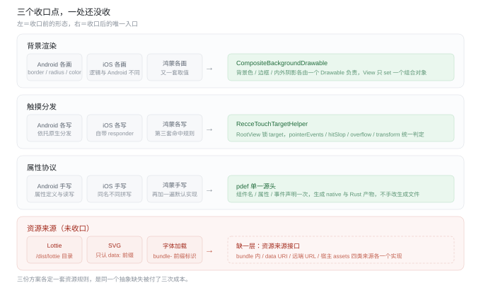
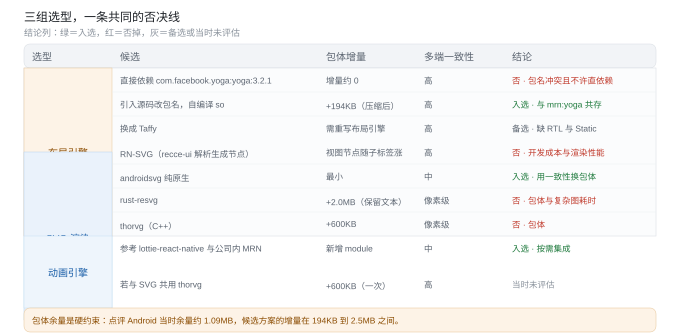
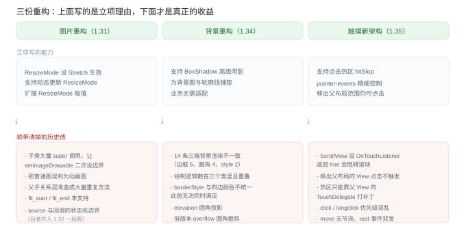
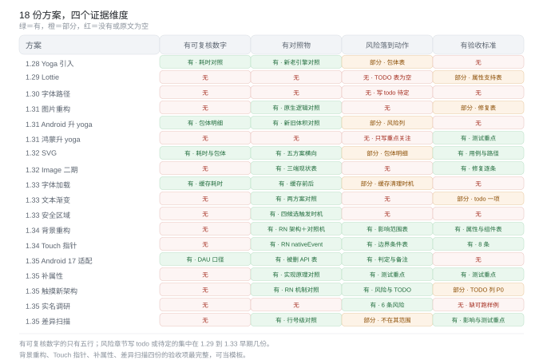
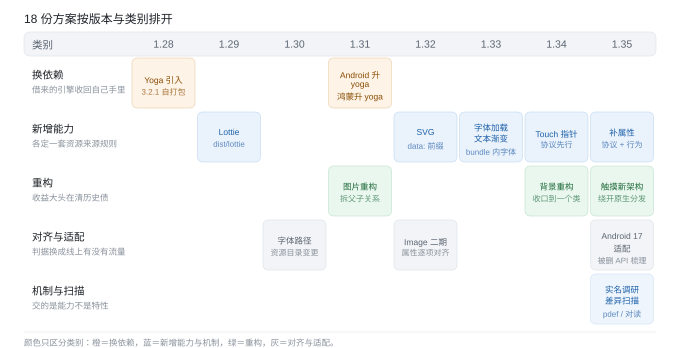
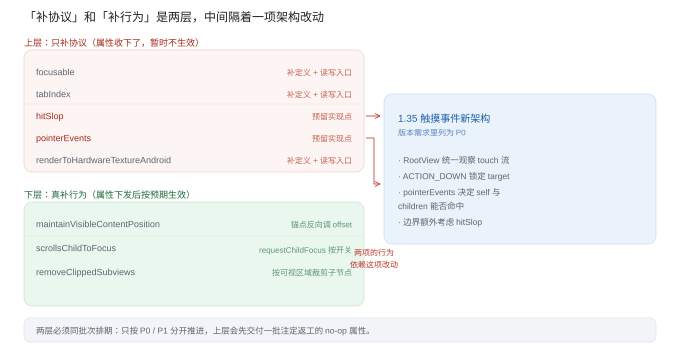
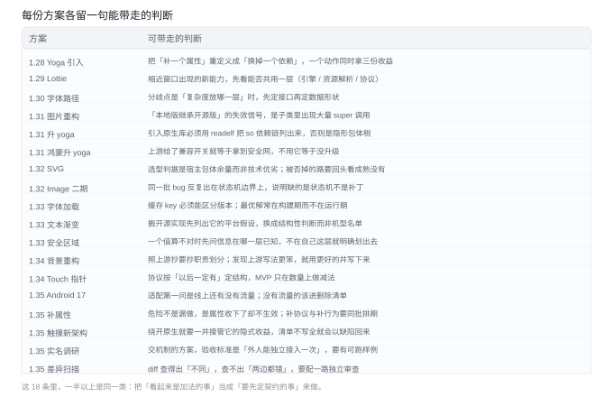

# Recce 1.28–1.35 技术方案复盘（Android 侧）

核实日期：2026-10-13

材料是内网学城《02-Recce Changelog》目录下 v1.28.x 到 v1.35 各版本的子树（读取日期 2026-10-13）。整棵树 234 份文档，本人创建 67 份，按「技术方案」筛出 18 份逐份分析，其余提测报告、自测用例、排查记录见文末附录。

**阅读约定**：数字照抄原文未复算；「更优解」是本文的分析结论，不是文档原文；18 份方案在下文一律用简称指代，对照表如下。

| 版本   | 简称                 | 原文档                                         |
| ---- | ------------------ | ------------------------------------------- |
| 1.28 | **Yoga 引入**        | 《引入 3.2.1 版本 Yoga 需求和方案》                    |
| 1.29 | **Lottie**         | 《Recce 1.29 支持 Lottie 动画》                   |
| 1.30 | **字体路径**           | 《【已上线】【keeta 国际支付】recce-Android 字体路径适配技术方案》 |
| 1.31 | **图片重构**           | 《recce-android 图片逻辑重构方案》                    |
| 1.31 | **Android 升 yoga** | 《Android 升级 yoga 到 3.2.1 版本技术方案》            |
| 1.31 | **鸿蒙升 yoga**       | 《鸿蒙升级 yoga 到 3.2.1 版本技术方案》                  |
| 1.32 | **SVG**            | 《Recce SVG 技术方案》                            |
| 1.32 | **Image 二期**       | 《1.32 Image 缺失能力完善（二期）》                     |
| 1.33 | **字体加载**           | 《1.33 Android 支持字体加载技术方案》                   |
| 1.33 | **文本渐变**           | 《1.33 Android 文本渐变技术方案》                     |
| 1.33 | **安全区域**           | 《Android 安全区域事件回调技术调研》                      |
| 1.34 | **背景重构**           | 《1.34 Android 背景逻辑重构技术方案》                   |
| 1.34 | **Touch 指针**       | 《1.34 Recce Touch 事件回调指针位置支持》               |
| 1.35 | **Android 17 适配**  | 《Android 17 适配》                             |
| 1.35 | **补属性**            | 《Android 补充缺失属性技术方案》                        |
| 1.35 | **触摸新架构**          | 《【已评审】1.35 Recce-Android 触摸事件新架构技术方案》       |
| 1.35 | **实名调研**           | 《Recce x 实名认证方案调研》                          |
| 1.35 | **差异扫描**           | 《Recce 与 React Native Android 组件实现差异扫描》     |

## 一、结论：这八份版本下来，最大的启发是什么

一句话：**1.28 到 1.35 做的主要不是「加功能」，而是「把借来的东西收回来」。** 顺着这句有五条判断，对应的动作放在第四节。

| # | 判断                                  | 证据                                                                                                                                                                                                                          |
| - | ----------------------------------- | --------------------------------------------------------------------------------------------------------------------------------------------------------------------------------------------------------------------------- |
| 1 | 对标的锚点从 MRN 换成 RN，方案性质就从「补能力」变成「消差异」 | 1.28–1.31 方案里的参照物还是 MRN（「MPN 已经有了」「和 MRN 对齐」）；1.32 之后几乎每份方案第一句都变成「对齐 RN」，验收标准从「业务能用」变成「和 RN 逐字段一致」。这是被动接需求转向主动定标准的分界点                                                                                                       |
| 2 | 凡是「多端不一致」，最后都是把差异收口到一处，不是三端各修一遍     | 背景收口到 `CompositeBackgroundDrawable`、触摸收口到 `RecceTouchTargetHelper`、属性协议收口到 pdef 生成，三份重构的共同形态都是「先建唯一入口，再让各端往里填」；反面是 Lottie 的 `/dist/lottie` 路径、SVG 的 `data:` 前缀、字体加载的 bundle 内字体，三份方案各定义了一套「资源从哪来」的规则——同一个抽象缺失，在三份方案里各付了一次成本 |
| 3 | 选型的分水岭永远是宿主 App 的包体余量，不是技术优劣        | 点评当时的 Android 余量约 1.09MB，而候选方案的增量在 194KB 到 2.5MB 之间；Yoga 走自打包 so、SVG 从 resvg 退回原生、thorvg 因 +600KB 落选，三次选型都倒在这条线上                                                                                                            |
| 4 | 重构类方案的收益大头是「清历史债」，立项理由却只写「加能力」      | 图片重构顺带修掉 `ResizeMode` 一串问题与继承链的重复实现；背景重构一次收口 14 条三端不一致；触摸新架构顺手解锁了依赖它的一批点击属性                                                                                                                                                 |
| 5 | 最弱的一环不是技术判断，是证据强度                   | 18 份里能在文档内给出可复核数字的只有 5 份（Yoga 引入的耗时对照、Android 升 yoga 的包体明细、SVG 的耗时与包体、字体加载的缓存耗时、Android 17 适配的 DAU 口径）；多数的「风险」章节写的是 todo 或「待定」，Benchmark 多为单机单次、无对照                                                                         |

## 二、全景

| 类别       | 方案                              | 共同点                          |
| -------- | ------------------------------- | ---------------------------- |
| 换依赖（3）   | Yoga 引入、Android 升 yoga、鸿蒙升 yoga | 借来的引擎要收回自己手里；代价是包体与双引擎共存     |
| 新增能力（5）  | Lottie、SVG、字体加载、文本渐变、Touch 指针   | 每个能力都要先定「资源从哪来、数据长什么样」       |
| 重构（3）    | 图片重构、背景重构、触摸新架构                 | 立项理由写「加能力」，实际收益大头是「清历史债」     |
| 对齐与适配（4） | 字体路径、Image 二期、Android 17、补属性    | 判据从「代码里有」换成「线上有流量」           |
| 机制与扫描（3） | 实名调研、差异扫描、安全区域                  | 交的是机制或边界判断，不是功能，验收标准与功能型方案不同 |

## 三、逐方案复盘

按类别排成五张表。每行的四个内容列分别是：**要解决的问题 → 做法与当时的取舍 → 2026 年视角下更优的解法 → 可带走的启发**（启发列用「启发：」起头）。

### 3.1 换依赖（3 份）

| 方案（版本）                   | 问题                                                                                                                | 做法与取舍                                                                                                                                                                                                                                                                        | 2026 视角：更优解                                                                                                                                                                                                                                      | 可带走的启发                                                                                                                |
| ------------------------ | ----------------------------------------------------------------------------------------------------------------- | ---------------------------------------------------------------------------------------------------------------------------------------------------------------------------------------------------------------------------------------------------------------------------- | ------------------------------------------------------------------------------------------------------------------------------------------------------------------------------------------------------------------------------------------------ | --------------------------------------------------------------------------------------------------------------------- |
| **Yoga 引入**（1.28）        | Recce 不实现布局计算，全部委托从 MRN 借来的 Yoga，版本停在官方 1.18.0。业务要 gap、上游若静默升级无人知会、1.18.0 还有 absolute 元素 `visible: false` 失效的 bug | 开源 Yoga 3.2.1 源码引入 recce-library、包名改 `com.meituan.android.recce.yoga`、自编 so 命名 `recce-yoga.so` 与 `mrn:yoga` 共存；horn 开关 `use_new_yoga` 默认关，特性分支先发特性版验证后合主干。取舍：直接依赖开源组件会与 `mrn:yoga` 包名冲突且公司不允许，只能自建；代价是包体（两份文档口径不一：428KB／168KB 与 489.52KB／194KB）、双 so 共存、开关是静态变量「只有重启 APP 生效」 | ① 版本判断到 2026-10 仍成立：Yoga 最新发布版仍是 3.2.1（2024-12-13），两年无新版，「等上游发新版」当时就不是选项。② 开关应走 Recce 已有的按 bundleName 白名单（后来实际落地就是这样），静态变量把「可回滚」缩水成「可重启回滚」。③ 更根本的是缺升级机制：立项里最值钱的一条是「上游静默升级无人知会」，答案不是换 Taffy（至今仍缺 RTL 与 `Position::Static`），而是把「引擎多久跟一次上游、由谁跟」写成机制 | 启发：把「补一个属性」重定义成「换掉一个依赖」，一个动作同时拿到功能、稳定性和历史 bug 三份收益；代价是验收面变宽，必须配「共存 + 开关 + 对照埋点」，否则「可回滚」只是文档上的一句话。判断这类方案成色，看开关的生效粒度就够了 |
| **Android 升 yoga**（1.31） | 三端统一升级里 Android 侧的落地记录                                                                                            | 两方案对比后选「导源码改包名自建构建」；so 构建放 `ndk_build.gradle` 与 wasai 的 so 同处、产物挪到 library 的 jni 目录；加载走美团 Soloader、时机保持与原先一致；用 readelf 查出新 so 不再依赖 `libc++_shared` 与 `libfd`。风险里写了包体：iOS 压缩前 +150.52KB、Android 压缩前 +489.52KB／压缩后 +194KB                                                      | ① 「用 readelf 查依赖并裁掉多余的 so」是最值钱的动作，值得固化成引入原生库的标准步骤，否则每次引入都静默多带几个 so。② so 加载时机是复制来的不是设计出来的：应收口成一个注册表，每个 so 声明依赖与时机由注册表统一排序，加依赖时不用改调用点。③ 同一版本两份文档包体口径分叉（428KB 与 489.52KB），说明数据没有唯一出处；应共用一份体积清单，写清构建类型、abi、压缩前后，方案只引用不重算                             | 启发：引入第三方原生库，验收项里必须有「so 依赖链」——把实到的 so 列出来；没列过依赖的引入等于默认接受了不可见的包体税。同一个数字在两个文档里不一致时，问题不在数字，在没有唯一出处                        |
| **鸿蒙升 yoga**（1.31）       | 同一次升级的鸿蒙侧落地                                                                                                       | `yoga-rs` 直接升 0.5.3、同步 Yoga 3.2.1 全部改动；`Config` 增加 `YGErrata` 配置以兼容旧行为；wasai 侧把 `text`／`textinput` 的 `Node::get_context` 换成 `get_node_ref_context` 以支持 gap。风险里明确写了「直接升级、并无 AB」                                                                                               | ① 同一次升级，Android 是「双引擎共存 + 开关」，鸿蒙是「直接升级无 AB」，两套风险口径；即使平台不支持共存，也要定义回滚路径（整包回滚／灰度回退）与生效条件。② 拿到了兼容开关却没用：`YGErrata` 可让新版按旧版布局行为跑，文档写「鸿蒙布局架构没有用到」——不能 AB 的端最该用它当安全网。③ 风险只写到「需要重点关注」没落到动作，应翻成必测页面清单、回滚顺序、决策人                                             | 启发：上游给了兼容开关就等于拿到了安全网，不用它等于把升级带来的确定性还回去；平台放量能力越弱，越要靠上游开关兜底。风险描述不落到动作，风险就等于没管                                           |

### 3.2 新增能力（5 份）

| 方案（版本）             | 问题                                                                                                                                                             | 做法与取舍                                                                                                                                                                                                                                                                                                                                                        | 2026 视角：更优解                                                                                                                                                                                                                                                            | 可带走的启发                                                                                                                   |
| ------------------ | -------------------------------------------------------------------------------------------------------------------------------------------------------------- | ------------------------------------------------------------------------------------------------------------------------------------------------------------------------------------------------------------------------------------------------------------------------------------------------------------------------------------------------------------ | ---------------------------------------------------------------------------------------------------------------------------------------------------------------------------------------------------------------------------------------------------------------------- | ------------------------------------------------------------------------------------------------------------------------ |
| **Lottie**（1.29）   | keeta 反馈竞品 talabat 动画表现好，Recce 动画能力有限；外卖在优化首页到提单的黄金链路，动画需求会持续增加                                                                                                | 新增 `recce-lottie` module（按需集成，集成到美团／点评要走新增 module 审批）；思路参考 `lottie-react-native` 与公司内 MRN；实现 ViewManager／View（继承 `LottieView`）／ShadowNode／属性工具类；规定业务动画 json 必须放在 bundle 根的 `dist/lottie` 下，用 `DioBundleUtil` 拼全路径读取。属性支持 8 项、不支持 4 项，其中 3 项有理由（Android 独有、iOS 的 lottie 版本太低），`AutoPlay` 标了未支持但没写理由                                                           | ① 硬编码 `/dist/lottie` 是可以避免的耦合：1.29 就该抽出「Recce 资源解析」一层（本地 bundle／data URI／远端各一个来源实现），后面 1.32 的 SVG 前缀规则、1.33 的 bundle 内字体都是同一层能力，被各写了一遍。② 「表里列了却不做」的项必须写理由，否则后来者分不出「有意不做」和「漏了」。③ Lottie 与 SVG 本可共用引擎（thorvg 两者都支持），两个决策分开做就看不到这个交集                                      | 启发：相近版本窗口内的一批新能力，先看能不能共用一层（引擎／资源解析／属性协议）再逐个决策；按需求逐个立项最容易重复造轮子——Lottie、SVG、字体加载三份方案各定义一套资源来源规则，就是同一个坑踩了三次                 |
| **SVG**（1.32）      | 业务需要 SVG 能力                                                                                                                                                    | 五方案对比（RN-SVG／androidsvg 纯原生／rust-resvg／rust 解析 + native 渲染／thorvg），初选 resvg，最终改原生；source 只支持 `data:image/svg+xml;utf8,` 与 `;base64,` 两种前缀，不支持本地文件与远程图片；recce-ui 的宽高不作用到 SVG 上。取舍：包体是决定项——resvg 保留文本 feature 加 2.0MB、去掉文本 1MB，thorvg +600KB，原生最小；复杂图耗时 thorvg 52ms、native 70ms、resvg >1000ms 且无法稳定加载                                                          | ① 回退原生的结论到 2026-10 仍然成立，但理由该换：thorvg 的 Rust 绑定已发到 0.5.1（2026-08），crate 自己标着「尚未可用于生产」，即「三端像素级一致」两年后仍未成熟。② 真正的缺口不是选型是共同契约：没把「支持的标签／属性白名单 + 逐项三端用例」写下来，「三端不一致」这个被否掉的风险其实原样保留，只是从选型风险变成长期维护风险。③ 同一个 `source` 字段两套规则会让业务困惑，SVG 应走与其它图片相同的 source 解析链，只在拿到字节后分流到不同解码器        | 启发：「像素级一致」和「包体」在移动端常常不可兼得，判据是宿主包体余量而不是技术优劣；选完要留一条「回头看」——当初否掉的那条路现在成熟了没有。成熟了切换成本会从「重新选型」降到「换一个实现」                         |
| **字体加载**（1.33）     | 微贷要三类能力：iconfont、bundle 内字体（业务把字体放进 bundle）、远端 URL 字体                                                                                                          | 远端 URL 判「无需支持」，聚焦 bundle 内字体，来源用 `FontFamily::new("bundle-xxx.ttf")` 显式标识。缓存单独论证：无缓存每次约 10ms、x 个 label 约 10x ms，加缓存后首次约 4ms、之后 0ms。缓存 key 选全路径（固定前缀 + bundleName + version + hash.dio + 路径），否掉字体名为 key（下发新版本后仍用旧字体、跨业务易冲突）与 md5 为 key（每次多一次 IO）；缓存策略 LRU 限数量防 OOM；跨 bundle 共享判不支持                                                                            | ① 这是 18 份里「用实测数据支撑决策」做得最好的一份，10ms／4ms／0ms 三个数字可直接当同类方案的书写模板。② 缓存 key 还有第三档没展开：内容指纹放构建期算（bundle 构建时把每个资源 md5 写进清单，运行期零 IO 直接查），或运行期用「路径 + 文件长度 + 首尾若干字节」做弱指纹。③ 跨 bundle 共享的运行期限制可以在构建期做资源去重解决（同一字体只打进一个公共 bundle）。④ 远端「无需支持」在安全上合理（任意 URL 加载字体是攻击面），但结论该把理由写出来，否则会被反复问起 | 启发：缓存设计只要记住一条——key 必须能区分版本；真正做到最优的往往是构建期（清单里带内容指纹），不在运行期。运行期做不到的事，先想能不能挪到构建期                                             |
| **文本渐变**（1.33）     | 微贷要实现文本渐变，Recce 不支持                                                                                                                                            | 两方案对比后倾向 MaskedView（基于 alpha 通道裁剪，通用性强，渐变内容可以是任意 View／Drawable，但需离屏 layer／bitmap、低版本合成坑多）；TextPaint Shader 更快更简单但只能用于文本。给出 RN `RNCMaskedView` 的 `dispatchDraw` + `DST_IN` 实现与 recce-ui 包装方式。踩坑写得很细：`RecceMaskedView` 只在 `child == getChildAt(0)` 时把 mask bitmap 标脏，小米成立、华为 Mate30 不成立（回调的是更深层的 `RecceTextView`），表现为「子文本变了但 masked view 没刷新」                  | ① 标脏条件应从「是不是第 0 个 child」改成「是不是 mask 视图的后代」（判断包含关系），就与视图层级数无关、不会换机型失效——照搬开源实现的第一件事是找出它依赖的平台假设：第几个 child、回调里是谁、依赖几层。② 「通用性强」在只有一类实际用途时是负收益：业务诉求就是文字颜色渐变，Shader 方案十行以内、无离屏合成、无低版本坑。③ 如果确实要通用能力，应该反过来先让提出方给出第二个用例，有排期才叫通用                                                  | 启发：搬开源实现时先把它的平台假设列出来，把假设换成结构性判断（是不是后代），不要换成机型名单；通用性只有在有第二个用例排期时才是收益，没排期叫过度设计                                             |
| **Touch 指针**（1.34） | 四个 touch 事件 prop（`on_touch_start`／`end`／`move`／`cancel`）回调不携带任何事件数据——`OnTouchStart` 的 Response 是 `()`，`OnTouchMove` 是裸 `String`，微贷因此做不了拖拽、自定义手势、点击涟漪、画板、长按跟随气泡 | 定义 `TouchPoint`（location／page／screen 三组坐标 + identifier、timestamp、force）与 `TouchEventData`（touches／changedTouches），字段命名对齐 RN 的 `nativeEvent`；Rust 侧用强类型结构体替代裸 String，反序列化失败走 `Default` 不 panic；MVP 首期不支持多指；`MotionEvent` 在回调里同步提取、不持有引用（避免被 recycle）；`force` 不支持压感时返回 1.0。验收 8 条，含「200×200dp 的 View 中点点击 `location_x ≈ 100`、误差 ≤ 2dp」「timestamp 单调递增」「三端字段一致」 | ① 这是 18 份里「字段规格 + 边界条件 + 验收标准」三样都齐的唯一一份，可直接当协议类方案的模板。② 协议形态埋了一处返工点：定成数组但 MVP 只有一个元素，多指需求来了要么改协议、要么在数组语义上打补丁——协议应按「以后一定有」的形态定死，MVP 只在「填几个」上做减法。③ `timestamp` 用「相对系统启动的单调时间」而非墙上时钟是对的，不受用户改系统时间影响，可作为同类字段的默认约定                                                           | 启发：协议类改动要按「以后一定有」的形态定数组与结构，MVP 只在「填几个」上做减法，不在结构上做减法。边界条件表（MotionEvent 会被 recycle、force 可能不支持、反序列化可能失败）比字段表更值钱，它决定上线后会不会崩 |

### 3.3 重构（3 份）

| 方案（版本）          | 问题                                                                                                                                                                                                                        | 做法与取舍                                                                                                                                                                                                                                                                                                                                                                                                                                                                                                                                                                                                                                                                 | 2026 视角：更优解                                                                                                                                                                                                                                                                                                                                       | 可带走的启发                                                                                                                  |
| --------------- | ------------------------------------------------------------------------------------------------------------------------------------------------------------------------------------------------------------------------- | --------------------------------------------------------------------------------------------------------------------------------------------------------------------------------------------------------------------------------------------------------------------------------------------------------------------------------------------------------------------------------------------------------------------------------------------------------------------------------------------------------------------------------------------------------------------------------------------------------------------------------------------------------------------- | ------------------------------------------------------------------------------------------------------------------------------------------------------------------------------------------------------------------------------------------------------------------------------------------------------------------------------------------------- | ----------------------------------------------------------------------------------------------------------------------- |
| **图片重构**（1.31）  | `ResizeMode` 设为 `Stretch` 无效、动态更新 `ResizeMode` 无效、`fit_start`／`fit_end` 未支持。根因两层：`RecceRoundImageView` 在 `setImageDrawable` 里把普通图误判为动画图，又用图片原始尺寸覆盖了一遍绘制边界；`MTRecceRoundImageView` 继承前者、子类大量无脑调 `super`，而 `super` 操作的是父类成员 | 认定根因是「父子关系错误」，做重构：解除父子关系、抽出公共基类，美团图片类与开源图片类各自实现；设置 `ResizeMode` 时把图片状态置 `Dirty`；`fit_start`／`fit_end` 与 iOS 沟通后挪到 1.32；给了降级路径。抽公共基类仍保留继承关系，只是把「父子」换成「兄弟」                                                                                                                                                                                                                                                                                                                                                                                                                                                                                                              | ① 更彻底的是改组合：外层包一个持有 `ImageView` + 一组 `Drawable` 的组合对象（1.34 背景重构最后就用了这个形态），抽公共基类只解决「谁调谁」，没解决「子类覆盖父类行为时静默失效」。② `configureBounds` 的坑是「在别人的决策点上二次覆盖」，系统已在 `updateDrawable` 算好边界，更优是不覆盖系统决策、只在需要「动画首帧」时局部处理。③ 这类坑本该被机制兜住：「子类大量 super」是显式信号，而 1.35 差异扫描做的正是同一件事——两份方案是同一问题的两半，却没有互相引用                                                                    | 启发：「本地版继承开源版」这种形态，一旦上游改了内部实现，子类的 `super` 调用就会静默失效，识别标志是子类里出现大量 `super`；修它要把父子关系一起拆掉（改组合），只加 override 治不好                |
| **背景重构**（1.34）  | 三端背景渲染不一致的问题越来越多（UIAutomation 发现）；C 端生活费、月付和收银台要 Recce 支持类 RN BoxShadow 的高级阴影；将来的背景图与轮廓线在现有架构上支持成本很高                                                                                                                      | 把全部背景收口到一个 `CompositeBackgroundDrawable`（内部管 `BackgroundDrawable`／`BorderDrawable`／内外阴影 Drawable），对齐 RN 的 `BackgroundStyleApplicator` 形态，各 ViewManager 只 set 一个组合 Drawable。手法：背景色用 `StateListDrawable` 持正常态与按下态；`borderStyle` 与「四边颜色／宽度不统一」的冲突用 `clipPath` 裁梯形再单独画线（RN 用不规则四边形，代价是 style 失效）；内阴影 Android 10+、外阴影 9+；RTL 下 `borderWidth` 的 left／right 定死不交换；`overflow: hidden` 用 `clipPath`（9 以下离屏 `DST_IN`）；`elevation` 重写 `getOutline` 让投影跟随圆角。测试：三端各一台手机 + 用 RN 写一套相同用例跑第四台，Android 覆盖 6／9／10+ 与小米、三星、华为                                                                                                                                                            | ① 这次「照上游抄」抄得最正：抄的是职责划分不是代码，而且有一处比上游好——文档自己提出边框变更可以用观察者模式让 `CompositeBackgroundDrawable` 通知各 Drawable 刷新，RN 是逐个手动 `invalidate`；「抄得比上游好」的点应该显式写出来，它是自研从跟随变成有主张的地方。② 两处「技术已具备却判暂不实现」可以再收：单边 `borderStyle` 用的就是同一个 `clipPath` 手法，边际成本只剩增量；`borderWidth` 变更时手动 `invalidate` 六处实体，观察者模式能一起解决。③ 测试里的「RN 对照组」最该固化成流程——三端一致只能说明三端内部一致，与 RN 同机对照才能说明「和标准一致」 | 启发：照上游抄要抄「职责划分」不抄「代码」；抄的过程里如果发现上游的做法更笨（手动逐个 `invalidate`），就用更好的写法并写下来。另一个动作：把上游跑成对照组——同一份用例、各一台设备，比「三端各测一遍」高一个证据等级      |
| **触摸新架构**（1.35） | 旧架构依托 Android 原生触摸（找点击范围内最深的 View，向上冒泡到第一个设了 onTouch／onClick 的 View 并返回 true），三条缺点：对原生响应有侵入（`ScrollView` 设 `OnTouchListener` 后返回 true 会阻碍滚动）、移出父布局范围的 View 点击不触发、点击热区只能在父 View 上设 `TouchDelegate`                         | 改成 RN 形态：`RecceRootView` 统一观察 Android touch 流，`ACTION_DOWN` 锁定整段手势的 target，`MOVE`／`UP` 只更新坐标不换目标；`RecceTouchTargetHelper` 从 root 递归 DFS（更深更靠上的 child 优先）；`pointerEvents` 四种取值决定 self／children 能否命中；边界判断考虑 `hitSlop`、`overflow`、`clipChildren`、`transform`（用逆矩阵把触点映射到 child 局部坐标）；Text 这类复合 View 做二次命中；native 统一发 touch 流，click 与 longclick 交给 recce-ui；`ScrollView`／`HScrollView` 只在真正 `onInterceptTouchEvent` 拦截成功后发 `touchcancel`；WebView／Titans 的内部 native child 设为 `pointerEvents=none`。另有两处细节：`move` 按帧回调（`Choreographer.postFrameCallback`，每帧只发最新一次）、以及去重（新架构下 root 的 `onIntercept` 与 `onTouchEvent` 会双发）。新旧共存选「native 加开关 + env 桥加开关 A，统一向业务层发 `on_touch_xxx`」 | ① 这是 18 份里技术含量最高的一份，形态也对：不是抄 RN 的代码，而是在 Recce 里重实现 RN 的命中算法，并补上 RN 没专门管的两处（双发去重、move 按帧节流）。② 接管成本没有列全：多指能力与无障碍影响都被列为 P0 未做，这两件事恰是「绕开原生自己做一套」的必然代价，应显式列一份「接管清单」（多指、无障碍、焦点、TV 遥控方向键）作为必须补的欠账。③ `move` 按帧节流改变了事件语义（业务收到的 move 次数不再等于真实移动次数），应给「是否逐条收取」的开关并写进文档。④ 共存方案选得对：加开关但不新增属性、由 recce-ui 统一向业务发事件，差异收在 native 与 recce-ui 之间，不给业务加心智负担           | 启发：当平台原生能力（Android 触摸分发）和上层期望（RN 的 responder 语义）冲突时，「绕开原生自己做一套」是对的，但代价是要一并接管原生的那些隐式收益（无障碍、多指、焦点）；接管清单不写全，下一轮就会以缺陷的形式补回来 |

### 3.4 对齐与适配（4 份）

| 方案（版本）                  | 问题                                                                                                                                                                                                                                        | 做法与取舍                                                                                                                                                                                                                                                                                                                                                                                                                                                                                                                                                           | 2026 视角：更优解                                                                                                                                                                                                                                                                                                                                               | 可带走的启发                                                                                    |
| ----------------------- | ----------------------------------------------------------------------------------------------------------------------------------------------------------------------------------------------------------------------------------------- | --------------------------------------------------------------------------------------------------------------------------------------------------------------------------------------------------------------------------------------------------------------------------------------------------------------------------------------------------------------------------------------------------------------------------------------------------------------------------------------------------------------------------------------------------------------- | --------------------------------------------------------------------------------------------------------------------------------------------------------------------------------------------------------------------------------------------------------------------------------------------------------------------------------------------------------- | ----------------------------------------------------------------------------------------- |
| **字体路径**（1.30）          | keeta 把字体文件目录从 assets 挪到 res，`fontFamily` 设置失效；短期让 keeta 在 assets 再放一套字体不解决根因                                                                                                                                                             | 给了三个方案（容器传「字体路径 + 名称到资源的映射」／「组装好的排列组合到 Typeface 的 map」／「字体文件到 FontFamily 的 map」），推荐第三个；随后 keeta 把文件名从大写改成小写，参数传递方案又改推第一个。多字体匹配只支持 Android 10 及以上。三个方案的差别其实是「谁负责把业务的字体标识解析成 Typeface」                                                                                                                                                                                                                                                                                                                                                                            | ① 三个方案的分歧点本可以消掉：先定一个 `FontResolver` 接口（res／font、assets、bundle 内、远端各一个实现）再定数据形状，接口稳定后「从哪个目录取」「文件名大小写」都只是实现内部的细节，不需要在容器契约层面再选一次——这就是方案选完紧接着又得选一次的原因；1.33 的字体加载实际做到了这一步，只是晚了三个版本。② 用「多加一层映射」掩盖「命名不统一」是把问题往后推：字体文件名大小写不一致本该在约定层解决（命名规范 + 打包期校验），而不是在加载层再引入一层映射                                                                                                | 启发：当备选方案的分歧点是「把复杂度放在哪一层」时，不要在几份具体数据形状里挑，先定接口再定数据形状；一个方案选完不久又要在同一组选项里再选一次，基本可以判定接口没抽出来     |
| **Image 二期**（1.32）      | 三类：远程图被服务端判为非法源而拦截，需要在请求里补 headers；三端图片属性与 MRN 不对齐；QA 报的图片缺陷分两类，背景边框类归到 1.34 背景重构、图片特有属性类由本方案解决                                                                                                                                           | 新增 `capInsets`、`fadeDuration`、`headers`、`onLoadStart`，`resizeMode` 值域对齐（三端默认值与兜底值此前各不相同）。同时修一批差异：Android 用 state 作 source 会多触发一次 error（加「source 是否初始化过」标志位）、点击把 source 置空串时 Android 不响应（放开限制）、普通图与 SVG 的加载回调代码合并（三个 PR）、`capInsets` 越界不校验（`left + right >= width` 产生灰区，改为直接失效）、Picasso 重绘前会先把 drawable 置空导致闪白（重绘时保存上一张图并启用内存缓存）。属性表逐项标了各端现状                                                                                                                                                                                                                     | ① 这批修复有同一个结构——状态机的边界没覆盖全：source 没设过就报错、source 置空不响应、重绘前先清空、`capInsets` 越界不校验，都是「某个状态下该做什么」没定义，而不是逻辑写错；更优是一开始把 `source`／`style`／回调三者的状态机画出来统一实现（文档里「普通图与 SVG 回调合并」已是朝这个方向收口的第一步）。② Picasso 那条是「绕过库的语义缺失」而不是修 bug：手动保存上一张图 + 手动开内存缓存能跑，但把图片状态管理继续留在自己手里；更优是用支持 placeholder／error 语义的加载器，让「旧图还在」由库保证。③ `capInsets` 的降级规则（越界则整体失效）对外可见，该写进接口约定与属性文档，而不是只写在实现里 | 启发：同一批 bug 反复出现在「状态机边界」上，说明缺的是状态机不是补丁；看到「某条件下不触发／多触发一次」这类缺陷连着来，就该停手先画状态机                  |
| **Android 17 适配**（1.35） | Android 17 于 2026-06-16 正式发布，主要变化是隐私安全强化、后台行为限制与开发规范收紧；美团 App 安卓 17 设备 DAU 约 8000（7 月 1 日数据）。面向 Target37 的适配项本次只需了解、无需适配                                                                                                                  | 梳理被删 API：`android.text.StaticLayout` 旧版多参构造（影响 `RecceSwitchButton` 与 `RecceTextShadowNode`）、`android.widget.TextView.mCursorDrawableRes` 反射被删（影响 `RecceTextInputManager`）。逐项判：label 与 input 早已适配（API 23 以上走 `StaticLayout.Builder`）无需改；SwitchButton 需要修，但线上没有业务使用，跟美团主版本即可                                                                                                                                                                                                                                                                                      | ① 「线上没有业务在用」是本方案的关键判据，该显式固化成规则：要不要适配的依据是「线上有没有流量」，不是「代码里有没有引用」——Recce 里有一批没有流量的历史组件，每次系统升级都要为它们花人力。② 反射 API 被删是确定趋势，该一次改掉而不是加版本判断：`mCursorDrawableRes` 这类私有字段反射应换成语义等价的公开途径（主题属性 `android:textCursorDrawable`）或自绘光标。③ 更彻底的解法是出「删除清单」而不是「适配清单」：对确认无流量的组件（SwitchButton 这类）从 SDK 里摘出去，适配成本直接归零                                                               | 启发：系统版本适配的第一问不是「怎么改」，而是「这段代码线上还有没有流量」；没有流量的引用不该进适配清单，该进删除清单——每次系统升级都给死代码做适配，是维护成本里最不划算的一块 |
| **补属性**（1.35）           | `ScrollView` 缺 `maintainVisibleContentPosition`、`scrollsChildToFocus`；`View` 缺 `removeClippedSubviews`、`needsOffscreenAlphaCompositing`、一组 `nextFocus*`、`focusable`／`tabIndex`、`hitSlop`、`pointerEvents`、`renderToHardwareTextureAndroid` | 分两类处理。**真补行为**：`maintainVisibleContentPosition`（属性设了才懒创建 helper、布局变化时记首个可见锚点、内容插入后按锚点反向调整 offset、接近顶部按阈值自动回顶）、`scrollsChildToFocus`（`requestChildFocus` 里按开关决定是否滚到 focused child，默认 true 保持原行为）、`removeClippedSubviews`（按可视区域裁剪，屏幕外子节点临时 detach）。**只补协议**：`focusable`／`tabIndex`／`hitSlop`／`pointerEvents`／`renderToHardwareTextureAndroid` 只补齐属性定义、二进制读写与 visitor 默认入口，Android 预留实现点、iOS／鸿蒙补空方法。分界本质是「行为依赖别的工作」（`hitSlop`／`pointerEvents` 依赖 1.35 的触摸重构，这正是需求把触摸重构列 P0、属性对齐列 P1 的原因）。注意项：给 `ScrollView` 设 `removeClippedSubviews` 时必须同时给 `scrollContentview` 设 | ① 「先补协议、后补行为」的手法本身是对的，危险在可观测性：属性收下了但不生效，业务会以为已经支持；更优是同时给可观测标记（显式标 no-op、或首次下发时打一条一次性日志），让「没生效」和「没实现」能区分开。② 依赖关系要反过来驱动排期而不是写在备注里：`hitSlop` 依赖触摸重构决定了这两项必须同批排期，否则会先交付一批注定返工的 no-op。③ `removeClippedSubviews` 从 `ScrollView` 专属属性上移为 `View` 通用属性、导入路径变了，这类变更要有迁移说明，否则业务升级后直接编译不过                                                                             | 启发：「补齐属性」真正的危险不是漏做，而是「属性收下了但不生效」；补协议和补行为要显式分开标注，当某个属性的行为依赖另一项架构改动时，两项必须同批次排期              |

### 3.5 机制与扫描（3 份）

| 方案（版本）                                | 问题                                                                                                                                | 做法与取舍                                                                                                                                                                                                                                                                                                                                                                                                                                                    | 2026 视角：更优解                                                                                                                                                                                                                                                                                                                                                                                         | 可带走的启发                                                                                         |
| ------------------------------------- | --------------------------------------------------------------------------------------------------------------------------------- | -------------------------------------------------------------------------------------------------------------------------------------------------------------------------------------------------------------------------------------------------------------------------------------------------------------------------------------------------------------------------------------------------------------------------------------------------------- | --------------------------------------------------------------------------------------------------------------------------------------------------------------------------------------------------------------------------------------------------------------------------------------------------------------------------------------------------------------------------------------------------- | ---------------------------------------------------------------------------------------------- |
| **实名调研**（1.35）                        | 实名认证业务要在 Recce 里做相册网格、图片预览、裁剪等对性能和系统能力要求高的区域                                                                                      | 结论是把「自定义业务 Native View」做成一项能力交付：业务自建组件仓库，走 pdef 声明（组件名、属性、事件、版本 feature）→ 执行 `generate.sh` 生成 native 与 Rust 产物 → 实现 `View`、`ViewManager`、`ShadowNode`、`ViewManagerProvider`、`Plugin` → 暴露 Rust crate（依赖与业务工程一致的 Recce／recce_props 版本）→ 业务仓库依赖并在 `rsx!` 里使用标签。同时划边界：文案、资源位、按钮、弹窗、实验策略放 Recce 侧；相册网格、图片预览、裁剪、复杂手势、高性能列表做 Native View；权限、拍照、上传、OCR、路由、埋点走 Bridge。风险列了协议稳定性、不要把业务流程写死在 Native View、图片不要走 Base64、新增 Native View 名需客户端预置、组件包与 Rust crate 需版本配套 | ① 这是「能力交付型」方案，与前面的「功能交付型」不是一个物种，验收标准也该不同：功能型看「功能对不对」，机制型看「没参与过的人能不能照着独立接入一次」。文档只给了步骤与一个示例仓库链接，缺一个最小可跑样例 + 生成脚本校验（CI 里跑一遍 `generate.sh` 并比对产物），而后者才是机制型交付的成立条件。② 「客户端低版本没有集成 Native View、业务方需要自行做好版控」是最容易出事故的一条：更优是让 Recce 在遇到未注册组件时给出可观测的降级（占位视图 + 上报），而不是把「业务会不会漏判」当成前提。③ pdef 作为唯一协议源头是这个方案里最值钱的设计，把属性、事件、三端产物收口到一处生成，正好回应了「把差异收口到一处」；这一点可以反过来推广到内部组件——新能力优先走 pdef，不手写三端属性                        | 启发：能力交付型方案（交机制）和功能交付型方案（交特性）要分开写；机制型的验收标准是「外部团队能独立接入一次」，所以产出里必须包含可运行样例与生成校验，光有步骤说明不算交付         |
| **差异扫描**（1.35）                        | Recce 的 Android 组件是从 RN 抄来改造的，长期分叉后不知道差在哪                                                                                         | 把 Recce 的 `views` 目录与 RN 的 `views` 目录逐文件对读，只记高置信的 bug 或行为差异（未支持属性、无 RN core 对照的能力不纳入）。得 14 条：ScrollView 5、TextInput 5、Modal 2、Text 1、ViewGroup 1，每条给「Recce 文件:行／RN 对应文件:行／影响／建议」。已修 4 条（`snapToAlignment` 未参与 `flingAndSnap`、纵向 `snapToOffsets=[]` 崩溃、`scrollTo`／`scrollToEnd` 未先 `abortAnimation`、TextInput selection 未 clamp），待修 10 条（含 `maxLength` 追加 `LengthFilter` 数组越界、Modal 生命周期缺失、ViewGroup clipping 缺少焦点与转场保护），并给了修复顺序                          | ① 这套「逐文件对读 + 行号级证据 + 已修／待修状态表」是 18 份里最可复用的工作方法，应该固化成周期任务（例如每个 RN 大版本发布后跑一次），产出形态也固定为「问题—状态—修复后表现—影响范围—测试重点」。② 最关键的自觉是作者主动标注的那一条：`maxLength` 那条注明「RN main 同位置仍能看到类似写法，因此这不是 Recce 相对 RN 的差异，但它是确定崩溃点，建议一起修」——等于说 diff 只能识别「与对照物不同」，识别不了「两边都错」；要覆盖这个盲区，必须配一路不看对照物、只看自身正确性的审查（边界用例、静态分析、fuzz）。③ 待修清单里 Modal 生命周期、ViewGroup clipping 的焦点与转场保护，都属于「绕开原生后接管不全」的欠账，和触摸新架构那份接管清单是同一批东西，应合成一条「补齐原生隐式收益」的主线排期 | 启发：「和上游 diff」是查差异的利器，但盲区是「两边都错的地方看不出来」；差异扫描要配一路不依赖对照物的审查，否则修完一轮，剩下的全是共同错误                      |
| **安全区域**（1.33，排期跟随 1.30 小版本／主版本 1.32） | iOS 已有 `safeAreaDidChange` 事件回调把安全区域值传给 recce-ui，Android 没有；核心问题是 Recce 内核无法判断当前页面是否沉浸式（内容延伸到状态栏），所以 recce 返回的 safeArea-top 一直有高度 | 结论是「Recce 暂不改动，改容器侧」：短期由容器自己维护当前页面的沉浸式状态、自己发事件给业务；长期由容器在 url 里携带安全区域信息（是否沉浸式、top 和 bottom），双端都要改造。实现上列了四个候选（`setOnApplyWindowInsetsListener` 挂 `RecceRootView`／挂 `DecorView`／重写 `onApplyWindowInsets`／在 `CustomGlobalLayoutListener.onGlobalLayout` 里追加 `checkForSafeAreaChanges`、`onAttachedToWindow` 时发），逐个标了「首次加载／旋转／键盘弹出是否触发」的差异                                                                                                                     | ① 这是 18 份里「边界划得最清醒」的一份：没有在错误的层硬凑，而是把「内核不知道沉浸式」这个信息缺口直接写成结论，把方案推回容器侧。② 长期方案用 url 传参会把会变的瞬时状态做成一次性快照：沉浸式是一个会变的状态（页面切换、旋转、键盘），url 传参只适合初始化一次的静态信息；更优是把沉浸式状态作为「可查询属性 + 变化事件」由容器暴露给 Recce，形式与 iOS 已有的 `safeAreaDidChange` 一致，也就顺手把双端语义对齐了。③ 四个候选的取舍标准该从「触发时机全不全」扩到「每帧成本」：`onGlobalLayout` 覆盖面最全但每次布局变化都执行，方案里用「与上次值比对后再发」方向对，更优是明确只在 insets 变化时计算                                                        | 启发：一个值算不对时，先问「这个信息在哪一层是已知的」，答案不在自己这层就明确划出去，不要在错误的层叠补丁；传参方式要匹配信息的生命周期——一次性信息走 url，会变的状态走属性 + 事件 |

## 四、该改的六件事

| # | 改什么                     | 为什么                                                              | 怎么做                                                       |
| - | ----------------------- | ---------------------------------------------------------------- | --------------------------------------------------------- |
| 1 | 把「资源从哪来」抽成一层            | Lottie、SVG、bundle 内字体三份方案各自定义路径或前缀规则，是同一个抽象缺失被付了三次成本             | 定一个资源来源接口（bundle／data URI／远端／宿主 assets），新能力只注册来源，不再发明路径约定 |
| 2 | 给所有包体相关的方案建一份共享的体积清单    | Yoga 的体积在两个文档里出现 428KB 与 489.52KB 两个口径，本身就是「没有唯一出处」的证据           | 清单写清测法（构建类型、abi、压缩前后），方案里只引用不重算                           |
| 3 | 把「上游当对照组」写进验收标准         | 背景重构已经做到了（三端各一台 + RN 写同一份用例跑第四台），其余方案没有                          | 凡是「对齐 RN／对齐上游」的方案，验收项里加一条同机对照                             |
| 4 | 差异扫描改成周期任务，并配一路不看对照物的审查 | 逐文件对读只查得出「不同」，查不出「两边都错」（`maxLength` 那条已证明）                       | 每个 RN 大版本发布后跑一轮 diff，再跑一遍纯边界用例与静态分析，两条独立结论合并才收口           |
| 5 | 重构类方案把「清债」写进立项收益        | 立项只写「支持 BoxShadow」「支持 hitSlop」时，这类方案在评审中很难拿到优先级，而三份重构的实际收益大头都在清债 | 立项页里把「顺带修掉的历史问题清单」与能力目标并列                                 |
| 6 | 交付前给数字配「对照物」            | 18 份里只有 5 份有可复核数字；多年后判断对错说不清，多半不是选错了，而是没留下可复核的对照                 | 把「对照物是谁、在什么设备上、测几次」写进文档——这条不需要额外交付成本                      |

## 五、待核实

| 事项         | 说明                                                                                                                |
| ---------- | ----------------------------------------------------------------------------------------------------------------- |
| 数字全部照抄原文   | 18 份方案引用的数字未复算；Yoga 包体存在两个口径（428.52KB 与 489.52KB），本文沿用原文各自写法，未做取舍                                                 |
| 「更优解」的性质   | 是分析结论不是原文内容。其中两条外部事实已核实：Yoga 最新发布版仍是 3.2.1（2024-12-13）；thorvg 的 Rust 绑定 2026 年已发到 0.5.1 但自述尚不可生产。其余属工程取舍分析，没有实测支撑 |
| 部分表格有截断    | 1.32 Image 二期与 1.35 补属性两份文档里，部分属性表来自折叠块，简化版 Markdown 有截断，本文只引用能完整读到的部分                                            |
| 落地状态未确认    | 触摸新架构文档标注「已评审」，落地情况未在本次材料中体现；补属性方案里「只补协议」那批属性的实际生效状态，需按上线后的版本复核                                                   |
| 未纳入分析的同批材料 | 提测报告、自测用例、上下线记录、问题排查见附录；其中排查类文档里可能还有可提炼的技术判断，未逐份展开                                                                |

## 附录：同期的落单与排查记录（非方案类）

这些是同一批子树里由本人创建、但不属于「技术方案」形态的文档，按版本列出备查。

| 版本   | 类别      | 文档                                                                                                                                                                              |
| ---- | ------- | ------------------------------------------------------------------------------------------------------------------------------------------------------------------------------- |
| 1.28 | 提测      | Recce 1.28 提测报告（已完成）                                                                                                                                                            |
| 1.30 | 排查与自测   | 红米 K80（Hyper OS）默认字体与降级兜底字体样式不一致排查；小米部分机型文字字重设置 N700 失效；外卖前置组件某些情况下未触发 appear 排查；字体路径适配自测用例；Recce-鸿蒙布局计算迁移自测与问题修复；Android 初始化逻辑梳理（暂停）                                           |
| 1.31 | 排查与上线   | recce-Android 图片加载异常陡增排查（含修复用例）；Recce UNB Android unsubscribe 失效排查；10-29 Neo 外卖预热 crash（进行中）；鸿蒙点评 11.51.0 上线 recce 1.30（yoga 升级）；鸿蒙点评 11.55.0 上线 recce 1.30（host 新架构，含两条缺陷单与自测） |
| 1.32 | 排查与升级记录 | 前置组件 update_view_failed；点评×外卖三端 SDK 升级 1.30→1.32；美团 12.59.400 版本 SDK 升级 1.30→1.32；骑手 SDK 升级 1.26→1.32（待定）                                                                       |
| 1.33 | 排查      | Android ScrollView 拖拽事件非稳定触发（含《Recce-Android 点击事件原理分析》）；图片加载时序问题排查；Lottie 体积增大加载耗时增长原因排查；Recce W13 update_view_failed 异常排查；1.33 提测报告（已完成）                                       |
| 1.34 | 需求与排查   | Recce 1.34 版本需求；1.34 Image 图片属性能力增强需求；Recce Touch 事件回调指针位置支持需求（已并入 Touch 指针）；Recce 初始化问题；1.34 提测报告（待提测）                                                                         |
| 1.35 | 需求与提测   | Recce 1.35 版本需求；前置收银台优惠数字被隐藏问题排查；1.34 提测报告副本（待提测）；1.35 提测报告（测试中）                                                                                                                |

同批只属于 1.35 树的、由其他同学创建的技术方案（组件属性对齐 RN 0.86 的七份专表、iOS SVG 渲染内存优化、Xcode 27 适配等）不在本文范围内。
