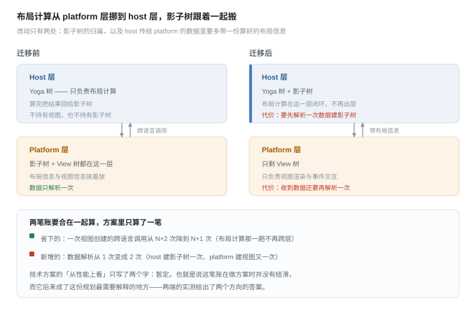
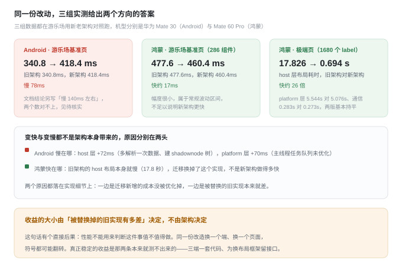
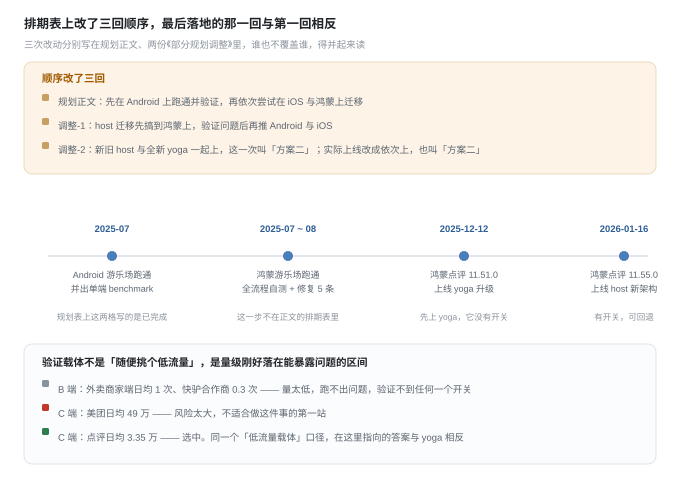
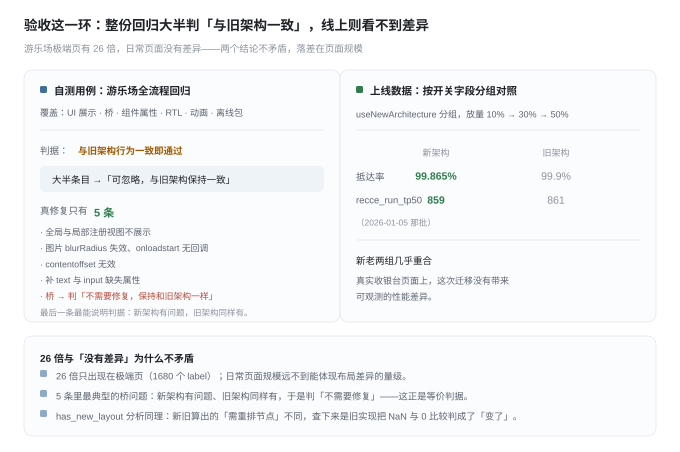
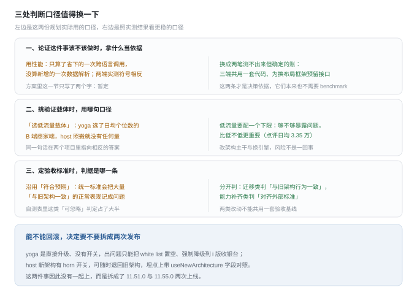

# Recce-Host 布局逻辑迁移复盘

核实日期：2026-10-13。材料通过学城 CLI 直读原文核对，未引用二手转述。这条线 2025-07 规划，2025-12 与 2026-01 完成两次上线，本文按上线结果回看规划。

## 写在开头：这次最值得记的是什么

上一份复盘讲「怎么把范围划清楚」，这份讲另一半：**怎么判断一个没有当下痛点的改造值不值得做。**

《Recce-Host 布局逻辑迁移规划》给了四条理由，性能排第一——跨语言调用从 N+2 次降到 N+1 次。这是四条里唯一可测的。实测两端给出相反的答案：Android 从 340.8ms 变 418.4ms（慢了），鸿蒙极端页 host 布局从 17.826s 降到 0.694s（快约 26 倍）。两端的成因都不在架构——一边是新增成本没结清（多解析一次数据建影子树 +72ms、主线程队列未优化 +70ms），一边是被替换的旧实现本来就慢。

> 用性能论证这类改造，等于把结论交给「被替换掉的旧实现有多差」这个偶然变量。

换一个端、换一个页面，符号都可能翻转。规划真正兑现的是那两条本来就测不出来的——三端共用一套布局计算代码，为将来换布局框架（taffy 这类）预留接口。**它们不需要 benchmark，也不该用 benchmark 来论证。**

另一条更实操：**能不能回滚，决定要不要拆成两次发布。** yoga 直接升级、没有开关，出问题只能把 white list 置空强制降级；host 新架构有 horn 开关，随时可退。两件事因此拆成鸿蒙点评 11.51.0（yoga）与 11.55.0（host）两次上线。

## 一张表看完

| 问题 | 这份规划给出的答案 |
| --- | --- |
| 这事该不该做 | 四条理由三条不可测；唯一可测的性能，两端实测符号相反 |
| 真正的收益在哪 | 三端共用一套布局计算代码、为换布局框架留接口——都不需要 benchmark |
| 怎么上线 | 拆两次：没开关的先上（yoga），有开关的后上（host） |
| 选哪个端做验证 | 不是越低越好，量级要够暴露问题——最终选点评（日均 3.35 万） |
| 怎么验收 | 与旧架构行为一致，不是「符合理想」 |

## 词表

| 词 | 意思 |
| --- | --- |
| host 层 / platform 层 | Recce 把渲染拆两层：host 层（Rust）跑布局计算，platform 层是各端原生侧，负责真实视图与事件 |
| 影子树（shadownode 树） | 连接 Yoga 树与真实视图的中间层，维护布局相关信息；它归谁，就是这次迁移的核心 |
| 跨语言调用 | host 层与 platform 层之间的数据传递，是这份规划给性能定的标尺 |
| useNewArchitecture | 新老架构的埋点字段与开关标识，1 走新架构、0 走旧架构；改开关要杀 App 重启才生效 |
| 等价验收 | 迁移类改动的判据是「与旧实现行为一致」，而不是「符合理想效果」 |

## 一、这是一件什么事：为未来铺路的改造

Recce 的布局计算是 Yoga，架构是三棵树：View 树（platform 层的真实视图）、影子树（platform 层，维护布局信息并与 host 通信）、Yoga 树（host 层，负责最终布局计算）。要动的，就是影子树的位置。

规划给了四条理由，**只有一条可测**：

| 理由 | 具体内容 | 能不能测 |
| --- | --- | --- |
| 业务 | 现有 Flex 够用，但将来有框架或业务方要 CSS Grid 时 Yoga 不支持，会「处于比较被动尴尬的局面」；迁移是为低成本甚至无缝替换布局框架 | 未来向，测不了 |
| 性能 | 省一次跨语言调用（视图创建从 N+2 次降到 N+1 次） | 能测——实测两端符号相反 |
| 人力 | 三端共用一套布局计算代码 | 测不了 |
| 架构 | platform 层只留渲染与交互、host 层布局计算闭环，两头都能低成本换 | 测不了 |

行业对照也列了：React Native 用 Yoga 只支持 Flex；Dioxus 用 taffy，Flex 与 Grid 都支持，但 Flex 样式集不支持 RTL；clay 也只支持 Flex。**「迁移是为了能换 taffy」这条因果链在前面那份 Yoga 复盘里也有**——Yoga 方案里否掉「换成 Taffy」时写的原话，就是「这个事情可以等到布局计算迁移之后」。

## 二、方案：改动两处，代价一处

技术方案把改动收敛成两条：树结构上，影子树从 platform 层挪到 host 层；数据传递上，host 传给 platform 的数据要额外带上算好的布局信息。

代价藏在一句细节里，方案自己写了，但没和收益放在一起算：

| 账 | 内容 |
| --- | --- |
| 省下的 | 视图创建的跨语言调用从 N+2 次降到 N+1 次（布局计算那趟不再跨层） |
| 新增的 | 数据解析从 1 次变成 2 次（host 建影子树解析一次、platform 建视图又解析一次） |

方案里「从性能上看」这一节只写了两个字：**暂定**。也就是说，做方案时这笔账并没有结清——省下的一次调用写进了正文，新增的一次解析写进了方案细节，两笔从未合在一起算。它后来成了这份规划最需要解释的地方。

风险列了三条：三端兼容性方案设计困难（鸿蒙已做一版，统一数据传输棘手）、删除节点这类细节麻烦（platform 层强依赖影子树，而影子树搬走了）、布局框架切换的接口设计繁重。

## 三、实测：Android 慢了，鸿蒙快了 26 倍

三组数据都在游乐场用新老架构对照跑，同一个开关切换、同一份 bundle。

| 场景 | 旧架构 | 新架构 | 差 | 差在哪 |
| --- | --- | --- | --- | --- |
| Android 基准页（启动到第一帧） | 340.8ms | 418.4ms | 慢 78ms | host 层 +72ms（多解析一次数据、建 shadownode），platform 层 +70ms（主线程任务队列未优化） |
| 鸿蒙基准页（286 个组件） | 477.6ms | 460.4ms | 快约 17ms | 常规波动区间，不足以说明新架构更快 |
| 鸿蒙极端页（1680 个 label）的 host 布局耗时 | 17.826s | 0.694s | 快约 26 倍 | platform 层与通信两版持平（5.544s / 5.076s、0.283s / 0.273s），差距全在 host 那一项 |

Android 的两项相加 142ms，正是文档结论「慢了 140ms 左右」的来源；但同一份文档第一张表算出的差值是 78ms，两张表口径没对齐（见待核实）。

鸿蒙极端页那份还拆了 platform 层：json 解析稳定在 0.8 秒左右、操作视图不稳定、动画平均 1.5 秒——这些新旧一样，迁移碰不到。**快出来的 17 秒不是新架构省出来的，是旧架构那一版 host 布局实现太慢。**

## 四、三个执行决定：顺序、载体、开关

**顺序改了三回。**

| 出处 | 主张 |
| --- | --- |
| 规划正文 | 先在 Android 上跑通并验证，再依次尝试 iOS 与鸿蒙 |
| 《部分规划调整-1》 | host 迁移先搞到鸿蒙上，验证问题后再推 Android 与 iOS |
| 《部分规划调整-2》 | 新旧 host 与全新 yoga 一起上，这一次叫「方案二」 |

而实际上线是**依次上**的，两份上线记录里同样把「依次上」称为方案二。同一个编号在两处指代相反（见待核实）。

**载体是量级挑出来的，不是「挑个低流量」这么简单。** 《部分规划调整-2》把候选 App 的日均量级列成了表：

| App | 日均量级 | 判断 |
| --- | --- | --- |
| 美团 | 49 万 | C 端量太大，风险高，不适合第一站 |
| 外卖 | 8.8 万 | 同上 |
| 点评 | 3.35 万 | **选中** |
| 外卖商家端 | 1 | B 端量太低，跑不出问题、验证不到 |
| 快驴合作商 | 0.3 | 同上 |
| 小象 / 骑手 / 众包 | 未知 / 未上线 | — |

原话是「B 端 app 量级太低了，没法验证，C 端诸如美团和外卖量级较大，不太适合」。**这与 Yoga 上线选外卖商家端 B 端的口径正好相反**——那边只换布局引擎、风险低，量越小越安全；这边改的是架构主干、需要能暴露问题，量太小等于没验证。同一句「选低流量载体」，在两个项目里指向相反的答案。

**开关决定了发布粒度。**

| 改动 | 开关 | 出问题怎么办 |
| --- | --- | --- |
| yoga 升级 | 无 | white list 置空，强制降级到 i 版收银台 |
| host 新架构 | horn 开关 | 随时退回旧架构 |

上线记录据此算过一笔风险账：yoga 升级「页面不可用的概率最大预估为 0.01%，出问题到修复问题的时间最长预估为 8 天」，对应约 64 单。另有两条工程约定：新旧 host 不合入主分支（保主分支稳定性），两个开关都要杀 App 重启才生效。

## 五、验收：判据是「与旧架构一致」

迁移类改动的验收基线是**行为等价**。自测用例整份是游乐场全流程回归（UI 展示、桥、组件属性、RTL、动画、离线包），而大量条目的结论写的是「可忽略，与旧架构保持一致」——纵向滚动的最大值不对、点击返回会退出、某属性无变化，只要旧架构也一样，就不算问题。真正的修复只有 5 条：

| 问题 | 处置 |
| --- | --- |
| 全局注册视图与局部注册视图不展示 | 修复 |
| 图片 blurRadius 失效，onloadstart 无回调 | 修复 |
| contentoffset 无效 | 修复 |
| 补 text 与 input 缺失属性 | 修复 |
| 桥问题 | **不需要修复，保持和旧架构一样** |

最后一条最能说明这套判据：新架构发现问题，旧架构同样如此，于是判「不需要修复」。这与前面那份复盘里「对齐的是 RN 的语义而非实现细节」是两种验收——**那是对齐外部标准，这是保持自身一致，两类改动不能共用一套判据**。迁移类改动若按理想效果逐条判，上面那一大批「保持一致」的正常表现都会被记成问题。

**has_new_layout 分析**是这套判据下一个很典型的例子：新旧架构对同一份页面算出「哪些节点需要重排」的结论不同，旧架构多出一个节点（第 365 号 RawText）。作者逐节点比对两份变更列表，定位到旧架构里该节点的 `cur_layout_height` 是 NaN、`last_layout_height` 是 0，比较结果为假于是判成了「变化了」。**这是旧实现的判断缺陷被迁移过程暴露出来的**，不是新架构的错。

上线数据方面，两次上线的放量节奏都是 10% → 30% → 50% 递进，埋点按 `useNewArchitecture` 分组对照。以 host 新架构那批为例，新老两组几乎重合：

| 日期 | 指标 | 新架构 | 旧架构 |
| --- | --- | --- | --- |
| 2026-01-05 | 抵达率 | 99.865% | 99.9% |
| 2026-01-05 | recce_run_tp50 | 859 | 861 |

**真实收银台页面上，这次迁移没有带来可观测的性能差异**——这正与游乐场极端页的 26 倍形成对照：日常页面的规模远不到能体现布局差异的量级。

## 六、可以带走的五条

1. **理论收益要减掉新增成本才是净收益。** 省一次跨语言调用是收益，多一次数据解析是成本，两笔要在同一张账上算。方案把第一笔写进正文、第二笔写进方案细节、性能一节写「暂定」，这是最容易漏掉的地方。
2. **用性能论证架构改造之前，先问对照组是哪个实现。** 收益大小取决于被替换的旧实现有多差，换一个端就会翻转。真正稳的决策依据是那些测不出来的：代码复用、架构自由度。
3. **「选低流量载体」要配一个下限。** 够不够暴露问题，比低不低更重要。改引擎可以选日均个位数的 B 端，改架构主干就不行。
4. **能不能回滚，决定要不要拆开发布。** 有开关的改动可以带着风险上，没开关的改动就得单独安排、留出更长的观察期。这次两件事因此被拆成两次上线。
5. **迁移类改动的验收基线是「等价」，不是「更好」。** 能力补齐是对齐外部标准（RN 的语义），迁移是保持自身一致（与旧架构行为相同）。判据混用会把大量「和旧架构一样」的正常表现记成缺陷。

## 七、还差的与待核实

| 事项 | 问题 |
| --- | --- |
| Android 差值三个口径 | 结论写「慢了 140ms 左右」（＝host +72ms 与 platform +70ms 之和），启动耗时表算出 78ms（340.8 对 418.4），点击按钮到上屏那张表算出 121ms（401 对 522）；三个数没有说明分别对应哪组数据 |
| 数据质量的通病 | `recce_run_tp999` 在 8191、16383、32767、60408 之间跳，属样本不足的典型表现，无样本量说明（与 Yoga 上线数据同一个问题）；两份上线记录里「结论：」后面都是空的，业务侧指标 host 这次没有对应结论 |
| 副本没有声明正本 | 两份同名近似的规划正文逐节相同、只有排期表不同，读者无法从文档本身判断该看哪份；《布局计算迁移 Benchmark》与《安卓游乐场新旧架构 - benchmark 测试》内容重叠，同样是两份 |
| 排期表状态没回填 | 现行版最后一格停在「5. 鸿蒙上线验证 进行中」，而实际上线分别在 2025-12 与 2026-01 完成；「调研 host 层闭环文本布局计算的可行性」与「尝试在 Android 上进行 taffy 布局计算框架替换」两格始终是「待开始」，都没有结论或触发条件 |
| 「方案二」指代相反 | 《部分规划调整-2》里方案二＝两件事一起上，两份上线记录里方案二＝两件事依次上；直接引用编号会读错 |
| 「三端统一复用」只落地一端 | 规划的首要目标含三端统一复用，实际完成的上线是鸿蒙点评，Android 与 iOS 侧的迁移复用没有找到对应记录 |

## 附：读了什么

| 材料 | 说明 |
| --- | --- |
| **规划两份同源副本** | 《Recce-Host 布局逻辑迁移规划》（2025-07-29 建，挂《03-Host》树下，同日后未再更新）与《Recce 布局逻辑迁移规划》（2025-01-14 建、2025-12-24 末次编辑）。两份正文逐节相同，只有第 5 节排期表不同——后者更新更晚，是现行版。读这份材料必须同时看两份，否则会拿 7 月的进度当现状 |
| **它的 6 份子文档** | 《Recce-Host 布局计算逻辑技术方案》（**技术方案**）、《部分规划调整-1》《部分规划调整-2》（**调整-1 / 调整-2**）、《关于新旧架构使用不同 has_new_layout 方法结果分析》（**has_new_layout 分析**）、《安卓游乐场新旧架构 - benchmark 测试》与《鸿蒙游乐场新旧架构 - benchmark 测试》（**Android / 鸿蒙 benchmark**）；另有一份内容完全相同的《布局计算迁移 Benchmark》独立文档 |
| **外围印证** | 《Recce-鸿蒙布局计算迁移 自测用例和问题修复》（**自测用例**）、《鸿蒙点评 11.51.0 上线 recce 1.30 版本【yoga 升级】(已完成)》与《鸿蒙点评 11.55.0 上线 recce 1.30 版本【host 新架构】（已完成）》（**两次上线记录**） |
