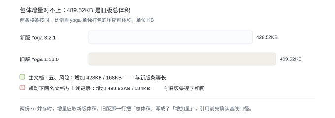

# Recce Yoga 3.2.1 升级方案复盘

核实日期：2026-10-13

2025 年上半年 Recce 把布局计算引擎从"借用 MRN 的 Yoga 1.18.0"换成"自己打包 Yoga 3.2.1 并与旧引擎并存"。这份文档复盘那次升级的方案设计，回答两件事：当时的判断哪些站得住、哪些证据不足；同一类"换掉外部依赖"的升级下次该怎么做。

复盘对象是主文档与它唯一的子文档，加上上游的规划、选型调研和两份 bug 排查。为方便行文，下文用简称指代：

| 材料 | 下文简称 | 时间 |
| --- | --- | --- |
| 《引入3.2.1版本 Yoga 需求和方案》（挂在《Recce 1.28 版本需求》下） | **主文档** | 创建 2025-03-13，最后编辑 2025-03-25 |
| 《Recce 布局计算引擎(Yoga)升级 - B端上线》 | **上线记录** | 创建 2025-07-03，数据写到 2025-08-04 |
| 《Recce 渲染能力补齐规划》 | **补齐规划** | 创建 2024-12-02，最后编辑 2025-07-07 |
| 《Yoga 引入方案调研》 | **选型调研** | 2024-12-19 |
| 《引入3.2.1版本 Yoga 需求和方案》（挂在《Recce 渲染能力补齐规划》下） | **规划下同名文档** | 2025-02-20 |
| 《Recce - RN Changelog 同步机制》 | **Changelog 同步机制** | 2025-03-12 |
| 《Android 元素 absolute 定位无法隐藏问题排查》 | **absolute 隐藏排查** | — |
| 《【已解决】Android 的 Display:None 和 Absolute 定位同时使用时，会让 UI 布局变慢》 | **display:none 变慢排查** | — |

以上材料均为内网文档，外部无法复核。**本文所有数字照抄自文档原文，未做复算**；放量与验收数据取自上线记录第 5 节。

## 结论

1. **方案的主干判断成立，而且值钱。** 它没有把这件事写成"补 4 个布局属性"，而是写成"换掉借来的依赖"，于是一个动作同时解决了功能（gap）、稳定性（MRN 静默升级无人知会）和既有 bug（1.18.0 的 absolute 隐藏失效）三件事。这个重定义的层级值得作为同类升级的范式。
2. **双引擎共存是低成本拿到对照组的做法，但"可降级"这个承诺从未验证。** 所有埋点带 `use_new_yoga` 维度，不需要实验平台就能按人群对比；可代价是回滚成了这套方案的核心承诺——而回滚本身没有演练过，也没写生效时机。
3. **短板全在验收的证据强度上。** 异常率差了约 14 倍却判定"与新 yoga 无关"；业务指标差异小于对照组自身的日间波动却写成"略好"；升级理由里那条性能问题根本没进验收项。结论方向不错，但支撑结论的证据不足以让第三方复核。

## 一、背景与问题

起点很窄。补齐规划里，Recce 对标 RN 的属性支持度统计为：通用布局 93%（52/56）、通用阴影 0%（0/4）、ScrollView 44%（27/61）、Image 48%（24/50）、View 48%（46/94）、Label 46%（31/69）、Input 53%（41/67）。通用布局只缺 4 个——`paddingHorizontal`、`gap`、`rowGap`、`columnGap`，其中 gap 系列是 keeta 与前置组件近期要用的，定为 P0。

但这件事做不了，因为属性不在自己手里。Recce 不实现布局计算，全部委托外部 Yoga，而这份 Yoga 是从 MRN 组件借来的，版本停在官方 1.18.0。补属性必须换引擎。

换引擎这个动作顺带绑上了另外两条诉求：

- **隐性耦合**：Recce 依赖 MRN 的 Yoga，MRN 若升级 Yoga 而没周知 Recce 做测试，很可能造成线上问题。原文写的是"很大安全隐患"。
- **已知 bug**：absolute 隐藏排查记录 1.18.0 上元素带 `Position::Absolute` 后 `visible: false` 失效（黑色块无法隐藏），1.18.0 及以下复现、3.2.1 正常。

三条诉求合并成一个动作，这是这份方案在需求侧成立的根本原因。

## 二、方案回顾

### 2.1 决策链

### 2.2 选型

候选三条，取舍依据来自选型调研与补齐规划的 yoga 引入一节，两份文档给的表一致：

| 方案 | 优点 | 缺点 | 结论 |
| --- | --- | --- | --- |
| Yoga 作为新增组件引入 | 未列 | 新增组件需要经过平台审批，引入成本较高 | 否 |
| Yoga 融合到 Recce 已有组件中 | 不需要新增组件，引入成本适中 | 未列 | **选中** |
| Yoga 替换为 Taffy | Benchmark 显示深树/超深树上更高效 | CSS 能力集不完善（不支持 RTL、不支持 `Position::Static`）；迁移成本高 | 长期备选 |

选型调研里还有一张更细的四框架对照（Yoga / Taffy / Blink / Stylo），比的是工程规模（18W+ / 19W+ / 20W+ / 10W+ 行）、issue 数量（641 / 236 / 10000+ / 15）和近两年有 commit 的核心维护者数（18 / 29 / 88 / 27）。这张表支持了"Yoga 与 Taffy 在核心属性上持平、Taffy 属性值更多但缺 RTL 与 Static"的判断，但最终决策还是落在引入成本上，不是技术能力上。

选"融合进已有组件"这个方案自带一个代价，文档写得很清楚：**两份 Yoga so 必须共存**，而 `com.facebook.yoga` 与 `mrn:yoga` 的包名相同，因此编译时必须把包名改成 `com.meituan.android.recce.yoga`，产物重命名为 `recce-yoga.so`。

### 2.3 落地步骤

Android 是唯一写全的一端（主文档与规划下同名文档内容一致）：

1. 编译 Yoga 3.2.1 得 so，改包名、改名 `recce-yoga.so`。
2. so 引入取"方案一"：脚本拉 `recce-yoga` 仓库 → 取编译生成的未剥符号中间产物 so → 挪进 `recce-library` 的 jni 目录 → 删掉本地临时仓库。理由是更新成本低、源码不驻留项目目录；代价是每次构建要重新拉取编译。
3. jar 以 java 源码方式并入 `recce-library`，参考 `mrn:yoga` 里的 java 类。
4. 开关：horn 下发开关，默认 false。

iOS 与 harmony 在主文档里是空章节（只有标题）。上线记录补了包体：iOS 压缩前 +150.52KB、压缩后 +34KB；harmony 压缩前 +1047KB，因 harmony 无包体管控所以列为无风险。**三端各自的实现差异没有沉淀**，后续如果 iOS 或 harmony 要单独改动，没有可参照的记录。

### 2.4 上线与放量

- 跟随 1.28 单拉特性分支 `feature/recce-89059528/yoga_3.2.1_integration` 发一个小版本，该版本相比 1.28 只多出 yoga 升级 + gap 支持，稳定后再合主分支。原话的理由是"希望 Recce 具备 Gap 布局能力"与便于回滚。
- 验证 APP 选的是 C/Keeta 之外的外卖商家端（7.16）。诉求一栏写明原因是"C/Keeta 对稳定性和性能要求都很高，不太好做实验"。原计划的众包、骑手被划线删除，**没记录原因**。
- 按 uuid 阶梯放量：6.30 的 1% → 7.3 的 30% → 7.8 的 50% → 7.16 的 80% → 7.21 全量。
- 观测三类：Recce 内核性能与异常、支付订单转化率、业务客诉。

## 三、文档之间的口径对照

这一节把同一件事在不同文档里的不同说法列出来，引用前先核。

### 3.1 Android 包体增量（三处说法，至少一处错）

| 出处 | 压缩前 | 压缩后 |
| --- | --- | --- |
| 主文档 · 五、风险 | 增加 428KB | 增加 168KB |
| 同一份文档 · 包体情况表（新版本 yoga） | 总体积 428.52KB（so 348 + java 80.52） | 168.4KB（so 131.8 + java 36.6） |
| 同一份文档 · 包体情况表（老版本 yoga） | 总体积 489.52KB（so 409 + java 80.52） | 194KB（so 157.4 + java 36.6） |
| 规划下同名文档 · 五、风险 与 上线记录 · 2.三端版本号 | 增加 489.52KB | 增加 194KB |

读法：489.52 / 194 与老版本 yoga 的总体积逐字相同，写成"增加"疑似把总体积当成了增量。既然两份 so 并存，增量应取新版体积，即 428 / 168。三个数字里至少有一处错，引用前必须确认基线（相对不含 Yoga 的包？统计了哪些架构？）。

### 3.2 降级开关的实现

| 出处 | 存储方式 | 生效粒度 | 生效时机 |
| --- | --- | --- | --- |
| 主文档 | 静态变量 | 未写 | "只有重启 APP 生效" |
| 规划下同名文档 | context 上下文 | "可以针对不同的包名进行放量" | 未写 |
| 上线记录 | horn 按 bundleName 白名单 | 按 APP 包名 | 未写 |

三处描述不同，最终落地是第三行。主文档那份是最旧的一版，评审时容易读到。

### 3.3 其它口径

| 项 | 说法 A | 说法 B | 说明 |
| --- | --- | --- | --- |
| RN 基线 | Changelog 同步机制：Platform 层实现对标 0.63.x | 补齐规划与 Changelog 同步机制的 TODO：对齐 RN 0.72.0（鸿蒙能支持的最新版） | 不冲突，前者是现状基线、后者是对齐目标，但文档里没有一句话点明区别 |
| Yoga 版本 | 补齐规划与选型调研：3.1.0 或以上 | 主文档与规划下同名文档：3.2.1 | 最终定 3.2.1，上游那份 3.1.0 的口径没有回改 |
| 同名文档 | 规划下同名文档（挂补齐规划下，2025-02-20 创建，含 so 引入方案对比与 armeabi 包体排查，内容更全） | 主文档（挂 1.28 需求下，2025-03-13 创建，无 so 方案对比，TODO 为空白表） | 标题完全相同、内容已分叉 |

## 四、结论核对

| 原判断（出处） | 是否成立 | 更正或补充 |
| --- | --- | --- |
| "耗时上没有明显差距"（主文档 四、benchmark） | 方向成立，证据偏薄 | 老组 5 次 14/13/15/15/14ms、均值 14.2ms，新组 5 次 16/13/16/12/12ms、均值 13.8ms。差异 0.4ms 小于样本内极差（13–16ms），所以结论方向是对的。但只写了机型（华为 Mate 30）与环境（benchmark bundle 走本地代理、游乐场 App 为本地 debug 编译包），没写测量方法、重复次数、中位数与波动范围，第三方无法复核 |
| "Android 无新类型异常…与新 yoga 无关"（上线记录 5.2 / 5.3） | **不成立** | 同一份文档 7.3 那行给出的异常率是：老 0.0032%、新 0.044%，约 14 倍；同期 iOS 从 0.14% 降到 0.08%。"异常类型集合没有新增"推不出"与 yoga 无关"——新 yoga 的布局结果完全可能让 `subview_empty` 更容易触发。文档自己在 5.3 标了"需判断是否影响业务流程 @杜冬旭"，未闭环 |
| "50% 放量情况下，无太大波动，且随着时间的推移 新 Yoga 业务指标反而略好"（上线记录 5.2） | **过度解读** | 新老差异在 0.03–0.41pp（7.11–7.14 android 组：-0.03 / +0.41 / +0.20 / +0.27pp），而同期老组自身的日间波动就有 0.61pp（93.2409 → 93.0501 → 93.6649 → 93.3183）。差异小于对照组自身波动，且无样本量与置信区间，应写成"未见可归因差异" |
| 业务转化率两列可以纵向对比 | 待核实 | 7.11–7.14 是「业务订单转化率 ~93.x% / 确认支付转化率 ~95.x%」，7.15 起两列相对大小整体翻转（业务 95.9 / 确认 93.3）。疑似列错位或口径变更，这段不可直接纵向比 |
| "一旦出现异常，enable 字段设置为 false 即可回滚到旧版本 yoga"（上线记录 4） | **未验证** | 全文没有写回滚的生效时机与生效时长，也没有做过一次回滚演练。"可降级"是这份方案的核心承诺——静态变量那版甚至写明"只有重启 APP 生效"——恰恰没验 |
| "仍然需要依赖 mrn:yoga，但后续会逐步解除对 mrn:yoga 的依赖"（主文档 二、诉求 3） | 无退出条件 | 没有定义"稳定"的标准、时长与跟进人，TODO 表里也没有这一条。双份 so + 开关是要还的技术债 |
| 升级能修掉 display:none + absolute 的布局变慢 | 未验 | 上线记录背景把它列为升级理由之一（原文"已经严重影响Recce部分功能的性能"），但验收项只有 tti、抵达率、异常率、转化率，没有一项针对该场景。该 bug 直到 display:none 变慢排查才以"Recce Native1.32 更新 Yoga"单独闭环 |

## 五、可复用的做法与下次的改法

### 5.1 这次做对的

1. **问题重定义的层级。** 不写"补 4 个属性"，写"依赖形态"。把上游的不确定性（MRN 随时可能升 Yoga）纳入设计目标，后面所有风险都因此被提前处理，而不是等出事再补。
2. **双引擎共存即对照组。** 所有埋点带 `use_new_yoga`，不需要实验平台就能按人群对比；灰度单位是 uuid，与放量节奏天然对齐。
3. **不可逆动作后置。** 先并存、稳定后再解绑；发版走单拉特性分支而非合主分支。两处都把"回不去了"这一步往后推，回滚边界干净。
4. **选小流量 B 端验证再谈合入。** 承认了 C 端不能做实验这个约束。值得补一句的是：这也意味着整轮验证的性质是"低风险验证"而非"统计验证"，这个定性应该写进结论。

### 5.2 同类「换外部依赖」的升级，按这五条改

1. **把"为什么要升"逐条映射成验收项。** 升级理由有几条就该有几条对照，否则只验了"没变差"、没验"变好了"。这次 gap 是新增能力、absolute 隐藏是修复 bug，两条都能测，都没进验收。
2. **异常率差异先做归因再下结论。** 判定"与本次变更无关"至少需要一处对照：按机型 / OS / bundle / 版本的新老分布对比，或把差异样本逐单追查。只在"异常类型集合"上比较是不够的。
3. **指标差异先跟对照组自身的日间波动比。** 差异幅度小于对照组自身极差时，结论只能写"未见可归因差异"，不写方向性判断。
4. **上线前做一次真实回滚演练，并给出回滚生效时长。** 用本次已有的 `use_new_yoga` 埋点量出"下发 false 后该维度归零的耗时分布"，把"回滚生效时间"本身列为验收项。
5. **给"解除旧依赖"设一个带日期的退出条件。** 例如"全量后 N 周无 P1，且旧 Yoga 代码路径调用量归零"。缺了这条，双份 so 会一直留在包里。

### 5.3 放量表要按样本量反推

上线记录 6.30 那行自己写着："iOS App 当前灰度 1%（Android 看不到），叠加 Yoga 灰度 1% 基本没量了，这样收数据太慢了，也看不出问题，下午计划先放到 30%……Recce 指标个位级 PV，性能数据无法参考。"

叠加灰度必然稀释样本，这一步应该在设计放量表时就用目标指标的最小可检出差异反推，而不是先放量再看够不够。本次因为 Recce 指标只有个位级 PV，最终仍然属于低风险验证，"业务指标稳定"这句话的强度有限——这个定性建议直接写进结论，免得被后来的人当作 A/B 结论引用。

## 六、待核实

- **Android 异常率的构成。** 老 0.0032% → 新 0.044% 的差异没有解释。上线记录 5.3 提到"同一个人有 3 个异常，三个订单号"，这 3 个样本未追到底；`subview_empty` 在新老侧的机型 / OS / bundle 分布也未做对比。
- **业务转化率两列是否错位。** 7.15 前后相对大小整体翻转，需要回到 SQL 定义核对，确认是列错位还是口径变更。
- **放量表的重复行与两套值。** 上线记录 5.2 表格自 7.22 起双端各出现两行重复数据（`use_new_yoga` 的 0/1 各出现两次），且同日出现两套 tp 值（android 的 tp50 为 97 与 399/400 两组，iOS 为 40 与 300 附近）。双端同时发生，与 yoga 无关，但口径切换原因不明，表里无注释。
- **armeabi 下的 so 包体优化疑问未闭环。** 规划下同名文档标红写着"最终打进 aar 中的 libyoga_recce.so 文件，在 armeabi 架构下的包体优化程度不如 libwasai_platfrom.so 明显"，表里给的是本地 jni 2.3MB、本地构建 aar 2.3MB、hpx 构建 aar（未开 so 优化）2.2MB、（开启 so 优化）2.2MB；对照 libwasai_platform.so 是 44.7MB → 2.9MB。后续文档没写这个问题是否解决。
- **规划表的时间口径。** 补齐规划的规划表把"单独引入 yoga(3.2.1 版本)"标在 1 月完成，而 1.28 需求文档 3 月创建、放量到 7 月才走完。不清楚"完成"指的是开发完成还是上线完成。
- **主文档的未回填项。** "六、TODO"是空白表；"五、风险"里 iOS 与 harmony 的数字仍是"？"，而上线记录与规划下同名文档已经有数。
- **测试账号密码明文入表。** 上线记录的集成测试计划表里写了测试账号与密码，内网文档也建议改走平台或密码管理。
- **候选验证 APP 被删除的原因。** 众包、骑手在测试计划表里被划线，未记录原因。
