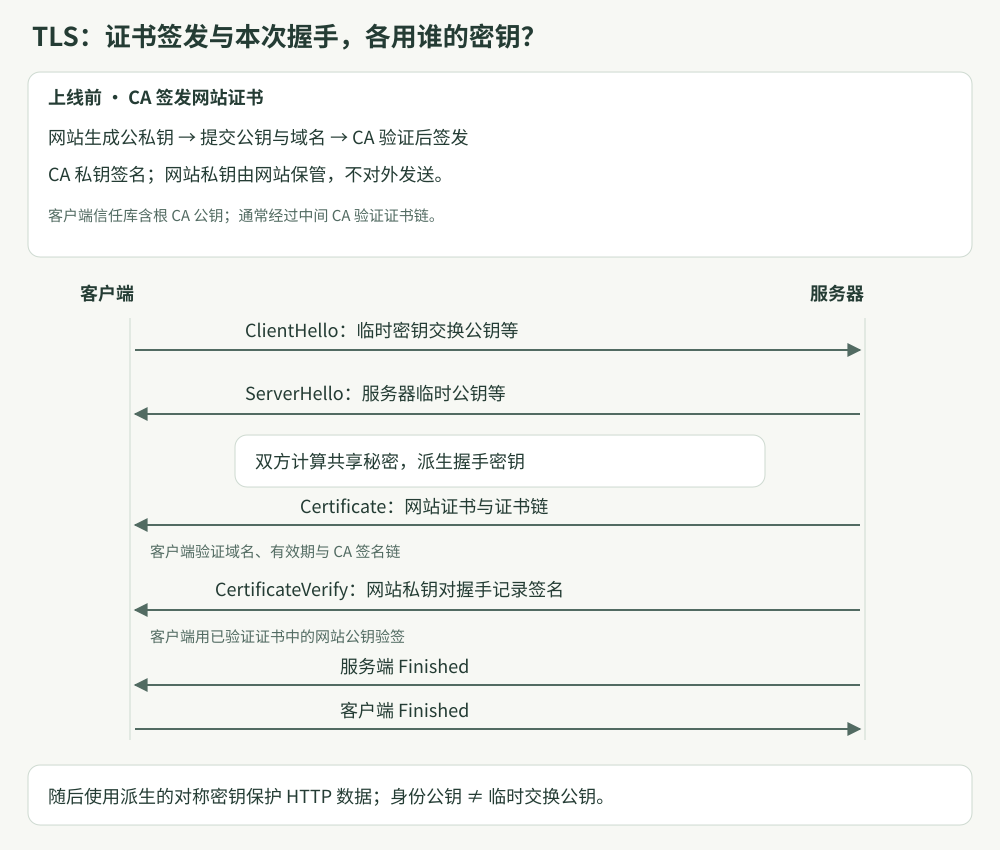
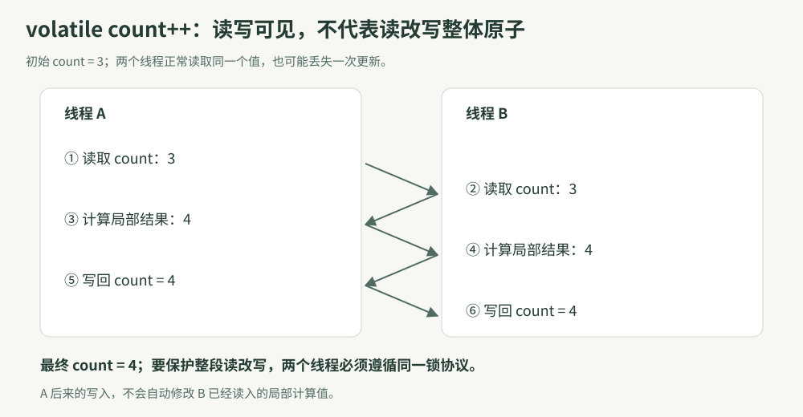

# 2026-10-14 计算机基础摸底复盘

> 场景：DeepSeek 笔试与小红书面试准备。小红书面试为 2026-10-29 19:00–21:00。
> 依据：当日口头问答、追问与下列一手规范。核对日期：2026-10-14。
> 本文记录个人训练表现与机制纠错；讲解后答对不代表已独立掌握。示例不等于本人项目的实测记录。

## 结论：优先补并发，其次补 TLS 与内存模型

能围绕实际 Android 开发解释问题，具备网络、线程、引用链和局部性的基础。主要问题是相邻概念混淆、边界条件不够明确。下一轮优先复述机制并分析反例，不增加大量新名词。

| 主题 | 首次回答表现 | 核心纠正 | 本轮结束状态 |
|---|---|---|---|
| HTTPS／TLS | 主链路基本正确；认证、公钥用途混淆 | 签名验证不等于解密证书；区分 CA、公钥认证与临时密钥交换 | 经讲解理解，需脱稿复测 |
| 线程与异常 | 知道共享内存、独立栈与寄存器；进程退出归因于主线程重要 | 运行时的异常处理策略可终止进程，Android 子线程也可能触发 | 能判断 Android 示例及 try-catch 控制流 |
| 栈堆与泄漏 | 能指出长生命周期持有 Activity；按对象大小划分栈堆 | 按职责而非大小区分；可达性与业务生命周期不同 | 引用链理解较好，工具操作与修复证据待验证 |
| 内部类 | 能识别匿名监听器持有外部实例，提出静态类修复 | 实例关联、private 访问权限、实际引用链要分开 | 主动提供 JLS，需补静态上下文及显式持有的边界 |
| volatile／锁 | 知道结果可能不足两万，但误称 volatile 保证复合原子性 | 可见性与原子性分开；所有线程必须使用同一把锁 | 能判断不同实例锁不能保护同一 static 数据 |
| 数组／链表 | 能从连续布局、空间局部性和缓存层次解释 | 补缓存行、预取与指针依赖，避免绝对化 | 本轮相对扎实，尚无性能实测 |

口头分数仅为辅导估计，追问次数和提示不同，不用它们计算平均分或预测通过率。

## 一、HTTPS 与 TLS：谁签名、谁验证、用谁的密钥

### 问题与纠错

- 新建基于 TCP 的 HTTPS 连接：DNS 获得地址 → TCP 握手 → TLS 握手 → 客户端发送 HTTP 请求 → 服务端响应 → 客户端处理。基于 QUIC 的 HTTP/3 不套用该 TCP 流程。
- 已有满足目标要求的可复用连接时，通常无需重新 DNS 查询、TCP 握手与完整 TLS 握手。
- HTTP/1.1 也支持持久连接；HTTP/2 的多路复用不能称为“HTTPS 2.0”。HTTP/2 连接复用见 [RFC 9113 §9.1](https://www.rfc-editor.org/rfc/rfc9113.html#section-9.1)。
- 证书是公开信息；验证签名不等于“用公钥解密证书”。



### 机制：先建立身份信任，再证明私钥持有

1. 网站方生成网站公私钥；CA 按签发规则完成身份／域名控制权验证，用 CA 私钥签发包含网站公钥、域名、有效期等信息的证书。网站私钥不交给客户端。
2. 服务端在握手中出示证书链。客户端校验目标域名、有效期、签名与证书链等，将信任追溯到本地信任库中的信任锚；不是预存每个网站的证书。
3. 在常见的证书认证 TLS 1.3 完整握手中，服务端用网站私钥对握手上下文和记录摘要生成 CertificateVerify 签名。客户端用已经验证的网站证书公钥验签，确认对端持有相应私钥，并把身份与本次握手绑定。
4. 临时密钥交换公钥负责密钥协商，与证书身份公钥职责不同。双方利用临时私钥与对方临时公钥计算共享秘密，再派生握手及应用数据密钥；业务数据使用对称加密保护。

以上密钥分工按 [RFC 8446 §2、§4.4.3、§7](https://www.rfc-editor.org/rfc/rfc8446.html#section-2) 与 [RFC 5280 §4、§6](https://www.rfc-editor.org/rfc/rfc5280.html#section-6)核对。图为采用临时 (EC)DHE 的证书认证简化路径；未展开 PSK 恢复、客户端证书认证或 0-RTT。TLS 1.3 不能无条件概括为“所有连接都使用 ECDHE”。

### 面试追问与答法

| 追问 | 应答要点 |
|---|---|
| 验证证书上的 CA 签名用谁的公钥？ | 对应签发 CA 的公钥，并验证证书链到受信任的根／信任锚。 |
| 验证服务器握手签名用谁的公钥？ | 已校验的网站证书中的公钥。 |
| 复制真证书能冒充网站吗？ | 不能；证书可能通过验证，但没有网站私钥就无法生成本次握手的有效身份签名。 |
| DNS 被篡改会怎样？ | 客户端仍按原目标域名验证身份；在攻击者无相应有效证书／私钥且校验正常的前提下，认证不能通过。 |

## 二、线程、进程与异常传播

### 首次回答的准确部分

同一进程线程共享地址空间、堆、全局状态与进程级资源；各线程保有执行上下文、栈与程序计数位置。共享不等于允许无同步并发修改，也不表示所有访问必须使用互斥锁。

### 需要改正的因果解释

“主线程负责 UI，所以它一崩进程必崩”没有解释终止机制。Android 普通应用中，异常若传播至默认未捕获异常处理器，运行时会执行进程终止逻辑，工作线程也能触发。核对的固定版本为 Android 15 的 RuntimeInit：commonInit 安装 KillApplicationHandler，其 uncaughtException 的 finally 包含 Process.killProcess 与 System.exit。[AOSP Android 15 源码](https://android.googlesource.com/platform/frameworks/base/+/refs/tags/android-15.0.0_r1/core/java/com/android/internal/os/RuntimeInit.java)

边界：不能把 Android 的默认策略泛化为所有 Java 程序；线程正常结束也不等于进程退出。线程池、协程或任务框架可能先捕获异常；自定义处理器、Native 致命信号是不同路径，应分别分析。

### 已回答正确的控制流追问

```java
try {
    stepA(); // 在这里抛出匹配的异常
    stepB();
} catch (Exception e) {
    handle(e); // 假设正常返回
}
stepC();
```

stepB 不执行，stepC 执行。捕获异常不会返回出错位置重新执行；异常不匹配则继续向外传播。若处理器再次抛异常或有其他异常控制流，结论需另判。[JLS 21 §14.20.1](https://docs.oracle.com/javase/specs/jls/se21/html/jls-14.html#jls-14.20.1)

## 三、栈、堆、可达性与 Activity 泄漏

### 纠正内存模型

栈堆不按“小对象／大对象”划分。按 JVM 逻辑模型：线程栈保存调用帧，帧中有局部变量与操作数栈；共享堆用于类实例和数组。局部引用可以在帧中，对象的引用字段则随所属对象位于堆中。实际编译与运行时可以优化，不能把逻辑模型当固定物理布局。[JVMS 21 §2.5–§2.6](https://docs.oracle.com/javase/specs/jvms/se21/html/jvms-2.html#jvms-2.5)

### 为什么有 GC 仍会泄漏

业务不再需要的对象，仍可能通过 GC Root 强可达。Activity 的 onDestroy 是生命周期事件，不等于对象已经不可达。问题常是引用关系保留，而非“GC 算法没有把应回收对象回收”。

示例：静态字段 → 单例管理器 → 监听器 → Activity。若监听器在 Activity 结束后仍被单例保留，就可能阻止回收。

### 修复与定位

1. 根据业务生效范围成对注册／注销监听，移除回调、清理不必要的强引用；不能把所有注销机械放到同一回调。
2. 静态嵌套类没有隐含的外部实例关联，但若显式保存 Activity，泄漏仍可能存在。
3. 弱引用不会单独阻止回收，但不能保证“下一次 GC 一定释放”，也不能消除其他强引用或无效监听器积累。[WeakReference API](https://docs.oracle.com/javase/8/docs/api/java/lang/ref/WeakReference.html)
4. 重复进入退出页面、采集 Heap Dump，检查已销毁 Activity 的到 GC Root 引用路径，再修复并复测。这里查的是引用链，不是方法调用链。[Android Heap Dump 文档](https://developer.android.com/studio/profile/capture-heap-dump)

本轮能说出定位工具方向，但未实际展示 Heap Dump、引用链或项目修复前后证据；这些仍待验证。

## 四、内部类：语言关联、访问权限、运行时持有分开判断

这部分由用户主动补充 JLS 7 原文，核对后并入本报告。

- 在非静态上下文中，内部类实例可以关联外部实例；静态上下文声明的局部／匿名类没有这种词法外部实例。不要说“所有匿名类都必然持有 Activity”。[JLS 7 §8.1.3](https://docs.oracle.com/javase/specs/jls/se7/html/jls-8.html#jls-8.1.3)
- private 访问权限允许同一顶级类主体中的相关代码访问私有成员；这解释了静态嵌套类也有访问权限，但不替它提供外部实例。[JLS 7 §6.6.1](https://docs.oracle.com/javase/specs/jls/se7/html/jls-6.html#jls-6.6.1)
- 访问外部实例字段仍需具体实例；“外部实例”不是继承中的“父类”。

```java
class Outer {
    private int value = 10;
    class Inner {
        int read() { return value; } // 使用关联的 Outer 实例
    }
    static class Nested {
        int read(Outer outer) {
            return outer.value; // 有访问权限，实例通过参数提供
        }
    }
}
```

Nested 的方法参数本身不等于它长期保存了 outer。语言语义中的外部实例关联，也不应不加版本条件地断言为某个固定合成字段；实际泄漏以编译产物和 Heap Dump 的持有关系为准。

## 五、volatile、原子性和同一把锁

### 原始误区

首次结论“不一定两万”正确，但理由中说“volatile 保证原子性”，又将丢失更新当成未加 volatile 才出现的问题。这是本轮最需要复习的概念混淆。

volatile 读写提供相应可见性和顺序保证，但 count++ 是读、计算、写回的复合操作，整体不是原子的。



即使两次读取都正确读到当时的 3，线程 A、B 仍可以分别算出 4 并写回，最终只增加一次。A 后来写回不自动修改 B 已经读入的局部计算结果。

### 正确的锁保护

```java
class Counter {
    private static int count = 0;
    private static final Object LOCK = new Object();

    static void increment() {
        synchronized (LOCK) {
            count++;
        }
    }

    static int value() {
        synchronized (LOCK) {
            return count;
        }
    }
}
```

所有相关访问遵循同一锁保护协议。在两个线程各调用 increment 一万次、都正常完成且主线程 join 成功后，读取应得到两万。锁住整个循环也可保证结果，但临界区更大。

实例 synchronized 方法锁住 this；两个实例对应不同锁，不能靠它们分别保护同一 static count。两线程仍竞争同一数据，并非“没有竞争同一资源”。static synchronized 方法锁住声明类对应的 Class 对象；前提仍是所有相关访问使用一致机制。

依据：同一监视器的解锁 happens-before 后续加锁；volatile 写 happens-before 同变量后续读；线程动作与成功 join 返回也有对应顺序保证。[JLS 21 §17.4.5](https://docs.oracle.com/javase/specs/jls/se21/html/jls-17.html#jls-17.4.5)

### 尚未作答的追问

**若 count 的所有读写都在同一把 synchronized 锁内，是否还需要 volatile？** 本轮用户尚未回答，不能标记掌握。复习参考：就该变量的互斥与可见性需求而言通常不需要再加 volatile；必须检查是否有绕过锁的访问。

## 六、数组与链表：复杂度之外的访问代价

首次回答已抓住连续布局、空间局部性、L1／L2 与主存访问代价的关系。补充：缓存按缓存行搬运，连续访问更易复用邻近数据，并让常见顺序／步长预取机制发挥作用；链表 next 的地址依赖前一个节点的读取，限制提前发起后续访问。

边界：链表节点不一定分散，内存池可能改善局部性；Java 对象数组连续的是引用槽，目标对象未必连续；现代处理器也可能有指针相关预取，不能说链表绝对无法预取。本文未实测本机缓存命中率或性能差距。[Intel 硬件预取说明](https://intel.github.io/optimization-zone/hardware/HWPrefetchTuning/)

## 高频追问速查

| 面试官问 | 最短准确回答 |
|---|---|
| 公钥解密证书吗？ | 证书公开；用签发者公钥验证其签名，不能统称解密证书。 |
| 证书为何不能直接证明对端身份？ | 公开证书可复制，还需本次握手中的私钥持有证明。 |
| 子线程抛异常为什么可能崩应用？ | Android 默认未捕获异常处理器可终止进程，而非只有主线程重要。 |
| 堆只放大对象吗？ | 不是；对象和数组按逻辑模型在堆中，不按大小分。 |
| 有 GC 为什么泄漏？ | 不再需要的对象仍沿强引用链可达。 |
| 静态嵌套类能访问 private 吗？ | 有权限；访问实例成员仍需具体对象，不自动持有外部实例。 |
| volatile 自增安全吗？ | 不安全，读改写整体不原子。 |
| synchronized 写了就安全吗？ | 检查是否同一把锁、是否覆盖所有相关访问。 |
| 同为 O(n) 数组为何通常快？ | 局部性、缓存行利用、预取与更少的指针依赖等待。 |

## 建议与复习安排

- **10/15：并发优先。** 不看资料画出丢失更新交错；解释实例锁、类锁与可见性。回答上面的未作答追问。
- **10/16：TLS 与泄漏。** 画出 CA 签发和服务器验签关系；解释复制证书为何不够；重建监听器泄漏引用链并给出成对注册／注销方案。
- **10/18：混合复测。** 随机抽问本报告 5 个问题；能给机制、反例和边界才标记独立掌握。
- 项目证据待补：实际内存泄漏定位过程、工具截图、修复及回归结果。本轮例子不替代真实项目材料。

## 待核实与归档边界

- Java 编译器、Android／ART 版本及内部类实际编译字段尚未确认；不把特定字节码实现写成跨版本保证。
- 未运行并发示例、泄漏实验或数组／链表基准。结论为规范／源码核对和机制分析，不宣称实测。
- 今日五题的首次问答已完成；最后补充的 synchronized 与 volatile 追问尚未作答。
- 本报告作为日期化面试复盘，与既有网络、操作系统、组成原理和设计模式知识体系互补，不将个人熟练程度当作通用技术节点。
- 当前本机知识库不存在旧版 99-System/知识规范.md、tools/knowledge.ps1、Templates/知识节点说明.json，也未发现 knowledge-graph-builder 技能；不能执行旧 capture／node／validate／build 流程，不声称图谱已更新。按现有 04-Interview/README.md 写法保存报告与自绘 SVG，并校验文内本地链接和副本一致性。

## 来源与版本

| 来源 | 本文核对内容 |
|---|---|
| [RFC 8446](https://www.rfc-editor.org/rfc/rfc8446.html) §2、§4.4.3、§7 | TLS 1.3 的证书认证、CertificateVerify 与密钥派生 |
| [RFC 5280](https://www.rfc-editor.org/rfc/rfc5280.html) §4、§6 | X.509 证书结构和认证路径 |
| [RFC 9113](https://www.rfc-editor.org/rfc/rfc9113.html#section-9.1) | HTTP/2 连接复用 |
| [AOSP Android 15 RuntimeInit](https://android.googlesource.com/platform/frameworks/base/+/refs/tags/android-15.0.0_r1/core/java/com/android/internal/os/RuntimeInit.java) | 默认异常处理器及进程终止路径 |
| [JLS 21 §14.20.1](https://docs.oracle.com/javase/specs/jls/se21/html/jls-14.html#jls-14.20.1) | try-catch 控制流 |
| [JVMS 21 §2.5–§2.6](https://docs.oracle.com/javase/specs/jvms/se21/html/jvms-2.html#jvms-2.5) | JVM 栈、堆、栈帧与局部变量 |
| [JLS 7 §8.1.3](https://docs.oracle.com/javase/specs/jls/se7/html/jls-8.html#jls-8.1.3)、[§6.6.1](https://docs.oracle.com/javase/specs/jls/se7/html/jls-6.html#jls-6.6.1) | 用户提供的内部类关联与私有访问规则 |
| [WeakReference API](https://docs.oracle.com/javase/8/docs/api/java/lang/ref/WeakReference.html)、[Android Heap Dump](https://developer.android.com/studio/profile/capture-heap-dump) | 弱引用边界、引用路径定位 |
| [JLS 21 §17.4.5](https://docs.oracle.com/javase/specs/jls/se21/html/jls-17.html#jls-17.4.5) | volatile、监视器、join 的 happens-before |
| [Intel 硬件预取白皮书](https://intel.github.io/optimization-zone/hardware/HWPrefetchTuning/) | 顺序／步长与指针相关预取边界；具体能力取决于硬件 |

## 相关知识体系

- [计算机网络面试知识体系](E:/AI-Knowledge/04-Interview/计算机网络面试知识体系.md)
- [操作系统面试知识体系](E:/AI-Knowledge/04-Interview/操作系统面试知识体系.md)
- [计算机组成原理面试知识体系](E:/AI-Knowledge/04-Interview/计算机组成原理面试知识体系.md)
- [面向对象与设计模式面试知识体系](E:/AI-Knowledge/04-Interview/面向对象与设计模式面试知识体系.md)
