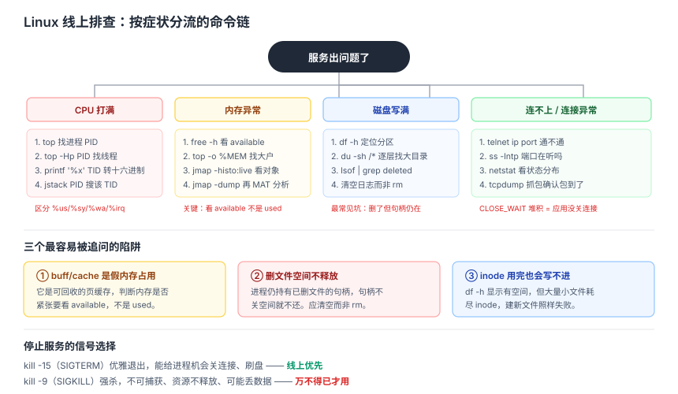

# Linux 与工程实践面试知识体系

> 整理日期：2026-10-13 ｜ 定位：对标 CS-Notes「工具（Linux / Git / Docker）」章节。这部分常被当作「非核心」而跳过，但**排查线上问题时它是硬门槛**，后端面试几乎必问。

## 结论

- Linux 面试的考察重心不是「背命令」，而是**排查思路**：给你一个「CPU 打满 / 内存泄漏 / 磁盘写满 / 服务无响应」的场景，你会按什么顺序定位。命令只是思路的载体。
- **必须能说出口的排查工具**：`top`/`htop`（CPU）、`free`（内存）、`iostat`/`df`（磁盘）、`netstat`/`ss`（连接）、`tcpdump`（抓包）、`jstack`/`perf`（进程栈）。
- Git 面试问的是**协作能力**：rebase vs merge、reset vs revert、冲突解决、分支模型。答不出这些，会被怀疑没在团队里真正协作过。
- Docker 最低要求：说清**镜像与容器的关系**、**分层存储与联合文件系统**、**为什么容器比虚拟机轻**。

## 一、Linux 排查思路（最高频）

### 场景一：CPU 使用率 100%

```text
1. top            → 找到占 CPU 的进程 PID
2. top -Hp <PID>  → 找到占 CPU 的线程 TID
3. 把 TID 转十六进制 → printf '%x' <TID>
4. jstack <PID> | grep -A20 <十六进制TID>   → 定位到具体 Java 栈
5. 若是非 Java 进程，用 perf top 看热点函数
```

**四种 CPU 高的情况**要能区分：用户态高（业务算得慢）、系统态高（系统调用多/上下文切换频繁）、等待 IO 高（磁盘/网络慢）、中断高（网卡压力大）。

### 场景二：内存占用高 / 疑似泄漏

```text
1. free -h              → 看 available（不是 used），buff/cache 可回收
2. top -o %MEM          → 找内存大户
3. ps aux --sort=-%mem  → 排序取前几
4. 进程内：jmap -heap <PID> / jmap -histo:live <PID> 看对象分布
5. 采样：jmap -dump:live,format=b,file=heap.bin <PID> 再 MAT 分析
```

**关键概念**：`free` 里的 `buff/cache` 是**可回收**的，所以判断内存是否真的紧张要看 `available`，不是 `used`。这是最常被追问的点。

### 场景三：磁盘写满

```text
1. df -h                    → 定位到哪个分区满
2. du -sh /* | sort -rh     → 逐层往下找大目录
3. lsof | grep deleted      → 常见陷阱：文件被删但进程仍持有句柄
```

**最高频的坑**：日志文件被 `rm` 了，但写了它的进程还在跑，空间不释放。解法是**重启进程或用 `> file` 清空而不是 `rm`**。这个点答出来非常加分。

### 场景四：服务连不上

```text
1. ping / telnet <ip> <port>  → 通不通
2. ss -lntp                   → 端口有没有在听、被谁听
3. netstat -an | grep <port>  → 连接状态分布（大量 TIME_WAIT/CLOSE_WAIT？）
4. tcpdump -i eth0 port <port> → 抓包看包到没到
5. curl -v / traceroute        → 应用层与路由层
```

**CLOSE_WAIT 堆积**几乎总是**应用没关连接**（代码 bug）；**TIME_WAIT 过多**是主动关闭方太多，可调内核参数。



### 常用命令速查

| 目的 | 命令 |
|---|---|
| 查看进程树 | `pstree -p` / `ps -ef` |
| 实时看日志 | `tail -f app.log` |
| 按关键词过滤日志 | `grep -n "ERROR" app.log` / `grep -A5 -B5 "异常"` |
| 统计日志条数 | `wc -l` / `awk '{print $1}' \| sort \| uniq -c \| sort -rn` |
| 查看端口占用 | `ss -lntp` / `lsof -i:8080` |
| 查看文件句柄上限 | `ulimit -n` / `cat /proc/<PID>/limits` |
| 查看网络连接状态 | `netstat -an \| awk '{print $6}' \| sort \| uniq -c` |
| 查看内核参数 | `sysctl -a` / `cat /proc/sys/net/ipv4/tcp_tw_reuse` |
| 定时任务 | `crontab -e` / `crontab -l` |

**高频三剑客**：`grep`（找行）、`awk`（按列处理）、`sed`（替换）。例如统计访问日志 Top10 IP：

```text
awk '{print $1}' access.log | sort | uniq -c | sort -rn | head -10
```

## 二、进程与信号

### 常用信号

| 信号 | 编号 | 行为 |
|---|---|---|
| SIGHUP | 1 | 挂起，常被守护进程用来**重载配置** |
| SIGINT | 2 | Ctrl+C，**中断** |
| SIGKILL | 9 | **强杀，不可捕获、不可忽略** |
| SIGTERM | 15 | **优雅退出**的默认信号，可捕获清理 |
| SIGSTOP/SIGCONT | 19/18 | 暂停/继续，SIGSTOP 不可捕获 |

**面试常问**：`kill -9` 和 `kill -15` 的区别？答：15 是优雅退出（能给进程机会关连接、刷盘），9 是强杀（资源不释放、可能丢数据）。**线上优先 15，不行才 9**。

### 孤儿进程与守护进程

- **孤儿进程**：父进程先退出，被 init（PID 1）收养，无害。
- **僵尸进程**：子进程退出但父进程没 `wait`，占进程表项，无害但需父进程处理。
- **守护进程**：脱离终端、在后台长期运行的进程（`setsid` / 双 fork）。

## 三、文件系统与 IO

- **一切皆文件**：设备、管道、socket 都可以用文件描述符操作。
- **硬链接 vs 软链接**：硬链接共享 inode，不能跨分区、不能链目录，删原文件仍可用；软链接是独立文件存路径，可跨分区，原文件删了即失效。
- **inode 是什么**：存文件元数据（权限、大小、数据块指针），不存文件名。所以会出现「磁盘还有空间但 inode 用完」导致新建文件失败。
- **页缓存**：读写先经过内核页缓存，`fsync` 才真正落盘。这解释了为什么数据库要自己管刷盘策略。

## 四、Git 协作（必问）

### rebase vs merge

| 维度 | merge | rebase |
|---|---|---|
| 历史 | 保留分叉，多一个 merge commit | **线性**，改写提交 |
| 安全性 | 安全，不改已有提交 | **危险**，改历史，禁止对已推送的公共分支用 |
| 适用 | 主干合入功能分支 | 功能分支同步主干、合并前整理提交 |

**口诀**：**公共分支用 merge，私有分支用 rebase 整理后再合**。

### reset vs revert

- **reset**：移动分支指针，**改写历史**。`--soft`（保留暂存区）、`--mixed`（默认，保留工作区）、`--hard`（全丢，危险）。
- **revert**：新建一个**反向提交**抵消原提交，**不改历史**，适合已推送的公共分支。

**判断标准**：这个提交已经推给别人了吗？推了就 revert，没推才 reset。

### 其他高频

| 命令 | 用途 |
|---|---|
| `git stash` | 暂存未提交改动，切换分支前用 |
| `git cherry-pick <hash>` | 把某个提交摘到当前分支 |
| `git reflog` | **后悔药**，找回被 reset 掉的提交 |
| `git blame` | 逐行看是谁改的 |
| `git bisect` | 二分查找引入 bug 的提交 |
| `git diff --staged` | 看暂存区与上次提交的差异 |

**`git reflog` 是救命命令**：误删分支或 `reset --hard` 之后，只要没被 GC，都能靠它找回 commit hash。

## 五、Docker 基础

### 镜像与容器

- **镜像**：只读模板，由多个**只读层**堆叠（分层存储）。
- **容器**：在镜像最上面加一个**可写层**，进程跑在里面。
- **关系**：容器 = 镜像 + 可写层 + 运行时配置。一个镜像可以起多个容器。

### 为什么容器比虚拟机轻

| 维度 | 虚拟机 | 容器 |
|---|---|---|
| 隔离级别 | 硬件虚拟化，各自独立内核 | **共享宿主内核**，靠 Namespace 隔离 |
| 启动 | 分钟级（要起完整 OS） | 秒级甚至毫秒级 |
| 体积 | GB 级 | MB 级 |
| 隔离强度 | 强 | 相对弱（内核共享是攻击面） |

**关键技术**：**Namespace**（隔离视图：PID/NET/MNT/UTS/IPC/USER）+ **Cgroups**（限制资源：CPU/内存/IO）。

### 常用命令

```text
docker build -t name:tag .      # 构建镜像
docker run -d -p 8080:80 name   # 后台运行并映射端口
docker exec -it <id> bash       # 进容器
docker logs -f <id>             # 看日志
docker ps -a                    # 看所有容器
docker system prune -a          # 清理无用镜像/容器（谨慎）
```

## 六、高频对比速查

| 问题 | 一句话答案 |
|---|---|
| CPU 100% 怎么查？ | top → top -Hp → printf %x → jstack 定位线程栈 |
| 内存是否紧张看哪个数？ | `available`，不是 `used`（buff/cache 可回收） |
| 文件删了空间没释放？ | `lsof \| grep deleted`，进程仍持句柄，需重启或清空文件 |
| CLOSE_WAIT 堆积说明？ | 应用没关连接，是代码 bug |
| TIME_WAIT 过多说明？ | 主动关闭方太多，可调 tcp_tw_reuse |
| kill -9 和 -15？ | 9 强杀不可捕获，15 优雅退出；线上优先 15 |
| 僵尸进程危害？ | 占进程表项，不占 CPU/内存，需父进程 wait |
| inode 用尽会怎样？ | 有磁盘空间也建不了新文件 |
| rebase 还是 merge？ | 公共分支 merge，私有分支 rebase |
| reset 还是 revert？ | 已推送用 revert，未推送用 reset |
| 误 reset 怎么救？ | `git reflog` 找回 hash |
| 容器为什么轻？ | 共享宿主内核，Namespace 隔离 + Cgroups 限资源 |

## 建议

- **把排查思路背成流程图**。面试官问「CPU 高怎么办」，你要能立刻说出命令链，而不是零散回忆命令。
- **每个命令都说清「看什么指标」**。`top` 看的是 %us/%sy/%wa；`free` 看的是 available；`iostat` 看的是 %util 和 await。
- **准备一个真实排查故事**。哪怕是本机的练习，也远比背命令有说服力。
- **Git 部分重点准备合并冲突和分支策略**，这是团队协作的直接证据。
- **Docker 不必深入编排（K8s 可另开主题）**，但镜像/容器/Namespace/Cgroups 这条线必须清楚。

## 待核实

- 内核参数名（如 `tcp_tw_reuse`、`tcp_max_tw_buckets`）在不同内核版本与发行版间存在差异，调整前应核对目标环境。
- Docker 各版本的存储驱动默认值不同（overlay2 / devicemapper 等），镜像分层行为以官方文档为准。
- `jmap`/`jstack` 属于 JDK 工具，仅适用于 JVM 进程；非 JVM 进程需改用 `perf`、`gdb` 等。

## 来源清单

- CyC2018/CS-Notes —「工具：Git、Docker、正则表达式、构建工具」与「Linux」章节
- jwasham/coding-interview-university —「Unix command line tools」学习清单
- 本文排查思路基于通用 Linux 运维实践整理，命令参数以目标发行版手册（man page）为准。
