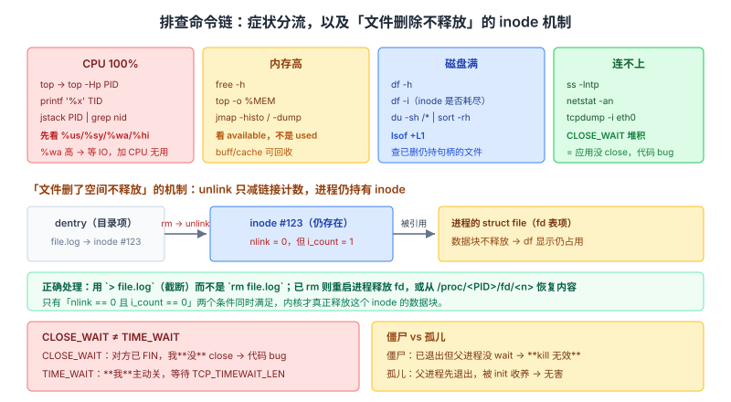
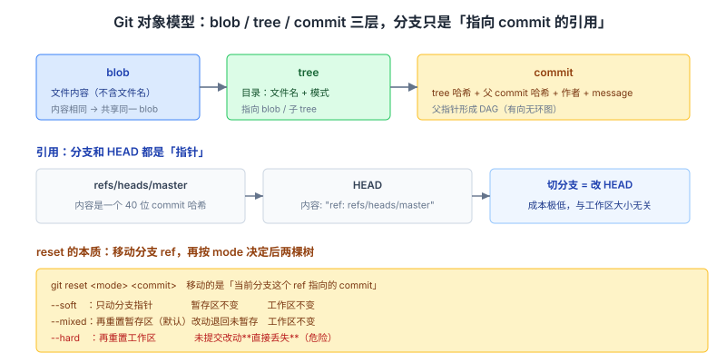

# Linux 与工程实践面试知识体系

> 整理日期：2026-10-13 ｜ 重写：2026-10-14。这份文档不铺广度，只挑面试官会**连问三层**的点。每个点讲三层：**机制（内核/工具内部到底怎么做的）→ 证据（inode 结构、系统调用、Git 对象类型、内核 namespace）→ 追问链**。

> 阅读约定：图在 `assets/2026-10-14/` 下。标注「待核实」的地方是本次未拿到一手依据的，不硬写。这篇的「深度」体现在**能把排查思路讲到机制层**，而不是罗列命令。

## 结论

Linux 与工程实践的深度，在于**你能从症状推到机制，再从机制推回命令**：

1. **「文件删了空间不释放」要先讲清 inode、dentry、硬链接计数**——`lsof | grep deleted` 只是结论，机制是**进程持有已 unlink 的 inode 引用**。
2. **`kill -15` 与 `kill -9` 的分界是「能否被捕获」**，而**信号本质是内核往 `task_struct` 写 pending 位并唤醒目标**。
3. **Git 的三个对象（blob/tree/commit）和引用（ref）要能说清**——`reset` 移的是 ref，`revert` 建的是新 commit，`reflog` 记的是 ref 的历史。
4. **Docker 轻的本质是「共享内核 + namespace 隔离视图 + cgroups 限资源」**，不是「更小的虚拟机」。

本文按「排查思路 → 进程与信号 → 文件系统与 IO → Git 对象模型 → Docker 与容器」组织，全部落到可验证的机制。

---

## 一、排查思路：从症状到机制

### 场景一：CPU 使用率 100%

```text
top                          → 找占 CPU 的进程 PID
top -Hp <PID>                → 找占 CPU 的**线程** TID
printf '%x' <TID>            → TID 转十六进制（因为 jstack 里 nid 是十六进制）
jstack <PID> | grep -A20 <十六进制TID>   → 定位 Java 线程栈
perf top -p <PID>            → 非 JVM 进程看热点函数
```

**关键一步是把 TID 转十六进制**——因为 `jstack` 输出里的 `nid=0x...` 是十六进制，而 `top -Hp` 给的是十进制。**这个细节答出来，说明真做过。**

**四种 CPU 高要能区分**（`top` 的 `%us`/`%sy`/`%wa`/`%hi`）：

| 指标 | 含义 | 典型原因 |
| --- | --- | --- |
| `%us` 用户态高 | 业务代码在算 | 死循环、正则回溯、频繁 GC |
| `%sy` 系统态高 | 内核在干活 | **频繁系统调用 / 上下文切换** |
| `%wa` 等待 IO 高 | CPU 在等磁盘/网络 | 磁盘瓶颈、swap 抖动 |
| `%hi`/`%si` 中断高 | 硬件中断处理 | 网卡软中断压力大（`softirq`） |

**注意 `%wa` 高时 CPU 其实「闲」**——它在等 IO。所以「CPU 100%」要先看是哪一类，**盲目扩容 CPU 对 `%wa` 高毫无帮助**。

### 场景二：内存占用高 / 疑似泄漏

```text
free -h                     → 看 available，不是 used
top -o %MEM                 → 找内存大户
ps aux --sort=-%mem         → 排序取前几
jmap -heap <PID>            → JVM 堆概况
jmap -histo:live <PID>      → 对象分布（会触发一次 Full GC）
jmap -dump:live,format=b,file=heap.bin <PID>   → dump 后用 MAT 分析
```

**核心概念**：`free` 输出的 `buff/cache` 是**可回收的页缓存**。

```
              total        used        free      shared  buff/cache   available
Mem:           15Gi       8.0Gi       0.5Gi       0.2Gi       7.5Gi       6.8Gi
```

**「free 只剩 0.5G」不代表内存不足**——内核会把空闲内存拿去做页缓存（提升 IO 性能），需要时随时回收。**判断内存是否紧张要看 `available`（约等于 free + 可回收的 cache），不是 `used`，更不是 `free`。** 这是最高频的追问点。

**关于 `jmap -histo:live` 的一个坑**：`live` 会先触发一次 Full GC 再统计存活对象，**在生产环境有 STW 停顿风险**，线上慎用。

### 场景三：磁盘写满

```text
df -h                       → 定位哪个分区满
df -i                       → 顺带看 **inode 是否耗尽**（一个重要分支）
du -sh /* | sort -rh        → 逐层往下找大目录
lsof +L1                    → 列出所有「已删除但有进程持有」的文件
lsof | grep deleted         → 同上（更常见的写法）
```

**最高频的坑**：日志文件被 `rm` 了，但**写它的进程仍在运行**，空间不释放。

**机制**（这是要点）：
1. `rm file` 实际调用 `unlink()`，它做的是**把目录项（dentry）与 inode 的链接断开，并把 inode 的硬链接计数减 1**。
2. **只有当链接计数为 0 且没有任何进程打开这个 inode 时**，内核才真正释放数据块。
3. 进程已经 `open()` 了这个文件，**它持有的 `struct file` 引用了该 inode**——所以链接计数为 0 但引用不为 0，**数据块不释放**。

**解法**：
- 正确做法：`> file.log`（截断）或 `truncate -s 0 file.log`，**而不是 `rm`**
- 已经 rm 了：**重启进程**（释放 fd）或从 `/proc/<PID>/fd/<n>` 恢复内容（`cp /proc/<PID>/fd/<n> /tmp/recovered.log`）
- **`df -i` 这个分支要提**：磁盘空间还有但 **inode 用尽**（大量小文件）会导致创建新文件失败，prometheus 的 WAL 目录、session 文件目录都容易踩

### 场景四：服务连不上

```text
ping / telnet <ip> <port>        → 通不通（telnet 能验证 TCP 层）
ss -lntp                         → 端口有没有在听、被哪个进程听
ss -s                            → 连接状态汇总
netstat -an | grep <port>        → 连接状态分布
tcpdump -i eth0 port <port>      → 抓包看包到没到（区分「没发/没到/被拒」）
curl -v / traceroute             → 应用层与路由层
```

**连接状态堆积的判读（这是核心）**：

| 状态 | 含义 | 通常说明 |
| --- | --- | --- |
| **CLOSE_WAIT 堆积** | **被动关闭方**收到了 FIN，但自己没关 | **应用没调 `close()`，是代码 bug** |
| **TIME_WAIT 过多** | **主动关闭方**完成四次挥手后等待 | 主动关闭方太多；可调内核参数 |
| SYN_RECV 大量 | 半连接队列满 | 可能被 SYN Flood 攻击，或 `tcp_max_syn_backlog` 太小 |
| ESTABLISHED 远超预期 | 连接泄漏 | 连接池没回收 |

**CLOSE_WAIT 是代码 bug 的信号**：内核已经收到对方的 FIN（被动关闭），接下来**应用层必须调 `close()`** 才会进入 LAST_ACK。如果应用不关，就停在 CLOSE_WAIT。**所以看到 CLOSE_WAIT 堆积，去查代码里哪里漏关了连接，而不是调内核参数**——这是最能体现「懂机制」的判断。

**TIME_WAIT 的机制和调优**（与网络篇的 `TCP_TIMEWAIT_LEN` 一节互补）：TIME_WAIT 是主动关闭方的状态，持续 `TCP_TIMEWAIT_LEN`（**Linux 固定 60 秒常量**）。`net.ipv4.tcp_tw_reuse` 默认值 **2**（只对 loopback 生效，且只对客户端连接生效）。**调优前先确认是「客户端主动关闭多」还是「服务端」，方向错了白调。**

### 常用命令速查（按用途分组）

| 目的 | 命令 |
| --- | --- |
| 进程树 | `pstree -p` / `ps -ef --forest` |
| 实时跟踪日志 | `tail -f app.log` / `tail -F`（应对日志轮转） |
| 关键词过滤 | `grep -n "ERROR" app.log` / `grep -A5 -B5 "异常"` |
| 统计 Top N | `awk '{print $1}' access.log \| sort \| uniq -c \| sort -rn \| head -10` |
| 端口占用 | `ss -lntp` / `lsof -i:8080` |
| 句柄上限 | `ulimit -n` / `cat /proc/<PID>/limits` |
| 连接状态分布 | `ss -ant \| awk '{print $1}' \| sort \| uniq -c` |
| 内核参数 | `sysctl -a` / `cat /proc/sys/...` |
| **动态跟踪** | `strace -p <PID>`（看系统调用）/ `perf top`（看热点函数） |

**`strace` 的定位价值**：当进程「卡住」但 CPU 不高、日志没输出时，`strace -p` 能看到它**卡在哪个系统调用上**（如卡在 `read()` 上等 IO、卡在 `futex()` 上等锁）。**这是排查「无响应」最直接的工具**，比猜强得多。

> **追问链**
> 1. 「CPU 100%」要先分辨什么？→ 是 `%us`/`%sy`/`%wa`/`%hi` 哪一类；`%wa` 高说明在等 IO，加 CPU 无用。
> 2. 内存紧不紧看哪个数？→ `available`；`free` 少不代表不足，buff/cache 可回收。
> 3. 文件删了空间没释放的机制？→ `unlink` 减**硬链接计数**，但进程持有的 `struct file` 仍引用 inode，计数不为 0 时不释放数据块。
> 4. 怎么救？→ 截断（`> file`）避免；已 rm 则重启进程或从 `/proc/<PID>/fd` 恢复。
> 5. CLOSE_WAIT 堆积说明什么？→ 应用没调 `close()`，是**代码 bug**，不要调内核参数。
> 6. 进程卡住怎么定位？→ `strace -p` 看卡在哪个系统调用。



---

## 二、进程、信号与文件描述符

### 信号的本质

**信号不是「消息」**，而是**内核在一个 `task_struct` 的 pending 位图上置位，并在合适时机（返回用户态前）检查并调用处理函数**。

**这一条机制直接解释了三个常见问题**：

| 问题 | 机制层面的答案 |
| --- | --- |
| 为什么信号处理函数要「可重入」？ | 信号可能在主流程**任意指令边界**打断，处理函数里若用非可重入函数（如 `malloc`、`printf`）会与主流程的状态冲突 |
| 为什么信号不能传递复杂数据？ | 它本质是个**位图**（标准信号只有编号，不携带数据）；`sigqueue`/实时信号才带 `siginfo` |
| 「不可捕获」是什么意思？ | `SIGKILL`/`SIGSTOP` 的处理器表项在**内核里根本不允许设置**——不是「忽略用户设置」，而是**没有可设置的路径** |

### 常用信号对照

| 信号 | 编号 | 默认行为 | 可捕获 | 典型用途 |
| --- | --- | --- | --- | --- |
| SIGHUP | 1 | 终止 | 是 | 终端断开；**守护进程常用于重载配置** |
| SIGINT | 2 | 终止 | 是 | Ctrl+C |
| **SIGKILL** | **9** | **终止** | **否** | **强杀，内核直接回收** |
| SIGQUIT | 3 | 终止 + core | 是 | Ctrl+\ |
| **SIGTERM** | **15** | **终止** | **是** | **默认优雅退出信号** |
| SIGSTOP/SIGCONT | 19/18 | 暂停/继续 | 否/是 | 作业控制 |
| SIGSEGV | 11 | 终止 + core | 是 | 段错误 |
| SIGCHLD | 17 | 忽略 | 是 | 子进程状态变化，父进程据此 `wait` |

**`kill -9` vs `kill -15` 的准确答法**：

| | `kill -15`（SIGTERM） | `kill -9`（SIGKILL） |
| --- | --- | --- |
| 可捕获 | **是**，能注册 handler | **否**，内核直接终止 |
| 能否清理 | 能（关连接、刷盘、注销） | **不能**，资源不清理 |
| 能否阻塞在 IO | 能被打断但**可能仍有时间窗** | 立即终止 |
| 数据风险 | 低 | **可能丢数据 / 留下不一致状态** |

**线上原则**：先 `kill -15`，给进程清理机会（配合应用里的 shutdown hook），等一段时间仍不退再 `kill -9`。**直接 `-9` 是撤手**——比如数据库进程被 `-9`，未刷盘的 redo 要靠崩溃恢复，虽然能恢复但更慢。

### 僵尸进程 vs 孤儿进程

| | 产生原因 | 是否占资源 | 处理 |
| --- | --- | --- | --- |
| **僵尸（zombie）** | 子进程**已退出**，父进程**未 `wait`** | 只占**一个进程表项**（PID + 退出状态），**不占 CPU/内存** | 父进程 `wait`/`waitpid`；或父进程退出后由 init 收养并回收 |
| **孤儿（orphan）** | **父进程先退出**，子进程还在 | 正常运行，占资源 | 被 init（PID 1）收养，**无害** |

**关键区别**：僵尸是「**已死但没被收尸**」，孤儿是「**还活着但没爹**」。

**僵尸为什么杀不掉**：僵尸进程**已经退出**，它不是一个可运行的任务，所以 **`kill` 对它无效**。唯一解是**让父进程 `wait`**（这需要修父进程的代码，或让父进程退出）。**这是最能区分「背概念」和「懂机制」的一问。**

**工程上的防护**：父进程应注册 `SIGCHLD` handler 并调 `waitpid(-1, ..., WNOHANG)`，或直接用**双 fork 让 init 收养**；也可以设 `SIGCHLD` 为 `SIG_IGN`（POSIX 允许，内核会自动回收，等于「不产生僵尸」）。

### 文件描述符

**fd 是进程级的「文件表索引」**，本质是 `task_struct->files->fd_array[]` 的**下标**（一个整数）。

**默认上限**：`ulimit -n` 通常 1024；`cat /proc/<PID>/limits` 看进程实际限制。

**`Too many open files` 的排查链**：
```text
ls -l /proc/<PID>/fd | wc -l     # 当前打开数
ls -l /proc/<PID>/fd | tail      # 看都是什么（socket / 普通文件 / pipe）
cat /proc/<PID>/limits           # 看软硬限制
```
**常见原因**：连接没关、文件打开了没关、`ulimit` 太小。**配合上面 CLOSE_WAIT 一起看，能定位到具体是哪种泄漏。**

**三个「重定向」的差别**（面试常问）：
- `nohup cmd &`：忽略 SIGHUP 且把 stdout/stderr 重定向到 `nohup.out`，**终端断开后进程继续**
- `cmd &`：后台运行，但**终端关闭时可能收到 SIGHUP 而退出**
- `disown`：把已经后台化的任务从 shell 的作业表移出，**此后 shell 退出不发 SIGHUP 给它**

> **追问链**
> 1. 信号为什么要在指令边界处理？→ 内核在返回用户态前检查 pending 位，处理函数可能在任意指令处打断。
> 2. `SIGKILL` 为什么不能捕获？→ 内核里**没有可设置的路径**，不是「不理会用户的设置」。
> 3. 僵尸进程能 kill 掉吗？→ 不能，已退出；要让父进程 `wait`，或让 init 回收。
> 4. 孤儿进程有害吗？→ 无害，被 init 收养。
> 5. `nohup`、`&`、`disown` 的区别？→ 忽略 SIGHUP+重定向 / 后台 / 从作业表移出。

---

## 三、文件系统与 IO

### inode、dentry 与「一切皆文件」

| 结构 | 存什么 | 关键点 |
| --- | --- | --- |
| **inode** | 元数据：权限、大小、时间戳、**数据块指针**、**硬链接计数** | **不存文件名** |
| **dentry** | 目录项：**文件名 → inode** 的映射 | 由 VFS 缓存（dcache） |
| **file** | 进程打开文件的实例：当前偏移、打开模式、指向 inode | 每次 `open` 一个 |

**「文件名不存在于 inode 里」这个事实直接解释了几件事**：
- **多个文件名可以指向同一个 inode**（硬链接）
- **`rm` 只删了一个 dentry + 减引用计数**，不直接删数据
- **文件被删但仍能通过 `/proc/<PID>/fd` 访问**（inode 还被引用）

**「一切皆文件」的准确含义**：设备、管道、socket 都被抽象成**可以用文件接口（`open`/`read`/`write`/`close`）操作的对象**。这让 IO 多路复用（`epoll` 能同时管 socket 和管道）、重定向等技术统一在一套接口上。

### 硬链接 vs 软链接

| | 硬链接 | 软链接（符号链接） |
| --- | --- | --- |
| 本质 | **同一个 inode** 的另一个 dentry | 一个**独立文件**，内容是目标路径字符串 |
| 跨分区 | **不能**（inode 号是分区内的） | 能 |
| 链目录 | 不能（会造成目录环） | 能 |
| 删原文件 | **仍可用**（只是链接计数减 1） | **失效**（悬空链接） |
| `ls -l` 显示 | 与普通文件相同 | `l` 开头，显示 `->` 目标 |
| 创建 | `ln a b` | `ln -s a b` |

**判断依据**：硬链接基于 **inode 共享**，软链接基于 **路径解析**。

### 页缓存与 fsync

**Linux 的写是「延迟写」（write-back）**：
1. `write()` 把数据从用户空间**拷进内核页缓存**就返回（**没落盘**）
2. 内核由**回写线程**（`pdflush`/`kworker`）在之后的某个时间批量刷盘
3. `fsync()` 强制把该文件的脏页**同步刷到持久存储**才返回

**这解释了数据库为什么必须自己管刷盘**：靠 OS 的页缓存刷盘，**时机不可控**，进程崩溃/机器断电可能丢最近的写入。所以：
- MySQL 的 redo log 用 `fsync` 控制 `innodb_flush_log_at_trx_commit`
- 消息队列（Kafka/RocketMQ）都有自己的刷盘策略
- **「先写日志再落盘」是所有持久化系统的通用模式**

**顺带一个常被追问的点**：`fsync` 不只是「刷这个文件」，它还要**保证该文件的元数据（大小、块指针）也持久化**——因为文件可能刚被扩展（新增了数据块），如果只刷数据不刷元数据，崩溃后数据块会「无主」。**这就是「先写日志（journal / WAL）」的必要性所在**：原子地记录「接下来要做的元数据变更」。

### df 和 du 结果不一致的原因

**这是高频的实操坑**：

| 原因 | 机制 |
| --- | --- |
| **已删除但被进程持有** | `df` 统计 inode/块占用（仍占），`du` 遍历目录树（看不到） |
| **挂载点覆盖** | `du` 不跨挂载点，`df` 按分区算 |
| **稀疏文件** | 逻辑大小大，实际占用块少 |
| **文件系统预留空间** | ext4 默认给 root 预留 5%，`df` 的 total 已扣 |

**排查顺序**：先 `df -h`（确认哪满）→ `du -sh /* | sort -rh`（找大目录）→ **不一致时 `lsof +L1`**（找被删但持有的文件）。**这个顺序本身就是答案。**

> **追问链**
> 1. inode 存文件名吗？→ 不存，文件名在 dentry 里；这才有硬链接和「删了还能访问」。
> 2. 硬链接为什么不能跨分区？→ inode 号是分区内编号。
> 3. `write()` 之后数据落盘了吗？→ 没有，仅在页缓存；`fsync` 才强制落盘。
> 4. `fsync` 要刷元数据吗？→ 要，否则崩溃后新增的数据块可能「无主」。
> 5. `df` 和 `du` 为什么对不上？→ 已删仍持有 / 挂载点 / 稀疏文件 / 预留空间。

---

## 四、Git 对象模型

### 三个对象：blob / tree / commit

Git 是**内容寻址**的存储：**对象名 = 内容的 SHA-1/SHA-256 哈希**。

| 对象 | 存什么 | 指向 |
| --- | --- | --- |
| **blob** | **文件内容**（不含文件名！） | 无 |
| **tree** | **目录**：文件名 + 模式 + 子对象哈希 | blob 和其他 tree |
| **commit** | 一次提交：tree 哈希、父 commit 哈希、作者、message | 一个 tree + 零/多个父 commit |

**关键理解：文件名和内容分开存**。同样的内容在不同文件名下**共享同一个 blob**——这是 Git 存储高效的原因之一。

**commit 的「父指针」形成 DAG**（有向无环图），分支只是**指向某个 commit 的轻量指针**。

### 引用：分支和 HEAD

- **分支（branch）**：只是一个**指向 commit 的引用**（`refs/heads/master` 里存一个 40 位哈希）
- **HEAD**：**指向当前分支的引用**（`refs/HEAD` 内容通常是 `ref: refs/heads/master`）
- **tag**：指向 commit 的引用，但通常**不变**（分支会移动）

**所以「切分支」实际是「改 HEAD 指向哪个 ref」**——成本极低，与工作区大小无关。

**这一条直接解释 `reset` 的本质**：



```
git reset <mode> <commit>
```

**它移动的是当前分支这个 ref 指向的 commit**，然后按 `<mode>` 决定暂存区/工作区怎么办：

| mode | 分支指针 | 暂存区（index） | 工作区 |
| --- | --- | --- | --- |
| `--soft` | **移动** | 不变（保留已暂存改动） | 不变 |
| `--mixed`（默认） | **移动** | **重置**（改动退回未暂存） | 不变 |
| `--hard` | **移动** | **重置** | **重置（丢改动）** |

**`--hard` 的危险**在于它会**覆盖工作区文件**——未提交的改动直接丢失（部分情况可从 `reflog` + `stash`/`fsck` 抢救，但不可靠）。

### reset vs revert：判断标准是「推没推」

| | `reset` | `revert` |
| --- | --- | --- |
| 操作 | **移动分支指针**（改写历史） | **新建一个反向 commit**（不改历史） |
| 对已推送分支 | **禁止**（会与远端分叉，需要 force push） | **安全**（就是普通的追加提交） |
| 适用 | 本地未推送的提交 | **公共分支**上撤销某个已推送的提交 |

**判断口诀**：**这个提交已经推给别人了吗？推了就 `revert`，没推才 `reset`。**

### rebase vs merge

| | merge | rebase |
| --- | --- | --- |
| 结果历史 | **保留分叉** + 一个 merge commit | **线性**，改写原提交为新的 commit（**新哈希**） |
| 对已推送分支 | 安全 | **危险**（改写已发布的历史，别人会冲突） |
| 冲突解决次数 | 一次（在 merge 点） | **可能每个提交都要解一次** |
| 适用 | 主干合功能分支 | **私有分支**同步主干 / 合并前整理提交 |

**两者都「安全」的说法是错的**：`rebase` 会**改写提交哈希**——如果这些提交已被别人拉取，他们的历史会和你的分叉，下次 pull 就是一团冲突。所以**铁律是：只对未推送的私有提交 rebase。**

### `git reflog` 是本地操作日志

**reflog 记录的是「HEAD 和分支引用在本地移动的历史」**，存在 `.git/logs/` 下（**本地，不随 push/fetch 走**）。每个条目是：`<旧哈希> <新哈希> <身份> <时间> <操作>`。

**为什么它是救命命令**：`reset --hard`、`branch -D`、误操作 rebase 之后，**只要对应的 commit 还在 reflog 里（默认保留 90 天，未引用对象 30 天后被 GC）**，就能用 `git reflog` 找到哈希并用 `git reset --hard <hash>` 或 `git branch <name> <hash>` 恢复。

**对比 `git log`**：`log` 走的是**当前分支的可达历史**，被 reset 掉的提交不在其中；`reflog` 走的是**本地引用移动记录**——所以它能看到「曾经指向过」的提交。

### 其他高频工具

| 命令 | 本质 |
| --- | --- |
| `git stash` | 把工作区+暂存区改动存成 commit（挂在 `refs/stash`），工作区恢复干净 |
| `git cherry-pick <hash>` | 把某个 commit 的**变更**在新位置重新提交（新哈希） |
| `git bisect` | 二分查找引入 bug 的提交（`O(log n)` 次 checkout） |
| `git blame` | 逐行显示最后一次修改该行的 commit |
| `git fsck --lost-found` | 找**悬空对象**（dangling commit/blob），reflog 之外的最后手段 |

> **追问链**
> 1. 分支到底是什么？→ 一个指向 commit 的引用（40 位哈希），不是目录拷贝。
> 2. `reset --soft/--mixed/--hard` 的区别？→ 只动分支 / 再动暂存区 / 再动工作区。
> 3. `reset` 和 `revert` 怎么选？→ 推没推；推了用 revert。
> 4. `rebase` 为什么危险？→ 改写哈希，已推送的历史分叉。
> 5. `reflog` 和 `log` 的区别？→ 前者是**本地引用移动记录**，后者是当前分支可达历史。

---

## 五、Docker 与容器

### 镜像、容器与联合文件系统

| 概念 | 本质 |
| --- | --- |
| **镜像** | 一组**只读层**（layer）堆叠，每层是一个 diff |
| **容器** | 镜像 + 一个**可写层**（copy-on-write）+ 运行时配置（namespace/cgroups） |
| **联合文件系统** | 把多个只读层 + 一个可写层「叠加」成**单一视图** |

**分层的关键价值：层是共享的**。多个镜像基于同一个基础层（如 `ubuntu:22.04`）时，**这个层只存一份**。所以「拉一个基于相同 base 的新镜像」通常很快——只需要下载差异层。

**Dockerfile 的层数优化（面试常问）**：
```dockerfile
# 差：每行 RUN 建一层，且 apt 缓存留在上一层，后续删不掉
RUN apt-get update
RUN apt-get install -y curl

# 好：合并成一层，缓存与安装在同一层，删缓存才有意义
RUN apt-get update && apt-get install -y curl && rm -rf /var/lib/apt/lists/*
```
**原理**：`rm` 只在**当前层**标记删除，**上一层的文件仍占镜像体积**。所以「先装后删」必须在**同一层**完成。这是分层存储的直接推论。

**overlay2** 是当前主流存储驱动：`lowerdir`（只读层）+ `upperdir`（可写层）+ `merged`（联合视图）。

### 为什么容器比虚拟机轻

| 维度 | 虚拟机 | 容器 |
| --- | --- | --- |
| 隔离 | **硬件虚拟化**，各自独立内核 | **共享宿主内核** |
| 隔离机制 | Hypervisor + 虚拟硬件 | **namespace（视图）+ cgroups（资源）** |
| 启动 | 分钟级（起完整 OS） | 秒/毫秒级（就是个进程） |
| 体积 | GB 级 | MB 级 |
| 隔离强度 | **强**（内核都不同） | **相对弱**（共享内核 = 攻击面） |

**本质一句话**：**容器就是一个被 namespace 和 cgroups 约束的普通进程**，不是「轻量虚拟机」。

### namespace 与 cgroups

**namespace 隔离「看得见什么」**：

| namespace | 隔离内容 | 效果 |
| --- | --- | --- |
| **PID** | 进程 ID | 容器内 PID 1 是容器自己的 1，看不到宿主进程 |
| **NET** | 网络栈 | 独立的网卡、IP、端口、路由表 |
| **MNT** | 挂载点 | 独立的文件系统视图（镜像层就是靠它） |
| **UTS** | 主机名/域名 | 容器有独立 hostname |
| **IPC** | 进程间通信 | 独立的消息队列/共享内存 |
| **USER** | 用户/用户组 ID | 容器内 root 可映射为宿主的非 root（**rootless 容器的基础**） |

**关键系统调用**：`clone()` 创建新 namespace，`unshare()` 把当前进程放进新 namespace，`setns()` 让进程加入已有 namespace。

**cgroups 限制「能用多少」**：限制/统计 CPU（`cpu.max`）、内存（`memory.max`）、IO（`io.max`）、以及 PID 数量（`pids.max`）。**这是防止一个容器吃光宿主资源的关键**。

**为什么「容器不安全」的准确说法是「隔离强度不如 VM」**：容器和宿主**共享内核**，所以：
- 内核漏洞（提权）**可以直接逃逸到宿主**
- 未配 `USER` namespace 时容器内 root ≈ 宿主 root

**这也是为什么生产要**：配 rootless / userns-remap、加 seccomp/AppArmor/SELinux、用只读根文件系统、限制 capabilities。

### 常用命令

```bash
docker build -t name:tag .          # 构建镜像
docker run -d -p 8080:80 --name x name   # 后台运行、端口映射
docker exec -it <id> bash           # 进容器（会在容器内新起一个进程）
docker logs -f <id>                 # 看容器主进程的 stdout/stderr
docker ps -a                        # 所有容器（含已退出）
docker stats                        # 实时资源占用（对应 cgroups 的统计）
docker system prune -a              # 清理（谨慎）
```

**一个常被追问的点**：`docker exec` 和 `docker attach` 的区别。`exec` **在容器内新起一个进程**（如 bash），退出不影响容器主进程；`attach` **直接接到容器主进程的 stdio**，Ctrl+C 可能导致容器主进程收到信号而退出。**生产排查用 `exec`。**

> **待核实**：**Docker 各版本的默认存储驱动不同**（早年 devicemapper，后改进为 overlay2），**具体默认值随版本与发行版变化**；`cgroups v1 与 v2` 的接口也不同（如 `cpu.shares` vs `cpu.weight`）。本文给出的是通用机制与 overlay2/cgroups 的典型接口，**未逐版本核实**，实操请以目标环境为准。

> **追问链**
> 1. 容器是轻量虚拟机吗？→ 不是，它是**被 namespace 和 cgroups 约束的普通进程**。
> 2. 为什么「装完再删」要写在一行？→ 分层存储：删只作用于当前层，上一层的文件仍占体积。
> 3. namespace 和 cgroups 各干什么？→ namespace 隔离**视图**，cgroups 限制**资源**。
> 4. 容器为什么不安全？→ 共享内核，内核漏洞可逃逸；未配 userns 时容器 root ≈ 宿主 root。
> 5. `exec` vs `attach`？→ exec 新起进程，attach 接到主进程 stdio（Ctrl+C 可能杀掉容器）。

---

## 六、高频追问速查（按「面试官问 → 我答」组织）

| 面试官会问 | 你要答到的点 |
| --- | --- |
| CPU 100% 怎么查 | `top` → `top -Hp` → `printf %x` 转十六进制 → `jstack` 定位；**先分辨 %us/%sy/%wa/%hi** |
| 内存紧张看哪个数 | `available`（`free` 少不等于不足，buff/cache 可回收） |
| 文件删了空间不释放 | `unlink` 减**硬链接计数**，但进程持有 `struct file` 引用 inode；`lsof +L1` 查；截断别 `rm` |
| 磁盘满还有什么分支 | **`df -i` 看 inode 耗尽**（大量小文件） |
| CLOSE_WAIT 堆积什么原因 | 应用没调 `close()`，**代码 bug**，别调内核参数 |
| TIME_WAIT 过多怎么办 | 主动关闭方太多；`tcp_tw_reuse` 默认 2（仅 loopback、仅客户端） |
| 进程卡住没日志怎么查 | `strace -p` 看卡在哪个系统调用 |
| `kill -9` 和 `-15` | 9 不可捕获（内核直接终止）；15 可捕获，能清理。线上优先 15 |
| `SIGKILL` 为什么不能捕获 | 内核里**没有可设置的路径**，不是「不理会用户设置」 |
| 僵尸进程能 kill 吗 | **不能**（已退出）；要让父进程 `wait` 或由 init 回收 |
| 僵尸 vs 孤儿 | 已死没人收尸 vs 还活着没爹（孤儿无害） |
| inode 存文件名吗 | 不存，文件名在 **dentry**；这才有硬链接 |
| 硬链接为什么不能跨分区 | inode 号是分区内编号 |
| `write` 之后落盘了吗 | 没有，仅页缓存；`fsync` 才强制落盘 |
| `df` 和 `du` 对不上 | 已删仍持有 / 挂载点 / 稀疏文件 / 预留空间 |
| 分支是什么 | **指向 commit 的引用**（一个哈希），不是目录拷贝 |
| `reset` 三种模式 | `--soft` 只动分支；`--mixed` 再动暂存区；`--hard` 再动工作区（丢改动） |
| `reset` vs `revert` | 推没推；推了用 `revert`（新建反向提交，不改历史） |
| `rebase` 为什么危险 | **改写提交哈希**，已推送的历史会分叉 |
| `reflog` 和 `log` 的区别 | 前者是**本地引用移动记录**（`.git/logs/`），后者是当前分支可达历史 |
| 容器为什么轻 | 共享宿主内核；**它不是虚拟机，是被 namespace/cgroups 约束的进程** |
| Dockerfile 为什么合并 RUN | 分层存储：删只作用当前层，上层文件仍占体积 |
| namespace vs cgroups | 隔离**视图** vs 限制**资源** |
| 容器为什么不够安全 | 共享内核 → 内核漏洞可逃逸；未配 userns 时容器 root ≈ 宿主 root |
| `exec` vs `attach` | exec 新起进程；attach 接主进程 stdio，Ctrl+C 可能杀掉容器 |

## 建议

- **把排查思路讲成「症状 → 机制 → 命令」三段**。只说命令是「操作工」，能说出机制才是「工程师」。CLOSE_WAIT、文件删除不释放、僵尸进程这三个是最能体现的。
- **准备一个真实排查故事**，并带上数字（如「QPS 掉一半，`ss` 看到 3 万个 CLOSE_WAIT，定位到连接池的 `close` 漏在异常分支」）。有数字的故事可信度完全不同。
- **Git 部分要能画对象图**：blob/tree/commit 三层 + 分支是 ref + HEAD 指向分支。**能画图说明你真的理解，而不是背命令。**
- **Docker 的落点是「共享内核 + namespace + cgroups」这条线**，以及「分层存储导致 RUN 要合并」这个直接推论。
- **每个命令都说清「看什么指标」**：`top` 看 `%us/%sy/%wa/%hi`；`free` 看 `available`；`df` 看 `Use%` 和 `-i`；`ss` 看状态分布。

## 待核实

- **内核参数名与默认值随内核版本/发行版变化**（如 `tcp_tw_reuse`、`tcp_max_tw_buckets`、`net.core.somaxconn`），调整前必须核对目标环境，本文按 Linux 5.x/6.x 的公开默认值表述。
- **Docker 的默认存储驱动**随版本与发行版不同（早年 devicemapper，后主流 overlay2），**未逐版本核实**。
- **cgroups v1 与 v2 的接口不同**（`cpu.shares` vs `cpu.weight`、`memory.limit_in_bytes` vs `memory.max`），本文混用典型接口名，具体以目标内核为准。
- **`reflog` 的默认保留期**（未引用对象 30 天、可达对象 90 天，由 `gc.reflogExpire` / `gc.reflogExpireUnreachable` 控制）**未逐 Git 版本核实**。
- **信号处理函数「异步信号安全函数」的完整清单**由 POSIX 定义（`man 7 signal-safety`），本文只举 `malloc`/`printf` 为例。
- **`jmap`/`jstack` 仅适用于 JVM 进程**；非 JVM 用 `perf`、`gdb`、`strace`。本文已区分，但具体 JDK 版本的 `jmap` 参数（如 `-histo:live` 的 STW 行为）未逐版本核实。

## 来源清单

| 内容 | 来源（一手优先） | 说明 |
| --- | --- | --- |
| `unlink` 语义、硬链接计数、已删文件仍被引用 | man7 `unlink.2`、`open.2`；Linux VFS 文档 | 官方手册 |
| inode / dentry / file 结构分工 | Linux 内核文档 `filesystems/vfs`；VFS 相关源码 | 官方文档 |
| `free` 的 `available` 与可回收 buff/cache | `proc(5)` man page（`/proc/meminfo` 字段说明） | 官方手册 |
| `%us/%sy/%wa/%hi` 的含义 | man1 `top`、`proc(5)`（`/proc/stat`） | 官方手册 |
| `strace` / `perf` 用于定位阻塞系统调用与热点 | man1 `strace`；perf wiki（kernel.org） | 官方手册/文档 |
| 信号的可捕获性、`SIGKILL`/`SIGSTOP` 特殊 | man7 `signal.7`、`kill.2` | 官方手册 |
| 僵尸进程不可 kill、需父进程 `wait` | man2 `wait.2`、man7 `signal.7` | 官方手册 |
| 孤儿进程被 init 收养 | man7 `credentials.7` 相关；`clone.2` 说明 | 官方手册 |
| 文件描述符是进程级下标、`/proc/<PID>/fd` | man5 `proc(5)`；`open.2` | 官方手册 |
| 页缓存与 write-back、`fsync` 语义、元数据持久化 | man2 `fsync.2`、`write.2`；Linux 内核文档 `filesystems` | 官方手册 |
| `df` / `du` 差异原因（挂载点/稀疏/预留） | man1 `df`、`du`；ext4 预留块（`mke2fs`/`tune2fs` 文档） | 官方手册 |
| `tcp_tw_reuse` 默认值与适用范围 | Linux `ip-sysctl.rst`、`Documentation/networking`（与网络篇交叉） | 官方文档 |
| Git 对象模型（blob/tree/commit）、ref、reflog | Git 官方文档 `git help` 系列、Pro Git 第 10 章「Git 内部原理」 | 官方文档 |
| `reset --soft/--mixed/--hard` 语义 | man1 `git-reset`（官方文档明确列出三者对三棵树的影响） | 官方文档 |
| `rebase` 改写提交哈希 | man1 `git-rebase` 的 RECOVERING FROM UPSTREAM REBASE 章节 | 官方文档 |
| Docker 分层存储、镜像/容器、overlay2 | Docker 官方文档（storage driver、overlay2） | 官方文档 |
| namespace 七类、`clone`/`unshare`/`setns` | man7 `namespaces.7`、man2 `clone.2`、`unshare.2`、`setns.2` | 官方手册 |
| cgroups 资源限制 | man7 `cgroups.7`；Linux 内核文档 `admin-guide/cgroup-v2` | 官方文档 |
| 容器共享内核导致隔离强度弱 | Docker 官方安全文档；NIST SP 800-190 应用容器安全指南 | 官方文档 + 标准 |
| `exec` 与 `attach` 的区别 | Docker 官方 CLI 文档 | 官方文档 |
| 讲法组织参考（症状→机制→命令、给数字、画对象图） | xiaolincoder/CS-Base、Snailclimb/JavaGuide、doocs/advanced-java | GitHub 仓库，2026-10-14 核实 |
