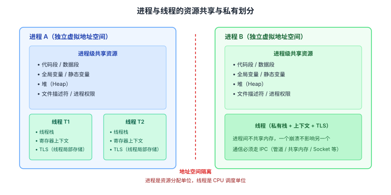
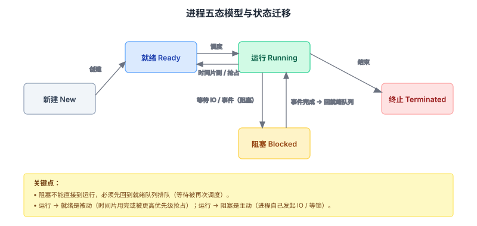
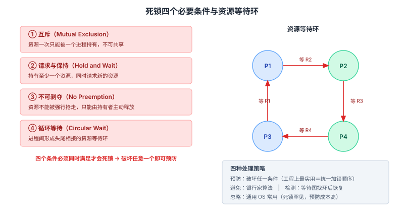
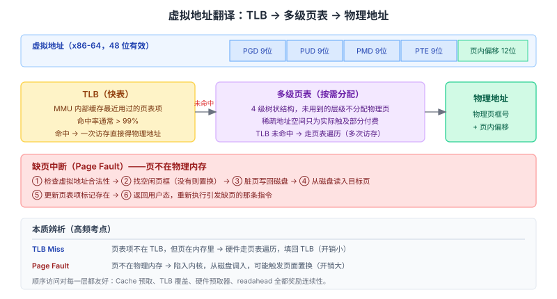
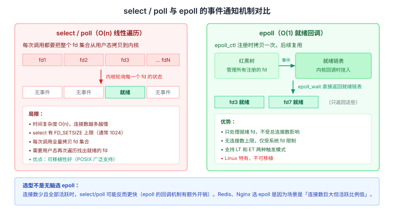

# 操作系统面试知识体系

整理日期：2026-10-13。本文面向客户端/后端校招与社招面试，覆盖进程与线程、CPU 调度、同步与死锁、内存管理、虚拟内存、文件系统、IO 模型。结论均标注依据。

## 结论

操作系统在面试里的地位不如算法和数据库那样「必考」，但一旦被问到，往往能拉开差距，因为它考的是**对系统底层运行方式的理解**，而不是记忆。三块内容占绝对主力：

1. **进程与线程**——区别、状态机、通信方式、调度算法。这是整门课的枢纽，把这块吃透，内存管理和 IO 模型都会顺很多。
2. **内存管理**——虚拟内存、页表、TLB、缺页中断、页面置换、写时复制。这是理解一切上层性能问题的地基。
3. **锁与死锁**——四个必要条件、处理策略、自旋锁与互斥锁、条件变量。

准备顺序建议：先「进程线程 → 内存管理」，再「死锁 → IO 模型 → 文件系统」。IO 模型（select/poll/epoll、零拷贝）是理解 Redis、Nginx、Netty 的基础，问到就说明面试官在探深度。

## 一、用户态与内核态

CPU 有两种运行模式，核心区别是**执行权限**。x86 下内核态通常运行在 Ring 0，用户态在 Ring 3。

- **内核态**：可执行特权指令，管理页表、中断、设备，运行操作系统内核。
- **用户态**：不能执行特权指令，不能随意访问内核内存和其他进程内存，需通过系统调用请求内核服务。

**为什么分两种态**：安全和稳定。用户程序不能直接碰硬件和别人的内存，恶意或写错的程序不会破坏系统。代价是每次系统调用都有模式切换开销（保存/恢复上下文、切换栈、刷新部分 TLB）。

**用户态到内核态的三种方式**：系统调用（主动）、异常（被动，如缺页）、外部中断（被动，如 IO 完成）。

## 二、进程与线程

### 核心区别

| 维度 | 进程 | 线程 |
| --- | --- | --- |
| 定义 | 资源分配的最小单位 | CPU 调度的最小单位 |
| 地址空间 | 独立虚拟地址空间，相互隔离 | 共享所属进程的地址空间 |
| 创建/切换/销毁开销 | 大（要切页表、刷新 TLB、重置地址空间） | 小（只操作线程控制块 TCB，不切内存空间） |
| 共享资源 | — | 全局变量、静态变量、堆、文件描述符、进程权限 |
| 私有资源 | — | 栈、寄存器上下文、线程局部存储 TLS |
| 崩溃影响 | 只影响自己 | 一个线程崩溃拖垮整个进程 |
| 通信方式 | IPC（管道、共享内存、消息队列、信号量、Socket） | 直接读写共享内存（需同步） |

「线程共享内存所以要同步，进程不共享所以不用」——这句话解释了为什么需要锁，以及为什么浏览器把每个标签页隔离成独立进程（一个崩了不影响别的）。

### 进程状态机

五态模型：新建（New）→ 就绪（Ready）→ 运行（Running）→ 阻塞（Waiting/Blocked）→ 终止（Terminated）。

关键迁移：

- 就绪 → 运行：被调度器选中。
- 运行 → 就绪：时间片用完或被更高优先级抢占。
- 运行 → 阻塞：主动等待 IO 或事件（如 `read`、等锁）。
- 阻塞 → 就绪：等待的事件完成（IO 回来、锁释放）。
- **阻塞不能直接到运行**，必须先回到就绪队列排队。

### 僵尸进程与孤儿进程

- **僵尸进程（Zombie）**：子进程已退出，但父进程没有调用 `wait`/`waitpid` 回收它的退出状态，PCB 残留、PID 被占用。大量僵尸会耗尽 PID。解决：父进程及时 `wait`，或处理 `SIGCHLD` 信号。
- **孤儿进程（Orphan）**：父进程先退出，子进程被 init（PID 1，现代 Linux 是 systemd）收养，由 init 负责回收，**不产生资源泄漏，无害**。

### 进程间通信（IPC）

| 方式 | 机制 | 特点 |
| --- | --- | --- |
| 匿名管道 pipe | 内核缓冲区，半双工 | 只能用于有亲缘关系的进程（父子），随进程消失 |
| 命名管道 FIFO | 有文件名的管道 | 无亲缘关系也能用 |
| 消息队列 | 内核中的消息链表 | 有格式、有边界，可随机读取 |
| 共享内存 | 映射同一块物理内存 | **最快**，不经过内核拷贝，但需配信号量做同步 |
| 信号量 | 计数器 + P/V 操作 | 同步互斥，不传数据 |
| 信号 signal | 异步通知 | 简单事件通知，不能带复杂数据 |
| Socket | 网络协议栈 | 唯一能跨主机 |

**为什么共享内存最快**：数据不用在用户态和内核态之间来回拷贝，两个进程直接读写同一块物理内存。代价是要自己解决同步。

## 三、CPU 调度

### 三级调度

- **高级调度（作业调度）**：从外存选作业调入内存，频率最低。
- **中级调度（内存调度）**：挂起/激活进程，处理内存紧张。
- **低级调度（进程调度）**：决定哪个就绪进程占用 CPU，**频率最高，是通常说的调度**。

### 常见调度算法

| 算法 | 原理 | 优点 | 缺点 |
| --- | --- | --- | --- |
| FCFS 先来先服务 | 按到达顺序 | 简单 | 长作业堵塞短作业（护航效应） |
| SJF 短作业优先 | 选运行时间最短的 | 平均等待时间最小（理论最优） | 需预知运行时间，长作业饥饿 |
| SRTF 最短剩余时间 | SJF 的抢占版 | 响应更好 | 同上 |
| RR 时间片轮转 | 每个进程一个时间片轮着跑 | 公平、响应快，交互系统常用 | 时间片太小切换开销大、太大退化成 FCFS |
| 优先级调度 | 优先级高的先跑 | 紧急任务优先 | 低优先级饥饿 |
| 多级反馈队列 | 多队列+不同时间片+动态调整优先级 | 综合适应不同类型任务 | 实现复杂 |

**饥饿的解法是「老化（aging）」**：逐步提高等待进程的优先级。

**抢占式 vs 非抢占式**：抢占式能在时间片到或更高优先级出现时打断当前进程，响应性好但切换多；非抢占式等当前进程主动让出或结束，简单但响应差。

## 四、同步与死锁

### 互斥与同步

- **互斥（Mutual Exclusion）**：同一时刻只允许一个线程进入临界区，解决**资源竞争**。
- **同步（Synchronization）**：让线程按预定顺序执行，解决**协作**。

### 锁的类型与选型

| 锁 | 特点 | 场景 |
| --- | --- | --- |
| 互斥锁 mutex | 读写完全互斥 | 通用，多写场景 |
| 自旋锁 spinlock | 忙等不睡眠 | 临界区极短、不希望睡眠开销；多核；不能长时间持锁 |
| 读写锁 rwlock | 读共享、读写互斥、写写互斥 | 多读少写 |
| 条件变量 condvar | 配合互斥锁，实现等待/唤醒 | 生产者消费者、线程池 |

**自旋锁 vs 互斥锁**：互斥锁拿不到就睡眠（让出 CPU），唤醒有开销；自旋锁拿不到就循环重试（占着 CPU 等）。临界区极短时自旋比睡眠更快（省了上下文切换）；持锁时间长时自旋纯浪费 CPU，该用互斥锁。单核上自旋毫无意义（等待方占着 CPU，持锁方跑不了）。

**条件变量必须用 `while` 而不是 `if` 判断条件**：因为存在**虚假唤醒（spurious wakeup）**——被唤醒后条件未必真的满足。用 `while` 重新检查，条件不满足继续等，这是标准写法，用 `if` 必出 bug。

### 死锁

**四个必要条件（Coffman 条件），必须同时满足才会死锁**：

1. **互斥**：资源一次只能被一个进程持有。
2. **请求与保持（持有并等待）**：持有至少一个资源，同时请求新的资源。
3. **不可剥夺**：资源不能被强行抢走，只能由持有者主动释放。
4. **循环等待**：进程间形成头尾相接的资源等待环。

**四种处理策略**：

| 策略 | 做法 | 代价 |
| --- | --- | --- |
| 预防 | 破坏任意一个必要条件 | 资源利用率低、并发性下降 |
| 避免 | 银行家算法，分配前判断是否仍处于安全状态 | 需预知最大需求，开销大，难以落地 |
| 检测与恢复 | 允许死锁，检测等待图成环后终止/回滚进程 | 检测有开销，恢复可能丢工作 |
| 忽略（鸵鸟算法） | 不管，出现了重启 | 通用 OS 多采用，因为死锁罕见且预防成本高 |

**工程上最实用的预防手段是「破坏循环等待」**：给资源统一编号，所有进程按固定顺序申请锁。零性能损耗、落地简单。锁超时释放、一次性申请所有锁是辅助方案。

**银行家算法**：分配资源前，先模拟分配，然后用安全性算法找一条安全序列（能按某顺序让所有进程跑完）。找得到才真正分配，否则阻塞。安全状态一定无死锁；不安全状态未必一定死锁。缺点是要求预先知道每个进程的最大资源需求，实际系统很难满足。

**死锁 vs 饥饿 vs 活锁**：

- **死锁**：互相等，谁都不动。
- **饥饿**：某个进程永远得不到资源，但别人在跑（优先级调度导致）。
- **活锁**：进程一直在改变状态却没进展（比如两个线程一直互相谦让）。

## 五、内存管理

### 连续分配与碎片

- **首次适应**：从头找第一个够大的空闲块，快但低地址易碎片化。
- **最佳适应**：找最小的够用块，产生大量难以利用的小碎片（外部碎片）。
- **最坏适应**：找最大的块，容易破坏大空闲块。
- **外部碎片**：空闲空间总量够但不连续，靠「紧凑（compaction）」解决，代价大。
- **内部碎片**：分配出去的块内部有浪费（如最后一页没用满）。

### 分页、分段、段页式

| 维度 | 分页 | 分段 |
| --- | --- | --- |
| 划分依据 | 固定大小页（通常 4KB） | 按逻辑模块（代码段、数据段、栈段） |
| 大小 | 固定 | 可变 |
| 地址 | 页号 + 页内偏移 | 段号 + 段内偏移 |
| 碎片 | 无外部碎片，有内部碎片 | 有外部碎片，无内部碎片 |
| 可见性 | 对用户透明 | 用户可见 |
| 优点 | 内存利用率高 | 符合程序逻辑，便于共享与保护 |

**段页式**：先分段，每段内再分页，兼顾两者优点。现代 x86 硬件支持分段，但 Linux 把所有段基址设为 0、界限设为最大值，实际上退化成纯分页。

### 虚拟内存

核心思想：**程序不需要全部装进内存才能运行**，只把当前用到的页调入，其余留在磁盘（swap）。每个进程有独立的虚拟地址空间。

三大作用：

1. **进程隔离**：每个进程看到独立的连续地址空间，互相看不见。
2. **突破物理内存限制**：程序可以比物理内存大。
3. **便于共享**：多个进程可映射同一物理页（如共享库、写时复制）。

虚拟地址到物理地址的翻译由 MMU（内存管理单元）硬件完成，依据页表。

### 页表、多级页表与 TLB

**单级页表的问题**：64 位地址空间、4KB 页，单级页表每个进程要占 512GB，不可行。

**多级页表（x86-64 四级）**：PGD → PUD → PMD → PTE，每级用 9 位索引，页内偏移 12 位。关键在于**按需分配**——未使用的虚拟地址区间对应的页表层级根本不分配物理页，稀疏地址空间只为其实际触及的部分付出代价。

**TLB（快表）**：页表遍历要多次访存，太慢。TLB 是 MMU 内部缓存最近用过的页表项，命中率通常 >99%，让地址翻译在多数情况下接近零成本。

**TLB 与缺页中断的本质区别**（高频辨析）：

| 事件 | 含义 | 处理 |
| --- | --- | --- |
| TLB Miss | 页表项不在 TLB，但**页在内存里** | 硬件（或软件）走页表遍历，把页表项填回 TLB |
| Page Fault | 页**不在物理内存** | 触发异常进入内核，从磁盘调入页，可能触发页面置换 |

**大页（Huge Pages）**：用 2MB 或 1GB 页替代 4KB 页，一个 TLB 项覆盖更大范围，提升 TLB 覆盖（reach），减少 TLB Miss。数据库缓冲池、大堆 JVM 常用。Linux 有透明大页（THP）自动合并。

### 缺页中断处理流程

1. 检查虚拟地址是否合法（是否在该进程的 VMA 区域内），非法则段错误。
2. 找空闲物理页框；没有就调用置换算法选一个牺牲页。
3. 若牺牲页被修改过（脏页），先写回磁盘。
4. 从磁盘或文件缓存读入目标页。
5. 更新页表项，标记存在。
6. 返回用户态，**重新执行**引发缺页的那条指令。

### 页面置换算法

| 算法 | 思路 | 特点 |
| --- | --- | --- |
| OPT 最优 | 换出未来最久不用的页 | 理论最优，无法实现（要预知未来），用作评估基准 |
| FIFO 先进先出 | 换出最早进入的页 | 简单，有 **Belady 异常**（加内存反而缺页增多） |
| LRU 最近最久未使用 | 换出最久没访问的页 | 接近 OPT，但精确实现开销大（需时间戳或链表） |
| Clock 时钟/二次机会 | 循环扫描，访问位为 1 则清零跳过，为 0 则换出 | LRU 的近似，开销小，**工业界最常用** |
| LFU 最不常用 | 换出访问次数最少的页 | 对突发访问不友好，历史计数会失真 |

**Belady 异常**：FIFO 特有——增加物理页框数，缺页率反而上升。LRU 和 OPT 是「栈算法」，不存在这个异常。这是常考的判别题。

**工程实践**：Linux 用的是改进版 Clock，维护 active/inactive 两个链表做近似 LRU。当系统内存严重不足、页面频繁换入换出，CPU 利用率反而暴跌，这叫**颠簸（thrashing）**，本质是并发进程的工作集之和超过了物理内存。

## 六、写时复制（Copy-on-Write）

`fork()` 后父子进程共享同一批物理页，但双方页表项都标记为**只读**。任一方尝试写时触发缺页，内核判断这是 COW 缺页（而非非法访问），就为该进程分配新页、拷贝内容、把页表指向新页并标记可写。

**为什么 `fork` + `exec` 很便宜**：经典 Unix 里 `fork` 完立刻 `exec`（启动新程序），`exec` 会直接丢弃整个地址空间，在任何写发生前就把地址空间换掉了，几乎不用拷贝物理内存。

**Redis 的 `fork` 快照**也是同理：`bgsave` 时 `fork` 出子进程，子进程遍历内存写 RDB 文件，父进程继续处理写请求；只有被修改的页才会真正拷贝，内存增量取决于期间被写的页数。

## 七、文件系统

| 概念 | 说明 |
| --- | --- |
| 文件描述符 fd | 进程打开文件的索引，指向内核的文件表项 |
| inode | 文件的元数据（权限、大小、时间戳、数据块指针），不含文件名 |
| 硬链接 | 多个目录项指向同一个 inode，删一个不影响其它，不能跨文件系统 |
| 软链接（符号链接） | 一个独立文件，内容是目标路径，目标删了就成了断链 |
| Page Cache | 内核缓存文件内容，读写文件先走缓存 |
| 为什么 `write` 成功不代表落盘 | 数据进了 Page Cache 就算成功，真正落盘靠后台刷脏页或 `fsync` |

**fd 与 inode 的区别**：fd 是进程级、打开时的句柄；inode 是文件级、磁盘上的元数据结构。同一文件被多进程打开会有多个 fd，但只有一个 inode。

**硬链接 vs 软链接**：硬链接是「同一个文件的多个名字」，共享 inode，所以不能跨文件系统、不能给目录建；软链接是「指向路径的快捷方式」，跨文件系统、可指向目录，但目标不存在就失效。

## 八、IO 模型与多路复用

### 五种 IO 模型

| 模型 | 说明 |
| --- | --- |
| 阻塞 IO | 调用后一直等，直到数据就绪并拷贝完 |
| 非阻塞 IO | 数据没就绪立刻返回，需轮询 |
| IO 多路复用 | select/poll/epoll 一次监听多个 fd |
| 信号驱动 IO | 数据就绪时内核发信号通知 |
| 异步 IO（AIO） | 调用后立刻返回，内核完成「读+拷贝」后通知 |

前四种都属于「同步 IO」（真正的数据拷贝阶段仍会阻塞），只有异步 IO 是真异步。Linux 的 `io_uring` 是新一代异步 IO 接口。

### select、poll、epoll 对比

| 维度 | select | poll | epoll |
| --- | --- | --- | --- |
| 底层结构 | fd_set 位图 | pollfd 数组 | 红黑树 + 就绪链表 |
| 最大连接数 | 有限（FD_SETSIZE，通常 1024） | 无上限（受内存限制） | 无上限 |
| 事件集合拷贝 | 每次调用全量拷贝到内核 | 每次全量拷贝 | `epoll_ctl` 注册时拷贝一次，后续复用 |
| 查找就绪 fd | 线性遍历全部 fd | 线性遍历全部 | 内核直接返回就绪链表 |
| 时间复杂度 | O(n) | O(n) | O(1)（按就绪数） |
| 触发模式 | 仅 LT 水平触发 | 仅 LT | 支持 LT 和 ET |
| 可移植性 | 广泛（POSIX） | 广泛 | Linux 特有 |

**LT 与 ET**：

- **水平触发（Level Triggered）**：只要 fd 上还有数据没读完，`epoll_wait` 会一直通知。编程简单，但如果一次没读完会反复通知。
- **边缘触发（Edge Triggered）**：只在状态变化时通知一次。必须一次性把数据读完（循环 `read` 到返回 `EAGAIN`），否则剩余数据不会再被通知。高吞吐场景常用，但容易写错。

**为什么 Redis、Nginx 都用 epoll**：连接数巨大但活跃比例低时，epoll 只处理就绪的连接，不受总连接数影响，避免了 select/poll 的线性遍历开销。Nginx 每个 worker 进程独立一个 epoll 实例，配 ET 模式。

**注意**：连接数少且全部活跃时，select/poll 可能反而比 epoll 快（epoll 的回调机制有额外开销）。所以选型要看场景，不是无脑 epoll。

### 零拷贝

传统文件发送（如静态文件服务）要经历**四次拷贝、四次上下文切换**：磁盘 → 内核缓冲区（DMA）→ 用户缓冲区（read）→ socket 缓冲区（write）→ 网卡（DMA）。

**`sendfile`**：数据在内核内直接从文件缓冲区到 socket 缓冲区，省掉用户态往返，减少两次拷贝和两次上下文切换。Nginx 的 `sendfile on` 就是它。

**`splice`**：进一步支持管道间的零拷贝传输，可配合 socket 使用。

**`mmap` + `write`**：把文件映射到用户地址空间，省掉一次拷贝，但仍有内核到 socket 的拷贝，且缺页开销和错误处理更复杂。

## 九、高频对比速查

| 对比项 | 要点 |
| --- | --- |
| 进程 vs 线程 | 资源分配 vs CPU 调度；隔离 vs 共享；开销大 vs 小 |
| 僵尸 vs 孤儿 | 前者父未回收（有害），后者父先退出被 init 收养（无害） |
| 用户级线程 vs 内核级线程 | 前者内核不知情、切换快、无法利用多核；后者可并行、切换开销大 |
| 互斥锁 vs 自旋锁 | 睡眠等待 vs 忙等；临界区长短决定选哪个 |
| 分页 vs 分段 | 固定大小无外部碎片 vs 逻辑划分符合程序结构 |
| 分页 vs 虚拟内存 | 分页是机制，虚拟内存是利用分页+换页实现的抽象 |
| TLB Miss vs 缺页 | 页在内存但翻译没缓存 vs 页不在内存 |
| FIFO vs LRU | 前者有 Belady 异常，后者没有（栈算法） |
| select vs epoll | 线性遍历 O(n) vs 就绪回调 O(1)；可移植 vs Linux 专属 |
| 硬链接 vs 软链接 | 共享 inode vs 独立文件存路径 |
| `write` 成功 vs 落盘 | 进 Page Cache 就算成功，落盘靠 fsync |
| 颠簸 vs 正常换页 | 工作集总量超物理内存，CPU 空转在缺页上 |

## 建议

- **把「进程线程 + 内存管理」练到能画图讲**，这两块是所有追问的发源地。
- **准备三个「讲透一层」的例子**：TLB Miss vs 缺页的区别、自旋锁为何不适合长临界区、`fork`+`exec` 为何便宜。有这种具体例子，面试官会认为你真理解而不是背的。
- **IO 模型一定连着讲应用**：select/poll/epoll 之后接 Redis 或 Nginx 为什么选 epoll，理解层级立刻不同。
- **死锁四个条件要能反推**：给出一个场景能指出违反了哪个条件、怎么破坏。

## 待核实

- Linux 具体内核版本下的 Page Cache 回收策略（如 `min_free_kbytes`、水位线算法、`vm.swappiness` 的精确行为）未逐项核实，正文给的是通用机制。
- 用户级线程/内核级线程的「1:1、N:1、M:N」模型在现代语言运行时（Go goroutine、Java 虚拟线程）里的具体调度实现未展开，需要时可单独成篇。
- io_uring 的完整能力与性能对比数据未做本地实测，正文只提到它的定位。

## 来源清单

| 内容 | 来源 | 日期 |
| --- | --- | --- |
| 用户态/内核态、进程线程、死锁四条件、内存管理、文件系统、IO 模型概览与高频重点 | 小林coding《操作系统面试题》 https://www.xiaolincoding.com/interview/os.html | 2026-10-13 核实 |
| 调度算法、互斥锁/读写锁/条件变量、死锁银行家算法、虚拟内存作用、分页分段、页面置换 | openEuler 社区《备战秋招春招系列——操作系统常见八股速成》 https://openeuler.csdn.net/6ac6337aad85947e68ce4a55.html | 2026-10-13 核实 |
| 进程线程本质区别与开销、僵尸/孤儿进程、同步互斥、死锁四条件与工程解法 | DevPress《操作系统终极复盘（收官篇）》 https://devpress.csdn.net/v1/article/detail/162601056 | 2026-10-13 核实 |
| 虚拟内存、页表/TLB、缺页、COW、页面置换、CLOCK 近似 LRU、大页 | Wikantik《Virtual Memory and Paging》 https://wiki.wikantik.com/wiki/VirtualMemoryAndPaging | 2026-10-13 核实 |
| 虚拟内存机制推演链（分段→分页→多级页表→TLB→换页）与考试重点 | Moyuin《操作系统 - 虚拟内存》 https://moyuin.top/en/notes/操作系统%20-%20虚拟内存 | 2026-10-13 核实 |
| 四级页表、TLB shootdown、需求分页、COW、CLOCK 算法 | Tech Interview《Low Level Design: Virtual Memory System》 https://www.techinterview.org/post/3233473068/lld-virtual-memory-system | 2026-10-13 核实 |
| 死锁四条件、预防/避免/检测、银行家算法、进程-资源分配图化简 | Barry《死锁》面试指南 https://barryyeee.github.io/InterviewGuide/Chapter2/操作系统/死锁.html | 2026-10-13 核实 |
| 死锁 Coffman 条件、死锁/活锁/饥饿区分、检测恢复 | InterviewBiz《What Is a Deadlock in Operating Systems?》 https://www.interviewbiz.com/questions/deadlock-in-operating-systems | 2026-10-13 核实 |
| select/poll/epoll 底层结构、mmap 减少拷贝、ET 模式陷阱 | 博客园《IO多路复用：select、poll、epoll底层原理全解析》 https://www.cnblogs.com/qixing/p/19682955 | 2026-10-13 核实 |
| 零拷贝 sendfile/splice、四次拷贝、拥塞控制参数 | 百度智能云《Linux网络开发常见面试题解析》 https://cloud.baidu.com/article/4089306 | 2026-10-13 核实 |
| IPC 方式、共享内存最快的原因、调度算法、颠簸 | 稀土掘金《一份不可多得的〈操作系统〉面试题大全》 https://juejin.cn/post/7613246340221206528 | 2026-10-13 核实 |
| 进程状态、银行家算法、每类资源单个资源的死锁检测 | Priodemy《Operating System Interview Questions and Answers》 https://priodemy.com/blog/operating-system-interview-questions | 2026-10-13 核实 |
