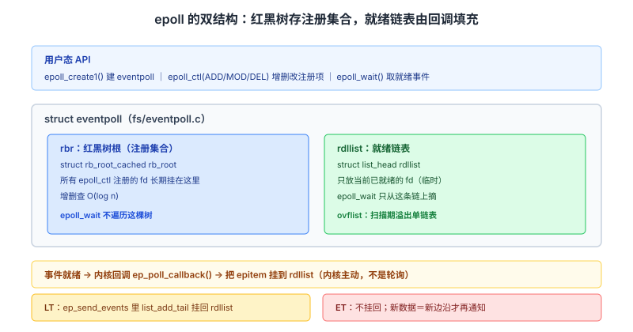
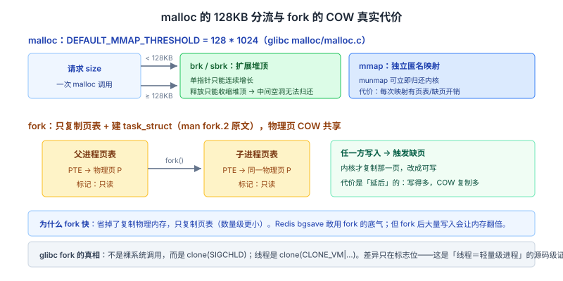

# 操作系统面试知识体系

整理日期：2026-10-13 ｜ 重写：2026-10-14。这份文档不铺广度，只挑面试会连续追问到底的点。每个点讲三层：**机制（内核里到底怎么做的）→ 证据（函数名、常量、数据结构）→ 追问链**。

> 阅读约定：图在 `assets/2026-10-14/` 下。标注「待核实」的地方是本次未拿到源码级依据的，不硬写。

## 结论

操作系统面试的深度体现在**你能不能说出内核里的名字**：

1. **`epoll` 的红黑树和就绪链表各自干什么**、ET/LT 在内核里的**唯一差异是一行 `list_add_tail`**——说得出这个，胜过背十遍「epoll 是 O(1)」。
2. **CFS 的 `vruntime` 增量公式**和 `sched_prio_to_weight` 数组、nice 差 1 级 CPU 时间比 **1.25 : 1**。
3. **`fork` 的代价只是复制页表**（man 原文），`malloc` 的 **128KB 阈值**（glibc 源码）。
4. **`pthread_mutex_lock` 无竞争时零系统调用**（futex 用户态快路径）。

本文按「IO 多路复用 → 进程调度 → 内存与 COW → 同步原语 → 进程线程」组织，全部落到实现细节。

---

## 一、epoll：内核里的红黑树与就绪链表

### 两个数据结构的分工

`epoll` 的核心是 `struct eventpoll`（Linux v6.6 `fs/eventpoll.c`），里面有两个关键成员：

| 成员 | 类型 | 作用 |
| --- | --- | --- |
| `rbr` | `struct rb_root_cached` | **红黑树根**，存放所有 `epoll_ctl` 注册的 fd（interest list），提供 O(log n) 的增删查 |
| `rdllist` | `struct list_head` | **就绪链表**，存放当前已就绪的 fd |
| `ovflist` | `struct list_head *` | 扫描期间的**溢出单链表**，避免事件丢失 |

每个被监听的 fd 对应一个 `struct epitem`（`fs/eventpoll.c:130`），它同时含两个挂载点：

```c
struct epitem {
    struct rb_node rbn;      /* 挂进红黑树 rbr */
    struct list_head rdllink; /* 挂进就绪链表 rdllist */
    ...
};
```

**这个双挂载点是理解 epoll 的关键**：一个 fd 注册时进红黑树（长期存在），就绪时被挂到就绪链表（临时）。`epoll_wait` **不遍历红黑树**，只从 `rdllist` 上摘就绪项。

### 就绪是怎么被"主动"挂上去的

不是 `epoll_wait` 去轮询找谁就绪，而是**事件发生时内核主动回调** `ep_poll_callback`。这个回调在 fd 的事件就绪时被触发，把对应的 `epitem` 挂到 `rdllist`。

**所以「epoll 是 O(1)」的准确含义是**：`epoll_wait` 返回就绪 fd 的复杂度是 **O(就绪数)**，而不是 O(注册总数)。因为内核侧没有「从 N 个 fd 里找出就绪者」的线性扫描——就绪者已经被回调挂好了。

**常见错误**：说「epoll 整个操作都是 O(1)」。实际上：
- `epoll_ctl(ADD)` 是 **O(log n)**（红黑树插入）；
- `epoll_wait` 的拷贝阶段是 **O(maxevents)**（受用户传入的数组大小限制）；
- O(1) 只在「平均每次就绪事件」的意义下成立。

### LT 和 ET 的本质差异：一行代码

这是最硬的一手证据。在 `ep_send_events()`（`fs/eventpoll.c:1676`）里，把事件拷贝给用户态之后（第 1724 行先 `list_del_init(&epi->rdllink)` 把 epitem 从就绪链表摘下），接着：

```c
if (epi->event.events & EPOLLONESHOT)
        epi->event.events &= EP_PRIVATE_BITS;
else if (!(epi->event.events & EPOLLET)) {
        /*
         * If this file has been added with Level
         * Trigger mode, we need to insert back inside
         * the ready list, so that the next call to
         * epoll_wait() will check again the events
         * availability.
         */
        list_add_tail(&epi->rdllink, &ep->rdllist);   /* ← LT 才做这一步 */
        ep_pm_stay_awake(epi);
}
```

**结论：LT 会重新把 epitem `list_add_tail` 回 `rdllist`，ET 不会。** 这就是 LT/ET 在**内核里的唯一本质差异**——不是「检查数据是否读完」的语义差别，而是「是否重新挂回就绪链表」这一行。

**顺带澄清一个高频误区**：「ET 就是只通知一次」是错的。ET 是**边沿触发**——每次新数据到达都是一个新的边沿，会再次通知。真正「只通知一次」的是 `EPOLLONESHOT`（上面代码第一分支，触发后 `epi->event.events &= EP_PRIVATE_BITS` 禁用该 fd，必须 `EPOLL_CTL_MOD` 重新武装）。



### 为什么 ET 必须配非阻塞 fd

man7 `epoll.7` 原文明确：

> An application that employs the **EPOLLET** flag should use **nonblocking file descriptors** to avoid having a blocking read or write starve a task that is handling multiple file descriptors.

原因链：ET 只在边沿通知，**用户态必须循环 `read` 直到返回 `EAGAIN`** 才能保证把内核缓冲区读空。如果 fd 是阻塞的，那最后一次「确认已读完」的 `read` 会**永久阻塞**这个线程——而线程还管理着其它 fd，整个事件循环就卡死了。

man 页给的经典陷阱原文：ET 下若只读走部分数据，「the call to `epoll_wait(2)` done in step 5 will probably **hang** despite the available data still present in the file input buffer」，因为 ET「delivers events only when changes occur on the monitored file descriptor」。

### select / poll / epoll 的准确对比

| 维度 | select | poll | epoll |
| --- | --- | --- | --- |
| 底层结构 | `fd_set` 位图 | `pollfd` 数组 | 红黑树 + 就绪链表 |
| 每次调用 | **全量拷贝** fd 集合进内核 + **线性遍历** | 全量拷贝数组 + 线性遍历 | 注册一次，之后只摘就绪链表 |
| 上限 | `FD_SETSIZE`（通常 1024） | 无（受内存限制） | 无 |
| 事件查找 | O(n) | O(n) | O(就绪数) |
| 触发模式 | 仅 LT | 仅 LT | LT + ET（`EPOLLET`） |
| 可移植性 | POSIX 广泛 | 广泛 | **Linux 特有** |

**注意一个反直觉结论**：连接数少且全部活跃时，**select/poll 可能反而比 epoll 快**（epoll 的回调注册和 `epoll_ctl` 有额外开销）。所谓「epoll 一定更快」只在「连接多、活跃比例低」时成立。面试里答「要看场景」比答「epoll 更快」更专业。

> **追问链**
> 1. `epoll_wait` 返回后，LT 模式下没读完数据下一轮为什么还会被通知？→ 内核在 `ep_send_events` 里重新 `list_add_tail` 回 `rdllist`。
> 2. ET 模式下 `read` 到 `EAGAIN` 之后，新数据到达还能被通知吗？→ 能，新数据是新的边沿。
> 3. 10 万连接、100 个活跃，`epoll_wait` 扫描多少 fd？select 呢？→ epoll 只摘就绪链表（约 100）；select 要线性遍历 10 万个。

---

## 二、进程调度：CFS 的 vruntime 与权重换算

### vruntime 是核心度量

CFS（完全公平调度器）不用时间片，而是用**虚拟运行时间 `vruntime`**（纳秒单位）。内核文档原文：

> In CFS the virtual runtime is expressed and tracked via the per-task **`p->se.vruntime`** (nanosec-unit) value. ... CFS maintains a **time-ordered rbtree**, where all runnable tasks are sorted by the `p->se.vruntime` key. CFS picks the 'leftmost' task from this tree and sticks to it.

**规则**：所有可运行任务按 `vruntime` 排在红黑树上，**每次选最左边（vruntime 最小）的那个运行**。

源码 `fair.c` 的 `update_curr()` 里：

```c
curr->vruntime += calc_delta_fair(delta_exec, curr);
```

即每次调度更新时，`vruntime` 增加 `calc_delta_fair(实际运行时间)`。

### 权重换算：不是 `vruntime += 实际时间`

`calc_delta_fair()`（`fair.c:311`）的关键逻辑：

```c
if (unlikely(se->load.weight != NICE_0_LOAD))
    delta = __calc_delta(delta, NICE_0_LOAD, &se->load);
```

`__calc_delta` 的计算是 `delta_exec * (weight * inv_weight) >> WMULT_SHIFT`，其中 `NICE_0_LOAD = 1024`。

**化简后的公式**：

```
vruntime 增量 = 实际运行时间 × (NICE_0_LOAD / 本任务权重)
             = 实际运行时间 × (1024 / weight)
```

**含义**：权重越大的任务，跑同样的实际时间，`vruntime` 增长越**慢**，于是更晚才被排到最右边，**获得更多 CPU**。这就实现了「按权重分配 CPU 时间」。

### nice 值怎么换算成权重

`sched_prio_to_weight[]`（`kernel/sched/core.c:11542`）是一个 40 项数组，覆盖 nice −20 到 +19。**内核注释原文**说明了换算逻辑：

> Nice levels are multiplicative, with a gentle **10% change for every nice level** changed. ... (to achieve that we use a multiplier of **1.25**. If a task goes up by ~10% and another goes down by ~10% then the relative distance between them is ~25%.)

数组关键值：

| nice | weight |
| --- | --- |
| −20 | 88761 |
| −1 | 1277 |
| **0（基准）** | **1024** |
| 1 | 820 |
| 5 | 335 |
| 10 | 110 |
| 19 | 15 |

**近似公式**：`weight(nice) ≈ 1024 / 1.25^nice`

**可算的结论**（面试直接能答）：
- nice 0 与 nice 1 的 CPU 时间比 = 1024 : 820 ≈ **1.25 : 1**
- 每差一个 nice 级，CPU 占比差约 25%
- `sched_prio_to_wmult[]` 存的是 `2^32 / weight` 的**预计算倒数值**，注释说明目的是「turning divisions into multiplications」，避免内核里做除法。

> **追问链**
> 1. 两个 nice 0 的进程和一个 nice 10 的进程同时可运行，CPU 怎么分？
>    → 权重 1024 : 1024 : 110，总和 2158，nice 10 的那个拿到约 110/2158 ≈ **5%**。
> 2. 新唤醒的进程 `vruntime` 从哪来？
>    → 不能从 0 开始（否则会独占 CPU 很久），内核取 `rq->cfs.min_vruntime` 做基准并加一个偏移，保证它不会长期霸占。
> 3. 为什么用预计算的 `wmult`？
>    → 内核态除法开销大，用乘法+移位替代。

**两个常见误区**：
- ❌「CFS 用时间片轮转」。内核文档明确「the CFS scheduler has **no notion of 'timeslices'** in the way the previous scheduler had, and has **no heuristics whatsoever**」。
- ❌「CFS 是当前默认调度器」。内核文档已说明「Nowadays, CFS is **making room for EEVDF**」——较新内核的默认调度器已转向 EEVDF（Earliest Eligible Virtual Deadline First）。

---

## 三、内存：fork 的真实代价与 malloc 的 128KB 阈值

### fork 到底复制了什么

man7 `fork.2` 的 NOTES 原文：

> Under Linux, **fork() is implemented using copy-on-write pages**, so the only penalty that it incurs is the time and memory required to **duplicate the parent's page tables**, and to create a unique **task structure** for the child.

**所以 fork 的开销 = 复制页表 + 建 `task_struct`**，不复制物理内存。物理页由父子共享，双方页表项都标记为只读；任一方写入时触发缺页，内核才真正复制那一页。

**这条原文直接解释了「fork 为什么快」**，也是 Redis `bgsave` 敢用 fork 的底气。但要注意代价的**延后性**：如果 fork 后有大量写入，COW 会复制大量页，`bgsave` 期间**内存可能翻倍**（详见数据库篇的 RDB 一节）。

### vfork 与 posix_spawn 存在的理由

`fork` 之后通常立刻 `execve`，而 `execve` 会**直接丢弃整个地址空间**——所以复制页表这件事常常是白做的。`vfork.2` 原文解释了这个历史动机：

> in the bad old days a `fork(2)` would require making a complete copy of the caller's data space, often needlessly, since usually immediately afterward an `exec(3)` is done.

`vfork` 的等价定义（man 原文）：

> A call to `vfork()` is equivalent to calling `clone(2)` with flags specified as: **`CLONE_VM | CLONE_VFORK | SIGCHLD`**

`CLONE_VM` 让子进程**共享父进程地址空间**（连页表都不复制），`CLONE_VFORK` 让父进程**阻塞**直到子进程 `exec` 或退出。

**`vfork` 的危险**（man 的 CAVEATS 原文）：

> the child shares all memory with its parent, including the stack. The child must not return from the current function or call `exit(3)` ... but may call `_exit(3)`.

即子进程共享父进程的**栈**，所以它绝不能从当前函数返回、也不能调 `exit()`（会刷新缓冲区、跑 atexit），只能用 `_exit()` 直接退出。

**`posix_spawn`** 是更现代的正规方案，`vfork.2` 提到其设计动机包括「implementable on systems that **lack an MMU**」。

**一个重要的现代事实**（`fork.2` VERSIONS 原文）：glibc 的 `fork()` 包装**并不是**直接调用内核的 `fork` 系统调用，而是

> invokes **`clone(2)`** with flags that provide the same effect as the traditional system call. (A call to `fork()` is equivalent to a call to `clone(2)` specifying flags as just **`SIGCHLD`**.)

**这就是「Linux 里线程和进程没有本质区别」的源码级证据**：`fork` 是 `clone(SIGCHLD)`，线程是 `clone(CLONE_VM | CLONE_FS | CLONE_FILES | CLONE_SIGHAND | CLONE_THREAD)`，差别只在共享标志。所谓「线程是轻量级进程」不是比喻，是实现事实。

> **追问链**
> 1. `fork` 后父子页表项指向同一物理页吗？→ 是，都标记只读，写入时才复制。
> 2. `fork` 后立刻 `execve` 有什么浪费？→ 复制了页表，而 `execve` 马上丢弃全部地址空间。
> 3. 多线程程序里 `fork` 有什么坑？→ man 原文：子进程**只含调用 fork 的那个线程**；且 fork 后到 execve 之间只能调 async-signal-safe 函数（因为锁状态可能不一致）。

### malloc：128KB 是分水岭

glibc `malloc/malloc.c`（master）里的默认值：

```c
DEFAULT_MMAP_THRESHOLD   128 * 1024     /* 128 KB */
DEFAULT_TRIM_THRESHOLD   128 * 1024     /* 128 KB */
DEFAULT_MMAP_MAX         65536
```

**分流规则**：
- 请求 **< 128KB** → 走 `brk` 扩展堆（`sbrk` 调整 program break）
- 请求 **≥ 128KB** → 走 `mmap` 建立独立匿名映射

**为什么这样分**，要从 `brk` 的缺陷说起（man7 `brk.2` 原文）：

> `brk()` and `sbrk()` change the location of the **program break**, which defines the end of the process's data segment.

`brk` 只能调整**单一**的堆顶指针，所以：
- **只能连续增长**，释放时只能收缩**堆顶**，无法归还中间的空洞 → 容易产生**外部碎片**且无法还内存给 OS；
- `mmap` 的映射是独立的，`munmap` 可以**立即归还**给内核。

**这就是 128KB 阈值的意义**：大块分配用 `mmap`，避免大块内存被卡在堆中间无法归还；小块用 `brk`，避免每个小对象都建一个映射（页表开销、缺页开销）。

**一个易被追问的细节**：阈值是**动态自适应**的（`malloc.c` 第 4406 行有 `chunksize_nomask(p) <= DEFAULT_MMAP_THRESHOLD_MAX` 的判断），上限由 `DEFAULT_MMAP_THRESHOLD_MAX` 控制。

> **追问**：`free` 之后内存立刻还给 OS 吗？
> 不一定。走 `mmap` 的（大块）`free` 后直接 `munmap` 归还；走 `brk` 的（小块）要看是否超过 `M_TRIM_THRESHOLD`（128KB）才收缩堆顶，否则留给进程复用。



### 虚拟地址翻译：x86-64 四级页表

`arch/x86/include/asm/pgtable_64_types.h` 的宏：

```
#define PGDIR_SHIFT  39
#define PTRS_PER_PGD 512
#define PUD_SHIFT    30
#define PMD_SHIFT    21
#define PTRS_PER_PMD 512
#define PTRS_PER_PTE 512
```

**推导**（这是面试可以直接推的）：
- 页内偏移 = **12 位**（4KB 页 = 2^12）
- 每级索引 = 9 位（`PTRS_PER_* = 512 = 2^9`）
- 4 级页表：PGD、PUD、PMD、PTE 各 9 位 → **4 × 9 + 12 = 48 位**虚拟地址

**5 级页表**加一级 P4D，达 **57 位**（内核文档 `arch/x86/x86_64/mm` 明确列出 4-level 与 5-level 两套内存布局）。

**TLB Miss vs 缺页中断**（高频辨析，必须分清）：

| 事件 | 含义 | 处理 |
| --- | --- | --- |
| **TLB Miss** | 页表项不在 TLB，但**页在物理内存里** | 硬件（x86 是 MMU 硬件）走页表遍历，填回 TLB |
| **Page Fault** | 页**不在物理内存** | 陷入内核，从磁盘/文件换入，可能触发页面置换 |

**一个必须补充的点（常见误区）**：x86-64 是 **canonical 地址**——48 位之外的高位**必须符号扩展**，否则触发 `#GP`。所以 48 位地址空间不是「随便用 2^48 个地址」，而是合法地址只有两段（用户空间低半 + 内核空间高半）。

> **待核实**：本次未拿到 `arch/x86/mm/tlb.c` 的源码级依据，因此 **PCID/ASID 避免刷 TLB 的具体实现、`invlpg` 的细节不在此展开**。可以确定的是 x86-64 提供了 PCID 机制，进程切换时若打上不同的 PCID 标记，可以避免全局刷新 TLB（否则每次进程切换都要刷，代价很大）——但具体代码路径需进一步核实。

---

## 四、同步原语：futex 的快慢路径

### mutex 无竞争时不进内核

`futex.2` 的标题就是 **fast user-space locking**（快速用户态锁）。设计要点：

- futex 是一个 **32 位整数**，位于用户态可访问的内存里；
- 加锁/解锁的**判断在用户态用原子指令完成**（如 CAS）；
- **只有出现竞争、需要阻塞时**，才通过 `FUTEX_WAIT` 系统调用陷入内核；
- 内核**不维护锁状态**，只在需要挂起/唤醒线程时参与。

**结论**：`pthread_mutex_lock` 在**无竞争时零系统调用**。glibc 的 `pthread_mutex` 实现正是基于 futex——用户态原子操作走快路径，竞争时才进内核慢路径。

**常见错误**：说「mutex 是内核对象，每次 lock 都要进内核」。这是对 futex 设计的误解。

### 内核侧：哈希桶排队

有竞争时，`FUTEX_WAIT` 的处理（`kernel/futex/waitwake.c` 文件头注释原文）：

> `futex_wait()`. This function computes the **hash bucket** and acquires the hash bucket lock. After that it reads the futex user space value ... enqueues itself into the hash bucket.

> `futex_wake()`. This function computes the hash bucket and acquires the hash bucket lock. Then it looks for waiters on that futex in the hash bucket and **wakes** them.

**设计要点**：内核用 **futex 地址哈希** 到不同的桶（`futex_hash(key)`），把等待者挂进桶里，唤醒时按桶查找。这样不同 futex 之间不互相干扰，避免了全局锁竞争。

`FUTEX_WAIT` 是**原子 compare-and-block**（man 原文 "atomic compare-and-block operation"）——先比较 futex 值是否还是期望值，是才阻塞。这个原子性解决了 **lost wakeup** 问题（如果分两步做，比较后、阻塞前对方可能已经 wake 了）。

### 自旋锁 vs 互斥锁

| | 自旋锁 | 互斥锁（futex） |
| --- | --- | --- |
| 拿不到锁 | **忙等**（占着 CPU 循环重试） | **睡眠**（让出 CPU） |
| 代价 | 白白烧 CPU，但省了切换 | 有上下文切换开销 |
| 适用 | 临界区**极短**（几个指令）、**多核** | 临界区可能较长、通用 |
| 单核 | **无意义**——等待方占着 CPU，持锁方跑不了 | 合适 |

**判据**：临界区执行时间 **小于** 两次上下文切换的开销时，自旋更划算；否则该睡眠。

> **追问链**
> 1. `pthread_mutex_lock` 无竞争时有没有系统调用？→ 没有（futex 用户态快路径）。
> 2. `FUTEX_WAIT` 怎么避免 lost wakeup？→ 原子 compare-and-block，比较与阻塞不可分割。
> 3. 为什么单核上自旋锁没意义？→ 等待线程占着唯一的核心空转，持锁线程无法被调度执行。

### 死锁的四个必要条件与工程解法

Coffman 条件（必须**同时**满足才有死锁）：① 互斥；② 请求与保持；③ 不可剥夺；④ 循环等待。

**工程上最实用的是破坏循环等待**：给所有锁**统一编号**，所有线程按固定顺序加锁，环就无法形成。零性能损耗、落地简单。这也是数据库篇里「InnoDB 死锁预防」用的同一招。

**注意**：通用 OS 对死锁通常采取「忽略 + 检测恢复」（鸵鸟算法），而不是预防——因为预防要求预知资源需求（银行家算法），实际系统很难满足。

---

## 五、条件变量为什么必须用 while

标准写法：

```c
pthread_mutex_lock(&m);
while (!condition)              /* 必须是 while，不能是 if */
    pthread_cond_wait(&cv, &m);
/* 此时 condition 一定为真 */
pthread_mutex_unlock(&m);
```

**用 `if` 必出 bug**，两个原因：

1. **虚假唤醒（spurious wakeup）**：`pthread_cond_wait` 可能在没有任何 `signal` 的情况下返回。POSIX 明确允许这种情况，所以醒来后必须重新检查条件。
2. **条件被抢占**：被唤醒到重新拿到锁之间有时间窗，别的线程可能先拿到锁并把条件又改回假了。

**用 `while` 才能保证持有锁时条件为真**。

---

## 六、高频追问速查（按「面试官问 → 我答」组织）

| 面试官会问 | 你要答到的点 |
| --- | --- |
| epoll 的两个数据结构 | `rbr` 红黑树存注册集合、`rdllist` 就绪链表；`epitem` 同时挂两边 |
| LT 和 ET 在内核的差异 | **一行 `list_add_tail`**：LT 把 epitem 重新挂回 rdllist，ET 不挂 |
| ET 为什么必须非阻塞 | 要读到 `EAGAIN` 才算读空；阻塞 fd 的最后一次 read 会永久挂起线程 |
| 「ET 只通知一次」对吗 | **不对**。ET 是边沿触发，新数据是新边沿；只通知一次的是 `EPOLLONESHOT` |
| 「epoll 是 O(1)」准确吗 | 不准确。`epoll_ctl` 是 O(log n)，`epoll_wait` 拷贝是 O(maxevents)，O(1) 只指「按就绪数」 |
| epoll 一定比 select 快吗 | 不一定。连接少且全活跃时 select/poll 可能更快 |
| CFS 的 vruntime 增量 | `实际时间 × (1024 / weight)`；权重越大增长越慢，拿到的 CPU 越多 |
| nice 差 1 级差多少 CPU | 时间比 **1.25 : 1**（`sched_prio_to_weight` 数组，注释说每级差约 25%） |
| nice 10 的进程占多少 | 与两个 nice 0 竞争：110/(1024+1024+110) ≈ **5%** |
| CFS 是默认调度器吗 | 较新内核已转向 **EEVDF**；CFS 也「不用时间片」 |
| fork 复制了什么 | **只复制页表 + 建 task_struct**（COW，man 原文）；不复制物理内存 |
| fork 和线程的关系 | glibc 的 fork 就是 `clone(SIGCHLD)`；线程是 `clone(CLONE_VM|...)`——同一套机制 |
| vfork 为什么危险 | 共享父进程**栈**，不能 return、不能调 `exit()`，只能 `_exit()` |
| malloc 的 brk/mmap 分界 | **128KB**（`DEFAULT_MMAP_THRESHOLD`，glibc 源码） |
| 为什么大块走 mmap | `brk` 只能收缩堆顶、无法归还中间空洞；`mmap` 可 `munmap` 立即归还 |
| x86-64 为什么是 48 位 | 4 级 × 9 位索引 + 12 位页内偏移 = 48；5 级是 57 位 |
| 48 位地址能随便用吗 | 不能，是 **canonical** 地址，高位必须符号扩展，否则 `#GP` |
| TLB Miss 和缺页区别 | 页在内存但翻译没缓存 vs 页不在内存 |
| mutex 无竞争进内核吗 | **不进**。futex 用户态快路径，只有竞争时才 `FUTEX_WAIT` |
| futex 内核怎么排队 | 按 futex 地址**哈希到桶**，挂起/唤醒在桶内进行 |
| 单核能自旋吗 | 不能，等待方占着唯一核心空转，持锁方无法运行 |
| 条件变量为什么 while | **虚假唤醒** + 唤醒后条件可能被抢占改回假 |
| 死锁最实用的解法 | 破坏**循环等待**：所有锁统一编号、固定顺序加锁 |

## 建议

- **说得出内核里的名字**：`epitem`、`rdllist`、`vruntime`、`sched_prio_to_weight`、`NICE_0_LOAD`、`DEFAULT_MMAP_THRESHOLD`、`FUTEX_WAIT`。这些是硬通货。
- **准备三个「反八股」结论**：LT/ET 差的是一行 `list_add_tail`、「epoll 是 O(1)」不准确、mutex 无竞争不进内核。这三个最能区分「背的」和「懂的」。
- **能算的当场算**：nice 权重比、48 位怎么来的、malloc 阈值分流。有数字的答案可信度高得多。
- **把「进程 vs 线程」答到实现层面**：不是列区别表，而是「它们都是 `task_struct`，`clone` 的标志位不同」，这个答案的档次完全不同。

## 待核实

- **PCID/ASID 与 `invlpg` 的具体实现**未拿到 `arch/x86/mm/tlb.c` 源码级依据，本文只提到机制存在，未展开代码路径。
- **x86 缺页异常的完整内核处理流程**（`arch/x86/mm/fault.c`）未逐行核实，本文给出的是通用机制层面的步骤。
- **slab/slub 分配器**的官方文档正文未取得，构造器名、`kmem_cache` 细节未展开。
- **EEVDF** 取代 CFS 的具体内核版本与算法细节未逐版本核实。
- `pthread_mutex` 在 glibc 中的**具体实现路径**（快路径的原子指令序列、`FUTEX_WAIT` 的 `waiters` 位优化）未到源码行级。
- 各命令与参数默认值随内核版本变化，请以目标环境的实际读数为准。

## 来源清单

| 内容 | 来源（一手优先） | 说明 |
| --- | --- | --- |
| epoll 的 `eventpoll`/`epitem` 结构、`rbr`/`rdllist`/`ovflist` | Linux v6.6 `fs/eventpoll.c` | 源码 |
| LT/ET 的分支差异（`list_add_tail`）、`EPOLLONESHOT` | Linux v6.6 `fs/eventpoll.c` 的 `ep_send_events()` | 源码 |
| ET 必须配合非阻塞 fd、ET 漏读陷阱 | man7 `epoll.7`（man-pages 6.19） | 官方手册 |
| `epoll_wait` 的 `maxevents` 上限 | Linux v6.6 `fs/eventpoll.c`（`res >= maxevents`） | 源码 |
| CFS 的 `vruntime`、红黑树、无时间片、EEVDF 转向 | kernel.org `sched-design-CFS` 文档 | 官方文档 |
| `calc_delta_fair`、`__calc_delta`、`NICE_0_LOAD` | Linux v6.6 `kernel/sched/fair.c` | 源码 |
| `sched_prio_to_weight[]`、1.25 倍率、`sched_prio_to_wmult[]` | Linux v6.6 `kernel/sched/core.c` | 源码 |
| `fork` 的 COW 实现、只复制页表、glibc 用 `clone(SIGCHLD)` | man7 `fork.2`（man-pages 6.19） | 官方手册 |
| `vfork` 的 `CLONE_VM\|CLONE_VFORK\|SIGCHLD`、共享栈的危险 | man7 `vfork.2` | 官方手册 |
| `brk` 的语义与缺陷 | man7 `brk.2` | 官方手册 |
| `DEFAULT_MMAP_THRESHOLD=128KB`、`M_TRIM_THRESHOLD`、自适应上限 | glibc master `malloc/malloc.c` | 源码 |
| x86-64 四级/五级页表位数、canonical 地址 | Linux v6.6 `arch/x86/include/asm/pgtable_64_types.h`；内核文档 `arch/x86/x86_64/mm` | 源码 + 官方文档 |
| futex 快慢路径、哈希桶、原子 compare-and-block | man7 `futex.2`；Linux v6.6 `kernel/futex/waitwake.c` | 手册 + 源码 |
| 死锁 Coffman 条件与处理策略 | 教材通用结论（Silberschatz《操作系统概念》）；Coffman et al. 1971 | 教材 + 论文 |
| 讲法组织参考（源码函数级、追问链式） | xiaolincoder/CS-Base、Snailclimb/JavaGuide | GitHub 仓库，2026-10-14 核实 |
