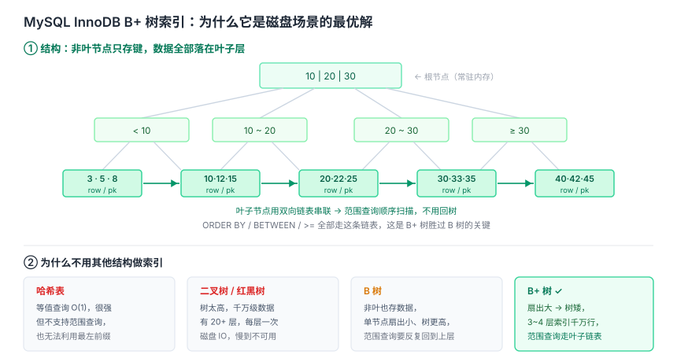

# 数据库与缓存面试知识体系

整理日期：2026-10-13。本文面向校招/社招面试，覆盖 MySQL 索引、事务、锁、日志，以及 Redis 的数据结构、持久化、缓存问题与高可用。结论均标注依据。

## 结论

数据库是面试的第二个高权重支柱，而 Redis 通常和 MySQL 一起考。两条主线：

1. **MySQL 考「因果链」**——不是考你会不会背「有 B+ 树、有 MVCC、有行锁」，而是考你能不能把**索引结构 → 查询效率 → 锁机制 → 并发问题 → 故障成因**串成一条因果链。典型例子：为什么一条没走索引的 UPDATE 会锁住大量行？因为 InnoDB 的行锁锁的是**索引**，不是记录本身。
2. **Redis 考「边界与取舍」**——它常被当成万能的缓存，面试就考你知道它**不能**做什么（不是可靠 MQ、不是事务替代品、冷数据缓存浪费内存），以及每种方案的一致性代价。

准备顺序：MySQL 先「索引 → 事务与 MVCC → 锁」；Redis 先「数据结构 → 持久化 → 缓存三问 → 分布式锁 → 高可用」。

## 一、MySQL 索引

### 为什么是 B+ 树

能做索引的结构有三类：**哈希、树、跳表**。逐层排除：

- **哈希表**：O(1) 等值查找，但**不支持范围查询**，而关系型数据库大量使用范围查询、排序、`order by`，所以不行。
- **跳表**：有序、支持范围，但**不适合磁盘场景**（层级跳转导致随机 IO 多）。
- **平衡二叉树 / 红黑树**：每个节点只存一个 key，数据量大时**树很深**，每次查找要多次磁盘 IO。
- **B 树**：节点存 key 和 data，内部节点能放的条目少，树相对更高。
- **B+ 树**：非叶子节点**只存 key 和指针**，同层能放更多条目 → **树更矮 → IO 次数更少**；且**叶子节点用链表串联**，天然支持范围扫描和排序归并。



**量化直觉**：B+ 树层高通常 3 到 4 层就能存百万到千万级数据。因为一个 16KB 的页能放几百个 key/指针，扇出几百，三层就能覆盖几百的三次方。

### 聚簇索引与二级索引

| 类型 | 叶子节点存什么 | 说明 |
| --- | --- | --- |
| 聚簇索引（主键索引） | **完整行数据** | 数据本身就存在主键索引的叶子节点里 |
| 二级索引（非聚簇索引） | 索引列的值 + **主键值** | 相当于「对主键的索引」，查完整行需要**回表** |

**回表**：用二级索引找到主键，再用主键去聚簇索引查完整行。这是额外的 IO 开销。

**覆盖索引**：如果查询要的所有列都在二级索引里（含主键），就不用回表。`SELECT id, name FROM users WHERE name = 'x'` 建 `(name)` 索引即可覆盖，因为二级索引里就有 name 和 id。

**没有主键时**：InnoDB 会自动生成一个隐藏的 6 字节 rowid 做聚簇索引。

### 联合索引与最左前缀

联合索引 `(a, b, c)` 按 a、再 b、再 c 排序。查询条件必须从最左列开始连续匹配才能用上索引：

| 查询条件 | 用到的索引部分 |
| --- | --- |
| `a = 1` | a |
| `a = 1 AND b = 2` | a, b |
| `a = 1 AND b = 2 AND c = 3` | a, b, c（全覆盖） |
| `b = 2 AND c = 3` | 用不上（跳过最左的 a） |
| `a = 1 AND c = 3` | 只用到 a（b 断了，c 用不上） |
| `a = 1 AND b > 2 AND c = 3` | 只用到 a, b（b 是范围，后面的 c 断了） |

**范围条件之后的列用不上索引**，这是最常见的坑。

### 索引失效场景

| 场景 | 例子 | 原因 |
| --- | --- | --- |
| 索引列参与运算 | `WHERE YEAR(create_time) = 2023` | 要对每行算函数，无法用索引 |
| 隐式类型转换 | `phone` 是 INT，却写 `WHERE phone = '138...'` | 转换后无法用索引 |
| `!=` / `NOT IN` | `WHERE status != 1` | 优化器判断全表扫描更划算 |
| `LIKE` 以通配符开头 | `WHERE name LIKE '%abc'` | 无法定位起始位置 |
| 联合索引不满足最左前缀 | 见上表 | 排序结构决定 |
| `OR` 连接非索引列 | `WHERE a = 1 OR b = 2` | 需要全表扫 |

**注意**：`LIKE 'abc%'` 前缀匹配是**能**用索引的；只有 `%abc` 或 `%abc%` 开头通配才失效。

### 索引设计建议

- 区分度高的列优先建索引（性别这种只有两个值的列建索引没意义）。
- 频繁作为查询条件、连接条件、排序字段的列考虑建索引。
- 用联合索引覆盖多个高频组合查询，而不是给每列单独建。
- 索引不是越多越好：每个索引都占空间，且增删改都要维护所有索引，写性能下降。

## 二、事务与 MVCC

### ACID 与实现

| 特性 | 含义 | InnoDB 的实现 |
| --- | --- | --- |
| 原子性 Atomicity | 要么全成功，要么全失败 | **undo log**（回滚日志）：修改前先记原值，回滚时恢复 |
| 一致性 Consistency | 事务前后数据满足约束 | 前三者共同保障的结果 |
| 隔离性 Isolation | 事务之间互不干扰 | **锁 + MVCC** |
| 持久性 Durability | 提交后永久生效 | **redo log**（重做日志）+ Buffer Pool |

**WAL（Write-Ahead Logging）**：修改先写 redo log 和 Buffer Pool，再定期刷脏页到磁盘。这样把「随机写数据页」变成「顺序写日志」，性能好得多。崩溃后用 redo log 重放恢复，保证持久性。

### 隔离级别与并发问题

| 隔离级别 | 脏读 | 不可重复读 | 幻读 | 实现 |
| --- | --- | --- | --- | --- |
| READ UNCOMMITTED 读未提交 | 可能 | 可能 | 可能 | 无锁 |
| READ COMMITTED 读已提交 | 不会 | 可能 | 可能 | 每次查询生成新 ReadView |
| REPEATABLE READ 可重复读（**InnoDB 默认**） | 不会 | 不会 | InnoDB 基本解决 | 首次查询生成 ReadView + 间隙锁 |
| SERIALIZABLE 串行化 | 不会 | 不会 | 不会 | 全加锁，性能最差 |

- **脏读**：读到别的事务未提交的数据。
- **不可重复读**：同一事务内两次读同一行，结果不同（别的事务改了并提交）。
- **幻读**：同一事务内两次按条件查询，第二次多出了新插入的行（别的事务插入并提交）。

**RC 与 RR 的本质区别就在生成 ReadView 的时机**：RC 是**语句级**（每条查询都新生成），RR 是**事务级**（第一次查询生成后一直用）。这一个差异就决定了「不可重复读」是否发生。

### MVCC 机制

MVCC（多版本并发控制）让**读不阻塞写、写不阻塞读**，是 RR 级别实现一致性读的基础。

两样东西：

1. **版本链**：每行记录隐含两个字段——`DB_TRX_ID`（最近修改它的事务 ID）和 `DB_ROLL_PTR`（指向 undo log 里上一个版本的回滚指针）。多次修改形成一条版本链。
2. **ReadView**：事务读取时生成的一致性视图，包含当前活跃（未提交）的事务 ID 列表。读取时沿版本链找「对当前事务可见」的那个版本。

**可见性判断规则（简化）**：某个版本的事务 ID 若在 ReadView 的活跃列表里（说明当时还没提交），就不可见，继续沿链往前找；否则可见。

**为什么 RR 能避免不可重复读**：ReadView 在第一次查询时生成后固定不变，所以整个事务内看到的都是同一个快照。

**为什么 RR 下幻读基本被解决**：快照读靠 MVCC，当前读（`SELECT ... FOR UPDATE`）靠**间隙锁 + Next-Key Lock** 锁住范围，阻止别的事务在这个范围内插入。

## 三、锁

### 锁的粒度与模式

| 维度 | 类型 | 说明 |
| --- | --- | --- |
| 粒度 | 表锁 / 行锁 / 页锁 | InnoDB 默认行锁，MyISAM 只有表锁 |
| 模式 | 共享锁 S（读锁）/ 排他锁 X（写锁） | S 之间兼容，S 与 X 互斥，X 之间互斥 |
| 意向 | 意向共享 IS / 意向排他 IX | 表级锁，快速判断表里有没有行锁 |
| 加锁方式 | `SELECT ... LOCK IN SHARE MODE`（S）/ `SELECT ... FOR UPDATE`（X） | 普通 SELECT 默认不加锁（快照读） |

### 行锁的三种算法

| 算法 | 锁定范围 |
| --- | --- |
| Record Lock | 锁定单个索引记录 |
| Gap Lock | 锁定索引记录之间的间隙，防止插入（防幻读） |
| Next-Key Lock | Record + Gap 的组合，锁定记录及其前面的间隙（**RR 默认**） |

**最高频的坑：InnoDB 的行锁锁的是索引，不是记录本身。** 所以如果 UPDATE/DELETE 的条件**没走索引**，InnoDB 只能锁全表（所有行），这直接解释了一个真实故障：**一条没走索引的慢 UPDATE 会锁住大量行，导致线上请求排队**。这个因果链是面试极爱考的。

### 死锁

**典型场景**：两个事务以相反顺序更新同一组记录。

```
事务 A: UPDATE t SET ... WHERE id = 1;  -- 持有 id=1 的行锁
        UPDATE t SET ... WHERE id = 2;  -- 等 id=2 的锁
事务 B: UPDATE t SET ... WHERE id = 2;  -- 持有 id=2 的行锁
        UPDATE t SET ... WHERE id = 1;  -- 等 id=1 的锁 → 死锁
```

**InnoDB 的处理**：有等待图检测机制，检测到死锁会**自动回滚代价较小的事务**（通常是修改行数少的那个），让另一个继续。

**预防**：统一加锁顺序（按主键排序后更新）、缩短事务、给操作加超时。

### 乐观锁与悲观锁

| 类型 | 实现 | 适用 |
| --- | --- | --- |
| 悲观锁 | `SELECT ... FOR UPDATE` 先加锁再操作 | 写冲突激烈、冲突代价高的场景 |
| 乐观锁 | 版本号：`UPDATE ... SET version = version + 1 WHERE id = ? AND version = ?` | 读多写少，冲突少 |

乐观锁不是数据库提供的锁，是应用层用版本号或时间戳实现的 CAS 思路。

## 四、Redis

### 为什么快

内存操作 + 高效数据结构 + IO 多路复用 + **核心命令单线程串行执行**（避免锁竞争和上下文切换）。

**「单线程」要讲清楚**：指**命令执行**是单线程，不是整个 Redis 只有一个线程。6.0 起网络 IO 也做了多线程化，后台还有线程做持久化、异步删除等。

**为什么单线程还可能慢**：慢在别的地方——大 key 的删除/遍历、大量命令排队、AOF 刷盘 `always` 策略、内存不足触发 swap、CPU 被其它进程抢占。

### 五种基础类型与底层编码

| 类型 | 用途 | 底层编码 |
| --- | --- | --- |
| String | 缓存、计数、分布式锁 | int / embstr / raw |
| Hash | 存对象 | listpack / hashtable |
| List | 队列、栈 | listpack / quicklist |
| Set | 去重、交并集 | intset / listpack / hashtable |
| ZSet | 排行榜、延时队列 | listpack / **跳表 + 哈希表** |

**ZSet 为什么同时用跳表和哈希表**：哈希表提供 member → score 的 O(1) 查找，跳表提供按 score 排序的范围查询和排名。**为什么用跳表不用红黑树**：跳表实现简单得多，且范围查询（底层链表顺序遍历）更自然，并发修改也更局部。

**大 key 与热 key**：大 key 看体积（几 MB 的 value 删除时会阻塞），热 key 看访问量。排查大 key 用 `SCAN` 分批，**慎用 `KEYS *`**（会阻塞整个 Redis）。

### 过期与淘汰

**过期删除**：**惰性删除**（访问时才检查是否过期）+ **定期删除**（周期性随机抽查一批）。两者配合，兼顾 CPU 和内存。所以**一个过期的 key 如果没人访问，可能长期占着内存**——直到定期删除抽到它或内存不足触发淘汰。

**内存淘汰策略（8 种）**：`noeviction`（默认，写满报错）、`allkeys-lru`、`allkeys-lfu`、`allkeys-random`、`volatile-lru`、`volatile-lfu`、`volatile-random`、`volatile-ttl`。生产常用 `allkeys-lru` 或 `volatile-lru`。

**Redis 用的是近似 LRU**：不维护完整的访问时间链表（太耗内存），而是**随机采样若干 key，淘汰其中最久未使用的**。这是精度与开销的折中。

### 持久化

| 方式 | 原理 | 优点 | 缺点 |
| --- | --- | --- | --- |
| RDB | 快照，`bgsave` fork 子进程写二进制 | 文件小、恢复快 | 两次快照间可能丢数据 |
| AOF | 追加写命令日志 | 数据更完整，`everysec` 最多丢 1 秒 | 文件大、恢复慢 |
| 混合持久化（4.0+） | RDB 头 + AOF 尾部 | 兼顾恢复速度和数据完整 | — |

**AOF 刷盘策略**：`always`（每条都刷，最安全最慢）、`everysec`（每秒刷，生产常用）、`no`（交给 OS，最快最不安全）。

**`bgsave` 的 fork + COW**：`fork` 出子进程写快照，父子共享内存页；只有被修改的页才真正拷贝。**所以 `bgsave` 期间主进程**可以**继续处理写请求**（这是常见面试题），但高写入时 COW 会造成内存膨胀。

**AOF 重写**：命令日志会越来越长（同一个 key 被改 100 次就有 100 条），重写用当前数据状态生成一个精简的新日志。重写期间的**新写命令会同时写入旧 AOF 缓冲和新 AOF 缓冲**，所以不会丢。

### 缓存三大问题

| 问题 | 场景 | 后果 | 处理 |
| --- | --- | --- | --- |
| **穿透** | 查不存在的数据，缓存和数据库都没有 | 每次都打到数据库 | 缓存空值（短 TTL）、布隆过滤器、参数校验 |
| **击穿** | 单个**热点 key 突然失效** | 大量请求同时打到数据库 | 互斥锁（只让一个请求回源）、逻辑过期（不设 TTL，用逻辑字段判断） |
| **雪崩** | **大量 key 同时失效**或 Redis 故障 | 数据库被瞬间压垮 | 过期时间加随机值打散、多级缓存、集群、熔断降级 |

**击穿和雪崩的处理为什么不一样**：击穿是**一个**热点 key，重点在「只让一个请求去回源」，所以用互斥锁；雪崩是**大批** key 同时失效，重点在「把失效时间打散」和「即使全打过来也不要压垮数据库」，所以加随机 TTL、多级缓存、熔断。**问题规模不同，解法就不同**，这是面试常追问的点。

### 缓存与数据库一致性

**Cache Aside 模式（最常用）**：读时未命中回源并写缓存；写时**先更新数据库，再删除缓存**。

**为什么是「删除缓存」而不是「更新缓存」**：

- 避免并发写导致的脏数据（两个写请求先后更新，缓存的更新顺序可能和数据库不一致）。
- 避免「写多读少」时白白更新了不会被读的缓存。
- 删除是幂等的、代价小的操作。

**为什么先更新数据库再删缓存**：反过来（先删缓存再更新数据库）在并发下更容易出现「删完缓存、另一个读请求回源读到旧值并写回缓存、然后数据库才更新」的脏数据窗口。

**更严的方案**：延迟双删（更新数据库后延迟再删一次缓存）、订阅 binlog 异步删缓存（Canal）。**注意：强一致做不到**，只能做到最终一致，这是分布式缓存的固有代价，面试时要主动说明这个边界。

### 分布式锁

基本实现：`SET key value NX PX 30000`（原子地加锁 + 设过期），value 用唯一标识（如 UUID），释放时用 Lua 脚本**先校验 value 再删除**（保证只删自己的锁）。

**为什么释放要用 Lua**：`GET` 再 `DEL` 是两步，中间锁可能已过期并被别人获取，会导致删掉别人的锁。Lua 保证校验和删除原子。

**为什么设了 TTL 还可能失效**：如果业务执行时间超过 TTL，锁会提前过期，另一个客户端就能加锁成功，导致**两个客户端同时操作资源**。缓解：Redisson 的看门狗（watch dog）自动续期、合理设置 TTL、业务侧幂等。

**RedLock 的争议**：RedLock 用多个独立 Redis 实例，多数加锁成功才算成功。它在理论上能提高可靠性，但存在争议——对时钟依赖、GC 暂停、网络延迟的假设在真实环境未必成立。面试时提一句「有争议、不适合严格正确性要求的场景」即可，不必深入。

### 高可用架构

| 架构 | 作用 | 说明 |
| --- | --- | --- |
| 主从复制 | 副本 + 读扩展 | 默认**异步**，主挂可能丢少量数据 |
| Sentinel 哨兵 | 监控 + 自动故障转移 | **不管分片**，只做高可用 |
| Cluster 集群 | 分片 + 高可用 | **16384 个槽**分配数据，每个分片内部还可有主从 |

**Sentinel 和 Cluster 最主要的区别**：Sentinel 解决「主库挂了怎么办」（高可用），Cluster 解决「一个主库装不下怎么办」（横向扩展）。Cluster 把数据分到多个主节点，每个节点只负责一部分槽。

**脑裂**：网络分区时可能同时出现两个主库，都接受写，恢复后数据冲突。防御：设置 `min-replicas-to-write`（至少 N 个从库才允许写）等参数。

**Pub/Sub 与 Stream**：Pub/Sub 是即发即弃，订阅者不在线就丢消息，**不能当可靠队列**；Stream 支持消费组和 ACK，更接近消息队列，但仍不是专业的 MQ。

### Redis 的边界（面试加分）

- **不是可靠 MQ**：Pub/Sub 会丢消息，Stream 也不是专业 MQ。
- **不是 MySQL 事务的替代品**：不支持运行时回滚（Redis 事务是命令批量执行，出错不回滚）。
- **Pipeline 不保证原子性**：它只是省 RTT 的批量发送，中间命令可能失败。
- **Write Behind（先写缓存后落库）可能丢数据**。
- **缓存冷数据浪费内存**：只有热点数据才值得缓存。

## 五、高频对比速查

| 对比项 | 要点 |
| --- | --- |
| B+ 树 vs B 树 | 数据只在叶子 vs 所有节点都存；叶子链表支持范围查询 |
| B+ 树 vs 红黑树 | 磁盘友好、树矮、IO 少 vs 内存中排序 |
| 聚簇 vs 二级索引 | 叶子存整行 vs 存索引列 + 主键（需回表） |
| RC vs RR | ReadView 语句级 vs 事务级 |
| 快照读 vs 当前读 | MVCC vs 加锁（间隙锁防幻读） |
| 乐观锁 vs 悲观锁 | 版本号 CAS vs 先加锁 |
| RDB vs AOF | 快照快恢复 vs 日志更完整 |
| 穿透 vs 击穿 vs 雪崩 | 数据不存在 vs 单热点失效 vs 大批同时失效 |
| 删缓存 vs 更新缓存 | 避免并发脏数据和无效更新 |
| Sentinel vs Cluster | 高可用 vs 分片扩展 |
| 跳表 vs 红黑树（Redis ZSet） | 实现简单、范围查询自然、并发局部性好 |

## 建议

- **把「因果链」讲出来**：从「B+ 树矮所以 IO 少」讲到「没走索引所以锁全表所以慢 UPDATE 阻塞线上」，这条链能证明你真懂而不是背的。
- **缓存三问要区分清楚**：不要三个问题一个解法，讲清「规模不同、解法不同」。
- **MVCC 讲两层就够**：版本链 + ReadView，重点落在「RC 和 RR 的区别就是生成 ReadView 的时机」。
- **Redis 主动提边界**：面试官很吃「我知道它不能干什么」这一套。
- **一致性只说最终一致**：别承诺强一致，说明代价。

## 待核实

- InnoDB 各版本对间隙锁、插入意向锁的行为有细节差异，正文给的是 RR 级别下的通用行为。
- AOF 重写期间新命令的缓冲机制在不同版本（尤其 7.0 的 multi-part AOF）有变化，未逐版本核实。
- RedLock 争议的具体论文结论与反驳未逐条引用，正文只给出结论性描述。
- MySQL 8.0 的 `performance_schema` 与新优化器行为未展开。

## 来源清单

| 内容 | 来源 | 日期 |
| --- | --- | --- |
| B+ 树优势、MVCC 与隔离级别协作、行锁锁索引、间隙锁与死锁 | 科维阔达《MySQL面试突击：三天理清索引、事务与锁的因果链》 http://www.kwkd.cn/news/83762 | 2026-10-13 核实 |
| 为什么选 B+ 树（对比哈希/跳表/平衡树/红黑树/B 树）、聚簇与二级索引 | 阿里云开发者社区《MySQL沉浸式面试：隔离级别、锁、索引原理连环炮》 https://developer.aliyun.com/article/1243984 | 2026-10-13 核实 |
| ACID 实现、隔离级别、锁类型、间隙锁、B+ 树索引 | BestHub《Master MySQL ACID, Isolation Levels, Locks & Indexes》 https://www.besthub.dev/articles/master-mysql-acid-isolation-levels-locks-indexes-a-deep-dive-bbf9d161d353 | 2026-10-13 核实 |
| 隔离级别实现、索引失效场景、死锁场景 | 百度智能云《MySQL面试题深度解析》 https://cloud.baidu.com/article/5379962 | 2026-10-13 核实 |
| MVCC 版本链、ReadView、锁算法、乐观锁/悲观锁 | CSDN《MySQL重点内容（索引、事务、锁、日志、性能优化）》 https://blog.csdn.net/2301_80333444/article/details/146228898 | 2026-10-13 核实 |
| Redis 数据结构与应用、过期淘汰、缓存三问、持久化、分布式锁、高可用 | CSDN《Redis 八股不靠硬背：跟着逆境守住一座缓存城》 https://blog.csdn.net/2401_87662859/article/details/163368299 | 2026-10-13 核实 |
| Redis 面试组织方式、与 MySQL 分工、边界 | 工具帮《Redis 面试串讲：从应用场景到高可用的一条回答线》 https://mytoolbang.com/guides/redis-interview-roadmap-guide | 2026-10-13 核实 |
| Redis 速记卡、大 key、分布式锁、集群架构 | CSDN《Redis面试核心考点速记：数据类型、持久化与分布式锁》 https://blog.csdn.net/weixin_29698641/article/details/164635014 | 2026-10-13 核实 |
| Redis 知识体系、跳表、PSYNC2、Cluster 16384 slot、近似 LRU | 炼金塔《Redis 知识体系总览》 https://lianjinta.com/redis/overview | 2026-10-13 核实 |
