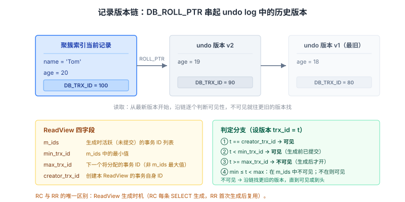
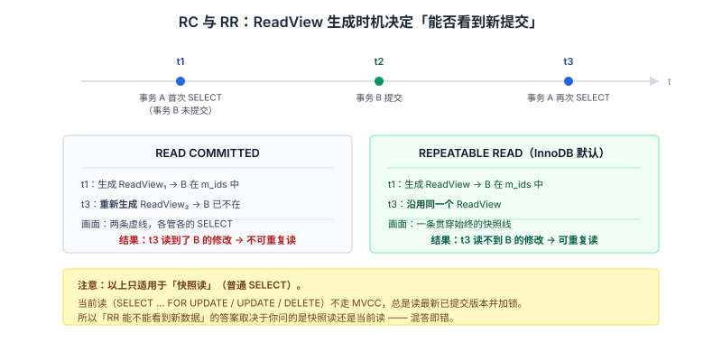
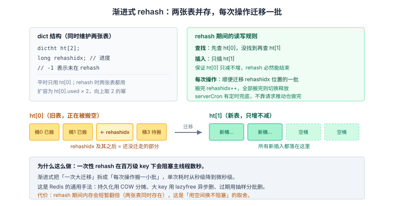

# 数据库与缓存面试知识体系

整理日期：2026-10-13 ｜ 重写：2026-10-14。这份文档不铺广度，只挑面试会一路追问到底的点。每个点讲三层：**机制（源码/页结构里到底怎么做的）→ 证据（函数名、常量、字段）→ 追问链**。MySQL 部分聚焦「B+ 树为什么在磁盘上成立」「MVCC 的可见性判定到底怎么算」「锁与索引的因果链」；Redis 部分聚焦「过期删除的源码实现」「渐进式 rehash」「持久化的真实代价」。

> 阅读约定：图在 `assets/2026-10-14/` 下。源码引用以 Redis 6.x/7.x、MySQL 8.0 为准，版本差异在正文显式标注。

## 结论

数据库面试的「深」体现在三个地方，缺一个都会被追问到卡壳：

1. **能把结构和性能连起来算**。不是「B+ 树矮所以 IO 少」，而是「16KB 页、一条记录约 1KB、非叶子节点存 key+指针约 14 字节 → 单页扇出上千 → 三层覆盖十亿级」——**能当场估算**，才算懂。
2. **能说出版本链上的可见性判定规则**。MVCC 不是「有个 ReadView」，而是「`m_ids` + `min_trx_id` + `max_trx_id` + `creator_trx_id` 四个字段，配合记录的两个隐藏列，走三条分支判断」。能写出这四条分支的人是少数。
3. **能说清 Redis 的实现函数名**。`expireIfNeeded`、`activeExpireCycle`、`ACTIVE_EXPIRE_CYCLE_LOOKUPS_PER_LOOP=20`、`rehashidx`——这些是区分「看过源码」和「背过八股」的分水岭。

---

## 一、B+ 树：为什么它在磁盘上成立

### 排除法只是铺垫，关键是算一笔账

「哈希不支持范围、红黑树太高、B 树内部节点存数据导致扇出小」这套排除法是铺垫。真正体现理解的是**量化**：

设 InnoDB 页大小 `innodb_page_size = 16KB`（默认）：

- **非叶子节点**只存「索引列值 + 6 字节页号」。假设索引列是 bigint（8 字节），一条非叶子记录约 `8 + 6 = 14 字节`。加上页头页尾开销（约 100 多字节），一个 16KB 页能放约 **1000+ 个**这样的指针记录。
- **扇出 ≈ 1000**。B+ 树三层能覆盖的叶子页数 = `1000 × 1000 = 100 万` 个叶子页。
- 每个叶子页能放多少行？假设一行 1KB，一个 16KB 页放约 15 行。那么三层树覆盖的行数 = `100万 × 15 = 1500 万` 行。

**结论：三层 B+ 树（即最多 3 次磁盘 IO）能覆盖千万级数据。** 而根节点和前三层几乎总在 **Buffer Pool** 里（热点页），实际磁盘 IO 往往只有 **1 次**（到叶子页取行）。

对比红黑树：同样是 1500 万条，红黑树高度约 `2·log₂(1500万) ≈ 48` 层，最坏要 48 次随机 IO。**这就是「树矮」的量化意义**——不是形容词，是 3 次 vs 48 次。

> **追问**：为什么非叶子节点不存数据行（对比 B 树）？
> 因为磁盘 IO 的单位是**页**，不是字节。一次 IO 读 16KB，我们希望这 16KB 里尽可能多地装「用于路由的 key」而不是「数据」。B 树的非叶子节点存 data 会挤掉 key 的空间，扇出从 1000 掉到几十，树高翻倍。**B+ 树把「数据下沉到叶子、非叶子纯路由」这一件事做到极致。**

### 页分裂：写放大从哪来

B+ 树插入时，如果目标叶子页满了，就要**页分裂**：申请新页、把一半记录搬过去、更新父节点的指针。这个动作有代价：

- **顺序插入（自增主键）**：新记录总在最右叶子页追加，页满就去申请新页，几乎不做分裂（`innodb_fill_factor` 默认留 1/16 空间）。插入是顺序 IO，快。
- **随机插入（如 UUID 主键）**：新记录随机落到中间某个页，该页满则分裂，把一半记录搬到新页。**这会导致大量随机 IO、页空间碎片化、Buffer Pool 命中率下降**。

**这就是「为什么推荐自增主键」的底层原因**——不是「自增好看」，而是**随机主键会引发频繁页分裂和随机写**。面试里能从页分裂讲到写放大和 Buffer Pool 污染，是深度体现。

### 最左前缀：从 B+ 树的排序结构推出来，而不是背

联合索引 `(a, b, c)` 在 B+ 树上**先按 a 排、a 相同再按 b 排、b 相同再按 c 排**。所以：

| 条件 | 能否用索引 | 为什么 |
| --- | --- | --- |
| `a=1` | ✅ 用到 a | 全局按 a 有序 |
| `a=1 AND b=2` | ✅ 用到 a,b | a 定值后，b 在 a=1 的区间内有序 |
| `a=1 AND c=3` | ⚠️ 只用到 a | a=1 的区间内 b 无序，c 更无序；c 无法用于定位 |
| `b=2` | ❌ 完全用不上 | 全局 b 不有序 |
| `a=1 AND b>2 AND c=3` | ⚠️ 只用到 a,b | b 是范围，b 之后 c 的定位失效（但可能用于**索引下推**过滤） |

**注意最后一行**：虽然 c 不能用索引定位，但 MySQL 5.6+ 的 **索引下推（ICP, Index Condition Pushdown）**可以在**存储引擎层**用 c 先过滤掉不满足的记录，减少回表次数。所以「用不上索引」不等于「完全没帮忙」。

### 索引失效里最容易被追问的一条：隐式类型转换

`phone` 是 `VARCHAR`，写 `WHERE phone = 13800138000`（不加引号）。MySQL 的规则是：**字符串列与数字比较时，把字符串转成数字**。所以 `phone` 列被隐式套上了 `CAST(phone AS SIGNED)`，**列上有了函数，索引失效**。

反过来的坑更隐蔽：如果 `id` 是 `INT`，写 `WHERE id = '123'`，规则是**把字符串转成数字**（数字与非数字比较时数字优先），列上**没有**函数，索引仍可用。**所以「字符串列用数字查」会失效，「数字列用字符串查」不一定失效**——这个不对称性是高频追问。

> **追问**：`WHERE status != 1` 为什么也用不上索引？
> 严格说不是「用不上」，而是**优化器算出来全表扫更划算**。如果 `status != 1` 命中的行占绝大多数，走索引（二级索引 → 回表）反而比直接全表扫代价大。**这是成本问题，不是语法问题**——所以同一句 SQL 在数据分布不同时执行计划可能不同。这个「优化器成本模型」的视角是加分项。

---

## 二、MVCC：可见性判定的四条分支

### 版本链：两个隐藏列

InnoDB 的聚簇索引记录里有两个隐藏列：

| 隐藏列 | 含义 |
| --- | --- |
| `DB_TRX_ID`（6 字节） | 最近一次修改该记录的事务 ID |
| `DB_ROLL_PTR`（7 字节） | 回滚指针，指向 undo log 中**上一个版本**的记录 |

每次修改记录，InnoDB 把旧版本写进 **undo log**，新记录的 `DB_ROLL_PTR` 指向旧版本，于是形成一条**版本链**（越往链尾越旧）。链的终点是「插入时的原始版本」。



### ReadView：四个字段

事务做**快照读**时生成一个 ReadView，里面有四个关键字段：

| 字段 | 含义 |
| --- | --- |
| `m_ids` | 生成 ReadView 时**活跃（未提交）**的事务 ID 列表 |
| `min_trx_id` | `m_ids` 中的最小值 |
| `max_trx_id` | 生成 ReadView 时**下一个将要分配**的事务 ID（注意：不是 `m_ids` 最大值，是「下一个待分配」） |
| `creator_trx_id` | 创建这个 ReadView 的事务自己的 ID |

### 可见性判定：沿着版本链从新到旧，逐版本套四条分支

读记录时，从版本链**当前最新版本**开始，逐个版本判断：

```
设该版本的 trx_id 为 t：

1) t == creator_trx_id        → 我自己改的，可见。停止。
2) t <  min_trx_id            → 该事务在 ReadView 生成前就已提交，可见。停止。
3) t >= max_trx_id            → 该事务在 ReadView 生成后才开启，一定不可见 → 沿链找下一个（更旧）版本。
4) min_trx_id <= t < max_trx_id：
     ├─ t 在 m_ids 中    → 生成 ReadView 时它还活跃（未提交），不可见 → 找下一个版本
     └─ t 不在 m_ids 中  → 生成 ReadView 时它已提交，可见。停止。
```

**这四条分支能默写出来，就超过了绝大多数候选人。** 关键点：

- 判定是**沿链迭代**的——不可见就找更旧的版本，直到找到可见的或链到头。
- 第 3 条用的是 `max_trx_id`（下一个待分配），所以 `>= max_trx_id` 意味着「这个事务在快照之后才开始」，天然不可见。

### RC 与 RR 的差别，就在 ReadView 什么时候生成

| | READ COMMITTED | REPEATABLE READ |
| --- | --- | --- |
| ReadView 生成时机 | **每条 SELECT 都重新生成** | **第一次 SELECT 时生成，之后复用** |
| 效果 | 每次读都能看到最新已提交 | 整个事务看到同一个快照 |
| 不可重复读 | 可能发生 | 不会 |

**一个具体推演**：事务 A 在 t1 时刻第一次 SELECT（生成 ReadView，此时事务 B 未提交，B 在 `m_ids` 里）。t2 时刻 B 提交。t3 时刻 A 再 SELECT：

- **RC**：t3 重新生成 ReadView，B 已不在 `m_ids` 里 → **能读到 B 的修改**（不可重复读）。
- **RR**：沿用 t1 的 ReadView，B 仍在 `m_ids` 里 → **读不到 B 的修改**（可重复读）。

**注意一个常见误区**：RR 下的**快照读**用 MVCC，但**当前读**（`SELECT ... FOR UPDATE` / `LOCK IN SHARE MODE` / `UPDATE` / `DELETE`）**不走 MVCC**，总是读最新已提交版本并加锁。所以「RR 能不能看到别人新提交的数据」取决于你问的是快照读还是当前读——混答就是错的。



### 幻读：为什么 RR 下「基本解决」而不是「完全解决」

- **快照读的幻读**：靠 MVCC 解决——整个事务看同一个快照，新插入的行根本不在快照里。
- **当前读的幻读**：靠**间隙锁 + Next-Key Lock** 解决——`SELECT ... FOR UPDATE` 不仅锁住命中的记录，还锁住记录之间的**间隙**，让别的事务无法在这些间隙里插入。

**但仍有边角**：如果事务先做快照读（拿到快照，看不到新行），然后**自己**插入了一行，再用当前读，可能看到「自己的插入」和「别人在间隙外插入的行」混合的情况。这类极端场景说明 RR 的防幻读是「大部分场景够用」而非「数学上完全消除」。**面试里答「InnoDB 在 RR 下用间隙锁基本解决了幻读」比答「完全解决了」更准确。**

---

## 三、锁：一条能解释真实故障的因果链

### 核心事实：InnoDB 的行锁锁的是索引，不是记录

这是理解 InnoDB 锁的**第一性事实**。锁加在**索引项**上，所以：

| 情况 | 加锁效果 |
| --- | --- |
| 条件走了**唯一索引**且等值命中 | 退化为**记录锁**（Record Lock），只锁这一行 |
| 条件走了**普通索引**且等值命中 | Next-Key Lock（记录 + 前面的间隙）；若该值有重复还会锁相邻 |
| 条件走了索引但**范围扫描** | Next-Key Lock 锁住扫描过的整个范围 |
| 条件**没走索引** | 无法用索引定位 → **锁全表的所有行**（等价于锁全表） |

**这条因果链解释了一个经典线上故障**：

> 一条 `UPDATE orders SET status=1 WHERE user_name='xxx'`（`user_name` 无索引）
> → 走全表扫描 → InnoDB 给**每一行**加 Next-Key Lock
> → 其它请求在这段时间内**全部阻塞**（不只是 user_name='xxx' 的行）
> → 请求堆积、连接池耗尽、服务雪崩

**所以「建索引」不只是为了查询快，也是为了避免锁范围失控。** 这个把「索引」和「锁」串起来的因果链，是面试官最爱的深度体现。

### 三种锁算法与它们防什么

| 算法 | 锁什么 | 防什么 |
| --- | --- | --- |
| Record Lock | 单条索引记录 | 改这一行 |
| Gap Lock | 记录之间的**间隙**（不含记录本身） | **插入**（防幻读） |
| Next-Key Lock | Record + 它**前面**的间隙 | 改 + 插入（RR 默认） |

**为什么只是「前面的间隙」**：Next-Key Lock 锁定 `(前一记录, 当前记录]`。多个 Next-Key Lock 连起来就能覆盖整个索引区间，比 Gap Lock 更完备地防插入。

> **追问**：为什么 RC 级别下没有间隙锁？
> 间隙锁的代价是**并发度下降**（锁住范围会阻塞很多插入）。RC 追求更高的并发，且 RC 允许不可重复读（幻读本就存在），所以**在 RC 下 InnoDB 会禁用间隙锁**（除唯一索引和唯一性检查外），只保留记录锁。这就是「RC 并发比 RR 高」的原因之一。

### 死锁：InnoDB 怎么检测、怎么选牺牲者

**场景**：两个事务以相反顺序更新同一组行，A 持 id=1 的锁等 id=2，B 持 id=2 的锁等 id=1。

**InnoDB 的检测**：维护一个**等待图（wait-for graph）**，每次加锁请求进入等待时检查是否形成环。检测到环，**回滚「代价较小」的事务**。

**「代价较小」怎么算**：InnoDB 用 `trx_weight`（事务权重）比较，大致是「持有/修改的行数 + 锁数量」。**改动行少的事务权重小，被选为牺牲者**，回滚成本低。被牺牲的事务收到 `Deadlock found when trying to get lock` 错误（错误码 1213）。

**预防的工程手段**：
- **统一加锁顺序**：所有事务都按主键（或固定字段）升序更新，从根上消除环。
- **缩短事务**：事务越长，持有锁越久，成环概率越大。
- **降低隔离级别**：RC 下没有间隙锁，死锁概率显著降低（很多互联网公司为此把隔离级别设为 RC）。
- **给锁等待设超时**：`innodb_lock_wait_timeout`（默认 50 秒），超时后报错而非无限等待。

---

## 四、MySQL 日志与崩溃恢复：WAL 不只是「先写日志」

### 三个日志各干什么

| 日志 | 层级 | 存什么 | 作用 |
| --- | --- | --- | --- |
| **redo log** | InnoDB 引擎层 | 物理日志（「在哪个页的哪个偏移改了什么」） | 崩溃恢复（持久性）；**固定大小、循环写** |
| **undo log** | InnoDB 引擎层 | 逻辑日志（「改回原值的操作」） | 事务回滚（原子性）+ MVCC 版本链 |
| **binlog** | MySQL Server 层 | 逻辑日志（SQL 或行变化） | 主从复制、数据恢复归档；**追加写，不循环** |

**redo log 为什么是「循环写」**：它大小固定（`innodb_log_file_size`），写满后从头覆盖已刷盘的 part。这是个精巧的设计——redo log 只需要保证「脏页刷盘前，对应的日志还在」，所以不需要无限增长。

### WAL 的真实含义：随机写变顺序写

修改数据时，InnoDB 不是直接改磁盘上的页（那是随机 IO），而是：

1. 修改 **Buffer Pool** 里的页（内存操作，快）；
2. 把「改了什么」**顺序追加**到 redo log；
3. 事务提交时，按 `innodb_flush_log_at_trx_commit` 策略决定 redo log 是否 `fsync` 到磁盘。

**关键**：数据页（脏页）**可以之后慢慢刷**，只要 redo log 已落盘，崩溃就能重放恢复。于是「随机写数据页」被转换成了「顺序写日志 + 后台批量刷脏页」。**这才是 WAL 的核心收益——不是「先写日志」这个动作，而是「让随机写变成顺序写」。**

`innodb_flush_log_at_trx_commit` 的三个取值决定了持久性的强度：

| 值 | 行为 | 崩溃丢数据 |
| --- | --- | --- |
| 1（默认） | 每次提交都 `fsync` | 不丢 |
| 2 | 每次提交写 OS 缓存，每秒 `fsync` | 机器崩丢 1 秒，进程崩不丢 |
| 0 | 每秒写+`fsync`，提交不管 | 最多丢 1 秒 |

> **追问**：redo log 和 binlog 的两阶段提交（2PC）为什么必要？
> redo log（引擎层）和 binlog（Server 层）是**两套独立日志**，如果写入顺序不当，崩溃会导致两者不一致：比如 redo 写了、binlog 没写 → 主库恢复后有这条数据，从库/binlog 恢复却没有 → **主从不一致**。
> 所以 InnoDB 用 **2PC**：① 写 redo log（prepare 状态）→ ② 写 binlog → ③ 提交 redo log（commit 状态）。崩溃恢复时：redo 是 prepare 且 binlog 完整 → 提交；redo 是 prepare 但 binlog 不完整 → 回滚。**这套机制保证 redo 和 binlog 逻辑一致。** 这是 MySQL 面试里最能体现深度的题之一。

---

## 五、Redis 过期删除：源码级的实现

### 惰性删除：`expireIfNeeded`

「惰性删除」在源码里就是 `db.c` 的 `expireIfNeeded` 函数——**每次访问 key 时调用**，检查是否过期：

```c
int expireIfNeeded(redisDb *db, robj *key) {
    if (!keyIsExpired(db,key)) return 0;
    /* 从库不主动删，等主库的 DEL 同步过来 */
    if (server.masterhost != NULL) return 1;
    /* 根据 lazyfree 配置决定同步删还是异步删 */
    return server.lazyfree_lazy_expire ? dbAsyncDelete(db,key)
                                       : dbSyncDelete(db,key);
}
```

**两个容易被追问的细节**：

1. **从库不主动删过期 key**：`server.masterhost != NULL` 时直接返回，把删除交给主库同步 DEL。因为从库自己删会导致主从不一致。
2. **`lazyfree_lazy_expire`**（Redis 4.0+）：大 key 删除会阻塞主线程，异步删除把它丢给后台线程。这是「Redis 单线程为什么不怕删大 key」的解法之一。

### 定期删除：`activeExpireCycle` 的三层参数

「定期删除」在 `expire.c` 的 `activeExpireCycle` 里，是**随机抽查 + 自适应循环**：

| 参数/常量 | 值 | 作用 |
| --- | --- | --- |
| `ACTIVE_EXPIRE_CYCLE_LOOKUPS_PER_LOOP` | **20** | 每轮从过期字典随机抽查的 key 数（写死在代码里） |
| 循环继续阈值 | 抽查的 20 个里过期数 **> 5（即 >25%）** | 超过就认为过期比例高，**继续下一轮** |
| 时间上限（`ACTIVE_EXPIRE_CYCLE_SLOW_TIME_PERC`） | 慢模式**不超过 25ms**（占每轮 CPU 时间的 25%） | 防止定期删除独占主线程 |
| 触发频率 | `server.hz` 默认 **10**（每秒 10 次） | 由 `serverCron` 驱动 |

**这个设计的精妙之处**：不是「每隔一段时间把所有过期 key 扫一遍」（那会阻塞），而是**抽样 + 自适应**——如果一轮抽查发现过期比例超过 25%，说明过期 key 还很多，就继续抽；同时用 25ms 硬上限兜底，保证不给主线程造成长时间阻塞。**「抽样 + 阈值自适应 + 时间预算」是 Redis 一贯的性能设计范式。**

> **追问**：一个过期的 key 一直没人访问，会怎样？
> 惰性删除不触发（没人访问），定期删除要**抽到它**才删。所以理论上，一个冷门的过期 key **可能长期占着内存**，直到：① 定期删除恰好抽到；② 内存达到 `maxmemory` 触发淘汰。**这是「内存泄露感」的来源**——不是 bug，是惰性+定期策略的固有行为。这也解释了为什么生产要监控内存和用 `maxmemory-policy`。

### 内存淘汰的近似 LRU：为什么不用真 LRU

Redis 的 LRU **不是真 LRU**。真 LRU 要维护一个全局的访问时间链表，每次访问都要移动节点——内存和 CPU 开销都不可接受（Redis 追求省内存）。

Redis 的做法是 **近似 LRU**：

- 每个 `redisObject` 里有个 `lru` 字段（**24 位**，记录访问时的时间戳，精度是秒级，所以只能存最近 194 天）。
- 淘汰时**随机采样 N 个 key**（由 `maxmemory-samples` 控制，默认 **5**），从中淘汰 `lru` 值最老的。
- `maxmemory-samples` 越大越接近真 LRU，但 CPU 开销越高；Redis 官方测试认为 **5 个样本**已足够接近真 LRU 效果。

**LFU 模式**（Redis 4.0+）复用了同一个 24 位字段：**高 16 位存访问时间（分钟精度），低 8 位存访问计数器**（logc 的对数计数）。计数器有两个可调参数：`lfu-log-factor`（增长难度，默认 10）和 `lfu-decay-time`（衰减周期，默认 1 分钟）。**LFU 解决的问题是 LRU 的盲区**：一个 key 曾经被高频访问但最近没人碰，LRU 会误杀它；LFU 按访问**频次**淘汰，保护了真正的热点。

---

## 六、渐进式 rehash：Redis 单线程怎么不卡

### 为什么需要它：一次性 rehash 会阻塞

Redis 的字典（`dict`）用哈希表实现，负载因子过高时要扩容、过低时要缩容。哈希表扩容需要**把旧表所有元素重新计算哈希、搬到新表**。如果是一次性做，几百万 key 的场景会**阻塞主线程数秒**——对 Redis 这种毫秒级响应的服务是灾难。

### 实现：两张表 + `rehashidx`

`dict` 结构里有个关键设计——**同时维护两张哈希表**：

```c
typedef struct dict {
    dictType *type;
    void *privdata;
    dictht ht[2];              /* 两张表：平时只用 ht[0]，rehash 时都用 */
    long rehashidx;            /* 记录 rehash 进度；-1 表示未在 rehash */
    unsigned long iterators;
} dict;
```

**渐进式 rehash 的过程**：

1. 开始 rehash 时，为 `ht[1]` 分配空间（扩容为 `ht[0].used × 2` 向上取 2 的幂），`rehashidx = 0`。
2. 此后**每次对字典操作**（增删改查）时，除了执行原操作，**顺便把 `ht[0]` 中 `rehashidx` 位置上的所有元素搬到 `ht[1]`**，然后 `rehashidx++`。
3. 搬完了，把 `ht[1]` 设为 `ht[0]`、释放旧表、`rehashidx = -1`。

**rehash 期间的查找/插入规则**：

- **查找**：先查 `ht[0]`，没找到再查 `ht[1]`（元素可能还在旧表）。
- **插入**：**只往 `ht[1]` 插**（保证 `ht[0]` 只减不增，rehash 必然能结束）。



> **追问**：如果一直没有操作，rehash 会不会永远做不完？
> 会延迟，但不会永远。`serverCron` 里有**定时 rehash 兜底**（`databasesCron` 会调用 `dictRehashMilliseconds`，在给定时限内推进 rehash）。所以即使没请求，rehash 也会在后台以极小的时间片推进完成。**这体现了 Redis「把大操作切碎、分摊到多次小操作」的通用设计思想**——同样的思路也用在持久化的 COW、大 key 的异步删除上。

### 顺带说清楚：为什么 ZSet 用跳表不用红黑树

这是同一个「源码级」问题的另一半：

- **ZSet 需要两种能力**：按 member 查 score（O(1)）+ 按 score 范围查询/排名。
- 所以 ZSet 底层**同时用哈希表（member→score）+ 跳表（按 score 有序）**，各管一摊。
- **为什么跳表而不是红黑树**：① 跳表实现简单（红黑树的旋转和着色很复杂）；② **范围查询更自然**（跳表底层是有序链表，范围扫描顺序遍历即可；红黑树要做中序遍历）；③ 并发修改时跳表只影响局部指针，红黑树的再平衡改动面大。

---

## 七、持久化：RDB 与 AOF 的真实代价

### RDB 的 fork 与 COW：为什么 bgsave 不阻塞主进程

`bgsave` 的执行流程：

1. `fork()` 出一个子进程——**Linux 的 `fork` 用写时复制（Copy-On-Write）**，父子进程**共享同一份物理内存页**，fork 本身几乎瞬间完成（只需复制页表）。
2. 子进程遍历内存生成快照写文件。
3. 期间父进程（主进程）**继续处理读写请求**。
4. 当主进程要修改某个页时，内核才**真正复制**那个页给父进程（COW），页表指向新页。

**所以「bgsave 期间主进程能继续服务」是对的**，但有代价：

- **内存膨胀**：如果 `bgsave` 期间大量写请求触发大量 COW，被复制的页越来越多，**内存占用可能翻倍甚至更多**。高写入场景下，RDB 快照可能导致 OOM。这是 `bgsave` 最容易被忽视的风险。
- **快照一致性**：因为 COW，子进程看到的是 fork 那一刻的内存快照，是个一致的时间点。这是 COW 的另一个好处。

> **追问**：`fork` 为什么要用 COW，能不能不用？
> 不用 COW 就得完整复制一份内存（几 GB 数据的复制要数秒且需要等量内存），完全不可接受。COW 让 fork 做到「几乎零成本」，代价延后到「发生写时」，把一次大开销拆成了按需的小开销。

### AOF 刷盘策略与重写

**三种刷盘策略**：

| 策略 | 行为 | 性能 | 崩溃丢数据 |
| --- | --- | --- | --- |
| `always` | 每个写命令都 `fsync` | 最慢（每次写都要落盘） | 几乎不丢 |
| `everysec`（默认） | 后台线程每秒 `fsync` | 快 | 最多丢 1 秒 |
| `no` | 交给 OS 决定何时刷 | 最快 | 不确定（OS 刷盘前崩溃全丢） |

**AOF 为什么要重写**：AOF 是「追加命令」，同一个 key 被改 100 次就有 100 条记录，文件持续膨胀。**重写**是用**当前数据状态**生成一份最精简的命令集（如「一个 key 的最终值」用一条 `SET` 表示）。

**重写期间的双缓冲**：重写子进程生成新 AOF 的同时，主进程仍在接收新的写命令。这些新命令会**同时写入「旧 AOF 缓冲」和「新 AOF 重写缓冲」**，等重写完成再把新缓冲追加到新 AOF 末尾。**这个设计保证重写期间不丢任何写命令。**

**Redis 7.0 的 multi-part AOF**：7.0 之前，重写期间的重写缓冲如果写爆了（写太频繁）会导致失败。7.0 改成 **base AOF（RDB 格式的基快照）+ 多个 incr AOF（增量命令）** 的多文件结构，取消了单一重写缓冲，也解决了一些旧版的原子性切换问题。

### 混合持久化（4.0+）

AOF 重写时，把当前数据用 **RDB 格式**写进 AOF 文件头部，后续增量命令用 AOF 格式追加。这样**恢复时先加载 RDB 头（快），再重放增量命令（全）**，兼顾了 RDB 的恢复速度和 AOF 的数据完整度。

---

## 八、缓存三大问题：不是三个并列的题，是三个规模不同的问题

| | 穿透 | 击穿 | 雪崩 |
| --- | --- | --- | --- |
| 问题规模 | 查**不存在**的数据 | **单个**热点 key 失效 | **大批** key 同时失效（或 Redis 挂） |
| 直接后果 | 每次都打到数据库 | 瞬间大量请求打到数据库同一行 | 数据库被整体压垮 |
| 核心解法 | 缓存空值（短 TTL）/ 布隆过滤器 / 参数校验 | **互斥锁**（只放一个请求回源）/ 逻辑过期 | TTL 加**随机值**打散 / 多级缓存 / 熔断降级 |
| 解法逻辑 | 别让它打过来 | 只放一个过去 | 分散 + 兜底 |

**为什么击穿和雪崩解法不同**：击穿是**一个** key，重点是「只让一个请求去回源，其他等」（互斥锁）；雪崩是**大批** key，重点是「让失效时间错开」+「就算全打过来也压不垮数据库」（随机 TTL + 熔断）。**规模不同、解法不同，这是面试官常追问的地方。**

**布隆过滤器的边界**：它能判断「**一定不存在**」和「**可能存在**」（有假阳性、无假阴性）。所以布隆过滤器挡穿透时，**假阳性会导致个别不存在的 key 漏过去**——但不会漏掉存在的 key。这是它的适用前提。

### 缓存与数据库一致性：为什么是删缓存而不是更新缓存

**Cache Aside 模式**：读未命中 → 回源 → 写缓存；写 → **先更新数据库，再删除缓存**。

**为什么删而不更新**：

1. **避免并发写导致的脏缓存**：两个写请求并发，若都更新缓存，缓存里的两次写顺序可能和数据库的执行顺序**不一致**，导致缓存是旧值。删除则不会有这个问题（下次读时从库重新加载最新值）。
2. **避免无效写**：写多读少时，更新缓存是白白计算一个马上又被覆盖的值。
3. **删除是幂等的**，重复删无害。

**为什么是先更新库再删缓存（而不是先删缓存）**：

- **先删缓存再更新库**：删完后、库更新前，另一个读请求回源**读到的还是旧值**，并把旧值写回缓存 → 缓存里又变成旧值（且此后再没人来纠正）。
- **先更新库再删缓存**：极端并发下仍可能出问题（读请求在「缓存未命中 → 读库」和「写请求更新库→删缓存」之间交错），但**概率远小于前者**，因为写库通常比读库慢。

**更强的方案**：**延迟双删**（更新库后延迟一段时间再删一次，覆盖掉那个窗口）、**订阅 binlog 异步删缓存**（Canal 监听 binlog，删除动作与库变更强绑定）。

**必须说清的边界**：**强一致做不到**，只能最终一致。这是分布式缓存的固有代价（缓存和数据库是两个独立系统，没有分布式事务）。**面试时主动说出「这是最终一致，不能承诺强一致」，是深度和诚实的体现。**

---

## 九、分布式锁：三个层次的正确性

### 层次一：加锁要原子

```
SET lock_key unique_value NX PX 30000
```

`SET` 命令带 `NX`（不存在才设）+ `PX`（毫秒级过期），**一条命令完成「判断 + 设置 + 过期」**。这是 2.6.12 之后 SET 支持的完整语法，替代了老式的 `SETNX` + `EXPIRE`（两步不原子，中间崩溃会导致死锁）。

### 层次二：解锁要校验 + 原子

```lua
if redis.call('get', KEYS[1]) == ARGV[1] then
    return redis.call('del', KEYS[1])
else
    return 0
end
```

**为什么要校验 value**：value 用唯一标识（UUID/线程 ID）。如果直接 `DEL`，可能删掉**别人的锁**——场景：A 加锁后业务执行超时，锁自动过期；B 加锁成功；A 执行完回来 `DEL`，把 B 的锁删了。

**为什么要用 Lua**：`GET` 和 `DEL` 是两步，中间可能锁过期被别人拿走。**Lua 脚本在 Redis 中原子执行**，保证「校验+删除」不被打断。

### 层次三：锁过期与业务时长的矛盾

**问题**：设了 30 秒 TTL，但业务执行了 35 秒。锁在 30 秒时过期，别的客户端拿到锁 → **两个客户端同时操作资源**。

**解法**：

- **看门狗（watch dog）**：Redisson 的实现——加锁成功后启动一个后台线程，每 `TTL/3` 时间检查一次，若业务还在执行就**续期**。业务结束则停止续期、释放锁。
- **合理设 TTL + 业务幂等**：看门狗不是万能的（进程被 kill 就停了），业务侧必须做幂等兜底。

> **追问**：RedLock 靠谱吗？
> RedLock 用 N 个**独立** Redis 实例，多数（N/2+1）加锁成功才算成功。它的争议在于**依赖了不成立的假设**：① 各节点时钟漂移有限（但时钟可能跳变）；② 加锁有明确的时间上限（但 GC 暂停、网络延迟可能让「获取锁」的实际耗时超预期）。
> **结论**：RedLock 不适合「严格正确性」的强一致场景（如金融扣款），这类场景应该用带 fencing token 的方案（如 etcd/ZooKeeper 的租约 + 单调递增的 token）或数据库唯一约束。**面试里答「RedLock 可用于对正确性要求不苛刻的场景，严格场景要换方案」是完整答案。**

---

## 十、高频追问速查

| 面试官会问 | 你要答到的点 |
| --- | --- |
| B+ 树为什么适合磁盘 | **页为 IO 单位 + 非叶子纯路由 → 扇出 1000+ → 三层cover千万级**；红黑树要 48 次 IO |
| 为什么推荐自增主键 | 随机主键引发**页分裂 + 随机写 + Buffer Pool 污染**；自增是顺序追加 |
| `phone='138...'`（不带引号）为什么失效 | 字符串列被隐式 `CAST` 成数字，**列上有了函数**；反过来数字列用字符串查不一定失效 |
| `!=` 为什么有时不用索引 | 是**优化器成本判断**（命中行多时全表扫更划算），不是语法限制 |
| MVCC 四条可见性分支 | `=creator` 可见 / `<min` 可见 / `>=max` 不可见 / 在 `m_ids` 中不可见 |
| RC 和 RR 的区别 | **ReadView 生成时机**：RC 每条 SELECT 生成，RR 首次生成后复用 |
| RR 能防幻读吗 | 快照读靠 MVCC；当前读靠**间隙锁**；**基本解决，不是数学上完全消除** |
| 行锁锁的是什么 | **索引项，不是记录**；不走索引 → 锁全表 → 慢 UPDATE 阻塞线上 |
| 为什么 RC 没有间隙锁 | 间隙锁降并发，RC 本就允许不可重复读，故禁用（除唯一性检查外） |
| 死锁谁被回滚 | InnoDB 用**等待图**检测，回滚 `trx_weight` 小的（改动行少的） |
| WAL 的核心收益 | 不是「先写日志」，是**把随机写数据页变成顺序写日志** |
| redo + binlog 为什么要 2PC | 两套独立日志，不 2PC 会**主从不一致**；prepare→写binlog→commit |
| Redis 定期删除参数 | `ACTIVE_EXPIRE_CYCLE_LOOKUPS_PER_LOOP=20`、过期>5 则继续、**25ms 上限**、hz=10 |
| 过期 key 没人访问会怎样 | 一直占内存，直到**定期删除抽到**或内存满触发淘汰 |
| Redis 是真 LRU 吗 | **不是**，是随机采样近似；`maxmemory-samples` 默认 5；LFU 复用 lru 字段 24 位 |
| 渐进式 rehash 怎么不阻塞 | `ht[0]`+`ht[1]` 双表，每次操作搬一批，`rehashidx` 记进度；`serverCron` 兜底 |
| rehash 期间插入插哪张表 | **只插 `ht[1]`**，保证 `ht[0]` 只减不增 |
| ZSet 为什么用跳表 | 范围查询自然、实现简单、并发修改局部；配哈希表做 O(1) 查 score |
| bgsave 为什么不阻塞 | `fork` + **COW** 共享页；但高写入时 **COW 会内存膨胀** |
| AOF 重写会丢命令吗 | 不会，双缓冲——新命令同时写旧 AOF 缓冲和重写缓冲 |
| 缓存一致性做到什么程度 | 只能**最终一致**；先更新库再删缓存；延迟双删 / binlog 订阅强化 |
| 缓存击穿和雪崩解法为什么不同 | 击穿是**单 key**（互斥锁），雪崩是**大批 key**（随机 TTL + 熔断） |
| 分布式锁在哪几个层次出问题 | 加锁原子 / 解锁校验+原子 / **TTL 与业务时长矛盾**（看门狗 + 幂等） |
| RedLock 靠谱吗 | 依赖时钟和耗时的强假设；**严格场景换 fencing token / etcd** |

## 建议

- **把「算一笔账」养成习惯**。B+ 树扇出、RTO 退避、端口 QPS、采样个数——凡是可以算的，就当场算。**能算的人，面试官不敢糊弄。**
- **背源码里的「名字」**。`expireIfNeeded`、`activeExpireCycle`、`ACTIVE_EXPIRE_CYCLE_LOOKUPS_PER_LOOP`、`rehashidx`、`DB_ROLL_PTR`、`m_ids`——这些是硬通货。
- **把因果链讲成一条线**：B+ 树矮 → IO 少 → 索引快；不走索引 → 锁全表 → 慢 UPDATE → 服务雪崩。**串成线比散着说有力十倍。**
- **主动说边界**。RR 不是完全消除幻读、缓存只能最终一致、RedLock 不适合严格场景——**说得出边界的人，才是真懂的人**。面试官特别吃这一套。
- **`EXPLAIN ANALYZE` 是必备技能**。不只是看 `type` 和 `key`，要看 `actual time` 和 `rows`，能看出优化器估算与实际差多少。

## 待核实

- InnoDB 间隙锁、插入意向锁的**行为细节随版本变化**（如唯一索引等值命中的锁退化规则、`innodb_locks_unsafe_for_binlog` 的历史影响），正文为 RR 通用行为。
- Redis `tcp_tw_reuse` 那类参数类比：Redis 参数默认值随版本变化（`maxmemory-samples` 默认 5 在 3.0 前后有调整），请以对应版本 `redis.conf` 为准。
- Redis 7.0 的 multi-part AOF 具体文件组织与切换步骤未逐版本核实。
- RedLock 争议的论文原文（Kleppmann vs antirez）与反驳未逐条引用，正文只给结论。
- 近似 LRU 在 `maxmemory-samples` 取不同值时的实际命中率差异，未做本地压测实测。

## 来源清单

| 内容 | 来源（一手优先） | 说明 |
| --- | --- | --- |
| InnoDB 页结构、B+ 树索引、页分裂 | MySQL 官方文档 `InnoDB Page Structure`、`InnoDB Index Types` | 官方文档 |
| 隐藏列 `DB_TRX_ID`/`DB_ROLL_PTR`、undo log 版本链 | MySQL 官方文档 `InnoDB Multi-Versioning` | 官方文档 |
| ReadView 四字段与可见性判定 | MySQL 源码 `storage/innobase/read/read0read.cc`（ReadView 类）+ 官方文档 | 源码 + 文档 |
| Next-Key Lock、Gap Lock、锁与索引关系 | MySQL 官方文档 `InnoDB Locking` | 官方文档 |
| 死锁检测与 trx_weight | MySQL 官方文档 `InnoDB Deadlocks` | 官方文档 |
| redo/undo/binlog、WAL、2PC | MySQL 官方文档 `InnoDB Redo Log`、`Binary Log`；《MySQL 45 讲》相关章节 | 官方文档 |
| Redis 惰性删除 `expireIfNeeded` | Redis 源码 `src/db.c` | 源码 |
| Redis 定期删除 `activeExpireCycle`、抽查常量 | Redis 源码 `src/expire.c`（`ACTIVE_EXPIRE_CYCLE_LOOKUPS_PER_LOOP`） | 源码 |
| 近似 LRU / LFU、`maxmemory-samples`、`lru` 字段 24 位 | Redis 源码 `src/evict.c`、`src/server.h`（redisObject） | 源码 |
| 渐进式 rehash、`dict`/`dictht`、`rehashidx` | Redis 源码 `src/dict.c`、`src/dict.h`（`_dictRehashStep`、`dictRehash`） | 源码 |
| ZSet 跳表 + 哈希表 | Redis 源码 `src/t_zset.c`、`src/server.h`（zset 结构） | 源码 |
| RDB fork + COW、AOF 刷盘与重写双缓冲 | Redis 官方文档 `Persistence`；源码 `src/rdb.c`、`src/aof.c` | 官方文档 + 源码 |
| RedLock 算法与争议 | antirez, "Distributed Locks with Redis"（Redis 官方）；Kleppmann, "How to do distributed locking"（2016） | 官方文档 + 论文 |
| 讲法组织参考（源码函数级、层层追问） | xiaolincoder/CS-Base、Snailclimb/JavaGuide、doocs/advanced-java | GitHub 仓库，2026-10-14 核实 |
