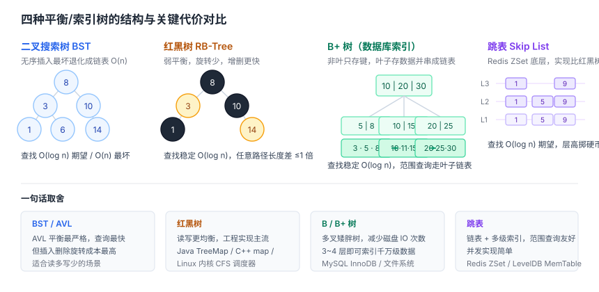
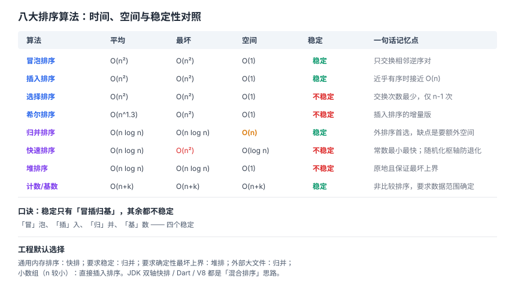
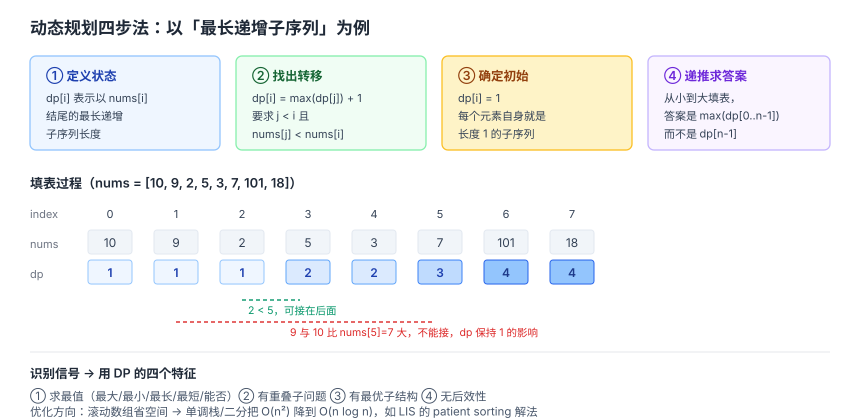

# 数据结构与算法面试知识体系

整理日期：2026-10-13。本文面向校招/社招算法与数据结构环节，覆盖复杂度分析、线性结构、树、哈希表、图、排序、查找、动态规划与解题套路。结论均标注依据。

## 结论

数据结构与算法是面试里权重最高的支柱，一线大厂通常占 40% 到 50%。但它考的不是「你会背多少种数据结构」，而是**在约束下选对结构、分析对复杂度、写对代码**三种能力。三条主线：

1. **复杂度是共同语言**——面试里所有优化都在谈「从 O(n²) 降到 O(n log n)」。不会分析复杂度，等于没有表达工具。
2. **结构决定能力**——哈希表给 O(1) 等值查找但丢顺序，B+ 树给范围查询，跳表给有序 + 高效插入，堆给 Top K。**选型题的本质是「你要什么操作、愿意付什么代价」**。
3. **套路可迁移**——双指针、滑动窗口、二分、DFS/BFS、DP、回溯这几套模板能覆盖绝大多数题。背模板不如理解模板适用的「问题特征」。

准备节奏建议：先把复杂度表和排序稳定性背熟（这是纯记忆、性价比最高），再把双指针/滑动窗口/二分/BFS-DFS 练到能默写，最后啃 DP 和图的进阶。

## 一、复杂度分析

### 三种渐进记号

- **O（大 O）**：渐进上界——「最坏会长成什么样」。
- **Ω（大 Omega）**：渐进下界。
- **Θ（大 Theta）**：紧确界，上下界同阶。

**最坏、平均、摊还复杂度是三个不同维度，不能混用**。面试里说「快排是 O(n log n)」严格说应指平均；最坏是 O(n²)。

**摊还复杂度**：把偶发的高代价操作平摊到多次操作上。例：动态数组扩容单次是 O(n)，但 n 次插入摊还下来每次 O(1)。这和「平均复杂度」不同——摊还是对操作序列的最坏保证，不假设输入分布。

### 常见规模与复杂度的对应（做题时的直觉）

| 复杂度 | 可处理规模 n | 典型算法 |
| --- | --- | --- |
| O(1) | 任意 | 哈希查找 |
| O(log n) | 10^18 | 二分查找 |
| O(n) | 10^7 | 线性遍历、哈希 |
| O(n log n) | 10^6 | 排序 |
| O(n²) | 10^4 | 双重循环 |
| O(2^n) | 25 | 子集枚举 |
| O(n!) | 12 | 全排列 |

这个表在做题时极其有用：看到 n ≤ 10^5，就知道需要 O(n log n) 或更优；看到 n ≤ 20，就允许 2^n 的枚举。

### 空间复杂度

优先 O(1) 额外空间；递归要注意栈空间（深度 d 就有 O(d)）；大数组 DP 优先考虑滚动数组压成一维；权衡上「哈希表用空间换时间」「预处理换查询优化」「记忆化 = 递归 + 缓存」。

## 二、线性结构

### 数组与链表

| 维度 | 数组 | 链表 |
| --- | --- | --- |
| 内存 | 连续 | 离散 + 指针 |
| 随机访问 | O(1) | O(n) |
| 头部插入/删除 | O(n)（要搬移） | O(1) |
| 尾部插入 | 均摊 O(1) | O(1)（有尾指针时） |
| 缓存友好 | 好（空间局部性） | 差（指针跳转） |
| 典型场景 | 频繁访问、随机读 | 频繁增删、LRU、链表排序 |

**为什么数组常常比链表快**：即使链表的操作复杂度更优，实际跑起来数组往往更快，因为它有空间局部性——连续内存一次能预取多块进 Cache 和 TLB，而链表每个节点都可能是一次 Cache Miss。这是「复杂度不等于实际性能」的经典例子。

### 栈与队列

- **栈 LIFO**：函数调用栈、括号匹配、表达式求值、单调栈（求下一个更大元素）。
- **队列 FIFO**：BFS、任务调度、缓冲区。
- **双端队列 deque**：滑动窗口最大值（单调队列）。
- **优先队列/堆**：不是严格的队列，但常放在一起考，见树章节。

### 单调栈与单调队列（高频套路）

- **单调栈**：求「每个元素左边/右边第一个比它大/小的元素」。思路是维护一个单调递减/递增的栈，遇到破坏单调性的元素就弹栈并结算。O(n)。
- **单调队列**：滑动窗口最大值/最小值。O(n)。
- 这类题的特征是「找下一个更大/更小」或「固定窗口的极值」。

## 三、哈希表

原理：哈希函数把 key 映射到桶，平均查找/插入/删除 O(1)，最坏 O(n)（全冲突时退化成链表）。

### 冲突处理

| 方法 | 做法 | 特点 |
| --- | --- | --- |
| 链地址法（拉链） | 每个桶挂一个链表/红黑树 | 实现简单，负载因子高时可转红黑树（Java HashMap） |
| 开放寻址-线性探测 | 冲突了往后找下一个空位 | Cache 友好，但易聚集 |
| 开放寻址-二次探测 | 按平方步长探测 | 减少聚集 |
| 双重散列 | 用第二个哈希函数定步长 | 聚集最少，探查序列多 |

**负载因子（load factor）** = 元素数 / 桶数。太高冲突多，需要 **rehash（扩容 + 重新散列）**。Java HashMap 默认负载因子 0.75，超过就扩容一倍。

**除留余数法的坑**：`H(key) = key % p`，p 通常取**不大于表长的质数**。若表长 10 却取 p=10，所有个位数相同的 key 都会冲突；取 p=7 就分散得多。这是考试常出的判断题。

**哈希表的边界**：只适合**等值查找**，做范围查找和排序就力不从心，那时要用树或 B+ 树。

## 四、树

### 二叉树遍历

| 遍历 | 顺序 | 典型用途 |
| --- | --- | --- |
| 前序 | 根 → 左 → 右 | 复制树、序列化 |
| 中序 | 左 → 根 → 右 | BST 有序输出 |
| 后序 | 左 → 右 → 根 | 释放树、子问题汇总 |
| 层序 BFS | 逐层 | 最短路径（无权图）、按层处理 |

**非递归实现要点**：前序用栈（先压右后压左）；中序用栈一路压左再弹出；后序可用双栈或记录上次访问节点；层序用队列。

### 二叉搜索树及其平衡变体

| 结构 | 平衡标准 | 查找 | 插入/删除 | 应用 |
| --- | --- | --- | --- | --- |
| 普通 BST | 无保证 | 平均 O(log n)，最坏 O(n) | 同左 | 教学、简单场景 |
| AVL 树 | 严格（左右子树高度差 ≤ 1） | O(log n)，更快 | 旋转多，较慢 | 高频查询场景 |
| 红黑树 | 宽松（最长路径 ≤ 2×最短路径） | O(log n)，稍慢 | 旋转少，更快更稳定 | C++ `map`/`set`、Java `TreeMap` |
| 跳表 | 概率平衡 | O(log n) 期望 | O(log n) 期望 | Redis ZSet、LevelDB |

**红黑树 vs AVL**：AVL 平衡更严格，查询更快但插入删除旋转多；红黑树平衡宽松，插入删除性能更稳定，工程上更常用。面试不需要手写红黑树，但要说清它的性质和为什么查找稳定在 O(log n)。

**跳表（Skip List）**：用多层链表加「索引层」实现 O(log n) 期望查找。相比红黑树，实现简单得多，且并发友好（局部修改少）。Redis 的 ZSet 用跳表维护顺序、用哈希表做 member 到 score 的映射，两者配合；**不用红黑树是因为跳表实现更简单、范围查询更自然（底层链表直接顺序遍历）**。

### 堆

完全二叉树，用数组存储。大顶堆根最大，小顶堆根最小。

- **建堆**：从最后一个非叶节点往前做下沉，整体 O(n)（不是 O(n log n)，这是常考陷阱）。
- **插入/删除堆顶**：O(log n)。
- **典型用途**：Top K（维护大小为 K 的堆）、优先队列、堆排序、多路归并（合并 K 个有序链表）。
- **求第 K 大用大小为 K 的小顶堆**，堆顶就是答案。

### B 树与 B+ 树

多路平衡搜索树，专为磁盘设计（扇出大、树矮，减少磁盘 IO）。

| 维度 | B 树 | B+ 树 |
| --- | --- | --- |
| 数据存放 | 所有节点都可能存数据 | 只有叶子存数据，内部节点仅索引 |
| 叶子链表 | 无 | 有，串联成有序链表 |
| 范围查询 | 需中序遍历 | 遍历叶子链表即可 |
| 内部节点容量 | 小（存了数据） | 大（只存 key）→ 树更矮 |

数据库索引用 B+ 树，正是因为叶子链表让范围查询和排序高效，且内部节点只存 key 使树更矮、IO 更少。

### 前缀树 Trie

按字符边组织，查询复杂度 O(L)（L 为串长），与存了多少 key 无关。用于前缀匹配、自动补全、敏感词过滤。代价是空间开销大。

## 五、图

### 存储方式

| 方式 | 空间 | 适用 |
| --- | --- | --- |
| 邻接矩阵 | O(V²) | 稠密图、需要 O(1) 判断两点是否相邻 |
| 邻接表 | O(V+E) | 稀疏图，最常用 |

### 遍历

- **BFS**：用队列，**无权图最短路径**的标准解法，也用于层序遍历、拓扑排序（配合入度）。
- **DFS**：用栈或递归，用于连通性、环检测、拓扑排序、回溯搜索。
- 邻接表下两者都是 O(V+E)。

### 经典算法

| 算法 | 用途 | 复杂度 | 限制 |
| --- | --- | --- | --- |
| Dijkstra | 单源最短路 | 堆优化 O((V+E) log V) | **不能有负权边** |
| Bellman-Ford | 单源最短路 | O(VE) | 允许负权，能检测负环 |
| Floyd-Warshall | 全源最短路 | O(V³) | 允许负权，代码极短 |
| 拓扑排序 | 有向无环图的线性序 | O(V+E) | 有环则无解（可检测环） |
| 并查集 | 连通性、Kruskal | 近 O(1)（路径压缩+按秩合并） | 只合并不拆分 |
| Kruskal / Prim | 最小生成树 | O(E log E) / O(E log V) | 无向图 |

**Dijkstra 为什么不能有负权**：它基于贪心，假设已确定的最短路径不会因为后续更长的路径而变短。负权边会破坏这个前提。

**并查集**两把优化：**路径压缩**（查找时把路径上所有节点直接挂到根）和**按秩/按大小合并**（把矮树挂到高树上）。两者结合后单次操作近似 O(1)。

## 六、排序

这是考点最密集、最容易出综合题的一章。

| 算法 | 平均 | 最坏 | 空间 | 稳定 | 特点 |
| --- | --- | --- | --- | --- | --- |
| 冒泡 | O(n²) | O(n²) | O(1) | 稳定 | 教学用，加 flag 后最好 O(n) |
| 选择 | O(n²) | O(n²) | O(1) | 不稳定 | 交换次数最少（≤ n−1） |
| 插入 | O(n²) | O(n²) | O(1) | 稳定 | 近乎有序时 O(n)，小数组最优 |
| 希尔 | O(n^1.3) | O(n²) | O(1) | 不稳定 | 分组插入，复杂度依赖 gap 序列 |
| 归并 | O(n log n) | O(n log n) | O(n) | 稳定 | 严格 O(n log n)，链表/外部排序首选 |
| 快速 | O(n log n) | O(n²) | O(log n) | 不稳定 | 平均最快，常数小；最坏退化 |
| 堆排 | O(n log n) | O(n log n) | O(1) | 不稳定 | 空间 O(1)，常数较大；建堆 O(n) |
| 计数 | O(n+k) | O(n+k) | O(k) | 稳定 | 非比较，值域小 |
| 基数 | O(d(n+k)) | O(d(n+k)) | O(n+k) | 稳定 | 非比较，定长关键字 |
| 桶 | O(n+k) | O(n²) | O(n+k) | 稳定 | 数据均匀分布时线性 |

**稳定性为什么重要**：多关键字排序时，先按次要关键字排、再按主要关键字排，稳定的算法能保持前一次的相对顺序。比如先按成绩排再按班级排，稳定的排序能保证班内仍按成绩有序。归并、插入、冒泡、计数、基数、桶都是稳定的；快排、堆排、选择、希尔不稳定。

**快排的优化**：随机选 pivot 或三数取中，避免已排序输入退化成 O(n²)；小区间改用插入排序（小数组插入更快）；三路快排处理大量重复元素。

**工业界实现**：`std::sort` 是内省式排序（插入 + 快排 + 深度超 2 log n 时转堆排兜底最坏情况）；`stable_sort` 是归并；Python/Java 对象排序用 TimSort（归并 + 插入，对现实数据里常见的局部有序极友好）。

**「最快的排序」问法**：没有绝对最快。通用比较排序平均最快是快排；要求稳定且严格 O(n log n) 用归并；空间受限用堆排；值域小用计数；近乎有序用插入/TimSort。

## 七、查找

- **二分查找**：有序数组上 O(log n)。变体包括找第一个等于目标、最后一个等于目标、第一个大于等于目标（`lower_bound`）、旋转排序数组。**边界条件（`<` 还是 `<=`、`mid` 怎么算）是最大失分点**，建议固定一套写法。
- **哈希查找**：O(1) 平均。
- **树查找**：平衡树 O(log n)，B+ 树适合磁盘。
- **跳表**：O(log n) 期望。

**二分的思想比实现更重要**：只要答案有「单调性」（可行/不可行随某个量单调变化），就能对答案二分，这叫「二分答案」，是很多优化题的突破口。

## 八、动态规划

### 四步法

1. **状态定义**：`dp[i]` 或 `dp[i][j]` 表示什么。
2. **转移方程**：`dp[i]` 怎么由更小的子问题推出来。
3. **初始化**：边界条件。
4. **遍历顺序 + 空间优化**：确保依赖已计算；能压维就压维。

### 经典模型

| 模型 | 状态 | 转移 | 复杂度 |
| --- | --- | --- | --- |
| 0-1 背包 | dp[i][j] 前 i 件容量 j | max(不选, 选) | O(nW)，可压成一维（逆序） |
| 完全背包 | 同上 | 允许重复选 | O(nW)，一维正序 |
| 最长递增子序列 LIS | dp[i] 以 i 结尾的长度 | 找前面更小的接上 | O(n²)，二分可优化到 O(n log n) |
| 最长公共子序列 LCS | dp[i][j] 前缀 | 相等则 +1，否则取 max | O(mn) |
| 编辑距离 | dp[i][j] | 增/删/改三选一 | O(mn) |
| 打家劫舍 | dp[i] | max(偷, 不偷) | O(n) |
| 零钱兑换 | dp[amount] | 枚举硬币 | O(n×amount) |

**空间优化的关键**：0-1 背包压成一维后必须**逆序**遍历 j（否则同一件物品会被用多次，变成完全背包）；完全背包压成一维后**正序**遍历 j。

**子序列 vs 子串**：子序列可以不连续，子串必须连续。转移方程不同，LCS 和最长公共子串别混。

**DP 的识别信号**：问题问「最多/最少/方案数/是否可行」，且存在重叠子问题和最优子结构。

## 九、常用解题套路

| 套路 | 适用特征 | 模板要点 |
| --- | --- | --- |
| 双指针 | 有序数组、链表、求和、去重 | 左右指针向中间收，或快慢指针 |
| 滑动窗口 | 连续子数组/子串满足某条件 | 右扩左缩，用哈希或计数维护窗口状态 |
| 二分 | 有序、或答案有单调性 | 定死边界写法，注意 `mid` 防溢出 |
| DFS | 遍历、连通性、路径、回溯 | 三参数（节点/累计/目标），回溯必还原状态 |
| BFS | 最短路径（无权）、层序 | 队列 + visited，注意入队即标记 |
| 回溯 | 全排列、组合、子集、N 皇后 | 选择 → 递归 → 撤销选择，剪枝优化 |
| 贪心 | 局部最优能推出全局最优 | 跳跃游戏、区间调度、分发饼干 |
| 单调栈/队列 | 下一个更大元素、窗口极值 | 维护单调性，弹栈时结算 |
| 前缀和 | 区间和、子数组和 | 预处理 O(n)，查询 O(1) |
| 快慢指针 | 链表环、找中点、倒数第 K | 快走两步慢走一步 |

**回溯的状态还原**：添加选择 → 递归 → **撤销选择**，三步缺一不可。漏掉撤销会导致后续分支污染。

**BFS 的 visited 时机**：入队时就标记（而不是出队时标记），否则同一节点会重复入队，复杂度爆炸。

## 十、高频对比速查

| 对比项 | 要点 |
| --- | --- |
| 数组 vs 链表 | 随机访问 O(1) vs 增删 O(1)；顺序存储缓存友好 vs 离散 |
| 哈希表 vs 平衡树 | 等值 O(1) 无序 vs 有序 O(log n) |
| 红黑树 vs AVL | 宽松平衡、插删快 vs 严格平衡、查询快 |
| B 树 vs B+ 树 | 内部节点存数据 vs 只存索引 + 叶子链表 |
| 快排 vs 归并 | 平均最快、不稳定、可原地 vs 严格 O(n log n)、稳定、需 O(n) |
| 快排 vs 堆排 | 平均常数小 vs 最坏保证 + O(1) 空间 |
| 最小堆 vs 最大堆 Top K | 求第 K 大用大小 K 的最小堆 |
| 子序列 vs 子串 | 可不连续 vs 必须连续 |
| 邻接矩阵 vs 邻接表 | O(V²) 稠密 vs O(V+E) 稀疏 |
| BFS vs DFS | 无权最短路 vs 连通/环/回溯 |

## 建议

- **先背纯记忆的部分**：复杂度表、排序稳定性、各结构操作复杂度。这些是送分题，不背就是白丢分。
- **把四套模板练到默写**：双指针、滑动窗口、二分、BFS/DFS。这四套能覆盖一半以上的题。
- **DP 不要硬背题，要练「认模型」**：看到「最多/最少/方案数」就往 DP 想，然后套四步法。
- **写代码前先说思路和复杂度**：面试是沟通过程，先说「我打算用 X，因为 Y，复杂度是 Z」，再动手。
- **注意边界**：空数组、单元素、溢出、`<` 与 `<=`。这些是实际失分最多的地方。

## 待核实

- 各语言标准库排序的具体实现细节（TimSort 的 run 阈值、`std::sort` 的插入排序阈值）随版本变化，正文给的是公开的通用描述，未逐版本核实。
- 「哈希表最坏 O(n) vs 红黑树稳定 O(log n)」在工程上的实际影响取决于哈希函数质量和攻击面（哈希碰撞攻击），未展开安全视角。
- 部分面试频率数据来自公开面经与经验总结，不是统计抽样，只作参考。

## 来源清单

| 内容 | 来源 | 日期 |
| --- | --- | --- |
| 各数据结构时间复杂度、算法优先级、解题套路 | 伯乐青狼《技术面试准备指南》 https://www.chencunli.com/tech-interview-prep | 2026-10-13 核实 |
| 排序算法复杂度与稳定性、红黑树 vs AVL、工业实现 | CSDN《百度一面面经（C++）》 https://blog.csdn.net/qq_29426201/article/details/147271710 | 2026-10-13 核实 |
| 排序算法全景、工业级实现、外部排序、场景→算法 | SegmentFault《排序算法全景图》 https://segmentfault.com/a/1190000047270895 | 2026-10-13 核实 |
| 复杂度速查表、题目分类与核心技巧、常见错误 | 代码知识库《面试题速查表》 https://docs.freetools.me/docs/leetcode-interview/cheatsheet | 2026-10-13 核实 |
| 大 O 速查、各结构操作复杂度、排序 best/avg/worst | TinkerTools《Big O Cheat Sheet》 https://tinkertools.app/tools/big-o-cheat-sheet | 2026-10-13 核实 |
| 复杂度 O/Ω/Θ、B/B+ 树、哈夫曼树、哈希冲突、图算法 | GitHub SYSU-CS-baoyan《数据结构与算法速记》 https://github.com/ouyangyipeng/SYSU-CS-baoyan | 2026-10-13 核实 |
| 哈希函数构造与冲突处理、除留余数法取质数、排序八讲 | CSDN《数据结构核心知识梳理》 https://blog.csdn.net/weixin_29290379/article/details/164480500 | 2026-10-13 核实 |
| DP 题型（背包/LCS/LIS/编辑距离）与优化技巧 | 百度智能云《互联网大厂技术岗面试：高频题与算法核心解析》 https://cloud.baidu.com/article/4645451 | 2026-10-13 核实 |
| 图/DP/贪心模板与判定特征 | 腾讯 ima《技术面试算法题8大类》 https://ima.qq.com/wiki/ | 2026-10-13 核实 |
