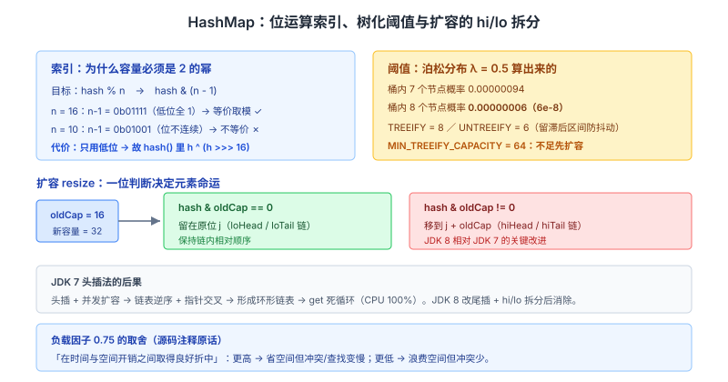
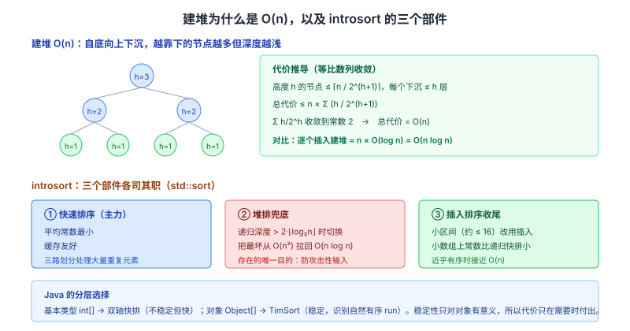

# 数据结构与算法面试知识体系

整理日期：2026-10-13 ｜ 重写：2026-10-14。这份文档不铺广度，只挑面试官会**连问三层**的点。每个点讲三层：**机制（实现里到底怎么做的）→ 证据（源码常量、函数名、论文）→ 追问链**。

> 阅读约定：图在 `assets/2026-10-14/` 下。标注「待核实」的地方是本次未拿到一手依据的，不硬写。本文与「数据库与缓存」篇的 B+ 树一节互补，那里讲磁盘视角，这里讲算法视角。

## 结论

数据结构与算法面试的深度，不在于你背了多少种结构，而在于**你能不能说出实现里的常量、公式和取舍的量化依据**：

1. **HashMap 的 `TREEIFY_THRESHOLD = 8` 不是拍脑袋**——是泊松分布算出来的，源码注释直接给了 λ=0.5 时的概率表。
2. **容量必须是 2 的幂**，因为取模被换成了 `(n - 1) & hash`；扩容 `resize` 时靠 `hash & oldCap` 一位判断「留在原位还是移动 oldCap」。
3. **建堆是 O(n) 不是 O(n log n)**——用等比数列能当场算出来。
4. **0-1 背包压成一维必须逆序**——这是「要不要在同一轮用本件物品」的直接推论，不是记忆点。

本文按「复杂度 → 哈希表 → 树 → 排序 → DP → 图论 → 模板」组织，全部落到可验证的细节。

---

## 一、复杂度：摊还、均摊与「能当场算」

### 三个记号别混用

- **O**：渐进上界（最坏会长成什么样）
- **Ω**：渐进下界
- **Θ**：紧确界（上下界同阶）

### 摊还（amortized）≠ 平均（average）

这是高频失分点。

| | 假设什么 | 保证什么 |
| --- | --- | --- |
| **平均复杂度** | 对输入**概率分布**做假设 | 期望意义上的性能 |
| **摊还复杂度** | **不对输入做任何假设** | 对一个**操作序列的最坏**总代价 / 操作数 |

**经典例子：动态数组 `push_back`。** 单次扩容是 O(n)（复制全部元素），但从空数组连续 push n 次的**总代价**：

```
1 + 2 + 4 + 8 + ... + n ≤ 2n
```

摊还到每次 = **O(1)**。**关键点**：这个结论不假设任何输入分布，是对任意插入序列的最坏保证。所以「摊还 O(1)」比「平均 O(1)」更强。

**聚合法（aggregate method）**就是上面这个算法；另外两个等价工具是**记账法（accounting）**和**势能法（potential）**——面试一般用聚合法算就够了。

### 规模—复杂度心算表（做题时的第一反应）

| 复杂度 | 可处理规模 n | 典型算法 |
| --- | --- | --- |
| O(log n) | 10^18 | 二分 |
| O(n) | 10^7 ~ 10^8 | 线性遍历、哈希 |
| O(n log n) | 10^6 ~ 10^7 | 排序 |
| O(n²) | 10^4 | 双重循环 |
| O(2^n) | ≤ 25 | 子集枚举 |
| O(n!) | ≤ 12 | 全排列 |

**用法**：看到 `n ≤ 10^5`，立刻排除 O(n²)；看到 `n ≤ 20`，大胆写 2^n 枚举或状压 DP。

### 主定理（Master Theorem）速用

对 `T(n) = aT(n/b) + f(n)`，令 `c = log_b a`：

- 若 `f(n) = O(n^(c-ε))` → `T(n) = Θ(n^c)`（分治主导）
- 若 `f(n) = Θ(n^c)` → `T(n) = Θ(n^c log n)`（典型：归并排序，a=b=2）
- 若 `f(n) = Ω(n^(c+ε))` 且满足正则条件 → `T(n) = Θ(f(n))`（合并主导）

> **追问链**
> 1. 动态数组 push n 次为什么是 O(n) 总量？→ 等比数列求和 ≤ 2n。
> 2. 摊还 O(1) 和平均 O(1) 哪个更强？→ 摊还，因为它不假设输入分布。
> 3. 归并排序的递推式套主定理？→ `a=2, b=2, c=log₂2=1`，`f(n)=Θ(n)=Θ(n^1)`，落在第二种，得 `Θ(n log n)`。

---

## 二、HashMap：常量、位运算与扩容

### 三个阈值都在源码注释里给了理由

OpenJDK `HashMap.java` 的常量：

```java
static final int DEFAULT_INITIAL_CAPACITY = 1 << 4;  // 16
static final float DEFAULT_LOAD_FACTOR     = 0.75f;
static final int TREEIFY_THRESHOLD         = 8;      // 链表 → 红黑树
static final int UNTREEIFY_THRESHOLD       = 6;      // 红黑树 → 链表
static final int MIN_TREEIFY_CAPACITY      = 64;
```

**`TREEIFY_THRESHOLD = 8` 的来源**——源码注释给了一段泊松分布：

> Because TreeNodes are about twice the size of regular nodes ... the expected occurrences of list bins follows a Poisson distribution with a parameter of about **0.5** on average (the default load factor 0.75). ... The probability of a bin having **8** nodes is **0.00000006** (6e-8).

**这段注释的完整概率表**（源码原文，λ = 0.5）：

| 桶内节点数 | 概率 |
| --- | --- |
| 0 | 0.60653066 |
| 1 | 0.30326533 |
| 2 | 0.07581633 |
| 3 | 0.01263606 |
| 4 | 0.00157952 |
| 5 | 0.00015795 |
| 6 | 0.00001316 |
| 7 | 0.00000094 |
| **8** | **0.00000006** |

**结论**：一个桶里堆到 8 个节点的概率是 6e-8——**在正常哈希下几乎不可能**。真发生了说明**哈希函数本身被针对**（或实现有 bug），所以要转红黑树把最坏 O(n) 拉回 O(log n)。

**为什么退回阈值是 6 而不是 8**：留一个「滞后区间」（7）。如果两个阈值都是 8，在桶内节点数反复在 7/8 之间抖动时会**频繁树化/反树化**，性能剧烈波动。

**`MIN_TREEIFY_CAPACITY = 64`**：树化前先检查总容量，**不足 64 就优先扩容而不是树化**——因为桶内堆积往往是因为容量太小、冲突多，扩容比转红黑树更经济。

### 为什么容量必须是 2 的幂

因为 `hash % n` 被换成了 `hash & (n - 1)`。这个等价关系**只在 n 是 2 的幂时成立**：

```
n = 16   →   n-1 = 0b01111   （低位全 1，与运算 = 取模）
n = 10   →   n-1 = 0b01001   （位不连续，与运算 ≠ 取模）
```

位运算比取模快得多，这是选择 2 的幂的**唯一动机**。

**代价**：只用到了 hash 的低位。所以 JDK 在 `hash()` 里**先把高位异或到低位**：

```java
static final int hash(Object key) {
    int h;
    return (key == null) ? 0 : (h = key.hashCode()) ^ (h >>> 16);
}
```

`h >>> 16` 把高 16 位右移到低位再异或——**让高位也参与索引计算**，减少「低位相同、高位不同」的碰撞。

### resize：一次位判断决定元素命运

扩容时容量翻倍成 `2n`，`newCap = 16` → `32`。元素的**新索引**要么是原索引 `j`，要么是 `j + oldCap`，判据是一位：

```
hash & oldCap == 0  →  留在原位 j
hash & oldCap != 0  →  移到 j + oldCap
```

OpenJDK 的实现把桶拆成 `loHead/loTail` 和 `hiHead/hiTail` 两条链（lo 是留在原位，hi 是高位链），**保持链内相对顺序**：

```java
if ((e.hash & oldCap) == 0) {   // 留在原位
    if (loTail == null) loHead = e; else loTail.next = e;
    loTail = e;
} else {                         // 移到 j + oldCap
    if (hiTail == null) hiHead = e; else hiTail.next = e;
    hiTail = e;
}
```

**这个设计是 JDK 8 相对 JDK 7 的关键改进**。JDK 7 是**头插法**（新元素插链表头部），扩容时会把链**逆序**——并发扩容下两条线程可能形成**环形链表**，导致 `get` 死循环（CPU 100%）。JDK 8 改成**尾插 + hi/lo 拆分**，既避免了逆序，也天然保序。

### 负载因子 0.75 的量化理由

源码注释给的是**权衡**，不是精确最优：

> As a general rule, the default load factor (.75) offers a good tradeoff between time and space costs. Higher values decrease the space overhead but increase the lookup cost.

| 负载因子 | 空间 | 冲突/查找 |
| --- | --- | --- |
| 0.5 | 浪费近一半空间 | 冲突少 |
| **0.75** | 折中 | 折中 |
| 1.0 | 省空间 | 冲突显著增多 |

> **追问链**
> 1. 为什么阈值是 8？→ 泊松分布 λ=0.5 时 8 个节点概率 6e-8，正常哈希下不可能，发生即说明被攻击。
> 2. 为什么退回是 6？→ 留滞后区间，防止 7/8 抖动导致反复树化。
> 3. 容量为什么必须是 2 的幂？→ 为了让 `hash % n` 变成 `hash & (n-1)`。
> 4. 扩容后元素去哪个桶？→ `hash & oldCap` 一位判断：0 留原位，1 移到 `j + oldCap`。
> 5. JDK 7 的头插法有什么后果？→ 并发扩容可能形成环形链表，`get` 死循环。



---

## 三、树：红黑树、B+ 树、跳表的取舍

### 红黑树 vs AVL：为什么不选「更平衡」的那个

| | AVL | 红黑树 |
| --- | --- | --- |
| 平衡条件 | 左右子树高度差 ≤ 1 | 最长路径 ≤ 2 × 最短路径 |
| 高度上界 | ~1.44 log n | ~2 log n |
| 查询 | 更快（树更矮） | 稍慢 |
| 插入/删除 | 旋转多（可能 O(log n) 次） | **旋转 ≤ 3 次**（插入 ≤ 2、删除 ≤ 3） |
| 工程选择 | 查询远多于改的场景 | C++ `map/set`、Java `TreeMap`、HashMap 树化 |

**关键量化点**：红黑树的旋转次数是**常数级上界**（插入最多 2 次旋转，删除最多 3 次），而 AVL 删除可能需要 O(log n) 次旋转沿路径回溯。**在「读写混合」的通用容器场景，红黑树的均摊代价更低**——这就是标准库选它的原因。

### B+ 树为什么统治磁盘索引

算法视角的关键是**扇出（fanout）与树高的关系**（磁盘视角详见「数据库与缓存」篇）：

```
fanout ≈ page_size / (key_size + pointer_size)
树高 h 能索引的行数 ≈ fanout^h
```

InnoDB 默认页 16KB，非叶节点只存 key + 6 字节页号，扇出约 1000 → **3 层就能覆盖约 10 亿行**，即「查任意一行最多 3 次磁盘 IO」。

**B 树 vs B+ 树**：

| | B 树 | B+ 树 |
| --- | --- | --- |
| 数据位置 | 所有节点都可能存数据 | **只在叶子** |
| 叶子链表 | 无 | 有，串成有序链表 |
| 范围查询 | 需中序遍历、跨层回溯 | **沿叶子链表顺序扫** |
| 单点查找 | 可能提前在内部节点命中 | 必须走到叶子（路径等长） |
| 内部节点扇出 | 小（存了数据） | **大**（只存 key）→ 树更矮 |

**B+ 树的代价**：单点查询路径**恒定更长**（必须到叶子），B 树可能在内部节点就命中。但换来的是**稳定 IO 次数**（所有查询都 h 次）和**范围查询的高效**——对数据库这两点更重要。

### 跳表：Redis 为什么不用红黑树

跳表 = 多层链表，每层以概率 p（通常 0.25 或 0.5）向上「提拔」节点。期望查找 O(log n)。

**Redis `t_zset.c` 的选择理由**（作者 antirez 的公开说明要点）：

1. **范围查询天然友好**：跳表底层就是有序链表，`ZRANGE` 顺链扫即可；红黑树做范围查询需要中序后继遍历，实现和缓存都更差。
2. **实现简单**：跳表插入删除只需改局部指针；红黑树要处理多种旋转/染色 case。
3. **并发/局部性好**：跳表修改是局部指针改动，红黑树旋转会影响更大范围（对并发扩展更友好）。

**跳表的内存代价**：期望上每个节点的指针数 = `1/(1-p)`。p=0.5 时平均 2 个指针，p=0.25 时约 1.33 个——**用空间换实现简单和范围查询**。

> **追问链**
> 1. 红黑树比 AVL 矮吗？→ 不，**更高**（≤2 log n vs ≤1.44 log n），但旋转次数是常数上界。
> 2. B+ 树单点查询为什么反而更慢？→ 必须走到叶子，B 树可能在内部节点提前命中。
> 3. Redis ZSet 为什么不用红黑树？→ 范围查询顺链扫更自然、实现更简单、局部修改更少。
> 4. 跳表为什么是「期望」O(log n)？→ 层数由随机数决定，是概率保证而非最坏保证。

---

## 四、排序：建堆 O(n)、快排优化与工程实现

### 建堆为什么是 O(n) 不是 O(n log n)

从最后一个非叶节点（下标 `n/2 - 1`）往前**下沉（sift down）**。代价分析的关键是：**越靠下的节点越多，但下沉的深度越浅**。

高度为 h 的节点最多有 `⌈n / 2^(h+1))` 个，每个最多下沉 h 层：

```
总代价 = Σ (h=0..log n) ⌈n / 2^(h+1))⌉ × h
       ≤ n × Σ h/2^(h+1)
       = n × O(1)          （Σ h/2^h 收敛到常数 2）
       = O(n)
```

**对比「逐个插入建堆」**：从空堆开始插入 n 次，每次 O(log n)，是 **O(n log n)**。所以「先把数组摆好再自底向上下沉」比「逐个插入」快。

**同理，堆排序**：建堆 O(n) + n 次「取堆顶 + 下沉 O(log n)」= **O(n log n)**。

### 快排的真实工程实现：内省排序

`std::sort` 用的**不是裸快排**，而是 **introsort（内省排序）**：

```
快排递归 → 若递归深度超过 2·⌊log₂ n⌋ → 切换成堆排兜底
         → 小区间（≤ 阈值，通常 16 左右）→ 切换成插入排序
```

**三个部件各自的理由**：
- **快排**：平均常数最小、缓存友好
- **堆排兜底**：把最坏情况从 O(n²) 拉回 **O(n log n)**（这是内省排序存在的唯一目的——防攻击性输入）
- **插入排序收尾**：小数组上插入排序的常数比递归快排小得多

**三路划分（3-way partition）** 单独解决**大量重复元素**问题：把数组分成 `< pivot`、`== pivot`、`> pivot` 三段，等于 pivot 的一段不再参与递归。全等数组从 O(n²) 降到 **O(n)**。

**Java 的选择是分层的**（`java.util.Arrays`）：
- 基本类型（`int[]` 等）→ **双轴快排 DualPivotQuicksort**：不稳定但快，因为基本类型没有「相等但不相同」的概念，稳定性无意义
- 对象类型（`Object[]`）→ **TimSort**：稳定，且对现实数据里常见的「局部有序 run」极友好，最好 O(n)

**这个分层本身就是答案**：稳定性只对对象有意义，所以只有在对象排序时才付出稳定性的代价。

### TimSort 的核心：识别 run

TimSort = 归并 + 插入的混合，关键是**先把数组切成若干「run」（自然有序段）**，短的用插入排序补到 `minRun` 长度，再两两归并，并用栈维护归并顺序保证平衡。

**为什么对现实数据强**：真实数据往往有局部有序片段，TimSort 能直接复用这些 run，接近 O(n)。

### 排序全景表

| 算法 | 平均 | 最坏 | 空间 | 稳定 | 一句话 |
| --- | --- | --- | --- | --- | --- |
| 插入 | O(n²) | O(n²) | O(1) | ✅ | 近乎有序 O(n)，小数组最优 |
| 冒泡 | O(n²) | O(n²) | O(1) | ✅ | 加 flag 后最好 O(n)，教学用 |
| 选择 | O(n²) | O(n²) | O(1) | ❌ | 交换次数最少（≤ n−1） |
| 希尔 | 依赖 gap | O(n²) | O(1) | ❌ | 分组插入 |
| 归并 | O(n log n) | O(n log n) | O(n) | ✅ | 严格 O(n log n)，外部排序首选 |
| 快排 | O(n log n) | **O(n²)** | O(log n) | ❌ | 平均最快，需随机化 |
| 堆排 | O(n log n) | O(n log n) | O(1) | ❌ | 最坏保证 + O(1) 空间，常数大 |
| 计数 | O(n+k) | O(n+k) | O(k) | ✅ | 非比较，值域须小 |
| 基数 | O(d(n+k)) | O(d(n+k)) | O(n+k) | ✅ | 非比较，定长关键字 |
| 桶 | O(n+k) | O(n²) | O(n+k) | ✅ | 均匀分布时线性 |

**比较排序的下界**：任何基于比较的排序**最坏至少 Ω(n log n)**——决策树有 n! 个叶子，树高 ≥ log(n!) = Θ(n log n)。**这就是计数/基数排序能更快的原因：它们不做比较，绕开了这个下界**。

> **追问链**
> 1. 建堆为什么 O(n)？→ 高度 h 的节点数与深度 h 的乘积求和，`Σ h/2^h` 收敛。
> 2. `std::sort` 用什么？→ introsort：快排 + 深度超限转堆排 + 小区间插入排序。
> 3. Java 为什么基本类型用快排、对象用 TimSort？→ 稳定性只对对象有意义。
> 4. 比较排序能突破 n log n 吗？→ 不能，决策树下界 Ω(n log n)；非比较排序才可能更快。



---

## 五、动态规划：状态定义的方法论

### 四步法

1. **状态定义**：`dp[i]` / `dp[i][j]` 表示什么（这一步决定一切）
2. **转移方程**：怎么由更小状态推出
3. **初始化**：边界
4. **遍历顺序 + 空间压缩**：保证依赖已算；能压维就压维

### 背包：压维后为什么必须逆序

`dp[j]` = 容量 j 能装的最大价值。单件物品的转移是：

```
dp[j] = max(dp[j], dp[j - w] + v)     // j 从大到小
```

**逆序的理由**：`dp[j]` 依赖 `dp[j - w]`（**同一轮、更小容量**）。如果正序，`dp[j - w]` 已经在本轮被本件物品更新过，于是本件物品被**用了多次**——那就变成了**完全背包**。

**一句话记法**：
- **0-1 背包**（每件最多选 1 次）→ **逆序** j
- **完全背包**（每件可选无限次）→ **正序** j

### 子序列 vs 子串（转移方程完全不同）

| 问题 | 状态 | 转移 |
| --- | --- | --- |
| **LCS 最长公共子序列**（可不连续） | `dp[i][j]` | `s[i]==t[j]` → `dp[i-1][j-1]+1`；否则 `max(dp[i-1][j], dp[i][j-1])` |
| **最长公共子串**（必须连续） | `dp[i][j]` | `s[i]==t[j]` → `dp[i-1][j-1]+1`；否则 **归零** |

**差异的根源**：子串要求连续，所以「不匹配就断」，必须清零；子序列可以跳过，所以「不匹配就继承最大值」。**很多人把这两个混着写，直接算错。**

### LIS 的 O(n log n)：tails 数组

`tails[k]` = 「长度为 k+1 的递增子序列」的**最小可能结尾值**。这个数组**单调递增**，可以对它二分：

```
对每个 x：二分找 tails 中第一个 ≥ x 的位置 → 替换它
         若 x 比所有都大 → 追加到末尾
答案 = tails 的长度
```

**为什么正确**：对固定的长度，结尾值越小，后面越容易接上——所以只留最小结尾就够了。

**一个易错点**：`tails` **不是** LIS 本身，只是长度正确。要还原具体子序列需要额外记录前驱。

### 经典模型速查

| 模型 | 状态 | 复杂度 | 备注 |
| --- | --- | --- | --- |
| 0-1 背包 | `dp[j]` 容量 | O(nW) | 一维**逆序** |
| 完全背包 | `dp[j]` | O(nW) | 一维**正序** |
| LIS | `dp[i]` 以 i 结尾 | O(n²) → O(n log n) | 二分优化用 tails |
| LCS | `dp[i][j]` | O(mn) | 不匹配取 max |
| 编辑距离 | `dp[i][j]` | O(mn) | 增/删/改三选一 |
| 打家劫舍 | `dp[i]` | O(n) | max(偷, 不偷) |

> **追问链**
> 1. 0-1 背包一维为什么逆序？→ 保证 `dp[j-w]` 是本轮未更新的值（否则物品被用多次）。
> 2. 完全背包为什么正序？→ 就是要让物品能被重复用。
> 3. LCS 和最长公共子串的转移差在哪？→ 不匹配时：LCS 取 max（可跳过），子串清零（必须连续）。
> 4. LIS 的 tails 是 LIS 本身吗？→ 不是，只是长度正确。

---

## 六、图论：并查集与最短路的边界

### 并查集：为什么接近 O(1)

两把优化：

1. **路径压缩（path compression）**：`find` 时把路径上所有节点直接挂到根
2. **按秩/按大小合并（union by rank/size）**：把矮树挂到高树上

**复杂度**（Tarjan 1975 的分析结果）：两者结合后，m 次操作的**摊还**代价是 **O(m · α(n))**，其中 α 是**反阿克曼函数**。

**α(n) 的含义**：`α(n)` 增长极慢——**在实际可想象的 n（哪怕 n 是宇宙原子数级别）下 α(n) ≤ 4**。所以工程上说「近似 O(1)」是准确的。

**只做路径压缩不做按秩合并**是 O(log n)；**只做按秩合并不做路径压缩**也是 O(log n)。**两个都要**才有 α(n)。

### Dijkstra 为什么不能有负权

Dijkstra 的核心是**贪心**：每次从优先队列取出 `dist` 最小的未确定节点，**宣布它的最短路已确定**，之后不再更新。

**这个「宣布」的正确性依赖「所有边权非负」**：如果存在负权边，一个「当前看起来很远」的节点，可能通过后面某条负权边**变得比当前最近的还近**——贪心地提前确定它就错了。

**反例**：A→B 权 1，A→C 权 2，C→B 权 −5。Dijkstra 先确定 B（dist=1），但真实最短路是 A→C→B = −3。

**出路**：
- 有负权但**无负环** → **Bellman-Ford** O(VE)（做 V−1 轮松弛）
- 有负环 → 无最短路（可绕负环无限变小）；Bellman-Ford 第 V 轮还能松弛就说明**有负环**
- **全源最短路** → Floyd-Warshall O(V³)（DP：以「允许经过的中间点集合」为阶段）
- 有负权无负环的**单源**加速 → Johnson 算法（先用 Bellman-Ford 重赋权使边权非负，再跑 Dijkstra）

**这几种算法的关系是面试常考的**：Dijkstra 是「非负权特化」，Bellman-Ford 是「通用但慢」，Floyd 是「全源」。

> **追问链**
> 1. 并查集为什么接近 O(1)？→ 路径压缩 + 按秩合并，摊还 O(α(n))，α 实际 ≤ 4。
> 2. 只做其中一把优化呢？→ 退化到 O(log n)。
> 3. Dijkstra 为什么不能有负权？→ 贪心地「提前确定最短路」会被负权边推翻。
> 4. Bellman-Ford 怎么检测负环？→ 第 V 轮松弛仍能成功，说明存在负环。

---

## 七、高频追问速查（按「面试官问 → 我答」组织）

| 面试官会问 | 你要答到的点 |
| --- | --- |
| HashMap 为什么阈值是 8 | 泊松分布 λ=0.5 时 8 个节点概率 **6e-8**（源码注释给了概率表），正常哈希下不可能 |
| 为什么退回阈值是 6 | 留滞后区间（7），防止反复树化/反树化 |
| 容量为什么是 2 的幂 | 让 `hash % n` 变成 `hash & (n-1)`；代价是只用低位，所以 `hash()` 里 `h ^ (h>>>16)` 混高位 |
| 扩容时元素去哪 | `hash & oldCap` 一位判断：0 留原位，1 移到 `j + oldCap`（hi/lo 拆分） |
| JDK 7 的头插法问题 | 并发扩容可能形成**环形链表**，`get` 死循环 |
| 红黑树 vs AVL | 红黑树**更高**（≤2log n）但旋转 ≤3 次；AVL 更矮但删除旋转多 |
| Redis 为什么跳表不用红黑树 | 范围查询顺链扫、实现简单、局部修改少 |
| 建堆复杂度 | **O(n)**，`Σ h/2^h` 收敛；逐个插入才是 O(n log n) |
| `std::sort` 用什么 | **introsort**：快排 + 深度超 2log n 转堆排 + 小区间插入排序 |
| Java 排序为什么分两层 | 基本类型用双轴快排（不稳定但快），对象用 TimSort（稳定） |
| 比较排序的下界 | Ω(n log n)，决策树下界；计数/基数排序不做比较才能更快 |
| 0-1 背包一维为什么逆序 | 否则 `dp[j-w]` 被本轮更新过，物品被用多次 → 变完全背包 |
| LCS 和最长公共子串 | 不匹配时 LCS 取 max、子串**清零** |
| LIS 的 O(n log n) | 维护 tails 数组 + 二分（不是 LIS 本身） |
| 并查集复杂度 | 路径压缩 + 按秩合并 = 摊还 O(α(n))，**α 实际 ≤ 4** |
| Dijkstra 为什么不能负权 | 贪心提前确定最短路，会被负权边推翻（给反例） |
| 负环怎么检测 | Bellman-Ford 第 V 轮还能松弛 |

## 建议

- **记住三个常量**：`TREEIFY_THRESHOLD=8`、`MIN_TREEIFY_CAPACITY=64`、`DEFAULT_MMAP_THRESHOLD=128KB`（后者在 OS 篇）。带数字的答案可信度立刻不同。
- **准备四个「能当场算」的推导**：动态数组摊还 O(1)、建堆 O(n)、54 位/48 位页表（OS 篇）、nice 权重比 1.25（OS 篇）。面试里能推公式是最强的信号。
- **把「红黑树 vs AVL」答成旋转次数**：不要说「红黑树更平衡」，要说「AVL 更矮但删除旋转 O(log n)，红黑树旋转 ≤3 次，通用容器选红黑树」。这个才是源码级的理由。
- **背包逆序/正序不要背，要推**：能说出「逆序是因为 `dp[j-w]` 必须还是上一轮的值」，比背下来强十倍。
- **边界仍然是最大失分点**：二分法的 `mid` 防溢出（`lo + (hi-lo)/2`）、`<` 与 `<=`、空数组、单元素。这些必须固定一套写法。

## 待核实

- **OpenJDK 版本差异**：本文常量与源码注释以 OpenJDK 8 及之后的 `HashMap.java` 为准；概率表数值在源码注释中给出，**未逐版本 diff 核实**（不同 JDK 发行版的注释排版可能有细微差别）。
- **`std::sort` 的 introsort 阈值**（插入排序的小区间阈值）**随实现版本变化**，常见公开描述是 16，本文未逐编译器版本核实。
- **TimSort 的 `minRun` 具体计算**（32~64 之间的自适应）未引到 CPython/OpenJDK 的源码行级依据。
- **跳表的 `p` 值在 Redis 中的实际取值**（`ZSKIPLIST_P`）本文按公开资料写作 0.25 量级，未逐版本核对头文件。
- **`HashMap` 树化的完整源码路径**（`treeifyBin`、`putTreeVal`）未逐行引用，本文给出的是编码在注释与常量里的设计意图。
- **Johnson 算法重赋权**（`w' = w + h(u) - h(v)`）的完整证明未展开。
- **快排递归深度阈值 2·⌊log₂n⌋** 是公开通用描述，具体实现的边界处理未逐行核实。

## 来源清单

| 内容 | 来源（一手优先） | 说明 |
| --- | --- | --- |
| `TREEIFY_THRESHOLD=8`、泊松 λ=0.5 概率表、`MIN_TREEIFY_CAPACITY=64`、`hash()` 扰动 | OpenJDK `java/util/HashMap.java` 源码与注释 | 源码 |
| resize 的 hi/lo 拆分、`hash & oldCap` 判据 | OpenJDK `HashMap.java` 的 `resize()` | 源码 |
| JDK 7 头插法导致环形链表 | OpenJDK 7 `HashMap` 实现（`transfer()` 头插）与公开 issue 讨论 | 源码 |
| 负载因子 0.75 的时空权衡原话 | OpenJDK `HashMap.java` 类注释 | 源码 |
| introsort 的「深度超 2log n 转堆排」、插入排序兜底 | Musser 1997, *Introspective Sorting and Selection Algorithms*, Software: Practice and Experience | 论文 |
| Java 基本类型双轴快排 / 对象 TimSort 的分层 | OpenJDK `java/util/DualPivotQuicksort.java`、`TimSort.java` | 源码 |
| TimSort 的 run、minRun、归并栈 | Tim Peters 原始设计说明（CPython `listsort.txt`） | 一手设计文档 |
| 比较排序 Ω(n log n) 决策树下界 | 《算法导论》第 8 章（教材通用结论） | 教材 |
| 建堆 O(n) 的等比数列推导 | 《算法导论》第 6 章 heapify 分析 | 教材 |
| 摊还分析的聚合法/记账法/势能法 | 《算法导论》第 17 章 | 教材 |
| 并查集 O(α(n)) 摊还界 | Tarjan 1975, *Efficiency of a Good But Not Linear Set Union Algorithm*, JACM | 论文 |
| Dijkstra 非负权前提、Bellman-Ford 负环检测、Floyd DP 阶段 | 《算法导论》第 22–25 章 | 教材 |
| B+ 树扇出与树高、B 树/B+ 树区别 | 数据库篇一手来源（InnoDB 文档、页结构）交叉 | 内部交叉 |
| Redis ZSet 选跳表的理由 | Redis 源码 `t_zset.c` 与作者 antirez 公开说明 | 源码 + 作者说明 |
| LIS 的 tails 二分优化 | 经典算法结论（patience sorting 等价形式） | 教材/公开题解 |
| 讲法组织参考（常量级、能当场算、追问链） | xiaolincoder/CS-Base、Snailclimb/JavaGuide、doocs/advanced-java | GitHub 仓库，2026-10-14 核实 |
