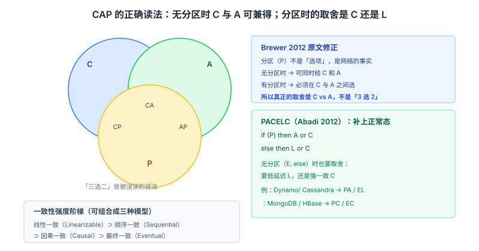
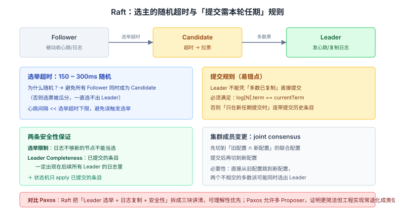

# 系统设计与分布式面试知识体系

> 整理日期：2026-10-13 ｜ 重写：2026-10-14。这份文档不铺广度，只挑面试会一路追问到底的点，每个点讲三层：**机制 → 证据（论文/规范/源码）→ 追问链**。

## 结论

分布式面试的分水岭，在于**你能不能把流行的简化说法纠正回来**：

1. **CAP 的「三选二」是误读**——Brewer 本人 2012 年发文澄清：分区很少发生，**没分区时 C 和 A 可以兼得**；取舍只在分区期间、且可以按操作/子系统细化。
2. **Raft 里「复制到多数派就算提交」是错的**——旧 term 的条目复制到多数派**不构成提交**，必须等本 term 的条目提交后间接提交。这是 Raft 最精妙也最常被答错的点。
3. **RedLock 的定位**——Redis 官方文档自己写着「You should implement fencing tokens」，Kleppmann 的批评核心不是时钟而是**缺少 fencing token**。
4. **Guava RateLimiter 不是漏桶**——从源码看它记的是 `nextFreeTicketMicros`（**下一次**请求的时间），是令牌桶家族。

---

## 一、CAP：把「三选二」这个误读纠正过来

### 表述的演变：从猜想（2000）到定理（2002）到澄清（2012）

- **2000**：Brewer 在 PODC keynote 提出猜想（conjecture）。
- **2002**：Gilbert & Lynch 在 *SIGACT News* 论文中**证明**了它，标题是 *Brewer's Conjecture and the Feasibility of Consistent, Available, Partition-Tolerant Web Services*。论文里的形式化定义是：
  - **Consistency**：「each server returns the right response to each request」，形式化为 **atomic read/write shared memory**（「for every operation, there is a single instant in between the request and the response at which the operation appears to occur」）。
  - **Availability**：「each request **eventually** receive a response」。
  - **Partition-tolerance**：「communication among the servers is not reliable, and the servers may be partitioned into multiple groups that cannot communicate」。
  - 定理原文：「In a network subject to communication failures, it is impossible for any web service to implement an atomic read/write shared memory that guarantees a response to every request.」

### 为什么「三选二」是误读

这是本文最重要的一条纠正。**Brewer 2012 年在 IEEE Computer 上发表 *CAP Twelve Years Later: How the "Rules" Have Changed* 亲自澄清**，原文三点：

> Partitions are **rare**, and when a system is not partitioned, the system can have **both** strong consistency and high availability.
>
> Consistency and availability can vary by **subsystem or even by operation**.
>
> There are various degrees of consistency.

**准确表述**：CAP 的取舍**只在分区发生期间**才强制存在。没分区时，强一致和高可用可以同时拿到。

**三个必须纠正的流行说法**：

| 流行说法 | 实际情况 |
| --- | --- |
| 「三选二，必须永久放弃 C 或 A」 | 取舍**只在分区时**；平时可兼得（Brewer 2012 原文） |
| 「存在 CA 系统」 | 在有分区的分布式网络里 CA 不成立。P 是对**底层网络**的陈述，不是可选项 |
| 「CAP 的 C 就是 ACID 的 C」 | 不是。CAP 的 C 是**原子读写/线性一致**，ACID 的 C 是约束不被破坏 |

**为什么 P 不能放弃**：Partition-tolerance 在论文里的定义是对**底层系统**属性的陈述——「communication among the servers is not reliable」。在异步模型下消息延迟无上界（等价于可能丢失），网络分区是**必然**会发生的。所以它不是设计选项，而是你必须接受的现实。

### PACELC：把「平时怎么办」补上

Abadi 2012 年（*IEEE Computer*, Feb 2012）提出 **PACELC**，补上了 CAP 忽略的「无分区时」这一段。原文定义：

> **if there is a partition (P), how does the system trade off availability and consistency (A and C); else (E), when the system is running normally in the absence of partitions, how does the system trade off latency (L) and consistency (C)?**

**核心洞察（论文原文）**：「CAP only posits limitations in the face of certain types of failures, and **does not constrain any system capabilities during normal operation**」。

**为什么 ELC 分支比 PC 分支更常用**：因为分区是**罕见**的，而「无分区时的延迟 vs 一致」是**每次请求**都在面对的日常决策。系统平时面对的真正矛盾是 **Latency vs Consistency**——强一致要多轮协调，延迟必然高。

分类举例（论文原文）：Dynamo、Cassandra、Riak 的默认配置是 **PA/EL**（分区时保可用、平时保低延迟）。



> **追问链**
> 1. CAP 的 C 和 ACID 的 C 是一回事吗？→ 不是，CAP 的 C 是原子读写/线性一致。
> 2. 一个系统平时 CA、分区时降 A，能说它是 CA 系统吗？→ Brewer 2012：取舍可按操作/子系统细化，但底层仍是分区时会牺牲某个维度，说「CA 系统」是误导。
> 3. 为什么 PACELC 的 ELC 分支日常更重要？→ 分区罕见，而延迟 vs 一致的权衡每次请求都在面对。

---

## 二、一致性模型：准确定义与强度关系

来源：jepsen.io/consistency 的模型页。

| 模型 | 准确定义 | 关键区别 |
| --- | --- | --- |
| **线性一致**（Linearizability） | 「every operation appears to take place **atomically, in some order, consistent with the real-time ordering**」——若 A 在 B 开始前完成，则 B 逻辑上必须在 A 之后生效 | **要求 real-time 顺序**；不可用性：「This model **cannot be totally or sticky available**; in the event of a network partition, some or all nodes will be unable to make progress」 |
| **顺序一致**（Sequential） | Lamport 1979 定义：「the result of any execution is the same as if the operations of all the processors were executed in some **sequential order**, and the operations of each individual processor appear in this sequence **in the order specified by its program**」 | **不要求 real-time 顺序**，只要各进程内部按程序序 |
| **因果一致**（Causal） | 「causally-related operations should appear in the same order on all processes—though processes may **disagree about the order of causally independent operations**」 | 基于 Lamport happens-before；**是 sticky available 的** |
| **最终一致** | 停止写入后所有副本收敛 | 最弱 |

**强度关系**：线性一致 ⊃ 顺序一致 ⊃ 因果一致（逐个变弱）。

**为什么因果一致能「sticky available」而线性一致不能**：因果一致允许无因果关系的操作在不同节点上顺序不同，各节点不需要全局协调，所以分区时每个连到正常节点的客户端都能继续推进。线性一致要求全局实时顺序，必须协调，分区时必然有节点无法推进。

**一个重要澄清（常见误区）**：线性一致 ≠ 强一致 ≠ 可串行化。
- 线性一致是**单对象**模型；
- 多对象上的强一致需要 **Strict Serializability**（可串行化 + 实时序约束）；
- 可串行化本身不要求实时序，是**事务级**概念。

> **追问链**
> 1. 线性一致与顺序一致差在哪？→ real-time 顺序约束（线性一致要求跨进程的实时序）。
> 2. 因果一致为什么分区时还能用？→ 无需全局协调，只保证因果序。
> 3. 最终一致蕴含因果一致吗？→ 不，方向相反（因果更强）。

---

## 三、Raft：选举与「已提交不会被回滚」的证明

### 三个状态与选举

- 节点状态：**leader / follower / candidate**。
- **term（任期）**：单调递增的整数，是 Raft 的逻辑时钟。每个 term 最多一个 leader。
- **选举超时**：论文原文「election timeouts are chosen randomly from a fixed interval (e.g., **150–300ms**)」。**随机是为了打散**，避免所有 follower 同时超时、反复分裂投票。
- **投票规则**（论文图 2 原文）：grant vote 的条件是「If `votedFor` is null or candidateId, **and** candidate's log is **at least as up-to-date** as receiver's log」。
- **同 term 每服务器只投一票**，先到先得。

### 日志复制与提交规则

`AppendEntries` 的参数（论文图 2）：`term, leaderId, prevLogIndex, prevLogTerm, entries[], leaderCommit`。

**一致性检查**（图 2 第 2 条原文）：「Reply false if log doesn't contain an entry at `prevLogIndex` whose term matches `prevLogTerm`」。这就是「日志匹配」的强制手段——leader 通过回退 `nextIndex` 反复试探，直到找到双方一致的日志点。

Leader 维护两个数组：
- `nextIndex[]`：初始化为 leader 最后日志索引 + 1
- `matchIndex[]`：初始化为 0

**提交规则（图 2 原文）**：

> If there exists an N such that N > `commitIndex`, a majority of `matchIndex[i]` ≥ N, **and log[N].term == currentTerm**: set `commitIndex = N`.

### 最容易被答错的一点：旧 term 的条目不能靠计数提交

上面规则里 **`log[N].term == currentTerm`** 这个条件极其关键。论文 §5.4.2 原文：

> Raft **never commits log entries from previous terms by counting replicas**. Only log entries from the leader's **current term** are committed by counting replicas; once an entry from the current term has been committed in this way, then all prior entries are committed indirectly because of the Log Matching Property.

**为什么**：如果一个旧 term 的条目「已经在多数派上」，看起来该提交了，但这是**不安全的**——论文 Figure 8 给了反例：集群 A、B、C、D、E，某些节点上的旧条目可能在后续选举中被新 leader 覆盖。只有「本 term 的条目被提交」这件事才证明了「新 leader 的日志已经与多数派达成一致」，从而旧条目才能**经由 Log Matching Property 间接**提交。

**面试里答「复制到多数派就算提交」就是错的**——必须带上「且是本 term 的条目」。

### 「已提交条目不会被回滚」是怎么保证的

这是 Raft 的安全核心，靠**两条性质**联合：

1. **Leader Completeness Property**（图 3 原文）：「if a log entry is committed in a given term, then that entry will be present in the logs of the leaders for all higher-numbered terms.」
2. **投票限制**：candidate 必须获得多数派选票；而任何已提交条目必定存在于「多数派中至少一个节点」上；RequestVote 携带 candidate 的日志信息，voter 若发现自己日志更新就拒绝投票。

**「更新」的判定**（§5.4.1 原文）：先比**最后条目的 term**，term 大者更新；term 相同则**更长者**更新。

**证明思路（§5.4.3，9 步反证）**：假设 leaderT（term T）提交了条目但 leaderU（term U > T）没有该条目。leaderT 能提交说明多数派接受了它；leaderU 能当选说明多数派投了它。两个多数派**必有交集**（至少一个节点同时在两个集合里）。该节点「接受了条目」却「投给了 leaderU」，但投票时它要求 leaderU 的日志「至少一样新」——矛盾。**所以已提交的条目必然出现在后续所有 leader 的日志里，不会被回滚。**

### 脑裂如何避免

**Election Safety**（图 3 原文）：「at most one leader can be elected in a given term.」由两条保证：

1. 选举需要**多数派**（majority）；
2. **每个节点在每个 term 只投一票**。

两个候选者不可能同时拿到多数票（多数派之间必有交集，交集节点的唯一一票只能给一个人）。

**时间不等式**（§5.6 原文）：`broadcastTime ≪ electionTimeout ≪ MTBF`（广播时间远小于选举超时，选举超时远小于平均故障间隔）——这是 Raft 能稳定工作的假设前提。

### 成员变更：为什么要 joint consensus

**直接切换是不安全的**。论文 §6 原文：

> any approach where servers switch **directly** from the old configuration to the new configuration is **unsafe** ... the cluster can potentially split into two independent majorities during the transition.

**因为**：切换瞬间存在「新旧配置各自都能形成多数派」的窗口——两个多数派可能各自选出 leader，就是脑裂。

**joint consensus 的做法**：引入中间配置 `C_old,new`，其规则（原文）：
- 日志**复制到两个配置的所有服务器**；
- **两个配置中的任意服务器都可以当 leader**；
- 达成一致（选举和提交）**需要旧配置和新配置各自的多数派**。

流程：先写 `C_old,new` 并提交（需 C_old 多数 **且** C_new 多数），再写 `C_new` 并提交。**「There is no point in time in which C_old and C_new can both make decisions independently」**——这是安全性的关键。

**三个实操细节（论文原文）**：
1. **新服务器先以 non-voting member 加入**——追赶日志期间若算作有投票权，会拖慢集群（它日志落后，可能拖长选举）。
2. **leader 若不在新配置中，提交 `C_new` 后主动退位**（step down），避免它继续以旧身份服务。
3. **被移除的服务器会不断发起选举干扰集群**——解法是「if a server receives a RequestVote RPC **within the minimum election timeout** of hearing from a current leader, it does not update its term or grant its vote」（最小选举超时内收到 RPC 就拒绝投票，防止被踢出者捣乱）。



> **追问链**
> 1. 为什么新 leader 不能靠「某旧 term 条目已在多数派」就提交它？→ 不安全（Figure 8 反例），必须等本 term 条目提交后间接提交。
> 2. 选举超时为什么要随机？→ 打散超时避免分裂投票反复。
> 3. joint consensus 为什么需要「两个配置各自多数」？→ 否则切换窗口内新旧配置可能各自形成多数派 → 脑裂。

---

## 四、分布式锁：RedLock 争议的实质

### 单实例 Redis 锁

标准写法（redis.io 官方文档原文）：

```
SET resource_name my_random_value NX PX 30000
```

- `NX`：不存在才设置（保证互斥）；
- `PX 30000`：30 秒过期（防死锁）；
- `my_random_value`：**「20 bytes from /dev/urandom」**（官方原文），用于释放时校验「只删自己的锁」。

释放必须用 Lua 保证「校验 value + 删除」原子——否则 `GET` 之后、`DEL` 之前锁可能过期被别人拿走，导致删掉别人的锁。

### RedLock 与它的争议

RedLock 的做法（官方原文）：并行向 N 个**独立** Redis 实例发 `SET`，「acquire the lock in the **majority** of the instances (**at least 3**)」，且总耗时小于有效性时间才算成功。有效性计算原文：`MIN_VALIDITY = TTL - (T2 - T1) - CLOCK_DRIFT`。

**Kleppmann（2016-02-08）的批评**，原文要点：

1. **核心是缺少 fencing token**：

   > you need to include a **fencing token** with every write request to the storage service ... a number that **increases** ... every time a client acquires the lock.

   他的结论原文：「the first big problem with Redlock: it does **not have any facility for generating fencing tokens**」。

2. **时钟跳变与 GC 暂停**：进程暂停可能长于租约期（「stop-the-world GC pauses have sometimes been known to last for **several minutes**」）。他举的具体失败时序：client 1 在 A、B、C 拿到锁，节点 C 时钟跳变导致锁提前过期，client 2 在 C、D、E 拿到锁 → **两个客户端同时持锁**。

3. **依赖同步系统模型**：原文「Redlock works correctly **only if you assume a synchronous system model**」（有界的网络延迟、进程暂停、时钟误差）。且指出「Redis uses **gettimeofday**, not a monotonic clock, to determine the expiry of keys」。

**antirez（2016-02-09）的回应**，原文要点：

1. **论点**：大多数需要分布式锁的场景，互斥被破坏时「**you already lost**」；且 Martin 假设你总有别的办法避免竞态。

2. **关键反论**：若你的存储能拒绝较小 token 的写，那它**本身就是线性一致的存储**，那你**根本不需要 RedLock**（直接用那个线性存储生成递增 ID 即可）。对非线性的共享资源，可用 **Check-and-Set + 唯一 token**。

3. **对时钟论的回应**：Redlock 的获取流程是「① 取时间 → ② 获取锁 → ③ 再取时间 → ④ 检查是否超时」，所以「whatever happens between 1 and 3, you can add the network delays you want, the lock will always be considered not valid if too much time elapsed」。

4. **官方也承认的一点**：antirez 原文「I think **Martin is right** that Redis and Redlock implementations should switch to the **monotonic time API**」。**Redis 官方文档自己**也写着「You should **implement fencing tokens**」和「Redis is not using **monotonic clock** for TTL expiration mechanism」。

**结论（面试可直接用）**：RedLock **不适合「严格正确性」要求的场景**（如资金操作）；官方文档自己都建议加 fencing token。严格场景应改用**带 fencing token 的方案**（etc/ZXid）或**线性一致的协调服务**。**答「RedLock 能提高可靠性但保证不了互斥的绝对正确性」比答「RedLock 是安全的分布式锁」准确得多。**

### ZooKeeper 的临时顺序节点方案

zookeeper.apache.org 官方 recipe 原文步骤：

1. `create()` 路径 `locknode/guid-lock-`，带 **sequence + ephemeral** 标志；
2. `getChildren()` **不设 watch**（原文：「this is important to avoid the **herd effect**」）；
3. 若自己序号最小 → 获得锁；
4. 否则对**前一个序号**节点 `exists()` 设 watch；
5. `exists()` 返回 null 则回第 2 步；否则等待通知。

**为什么没有 herd effect**（原文）：「The removal of a node will only cause **one client** to wake up since each node is watched by exactly one client.」

**关键设计点**：**每个客户端只 watch 它的前一个节点**，而不是 watch 锁节点本身。如果用后者，锁释放时**所有**等待者同时被唤醒（惊群），去抢锁只有一个人成功，其余白白消耗。顺序节点方案把「惊群」降为「只唤醒一个人」。原文还强调「There is **no polling or timeouts**」——纯事件驱动。

**fencing token 在 ZooKeeper 里怎么取**：Kleppmann 原文建议「if you are using ZooKeeper as lock service, you can use the **zxid or the znode version number** as fencing token」。

> **追问链**
> 1. 「锁过期了但我不知道」怎么破坏互斥？fencing token 如何根治？→ 客户端 A 以为自己持锁但锁已过期，B 已拿到锁；fencing token 让存储端拒绝旧 token 的写。
> 2. ZooKeeper 为什么只 watch 前一个节点？→ 避免惊群，每次只唤醒一个等待者。
> 3. RedLock 最致命的问题是时钟还是 fencing？→ 缺少 fencing token（Kleppmann 的核心论点）。

---

## 五、限流：从 Guava 源码看令牌桶

来源：`google/guava` 的 `SmoothRateLimiter.java`（`SmoothBursty` / `SmoothWarmingUp` 是它的内部静态类）。

### 核心字段与「记下一次」的设计

父类关键字段：`storedPermits`（存量令牌）、`maxPermits`、`stableIntervalMicros`、`nextFreeTicketMicros`。

**设计要点（源码注释原文）**：

> the RateLimiter doesn't remember the time of the _last_ request, but it remembers the (expected) time of the **_next_** request.

记「**下一次**该放行的时间」而不是「上一次请求的时间」，这样才支持「本次大请求可以先放行，但把后续请求推迟」的语义。

### 调度逻辑

`reserveEarliestAvailable` 的核心（源码）：

```java
storedPermitsToSpend = min(requiredPermits, this.storedPermits);
freshPermits = requiredPermits - storedPermitsToSpend;
waitMicros = storedPermitsToWaitTime(storedPermits, storedPermitsToSpend)
           + (long)(freshPermits * stableIntervalMicros);
nextFreeTicketMicros = saturatedAdd(nextFreeTicketMicros, waitMicros);
storedPermits -= storedPermitsToSpend;
```

逻辑：**先用存量令牌，不够的部分（`freshPermits`）要等**，等待时间 = `freshPermits × 稳定间隔`；然后**把 `nextFreeTicketMicros` 往后推**。

### SmoothBursty vs SmoothWarmingUp 的本质差异

**唯一的关键差异在 `storedPermitsToWaitTime()`**：

```java
// SmoothBursty：存量令牌不产生等待 → 允许突发
long storedPermitsToWaitTime(double storedPermits, double permitsToTake) {
    return 0L;
}
```

`SmoothBursty` 里 `maxPermits = maxBurstSeconds × permitsPerSecond`，且**用存量令牌不额外等待**——这就是「允许突发」的实现：攒下来的令牌可以一次性用掉。

**SmoothWarmingUp** 则把存量令牌的消耗**按梯形曲线计价**（越接近 `maxPermits` 越贵），实现「预热」——刚启动的系统需要逐步加速，不能一上来就打满。

源码注释里给出了原理：`coldIntervalMicros = stableIntervalMicros * coldFactor`（**`coldFactor` 默认 3**），并用「梯形面积 = 预热期」来推导 `thresholdPermits` 和斜率。注释还提到历史原因：`warmupPeriod/2` 的取值是为了「maintain the behavior of the original implementation where **coldFactor was hard coded as 3**」。

**误区**：说「Guava RateLimiter 是漏桶」。从源码看它是**令牌桶家族**（`storedPermits` + `freshPermits` 模型）。

> **待核实**：令牌桶/漏桶/滑动窗口/固定窗口四种算法的**规范级定义**（RFC 等）本次未取得，因此不在此给公式。可确定的是**固定窗口有临界问题**：窗口边界处（如第 59 秒和第 61 秒）两个窗口各自放行满额，跨边界瞬间实际通过 2× 限额。滑动窗口用「细分格子 + 加权」缓解。

---

## 六、一致性哈希

来源：Karger et al., *Consistent Hashing and Random Trees*, **STOC 1997**。论文原文：

> a **consistent hashing** ... assigns a set of items to buckets so that each bin receives **roughly the same number** of items. Unlike standard hashing schemes, a small change in the bucket set does **not** induce a total remapping of items to buckets.

**解决什么问题**：普通取模哈希 `hash(key) % N` 在 N 变化时（增删节点）几乎**全部** key 都要重新映射（雪崩），缓存全部失效。

**一致性哈希的做法**：把节点和 key 都映射到同一个哈希环上，key 顺时针找第一个节点。

**注意一个常见误区**：论文的承诺是「**roughly** the same number of items」——**不保证均匀**。实际实现需要**虚拟节点**（每个物理节点在环上映射多个位置）来改善均衡性，否则节点少时负载会明显倾斜。**虚拟节点的专门定义本次未在 Karger 原论文中逐句核实**，此点标注待补。

> **追问链**
> 1. 普通取模哈希增删节点为什么雪崩？→ `N` 变了，几乎所有 `key % N` 都变。
> 2. 一致性哈希为什么还需要虚拟节点？→ 物理节点少时环上分布不均，虚拟节点拉开分布改善均衡。

---

## 七、消息队列：从 RocketMQ 官方文档看顺序消息

来源：rocketmq.apache.org（5.0 文档）。

### 顺序消息：局部有序，不是全局有序

官方定义原文：「Ordered messages are delivered to consumers in the order in which the messages are sent.」

**机制（原文）**：「Apache RocketMQ uses **message groups** to determine the order ... The messages in a message group are processed in the **first-in, first-out (FIFO)** order. Message ordering does **not** apply to different message groups.」

**生产序的三个条件（原文）**：**Single producer**、**Serial transmission**（单线程发送）、同一 MessageGroup 的消息**路由到同一队列**。

**消费序的条件**：**Delivery order** + 保证「receive-process-reply」路径顺序（避免异步处理导致乱序）。

**关键结论**：顺序消息是 **message group 内的局部有序**，**不是全局有序**。「顺序消息 = 全局顺序」是常见误区。

### RocketMQ 事务消息：半消息 + 回查

官方文档原文：

- 生产者发消息，broker 保存并**标记为不可投递**，这种状态叫 **half message**（半消息）；
- 生产者执行本地事务后发第二个 ACK（**Commit** 或 **Rollback**）：Commit 则半消息投递，Rollback 则丢弃；
- **回查机制**：若网络断开或生产者重启导致 broker 没收到第二个 ACK，或半消息状态是 **Unknown**，「the broker waits a period of time and sends a request to a producer ... to query the status of the half message」。

生命周期：Initialized → **Transaction pending**（半消息入事务存储，消费者不可见）→ Ready / Rollback。

**它是什么**：官方原文说它是「two-phase commit on the basis of the normal message-based solution. The feature **combines two-phase commit and local transaction**」——即**两阶段提交 + 本地事务**的混合，不要简单等同于数据库 2PC。

**为什么消费者看不到半消息**：因为它在 broker 侧被标记为不可投递，只有收到 Commit 才变为可投递。这保证了「本地事务成功」与「消息可见」的一致性。

> **待核实**：2PC 的阻塞问题、3PC、TCC 的空回滚/悬挂、Saga 补偿、本地消息表这些主题，**本次未取得一手源**（论文或权威文档），因此本文不给出细节，避免编造。RocketMQ 的半消息回查次数/超时的具体默认值也未核实。

---

## 八、高频追问速查（按「面试官问 → 我答」组织）

| 面试官会问 | 你要答到的点 |
| --- | --- |
| CAP 的三选二对吗 | **不对**。Brewer 2012 澄清：分区罕见，**平时 C 和 A 可兼得**；取舍只在分区时 |
| 能选 CA 系统吗 | 不能。P 是对底层网络的陈述，不是可选项 |
| CAP 的 C 是什么 | **原子读写/线性一致**，不是 ACID 的 C |
| PACELC 解决什么 | 补上「无分区时」的 **Latency vs Consistency** 权衡（Abadi 2012） |
| 线性一致和顺序一致 | 差在 **real-time 顺序**；线性一致是单对象，多对象要 Strict Serializability |
| 因果一致为什么分区可用 | 无需全局协调，各节点只保因果序 → **sticky available** |
| Raft 选举超时为什么随机 | 打散超时，避免分裂投票反复（论文：150–300ms 区间） |
| Raft 复制到多数派就提交吗 | **不是**。旧 term 条目不能靠计数提交，**必须本 term 条目提交后间接提交**（§5.4.2） |
| 已提交条目会被回滚吗 | 不会，靠 **Leader Completeness** + 投票限制（日志 term 大者/更长者优先） |
| Raft 怎么防脑裂 | 多数派 + 每 term 每节点一票 → 同 term 最多一个 leader |
| 成员变更能直接改吗 | **不能**，必须 joint consensus；否则切换窗口可能出现两个多数派 |
| joint consensus 的规则 | 复制到两个配置、各自多数派才达成一致 |
| RedLock 是安全锁吗 | 官方文档自己写「should implement fencing tokens」；**不适合严格正确性场景** |
| Kleppmann 批评的核心 | **缺少 fencing token**（时钟/GC 是论据） |
| antirez 的对点 | 能拒小 token 的存储本身是线性一致存储，那就不需要 RedLock |
| ZooKeeper 锁为什么无惊群 | 只 watch **前一个**节点，释放时只唤醒一个人 |
| ZK 的 fencing token 取什么 | **zxid 或 znode 版本号** |
| Redis 锁释放为什么用 Lua | `GET`+`DEL` 两步之间锁可能过期，会删掉别人的锁 |
| Guava RateLimiter 是什么 | **令牌桶**家族（`storedPermits`/`freshPermits`），不是漏桶 |
| 它为什么记 nextFreeTicketMicros | 记「下一次」才能支持大请求先放行、后续推迟 |
| SmoothBursty 为什么能突发 | `storedPermitsToWaitTime` 返回 **0**，存量令牌不产生等待 |
| coldFactor 是多少 | **3**（源码注释说历史上硬编码为 3） |
| 固定窗口的临界问题 | 跨窗口边界瞬间可放行 **2×** 限额 |
| 一致性哈希保证均匀吗 | **不保证**，论文只说「**roughly** the same」；需虚拟节点改善 |
| RocketMQ 顺序消息是全局有序吗 | **不是**，是 **message group 内**的局部有序 |
| RocketMQ 半消息为什么消费者不可见 | broker 标记为不可投递，收到 Commit 才可见 |
| 事务消息等于 2PC 吗 | 官方说是「两阶段提交 + 本地事务」的混合，不等于数据库 2PC |

## 建议

- **准备四个「反流行说法」的正确答案**：CAP 不是三选二、Raft 旧 term 条目不能计数提交、RedLock 缺 fencing token、Guava RateLimiter 是令牌桶。这四个几乎每次都能用上，且立刻区分「背的」和「懂的」。
- **引用要落到论文的章节或原文**：说「Raft 论文 §5.4.2 明确…」比说「我记得 Raft 是这样」可信度高一个档次。
- **系统的取舍要讲「什么时候」**：不要一刀切「用 CP」或「用 AP」，要讲「分区期间降 A、平时保 C」。
- **主动说边界**：RedLock 不适合严格场景、一致性哈希不保证均匀、CAP 取舍可按操作细化——**说得出边界才是真懂**。
- **架构题要能估算**：QPS、存储、带宽的量级估算比架构图更能体现工程判断（参考方法论篇的时间分配）。

## 待核实

- **2PC / 3PC / TCC / Saga / 本地消息表**的一手源本次未取得，本文不展开，避免编造。TCC 的空回滚与悬挂问题、Saga 的补偿语义需要时可另行核实。
- **令牌桶 / 漏桶 / 滑动窗口**的规范级定义未取得，本文只给出固定窗口的临界问题这一可确认结论。
- **一致性哈希的虚拟节点**专门定义未在 Karger 1997 原论文中逐句核实，Dynamo 论文未抓取。
- **RocketMQ 的刷盘策略默认值、消费重试次数/间隔、消息堆积处理**未到源码级核实。
- **最终一致（eventual consistency）的正式定义原文**本次未取得。
- Raft 成员变更**后续论文**（Ongaro 博士论文中的 single-server changes 改进）未覆盖，本文只依据 2014 extended version。
- 各系统实际默认配置随版本变化（如 Cassandra/Dynamo 的一致性级别），请以对应版本文档为准。

## 来源清单

| 内容 | 来源（一手优先） | 说明 |
| --- | --- | --- |
| CAP 的形式化定义与证明 | Gilbert & Lynch, *Brewer's Conjecture and the Feasibility of Consistent, Available, Partition-Tolerant Web Services*, SIGACT News 33(2), 2002 | 论文 |
| CAP 的澄清（分区罕见、可按操作细化） | Brewer, *CAP Twelve Years Later: How the "Rules" Have Changed*, IEEE Computer, 2012 | 论文 |
| PACELC 定义与分类 | Abadi, *Consistency Tradeoffs in Modern Distributed Database System Design*, IEEE Computer, Feb 2012 | 论文 |
| 线性一致/顺序一致/因果一致的定义与强度关系 | jepsen.io/consistency（含 linearizable/sequential/causal 页） | 权威技术资料 |
| Raft 选举、日志复制、提交规则、单服务器变更、joint consensus、Figure 8 | Ongaro & Ousterhout, *In Search of an Understandable Consensus Algorithm (Extended Version)*, 2014-05-20 | 论文 |
| RedLock 的批评与 fencing token | Kleppmann, *How to do distributed locking*, 2016-02-08 | 原文 |
| RedLock 的辩护与 monotonic clock 承认 | antirez, *Is Redlock safe?*, 2016 | 原文 |
| Redis 锁的 SET NX PX、20 字节随机值、MIN_VALIDITY | redis.io 官方文档 distributed-locks | 官方文档 |
| ZooKeeper 临时顺序节点、无 herd effect、无轮询 | zookeeper.apache.org/doc/current/recipes.html | 官方文档 |
| Guava RateLimiter 的 storedPermits/nextFreeTicketMicros、SmoothBursty/WarmingUp、coldFactor=3 | google/guava `SmoothRateLimiter.java` | 源码 |
| 一致性哈希的定义与动机 | Karger et al., *Consistent Hashing and Random Trees*, STOC 1997 | 论文 |
| RocketMQ 顺序消息（message group）、事务消息（半消息+回查） | rocketmq.apache.org 官方文档（5.0） | 官方文档 |
| 讲法组织参考（源码/论文级、追问链式） | xiaolincoder/CS-Base、doocs/advanced-java、donnemartin/system-design-primer | GitHub 仓库，2026-10-14 核实 |
