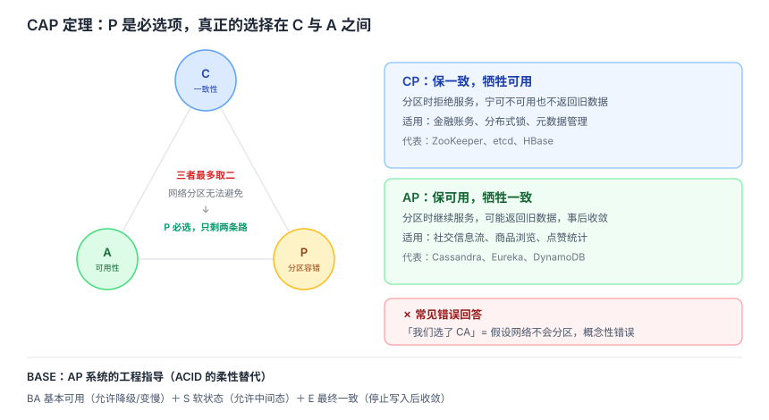
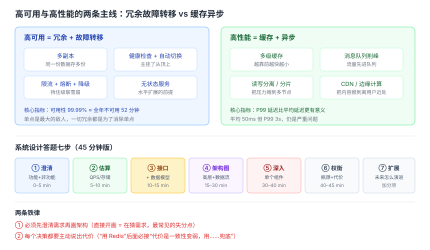
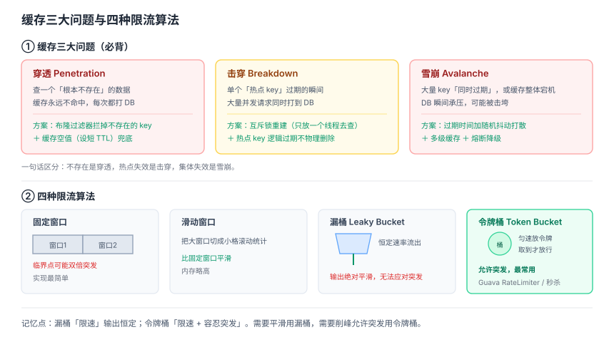

# 系统设计与分布式面试知识体系

> 整理日期：2026-10-13 ｜ 定位：对标 donnemartin/system-design-primer 与 CS-Notes「系统设计」章节。前五篇讲的是单机与协议原理，这一篇讲**多个节点怎么协作**。

## 结论

- 系统设计面试**没有标准答案**，考的是**权衡能力**。面试官想听的不是「用了 Kafka」，而是「为什么这里需要队列、代价是什么」。
- 一切的起点是 **CAP 定理**：网络分区一定会发生，所以真正的选择永远是 **CP 还是 AP**，P 不是可选项。
- 高可用的核心手段就四个字：**冗余 + 故障转移**；高性能的核心手段也是四个字：**缓存 + 异步**。
- 回答系统设计题的骨架固定：**需求澄清（功能/非功能）→ 估算（QPS/存储）→ 接口设计 → 数据模型 → 高层架构 → 逐层深入 → 瓶颈与权衡**。跳过澄清直接画架构是最常见的失分点。

## 一、基础理论

### CAP 定理

分布式系统中，一致性（C）、可用性（A）、分区容错性（P）**三者最多同时满足两个**。

- **P 必须选**：网络分区（节点间消息丢失/延迟）在真实网络里无法避免。
- 于是实际选择只剩两种：
  - **CP**：分区时拒绝服务，保证数据一致。例：ZooKeeper、etcd、金融核心账务。
  - **AP**：分区时继续服务，可能返回旧数据，事后收敛。例：Cassandra、Eureka、社交信息流。

**面试要点**：不要答「我们选择了 CA」——那等于说「我们假设网络不会分区」，是概念性错误。



### BASE 理论

AP 系统的工程指导原则，是 ACID 的**柔性替代**：

- **BA** Basically Available：允许响应变慢或降级，但基本可用。
- **S** Soft state：允许中间状态存在，不要求时刻一致。
- **E** Eventually consistent：经过一段时间后最终达到一致。

### ACID vs BASE

| 维度 | ACID | BASE |
|---|---|---|
| 一致性 | 强一致，事务提交即可见 | 最终一致，存在中间态 |
| 可用性 | 冲突时可能阻塞/失败 | 优先保证可用 |
| 适用 | 银行转账、库存扣减 | 点赞数、动态feed、日志统计 |
| 代表 | MySQL、Oracle | Cassandra、Redis 集群 |

**选型判据**：这笔数据错了会不会导致资金/资损或法律风险？会 → ACID；只是体验问题 → BASE。

## 二、一致性模型

| 模型 | 保证 | 典型场景 |
|---|---|---|
| **线性一致（强一致）** | 所有节点看到同一顺序，读到的必是最新 | 分布式锁、Leader 选举 |
| **顺序一致** | 所有节点看到相同操作顺序，但不保证实时 | 多副本日志 |
| **因果一致** | 有因果关系的操作保序，无因果的可乱序 | 评论与回复 |
| **最终一致** | 停止写入后，最终所有副本收敛 | DNS、CDN、缓存 |

**面试加分**：性能与一致性成反比。强一致要跨节点协调（多轮网络往返），弱一致可以本地返回。所以「全系统强一致」几乎必然是错误设计。

## 三、分布式共识

### 为什么需要共识

多副本场景下，需要一个协议保证所有节点对**同一个值/同一份日志顺序**达成一致，并能容忍部分节点故障。

### 主流算法对比

| 算法 | 特点 | 应用 |
|---|---|---|
| **Paxos** | 理论完备，但工程实现复杂、难理解 | 理论基石 |
| **Raft** | 易理解易实现，Leader 制 + 日志复制 | etcd、TiKV、Consul |
| **ZAB** | 类似 Raft，原子广播，保证顺序 | ZooKeeper |
| **PBFT** | 容忍拜占庭故障（可作恶节点） | 联盟链 |

### Raft 三个核心机制

1. **Leader 选举**：节点初始都是 Follower，各带一个 150~300ms 随机选举超时。超时未收到心跳 → 变 Candidate → 拉票 → 得多数派即当选。
2. **日志复制**：所有写请求走 Leader，Leader 追加日志后并行发给 Follower，**多数派确认**后提交并返回客户端。
3. **安全性约束**：只允许「日志至少和自己一样新」的节点当选，保证已提交日志不丢。

**高频追问：多数派为什么是安全的关键？**
任意两个多数派必然有交集，因此新 Leader 一定见过已提交的日志。这也解释了「为什么集群要奇数个节点」——3 节点容忍 1 台故障，4 节点只容忍 1 台但成本更高，所以 3、5、7 更划算。

## 四、分布式事务

这是**面试深水区**，能讲清方案选型的人不多。

| 方案 | 一致性 | 原理 | 代价 |
|---|---|---|---|
| **2PC 两阶段提交** | 强 | Prepare（问能否提交）→ Commit/Rollback | 同步阻塞、协调者单点、Prepare 后参与者长时间持锁 |
| **3PC** | 强 | 在 2PC 前加 CanCommit，并引入超时 | 减少阻塞，但仍有不一致窗口 |
| **TCC** | 强（业务层） | Try 预留资源 → Confirm 提交 → Cancel 释放 | 业务侵入大，要写三个方法，需处理空回滚/悬挂 |
| **Saga** | 最终 | 拆成一串本地事务，失败逐步补偿 | 无隔离性，中间态对外可见 |
| **本地消息表** | 最终 | 本地事务 + 消息表同库，定时投递 | 依赖轮询，有延迟 |
| **事务消息** | 最终 | MQ 支持半消息，回查本地事务状态 | 依赖 MQ 能力 |
| **最大努力通知** | 弱 | 反复重试通知，不保证成功 | 对账兜底 |

**选型口诀**：**强一致优先 TCC；长流程用 Saga；能接受延迟就用消息最终一致**。

**TCC 的三个坑**（说出来就是加分）：空回滚（Try 没到、Cancel 先到）、幂等（Confirm/Cancel 重试）、悬挂（Cancel 比 Try 先执行，之后 Try 又来）。

## 五、分布式锁

| 实现 | 优点 | 缺陷 |
|---|---|---|
| **数据库唯一索引/条件更新** | 简单、可靠 | 性能差、无自动过期 |
| **Redis SET NX PX** | 性能高、有 TTL | 主从切换可能丢锁（见下） |
| **ZooKeeper 临时顺序节点** | 强一致、天然防死锁 | 性能低于 Redis |
| **etcd + Lease** | 强一致、有租约 | 需引入新组件 |

### Redis 分布式锁的正确姿势

```text
加锁：SET key <唯一value> NX PX 30000
解锁：Lua 脚本「先比对 value 再删除」，保证原子性
```

**三个必须回答的追问**：

1. **为什么解锁要比对 value？** 防止误删别人的锁——A 超时释放后 B 拿到锁，A 执行完直接 DEL 会删掉 B 的锁。
2. **业务执行超过 TTL 怎么办？** 看门狗（watchdog）自动续期，如 Redisson。
3. **有续期就绝对安全吗？** **不是**。主从切换时锁可能未同步到新主，导致两个客户端同时持锁；进程 STW 停顿也可能让续期失败。**严格互斥需要 fencing token**——给每次加锁发递增版本号，存储层拒绝旧版本写入。这是从「大概率安全」到「可证明安全」的关键一步。

## 六、高并发治理四件套

### 限流

| 算法 | 原理 | 特点 |
|---|---|---|
| **固定窗口** | 按分钟/秒计数 | 简单，但临界点可能双倍突发 |
| **滑动窗口** | 把窗口切成小格滚动统计 | 平滑，内存略高 |
| **漏桶** | 恒定速率流出，多余排队/丢弃 | 输出绝对平滑，无法应对突发 |
| **令牌桶** | 匀速放令牌，取到才能过 | **允许突发**，最常用（Guava RateLimiter） |

**记忆点**：漏桶**限速**，令牌桶**限速 + 容忍突发**。电商秒杀用令牌桶。

### 熔断

三态机：**Closed**（正常放行）→ 失败率超阈值 → **Open**（直接拒绝，快速失败）→ 冷却后 → **Half-Open**（放几个探测请求，成功则回 Closed，失败回 Open）。

目的：**防止级联雪崩**——不让慢的下游拖死整条链路。

### 降级与隔离

- **降级**：非核心功能暂时关闭或返回兜底数据（如推荐挂了就返回热门榜）。
- **隔离**：线程池隔离 / 信号量隔离，给不同下游独立资源池，避免一个下游耗尽所有线程。

### 重试的正反面

重试是双刃剑（**重试风暴**）：

```text
下游变慢 → 上游超时 → 上游大量重试 → 下游压力更大 → 雪崩
```

正确重试需要：**有限次数 + 指数退避 + 随机抖动（jitter）+ 幂等 + 重试预算**。缺了幂等，重试就是重复扣款。



## 七、数据分片与扩展

### 一致性哈希

**普通取模的问题**：`hash(key) % N`，N 变化时几乎所有 key 都要迁移。

**一致性哈希**：把哈希空间组成环，节点和 key 都映射到环上，key 顺时针找到的第一个节点即归属。

- **优点**：增删节点时只影响相邻区间，迁移量从 ~100% 降到 ~1/N。
- **问题**：节点少时分布不均（数据倾斜）。
- **解决**：**虚拟节点**——每个物理节点映射成几百个虚拟节点散布环上，使分布均匀。

**应用**：Redis Cluster（16384 槽位）、Cassandra、CDN 调度。

### 分库分表

- **垂直拆分**：按业务/字段拆（如订单表拆出订单基础表 + 订单详情表）。
- **水平拆分**：按行拆，同一张表按分片键散到多个库/表。
- **分片键选择是第一要务**：选错会导致热点。经验是选**查询最常用的维度且分布均匀**的字段；若查询维度多，需要异构索引或宽表冗余。

### 读写分离与主从延迟

主从复制有延迟，因此：
- **写后立刻读** → 强制走主库。
- **或** 等待复制位点追上（`WAIT` 命令 / GTID 等待）。
- 这就是**读己之写（read-your-writes）**一致性在工程上的落地。

## 八、缓存体系

### 多级缓存

```text
浏览器缓存 → CDN → 反向代理（Nginx）→ 本地缓存（Caffeine）→ 分布式缓存（Redis）→ DB
```

越靠前越快、容量越小、一致性越难保证。

### 缓存三大问题（必背）

| 问题 | 现象 | 方案 |
|---|---|---|
| **穿透** | 查不存在的数据，绕过缓存直达 DB | 布隆过滤器 + 缓存空值（短 TTL） |
| **击穿** | 单个热点 key 过期瞬间，大量请求打 DB | 互斥锁重建 / 热点永不过期 + 逻辑过期 |
| **雪崩** | 大量 key 同时过期，或缓存整体宕机 | 过期时间加随机抖动 + 多级缓存 + 熔断降级 |

### 缓存与数据库一致性

最常用 **Cache Aside（旁路缓存）**：读时未命中回源并回填；写时**先更新 DB，再删缓存**。

**为什么是删而不是改？** 改缓存可能因为并发写导致中间值长期残留；删更安全（下次读自然回填）。



**延迟双删**：删缓存 → 更新 DB → 延迟一小段时间再删一次，覆盖「更新期间被读回旧值」的窗口。**注意**：延迟双删也只能**降低**不一致概率，无法完全消除，根本方案还是靠 binlog 订阅（Canal）异步补偿。

## 九、消息队列

### 三个核心用途

1. **异步解耦**：下单后发消息，积分/通知服务各取所需，不用同步调用。
2. **削峰填谷**：秒杀流量先进队列，后端按能力消费。
3. **最终一致**：配合本地消息表实现跨服务事务。

### 选型对比

| MQ | 顺序 | 吞吐 | 特点 |
|---|---|---|---|
| **Kafka** | 分区内有序 | 最高 | 日志/大数据管道，分区 + 消费组 |
| **RocketMQ** | 队列内有序 | 高 | 支持事务消息，国内电商常用 |
| **RabbitMQ** | 队列内有序 | 中 | 路由灵活，延迟消息成熟 |

### 必须能回答的四个问题

- **消息丢失**：生产端 ack 确认 + Broker 持久化 + 消费端手动 ack，三段都要防。
- **重复消费**：MQ 通常保证 at-least-once，**消费端必须幂等**（唯一键去重 / 状态机 / 乐观锁）。
- **消息积压**：临时加消费者（注意分区数上限）、批量消费、必要时先把消息转存再慢慢处理。
- **顺序消息**：同一业务 key 路由到同一分区/队列，且单线程消费。

**关键认知**：**Exactly Once 通常不是 MQ 天然给你的保证**，而是「at-least-once + 消费端幂等」组合出来的效果。

## 十、系统设计答题模板

以「设计一个短链服务」为例，展示完整应答结构：

```text
1. 需求澄清
   - 功能：长链转短链、短链跳转、可选过期与统计
   - 非功能：读多写少（估计 100:1）、日均 1 亿次跳转、可用性 99.99%

2. 容量估算
   - 写 QPS ≈ 1000，读 QPS ≈ 10 万
   - 5 年数据量 ≈ 1000 × 86400 × 365 × 5 ≈ 1.6 亿条
   - 单条 ~500B → 存储 ~80GB，单机不够，需要分片

3. 接口
   - POST /api/shorten  → { shortUrl }
   - GET  /{code}       → 302 重定向

4. 核心算法
   - 发号器（Redis INCR / 雪花算法）+ Base62 编码
   - 为什么不用哈希？哈希有冲突要处理，发号天然唯一

5. 存储
   - KV 结构，key=短码 value=长链
   - 按短码哈希分片，Redis 缓存热点

6. 深入与权衡
   - 发号器单点？→ 号段模式 / 多实例错位步长
   - 缓存穿透？→ 布隆过滤器
   - 302 vs 301？→ 302 便于统计，301 减少服务器压力
```

**这个模板适用于任何题**：澄清 → 估算 → 接口 → 数据 → 架构 → 深入 → 权衡。

## 十一、高频对比速查

| 问题 | 一句话答案 |
|---|---|
| CAP 怎么选？ | P 必选，实际在 CP 与 AP 间选 |
| 为什么不能选 CA？ | 等于假设网络不分区，现实中不成立 |
| BASE 是什么？ | 基本可用 + 软状态 + 最终一致 |
| Raft 靠什么保证安全？ | 多数派确认 + 只允许日志够新的节点当选 |
| 集群为什么用奇数节点？ | 同等容错能力下成本更低（3 台容忍 1 台） |
| 2PC 最大问题？ | 同步阻塞 + 协调者单点 + 长事务持锁 |
| TCC 三个坑？ | 空回滚、幂等、悬挂 |
| Redis 锁安全吗？ | 大概率安全，严格互斥需 fencing token |
| 漏桶 vs 令牌桶？ | 漏桶恒定速率，令牌桶允许突发 |
| 熔断三态？ | Closed → Open → Half-Open |
| 一致性哈希解决什么？ | 节点变化时只迁移相邻区间 |
| 虚拟节点做什么？ | 解决数据倾斜 |
| 缓存穿透/击穿/雪崩？ | 不存在 / 热点失效 / 集体失效 |
| 为什么删缓存不是改缓存？ | 并发写下改缓存会残留中间值 |
| MQ 如何不丢消息？ | 生产 ack + 持久化 + 消费手动 ack |
| Exactly Once 怎么实现？ | at-least-once + 消费端幂等 |
| 主从延迟怎么破？ | 写后读主，或等复制位点 |

## 建议

- **先讲澄清再画架构**。直接开画是最常见的失分点——面试官会认为你在猜需求。
- **每个决策都主动说代价**。「用 Redis 缓存」后面必接「代价是一致性变弱，我们用延迟双删 + binlog 补偿兜底」。
- **准备 1~2 个真实项目故事**。系统设计题用「我们线上遇到过……」开场，说服力立刻不同。
- **别堆名词**。提到 Kafka 就要能说清为什么不用 RabbitMQ；提到分库分表就要能说出分片键怎么选的。
- **量化**。说「读多写少」不如说「读写比 100:1，读 QPS 10 万」。

## 待核实

- 各 MQ 的事务消息实现细节与版本强相关，引用时宜标注版本。
- 一致性哈希的具体迁移量约为 1/N，是在理想均匀假设下的估算，真实值受虚拟节点数与分布影响。
- 各云厂商托管中间件的默认参数（如 Redis Cluster 槽位数）可能调整，以官方文档为准。

## 来源清单

- donnemartin/system-design-primer — 系统设计基础、可扩展性、权衡与例题
- CyC2018/CS-Notes —「系统设计：系统设计基础、分布式、集群、缓存、消息队列」章节
- doocs/advanced-java — 高并发、分布式、微服务方向的面试题框架
- jwasham/coding-interview-university —「System Design, Scalability, Data Handling」学习清单
- binhnguyennus/awesome-scalability — 大规模系统设计的实践案例与文章索引
- 本文结论基于上述公开仓库的知识框架整理，具体实现细节以官方文档为准。
