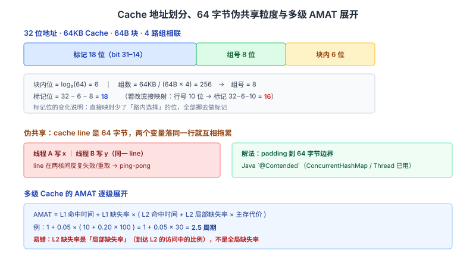
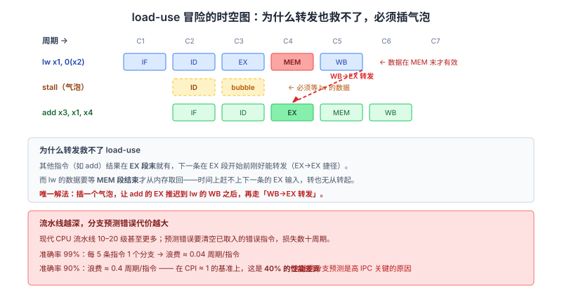

# 计算机组成原理面试知识体系

整理日期：2026-10-13 ｜ 重写：2026-10-14。这份文档不铺广度，只挑面试官会**连问三层**的点。每个点讲三层：**机制（硬件里到底怎么做的）→ 证据（规格、常量、电路结构）→ 追问链**。

> 阅读约定：图在 `assets/2026-10-14/` 下。标注「待核实」的地方是本次未拿到一手依据的，不硬写。计组的特殊性在于「标准」（Intel SDM、ARM ARM、IEEE 754）是唯一权威，二手博客大量抄错。

## 结论

计组面试的深度体现在**你能算、能画、能说出规格里的名字**：

1. **Cache 地址划分要能手算**，并且知道 **64 字节 cache line** 不只是 Cache 的单位，也是**伪共享（false sharing）的粒度**。
2. **`load-use` 冒险连转发都救不了**——要能画出时空图指出为什么必须插气泡。
3. **AMAT 公式要会拆**：`AMAT = 命中时间 + 缺失率 × 缺失代价`，多级 Cache 要逐级展开。
4. **IEEE 754 的 `0.1 + 0.2 ≠ 0.3` 要能算出误差来源**，而不只是说「浮点不精确」。

本文按「数据表示 → 存储层次 → 流水线 → IO 与中断 → 性能定律」组织，全部落到可验证的细节。

---

## 一、数据表示：补码与 IEEE 754

### 为什么是补码

| 表示 | 0 的个数 | 加减法 | 符号位 |
| --- | --- | --- | --- |
| 原码 | 2（+0/−0） | 要分别处理 | 不参与运算 |
| 反码 | 2 | 要处理循环进位 | 部分参与 |
| **补码** | **1** | **减法统一成加法** | **直接参与运算** |

**补码的本质**：模 2^n 意义下的「负数 = 补数」。在 n 位无符号算术里，`-x` 就是 `2^n - x`。所以 `a - b` 直接算成 `a + (2^n - b)` 再截断，硬件只需一个加法器。

**补码的表示范围不对称**：n 位补码是 `[-2^(n-1), 2^(n-1) - 1]`。**正数比负数少一个**——因为 `0` 占用了全 `0` 的编码，`-2^(n-1)` 没有对称的正数。这就是 `abs(INT_MIN)` 会溢出的根源。

**这个不对称的经典 bug**：
```c
int x = INT_MIN;      // -2147483648
int y = -x;           // 仍然是 -2147483648（溢出，UB）
int z = abs(x);       // 同样是未定义行为
```

### IEEE 754：位布局与偏移

```
单精度（32 位）：[1 位符号][8 位阶码（偏移 127）][23 位尾数]
双精度（64 位）：[1 位符号][11 位阶码（偏移 1023）][52 位尾数]
```

**隐含的 1（implicit leading bit）**：规格化数的尾数隐含最高位 1（`1.xxxx × 2^e`），所以 23 位尾数实际表达 **24 位精度**。这是「省一位」的经典设计。

**阶码的两个特殊值**：

| 阶码 | 尾数 | 含义 |
| --- | --- | --- |
| 全 0 | 全 0 | **±0** |
| 全 0 | 非 0 | **非规格化数**（隐含位变 0，用于表示极小值、渐近下溢） |
| 全 1 | 全 0 | **±∞** |
| 全 1 | 非 0 | **NaN** |

**非规格化数的存在意义**：如果没有它，最小的两个规格化数之间会有「下溢断崖」；非规格化数让下溢变成**渐进的（gradual underflow）**，这是 `subnormal` 这个规格概念的全部目的。

**为什么阶码用偏移而不是补码**：偏移表示让浮点数的**位模式按无符号整数比较时，大小顺序与浮点数值顺序一致**。所以比较两个正浮点数可以直接用整数比较指令（硬件低成本）。这也顺便解释了为什么 `-0.0 == 0.0` 成立但 `bits(-0.0) != bits(0.0)`。

### 0.1 + 0.2 ≠ 0.3 的量化解释

`0.1` 在二进制里是**无限循环小数**：

```
0.1（十进制）= 0.0001100110011001100...（二进制，1100 无限循环）
```

单精度只有 23 位尾数、双精度 52 位尾数，**必然截断**。截断后：

```
0.1 → 0.1000000000000000055511151231257827...
0.2 → 0.2000000000000000111022302462515654...
和   → 0.3000000000000000444089209850062616...
0.3 → 0.2999999999999999888977697537484346...
```

**和为 0.30000000000000004，真值 0.3 略小——所以不相等。** 这不是 bug，是二进制浮点表示能力的边界。

**直接推论（面试官爱问）**：
- **金额不能用 float/double**：累加会累积误差；应使用**定点整数（以分为单位）**或 `BigDecimal`。
- **浮点数比较要用容差**：`Math.abs(a - b) < EPS`，且要理解这个做法本身在极端情况下也不可靠。

> **追问链**
> 1. 为什么补码能把减法变成加法？→ 模 2^n 下的补数运算。
> 2. `INT_MIN` 取绝对值为什么错？→ 补码范围不对称，`2^(n-1)` 没有对应正数。
> 3. 阶码为什么用偏移？→ 让位模式的整数序等于浮点值的实数序。
> 4. 为什么有非规格化数？→ 让下溢渐进，避免断崖。
> 5. 0.1+0.2 为什么 ≠ 0.3？→ 二进制无限循环 + 尾数截断，给出误差量级。

---

## 二、存储层次：Cache 的地址、容量与伪共享

### 金字塔与延迟量级

| 层级 | 典型容量 | 典型延迟（量级，周期） |
| --- | --- | --- |
| 寄存器 | 几百字节 | < 1 |
| L1 Cache | 32–64 KB | **4–5** |
| L2 Cache | 256 KB–1 MB | **10–20** |
| L3 Cache | 数 MB–数十 MB | **40–70** |
| 主存 DRAM | 数十 GB | **200–400** |
| SSD | TB 级 | 10^5 量级 |
| HDD | TB 级 | 10^7 量级 |

**这张表的用法**：它直接解释了「为什么 Cache 命中率重要」——**一次 L1 命中和一次 DRAM 访问差两个数量级**。也是 AMAT 公式里缺失代价的取值来源。

### 局部性原理是地基

- **时间局部性**：刚访问的位置很可能再被访问（循环变量、热点函数）
- **空间局部性**：访问一个地址后，邻近地址很可能被访问（数组顺序遍历）

**Cache、虚拟内存、预取器、readahead 全是这一条原理的应用**。面试问「为什么需要 Cache / 为什么需要虚拟内存」，答案的根都在这里。

**顺序访问为什么对每一层都友好**：Cache 预取、TLB 覆盖（一页覆盖连续 4KB）、硬件预取器、OS readahead 全奖励顺序访问。**这才是「数组比链表快」的真正原因——不是复杂度，是局部性。**

### Cache 的三种映射（要能手算）

| 方式 | 地址划分 | 特点 | 冲突 |
| --- | --- | --- | --- |
| 直接映射 | `标记 \| 行号 \| 块内` | 每块只能放固定位置，硬件最简 | 最严重 |
| 全相联 | `标记 \| 块内` | 任意块放任意行 | 最少，但要并行比较所有标记 |
| **组相联** | `标记 \| 组号 \| 块内` | 每组 n 路 | 折中，**实际最常用** |

**地址划分的算法（必须会）**：

```
块内地址位 = log2(块大小)
组数      = Cache 容量 / (块大小 × 路数)
组号位    = log2(组数)
标记位    = 地址总位 - 块内位 - 组号位
```

**完整例题**：主存地址 **32 位**，Cache **64KB**，块大小 **64B**，**4 路**组相联。

```
块内位 = log2(64) = 6
组数   = 64KB / (64B × 4) = 256
组号位 = log2(256) = 8
标记位 = 32 - 6 - 8 = 18
```

**换一种问法**：如果改为**直接映射**，同样是 64KB / 64B：

```
行数   = 64KB / 64B = 1024
行号位 = 10
标记位 = 32 - 6 - 10 = 16
```

**标记位从 18 变 16**——因为直接映射不需要「路内选择」的位，全部用来做标记。**这个对比是最能说明问题的地方**。

### 伪共享（False Sharing）：64 字节的隐藏代价

**这一节是高频难点**。Cache line 是 Cache 与主存交换的**最小单位**（x86-64 典型 **64 字节**）。如果两个线程分别写**不同的变量**，但这两个变量**恰好落在同一条 cache line 上**，那么：

```
线程 A 写变量 x  → 该 line 在 A 的核上变脏
线程 B 写变量 y  → 需要独占该 line → 让 A 的副本失效
线程 A 再写 x    → 需要重新拉取该 line（已失效）
...无限来回，line 在核间「弹跳」（cache line ping-pong）
```

**后果**：两个线程理论上无共享，实际性能却急剧下降（串行化 + 总线流量）。

**解法：填充（padding）到 cache line 边界**。Java 的经典做法：

```java
// 用无用字段把变量「孤立」在独立的 cache line 里
public final class PaddedLong {
    public volatile long p1, p2, p3, p4, p5, p6, p7;  // 填充
    public volatile long value = 0;
    public long sum() { return p1 + p2 + p3 + p4 + p5 + p6 + p7; }  // 防止被优化掉
}
```

JDK 8 起提供 `@sun.misc.Contended` 注解（需 `-XX:-RestrictContended`），由 JVM 自动填充。**`ConcurrentHashMap` 的 `CounterCell`、`Thread` 的 `threadLocalRandomSeed` 都用它**——这是「64 字节在并发里真有代价」的工业证据。

**CPU 侧也有对策**：Intel 的**相邻扇区预取器（adjacent cache line prefetcher）**、以及硬件层面的**写合并**，都在缓解这个问题，但软件层面的 padding 仍是最可控的手段。

### 替换算法与写策略

**替换**：直接映射无需替换；组相联用 **LRU（最常用）**、FIFO、随机、LFU。硬件上实现精确 LRU 代价高（每个 set 维护访问序），所以真实 CPU 用**近似 LRU**（如 clock 或 NRU，给每行一个计数值，按计数值淘汰）。

**写策略**：

| 策略 | 做法 | 特点 |
| --- | --- | --- |
| 写直达 Write Through | 同时写 Cache 和主存 | 一致性好，写开销大；常配**写不分配** |
| **写回 Write Back** | 只写 Cache 并标脏位，替换时才写回 | **现代 CPU 主流**；减少写主存，但一致性复杂 |

**写不命中的组合**（常考搭配）：
- **写回 + 写分配（write allocate）**：先把块调入再写。写回场景下主流。
- **写直达 + 非写分配（no-write-allocate）**：直接写主存。

### AMAT 与多级 Cache 展开

**单级**：

```
AMAT = 命中时间 + 缺失率 × 缺失代价
```

**例题**：命中时间 1 周期，缺失率 5%，缺失代价 100 周期 → `AMAT = 1 + 0.05 × 100 = 6` 周期。

**两级要逐级展开**（这是进阶考点）：

```
AMAT = L1_hit_time
     + L1_miss_rate × (L2_hit_time
     + L2_miss_rate × L2_miss_penalty)
```

例题：L1 命中 1 周期、缺失率 5%；L2 命中 10 周期、局部缺失率 20%；主存代价 100 周期：

```
L2 级代价 = 10 + 0.20 × 100 = 30
AMAT     = 1 + 0.05 × 30 = 2.5 周期
```

**关键区分**：`L2_miss_rate` 是**局部缺失率**（在到达 L2 的访问中的缺失比例），不是全局缺失率。**这个混用是最常见的计算错误**。

### 影响命中率的因素

- **容量**：越大越不易冲突，但成本/延迟上升
- **块大小**：**过犹不及**——太小则空间局部性利用不足；太大则块内有效数据占比下降、搬运时间变长、miss 代价增大。**存在最优点。**
- **相联度**：越高冲突越少，硬件越复杂
- **替换算法**：近似 LRU 通常优于随机/FIFO
- **程序局部性**：**根本因素**。同一块 Cache，局部性好的程序命中率可近 99%，差的可以很惨。

> **追问链**
> 1. 32 位地址、64KB Cache、64B 块、4 路 → 各组多少位？→ 块内 6、组号 8、标记 18。
> 2. 改成直接映射呢？→ 标记变 16（少了路内选择位）。
> 3. 两个线程写不同变量为什么变慢？→ 伪共享，同一 cache line 在核间弹跳。
> 4. 怎么解决？→ 填充到 64 字节边界；Java 用 `@Contended`。
> 5. 两级 Cache 的 AMAT 怎么算？→ 逐级展开，注意用**局部**缺失率。
> 6. 块大小越大越好吗？→ 不是，存在最优点，这是「过犹不及」的经典例题。



---

## 三、流水线：load-use 冒险与分支预测

### 五阶段与数据通路

**IF 取指 → ID 译码 → EX 执行 → MEM 访存 → WB 写回**

关键部件：PC（程序计数器）、IR（指令寄存器）、寄存器堆、ALU、数据存储器、MUX（多路选择器）、符号扩展单元。

**加分做法**：能说清一条指令怎么**流经**这些部件（如 `lw` 在 EX 算地址、MEM 读数据、WB 写回），而不是只背阶段名。

**理想吞吐**：五段流水线每周期完成一条指令，理论加速比 ≈ 5×（相对非流水）。

### 三类冒险

| 冒险 | 原因 | 解决 |
| --- | --- | --- |
| **结构冒险** | 硬件资源争用（单端口存储器无法同时 IF 和 MEM） | 资源复制（分离 I-Cache/D-Cache）、停顿 |
| **数据冒险** | 指令间数据依赖（**RAW** 是主要类型） | **转发/旁路（forwarding）**、停顿 |
| **控制冒险** | 分支导致后续取指不确定 | 分支预测、延迟槽、停顿 |

**RAW 的三种化解手段（按代价递增）**：
1. **转发（forwarding）**：把 EX/MEM 或 MEM/WB 段的结果直接旁路给需要的 ALU 输入，多数 RAW 零停顿解决
2. **停顿（stall）**：插气泡
3. **编译器调度**：重排指令、插入有用指令填延迟槽

### `load-use` 冒险：转发也救不了

**这是计组最高频、最能区分「懂」与「背」的考点。**

场景：
```
lw   x1, 0(x2)     # IF ID EX MEM WB  ← 数据在 MEM 段末才有
add  x3, x1, x4    #    IF ID EX ...  ← EX 段就需要 x1
```

**为什么转发不行**：`lw` 的数据要等 **MEM 阶段结束**才从内存取回；而 `add` 的 **EX 阶段**（也就是下一周期）就需要它作为 ALU 输入。**时间上数据还没到，转发也无从转起。**

**唯一解法：插一个气泡（stall 1 周期）**，让 `add` 的 EX 推迟到 `lw` 的 WB 之后，此时可用**转发**（从 WB→EX）或直接读寄存器堆。

```
lw   x1, 0(x2)     IF ID EX MEM WB
stall                  ID EX  ...       ← 气泡
add  x3, x1, x4        IF ID  EX MEM WB ← 现在 EX 与 lw 的 WB 相邻，可转发
```

**面试要能当场画这张图并指出气泡位置。**

**为什么 `lw` 特殊**：其他类型的指令（如 `add`）结果在 **EX 段末**就有，下一指令的 EX 段开始前刚好能转发；`lw` 的 MEM 段插在中间，破坏了「EX→EX」这条转发捷径。

### 分支预测：为什么这么重要

现代 CPU 流水线很深（**10–20 级甚至更多**）。分支预测错误时，已按错误路径取入的指令**全部作废**，要清空（flush）流水线并从正确地址重新取指——**损失数十个周期**。

**准确率的杠杆效应**：设流水线 20 级、分支预测准确率 99%、每 5 条指令一个分支：

```
错误率 1% × 每分支代价约 20 周期 / 每 5 条指令 ≈ 每指令 0.04 周期浪费
```

准确率降到 90%，浪费就变成约 0.4 周期/指令——**在 CPI 基准 1 的量级上，这是 40% 的性能差异**。

**主要技术**：

| 技术 | 做法 |
| --- | --- |
| 静态预测 | 编译器指定（如「回边预测跳转、前向预测不跳转」） |
| 动态预测（2 位饱和计数器） | 用状态机记录分支历史，需连续两次反向才翻转预测 |
| **关联预测 / 全局历史** | 用其他分支的历史（gshare）预测当前分支 |
| **TAGE / 感知机预测器** | 多张不同历史长度的表叠加，现代高性能 CPU 主流思路 |
| 返回地址栈（RAS） | 专门预测函数返回地址（`call`/`ret` 配对） |
| 延迟槽 | 分支后固定一条指令一定执行（MIPS 风格） |

> **待核实**：**TAGE 预测器的具体表结构、历史长度配置、以及各代 Intel/AMD 的实际预测器实现未取得一手规格依据**（Intel SDM 不公开微架构细节），本文只给通用机制层面的描述。可以确定的是现代高性能 CPU 的分支预测准确率在多数工作负载上可达 95% 以上。

### 超标量与乱序执行（加分点）

流水线提 IPC 的下一步是**超标量（每周期发射多条）**和**乱序执行（OoO）**。

- **乱序执行**：硬件在窗口内动态调度，不受编译器指令顺序限制，靠**寄存器重命名**消除假依赖（WAR/WAW）
- **ROB（重排序缓冲区）**：所有指令按序提交（in-order retire），保证精确异常
- **限制因素**：重排序窗口大小、寄存器数量、以及**分支预测错误**（清窗口）

**一个常被追问的结论**：乱序执行 + ROB 让「按序提交」和「乱序执行」并存——**这是精确异常（precise exception）能实现的前提**。

> **追问链**
> 1. 转发能解决所有 RAW 吗？→ 不能，`load-use` 必须插气泡。
> 2. 为什么 `load-use` 特殊？→ `lw` 数据在 MEM 段末才有效，赶不上下一条的 EX。
> 3. 分支预测错误的代价有多大？→ 清空流水线，损失数十周期（按流水深度）。
> 4. 为什么要有 ROB？→ 乱序执行 + 按序提交 = 精确异常。
> 5. 寄存器重命名解决什么？→ 消除 WAR/WAW 假依赖，让乱序更自由。



---

## 四、IO 与中断：CPU 的角色演进

### 总线仲裁三法

| 方式 | 做法 | 特点 |
| --- | --- | --- |
| **链式查询** | 一根请求线 + 一根应答线串接所有设备 | 结构最简、优先级固定（越靠前越高）、可靠性差（断链即瘫） |
| **计数器定时查询** | 计数器轮询设备号 | 优先级可轮转，较公平 |
| **独立请求** | 每设备独立请求/应答线 | 响应最快、优先级灵活，但线多、复杂 |

### 三种 IO 控制方式（必考）

主线是**CPU 在数据传输中扮演什么角色**：

| 维度 | 程序查询 | 中断驱动 | DMA |
| --- | --- | --- | --- |
| CPU 参与 | 全程轮询等待 | 每传一个数据中断一次 | 数据块搬运期间几乎不干预 |
| 传输单位 | 字节/字 | 字节/字 | **数据块** |
| CPU 利用率 | 最低 | 中等 | 最高 |
| 硬件 | 最简 | 中等 | 需 DMA 控制器 |

**一句话类比**：查询里 CPU 是**保姆**（一直盯着）；中断里是**老板**（有事才叫醒）；DMA 里是**甩手掌柜**（真正搬运的是 DMA 控制器）。

**完整场景串讲（面试推荐这样答）**：
> CPU 发出读磁盘请求 → DMA 控制器直接把数据从磁盘搬到内存（**此期间 CPU 可干别的**）→ 搬完发一个中断 → CPU 中断处理只做善后（更新缓冲区指针、唤醒等待进程）。

**这样答能证明你理解「为什么 DMA 能减轻 CPU 负担」**，而不是背表格。

### 中断处理流程与「为什么在指令边界响应」

**标准框架**：
```
中断请求 → 中断判优（选优先级最高）→ 中断响应（关中断、保存断点和 PSW）
→ 执行中断服务程序 → 中断返回（恢复现场、开中断）
```

**关键细节：CPU 只在一条指令执行结束后才检测中断请求。**

**为什么不中途响应**：指令执行中间有大量**中间状态**（各流水段寄存器、部分更新的寄存器堆）。中途打断的话，现场极难保存和恢复，处理不当会破坏数据完整性。**这是在「响应及时性」和「实现复杂度」之间的取舍**——和「为什么要有 ROB 保证按序提交」是同一个设计哲学。

**中断向量与优先级**：
- **中断向量表**：每个中断号对应一个处理程序入口，CPU 拿到中断号后查表跳转（避免逐个比较）
- **可屏蔽 vs 不可屏蔽（NMI）**：NMI 用于不可恢复的硬件错误
- **中断嵌套**：高优先级可打断低优先级的 ISR

### DMA 与 CPU 的总线争用

DMA 直接访存会和 CPU 争总线。**周期窃取（cycle stealing）**：DMA 控制器占用一个总线周期搬数据，CPU 暂停一个周期。**因为只是偶尔偷一个周期，对 CPU 影响很小**——这是 DMA 高效的关键。

**DMA 传输中 CPU 并非完全不参与**：
- 传输**前**：CPU 要初始化 DMA 控制器（源地址、目标地址、长度、方向）
- 传输**后**：CPU 要处理中断（善后）

**这个「两头参与、中间放手」的图景，才是准确的 DMA 认识。**

> **追问链**
> 1. 为什么中断在指令边界响应？→ 中间状态难保存恢复，是及时性与复杂度的取舍。
> 2. DMA 为什么高效？→ 数据块搬运期间 CPU 不参与，只偷总线周期。
> 3. DMA 传输中 CPU 完全不参与吗？→ 不，前后都要参与（初始化 + 中断善后）。
> 4. 链式查询的问题？→ 优先级固定、断链会导致后续设备全部失效。

---

## 五、性能定律：Amdahl 与 CPI

### Amdahl 定律（量化「局部优化」的天花板）

设程序中**不可被加速的部分**占比为 `s`，**可加速部分**的加速比为 `k`，则整体加速比：

```
Speedup = 1 / (s + (1 - s) / k)      →   上限 = 1 / s
```

**量化例子**：某程序 40% 的时间可以并行化，单核 → 100 核：

```
Speedup = 1 / (0.6 + 0.4/100) = 1 / 0.604 ≈ 1.66
```

**结论：即使把可并行部分加速到无穷（k→∞），整体上限也只有 `1/0.6 ≈ 1.67`。** 这就是「Amdahl 定律」最反直觉也最有用的地方——**提醒你别把力气花在不是瓶颈的地方**。

**和 GC、锁优化的对应**：优化一个只占 5% 时间的函数，哪怕加速 100 倍，整体也只快不到 5%。**先测剖再优化。**

### CPI 分解

```
CPU 时间 = 指令数 × CPI × 时钟周期
```

拆成流水线视角：

```
CPI_实际 = CPI_理想 + 各类停顿的贡献
```

**误区**：把「主频高」等同于「快」。**实际上 `指令数 × CPI × 周期` 三者缺一不可**——这就是为什么同主频的 ARM 和 x86 性能差异巨大（IPC 不同），也是为什么「提高主频」在某些架构上反而因为流水线更深（分支预测错误代价更大、CPI 上升）而不划算。

> **追问链**
> 1. Amdahl 定律的上限怎么算？→ `1/s`，s 是不可加速部分占比。
> 2. 40% 可并行、100 核，加速比多少？→ 约 1.66，因为剩下 60% 串行。
> 3. Amdahl 的实用启示？→ 别优化非瓶颈；先剖测。
> 4. 主频高就一定快吗？→ 不，要看指令数和 CPI；深流水线可能抬 CPI。

---

## 六、高频追问速查（按「面试官问 → 我答」组织）

| 面试官会问 | 你要答到的点 |
| --- | --- |
| 为什么用补码 | 模 2^n 的补数，减法变加法；0 唯一；符号位参与运算 |
| 补码范围为什么不对称 | `[-2^(n-1), 2^(n-1)-1]`，故 `abs(INT_MIN)` 溢出 |
| 阶码为什么用偏移 | 让位模式的无符号整数序 = 浮点值的实数序 |
| 非规格化数干什么 | 让下溢**渐进**，避免断崖 |
| 0.1+0.2 为什么不等于 0.3 | 二进制无限循环 + 尾数截断，和为 0.30000000000000004 |
| 金额能用 double 吗 | 不能，用定点整数（分）或 `BigDecimal` |
| 64KB/64B/4 路怎么划分地址 | 块内 6、组号 8、标记 18（32 位地址） |
| 改成直接映射呢 | 标记变 16，因为少了路内选择位 |
| 伪共享是什么 | 不同变量落在同一 cache line，核间弹跳；**64 字节**粒度 |
| 怎么解决伪共享 | padding 到 64B；Java 用 `@Contended` |
| 两级 Cache 的 AMAT | 逐级展开，注意用**局部**缺失率 |
| Cache 块越大越好吗 | 不是，存在最优点（过犹不及的经典例） |
| `load-use` 能转发吗 | **不能**，`lw` 数据在 MEM 段末才有效，必须插气泡 |
| 分支预测为什么重要 | 深流水线下预测错误要清空，损失数十周期 |
| 中断为什么在指令边界响应 | 中间状态难保存恢复，是及时性与复杂度的取舍 |
| DMA 传输中 CPU 参与吗 | 前后都参与（初始化 + 中断善后），中间放手 |
| DMA 怎么不抢总线 | **周期窃取**，每次只偷一个总线周期 |
| Amdahl 定律 | `1/(s+(1-s)/k)`，上限 `1/s`；先优化瓶颈 |
| 主频高就快吗 | 不，`指令数 × CPI × 周期` 三者缺一不可 |

## 建议

- **动手算三样**：Cache 地址划分、多级 AMAT、Amdahl 加速比。**能算和只会背公式，面试表现差一个档次。**
- **把 `load-use` 时空图画一遍**：这是「懂流水线」与「背流水线」的分界线。
- **记住 64 字节**：它既是 cache line 大小，也是伪共享粒度。能把这两件事连起来讲，是深度信号。
- **IO 三方式用一条场景串**:别背表格，讲「CPU 从保姆→老板→甩手掌柜」。
- **准备「过犹不及」的例子**：Cache 块大小；以及 Amdahl 定律（优化非瓶颈无意义）。这两个权衡题面试官很爱听。

## 待核实

- **各级存储的延迟数字**是量级参考，随硬件代际变化，正文用数量级而非精确值。
- **x86-64 的 cache line 是否为 64 字节**：本文按公开通用值写作 64 字节；**Intel SDM 未在正文明确统一给出**，且不同微架构存在差异，未逐型号核实。
- **TAGE / 感知机预测器**的具体表结构、历史长度配置，以及各代 Intel/AMD 的实际预测器实现未取得一手规格依据（微架构细节通常不公开）。
- **具体某代 x86/ARM 的流水线级数、Cache 容量、相联度、ROB 大小**未逐型号核实。
- **近似 LRU 的具体替换策略**（clock / NRU / 伪 LRU 的变体）在不同微架构上不同，本文只给通用机制。
- **Intel SDM 的相关正文**（数据格式、Cache 机制、异常处理）本次未取得可引用的规范原文，本文的规范级结论以 IEEE 754 与通用计算机体系结构教材为准。

## 来源清单

| 内容 | 来源（一手优先） | 说明 |
| --- | --- | --- |
| IEEE 754 位布局、阶码偏移、隐含 1、非规格化数、NaN/∞ 编码 | IEEE Std 754 浮点标准（通用规范结论） | 标准 |
| 0.1/0.2 的二进制截断值、0.30000000000000004 | 双精度（binary64）按 IEEE 754 的定义与公开计算 | 标准推算 |
| 补码的范围不对称、`INT_MIN` 溢出 | 计算机体系结构教材通用结论（Patterson & Hennessy 等） | 教材 |
| Cache 地址划分算法、组相联计算 | 教材通用结论 + 本文按参数手算 | 教材 + 计算 |
| 64 字节 cache line 与伪共享 | 公开通用值；`@sun.misc.Contended` 见 OpenJDK 文档与 `ConcurrentHashMap` 实现 | 实现证据 |
| `@Contended` 与 `-XX:-RestrictContended` | OpenJDK `jdk.internal.vm.annotation.Contended` 文档 | 官方文档 |
| AMAT 单级/多级公式 | 教材通用结论（Patterson & Hennessy） | 教材 |
| 五段流水线、三类冒险、转发 | Patterson & Hennessy《计算机组成与设计》 | 教材 |
| `load-use` 必须插气泡 | 同上，流水线数据冒险章节的标准结论 | 教材 |
| 分支预测器分类（2 位计数器、gshare、TAGE、RAS） | 体系结构公开文献综述（TAGE 见 Seznec 相关论文） | 论文/综述 |
| 乱序执行、寄存器重命名、ROB、精确异常 | Tomasulo 算法（1967）；Patterson & Hennessy | 论文 + 教材 |
| 总线仲裁三法、三种 IO 控制方式 | 教材通用结论 | 教材 |
| 中断处理流程、指令边界响应原因 | 教材通用结论 | 教材 |
| DMA 周期窃取 | 教材通用结论 | 教材 |
| Amdahl 定律与加速比上限 | Amdahl 1967, *Validity of the single processor approach to achieving large scale computing capabilities*, AFIPS | 论文 |
| CPI 分解与性能公式 | Patterson & Hennessy | 教材 |
| 讲法组织参考（能当场算、区分懂与背、追问链） | xiaolincoder/CS-Base、Snailclimb/JavaGuide | GitHub 仓库，2026-10-14 核实 |
