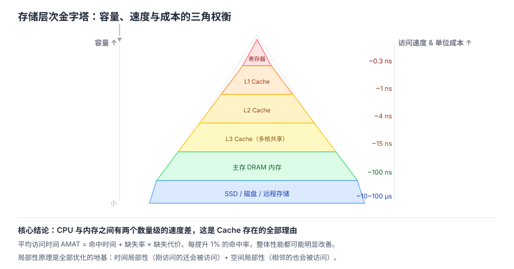
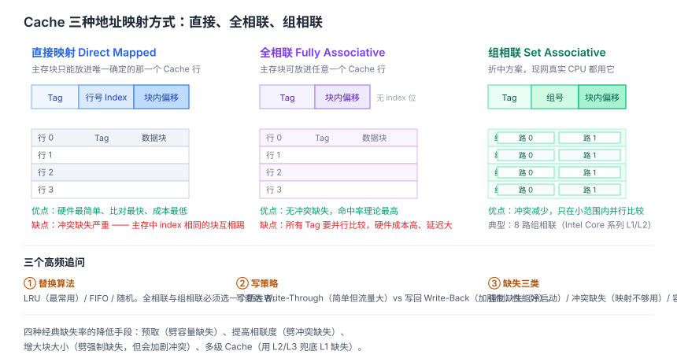
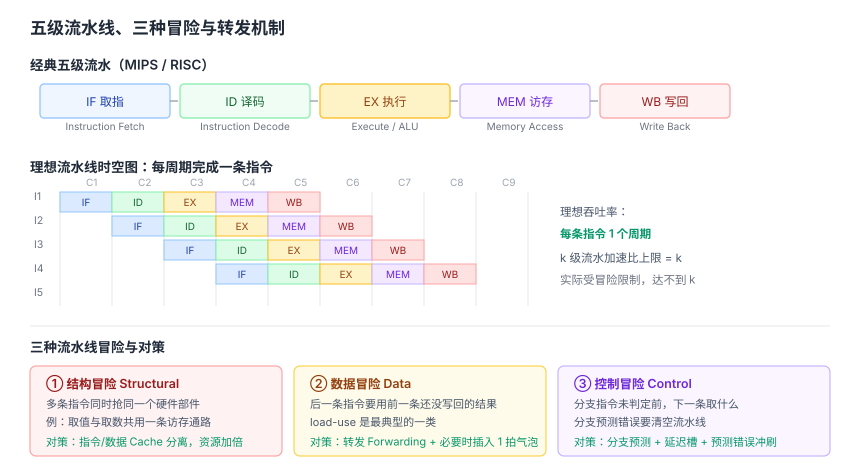
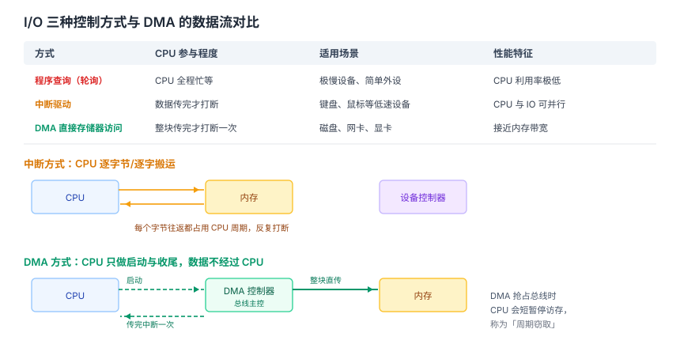

# 计算机组成原理面试知识体系

整理日期：2026-10-13。本文面向校招/社招的计算机组成原理环节，覆盖数据表示、存储层次、CPU 微架构与流水线、指令系统、总线与 IO 控制。结论均标注依据。

## 结论

计算机组成原理是四门基础课里最琐碎、最不容易「临时抱佛脚」的一门，但在客户端/系统/嵌入式方向的面试里权重不低。真正高频的其实集中在四块：

1. **存储层次（Cache）**——三种映射方式怎么算、替换算法、写策略、命中率受什么影响。**这是绝对高频，必须动手算过一遍**。
2. **CPU 执行指令的流程与流水线**——取指到写回的主线，以及三类冒险（结构、数据、控制）怎么处理。
3. **中断与 IO 方式**——程序查询、中断、DMA 的区别，以及「CPU 在传输中扮演什么角色」这条主线。
4. **局部性原理**——它是整个存储层次的设计地基，被问到「为什么要 Cache / 为什么要虚拟内存」时，答案都指向它。

准备策略：**别只背概念，要能算**。Cache 映射和地址划分、流水线的性能损失周期数、平均访存时间 AMAT，这些是笔试和面试都可能让你手算的。

## 一、冯·诺依曼结构与哈佛结构

| 维度 | 冯·诺依曼 | 哈佛 |
| --- | --- | --- |
| 存储 | 程序和数据同一存储器 | 分开存储 |
| 总线 | 一套地址/数据总线 | 两套 |
| 指令与数据宽度 | 相同 | 可不同 |
| 瓶颈 | 取指和取数不能同时（存储器瓶颈） | 减轻访存瓶颈 |
| 例子 | Intel x86、ARM7、MIPS | ARM9/10、51 单片机 |

**冯·诺依曼瓶颈**：因为指令和数据共享同一总线和存储器，CPU 高速运行时无法同时取指令和取操作数。现代 CPU 通过分离的 L1 指令 Cache 和 L1 数据 Cache 在缓存层面「部分哈佛化」来缓解。

## 二、数据表示

- **原码、反码、补码**：现代计算机用**补码**表示有符号整数，因为补码把减法统一成加法（`a - b = a + (-b)`），且 0 只有一种表示，符号位可以直接参与运算。
- **定点与浮点**：浮点左右移位不影响数值（只改阶码），定点移位改数值。
- **IEEE 754 浮点**：`符号位 | 阶码（含偏移）| 尾数`。单精度 1+8+23，双精度 1+11+52。阶码用偏移表示（单精度偏移 127），使浮点数可以按整数方式比较大小。
- **浮点精度问题**：0.1 + 0.2 ≠ 0.3 是浮点表示误差，不是 bug。这直接关联到「为什么金额不能用浮点、要用定点或整数分」。

## 三、存储层次与 Cache

### 存储层次金字塔

寄存器 → L1 Cache → L2 Cache → L3 Cache → 主存（DRAM）→ 磁盘/SSD。越往上越快、越小、越贵。

### 局部性原理

这是整个层次结构能成立的前提：

- **时间局部性**：刚被访问过的内存位置很可能再次被访问（如循环变量、热点函数）。
- **空间局部性**：访问一个地址后，其邻近地址很可能被访问（如数组顺序遍历）。

Cache 和虚拟内存都建立在局部性上：把近期可能用到的数据从慢速下层预取到快速上层，让 CPU 大部分时间在高速层工作，掩盖下层延迟。

**顺序访问为什么对每一层都友好**：Cache 的预取、TLB 覆盖、硬件预取器、readahead 全都奖励顺序访问。这就是为什么同样复杂度的算法，数组跑得比链表快——不是复杂度问题，是局部性问题。

### Cache 的三种映射方式

| 方式 | 地址划分 | 特点 | 冲突 |
| --- | --- | --- | --- |
| 直接映射 | 标记 \| Cache 行号 \| 块内地址 | 硬件最简单，每块只能放一个固定位置 | 冲突最严重 |
| 全相联 | 标记 \| 块内地址 | 任意块可放任意行，冲突最少 | 硬件比较复杂（要并行比较所有标记） |
| 组相联 | 标记 \| 组号 \| 块内地址 | 每组 n 路，折中方案 | 冲突介于两者之间，**实际最常用** |

**地址划分的本质**：块内地址位由块大小决定（块 64B 则 6 位）；组号/Cache 行号位由组数决定；剩下的是标记位。面试常给一个具体参数让你算：

- 主存地址 32 位，Cache 大小 64KB，块大小 64B，4 路组相联 → 块内地址 6 位，组数 = 64KB / (64B × 4) = 256 组 → 组号 8 位，标记 32 − 6 − 8 = 18 位。

### 替换算法与写策略

**替换算法**：直接映射无需替换；组相联/全相联需要。常见有随机、FIFO、LRU（最常用）、LFU。

**写策略**：

| 策略 | 做法 | 特点 |
| --- | --- | --- |
| 写直达 Write Through | 同时写 Cache 和主存 | 简单、一致性好，但写开销大 |
| 写回 Write Back | 只写 Cache，标脏位，替换时才写回主存 | 减少写主存次数，但一致性复杂；**现代 CPU 主流** |

**写不命中时**：写分配（先把块调入 Cache 再写，配写回）或非写分配（直接写主存，配写直达）。

### 影响命中率的因素（高频追问）

- **Cache 容量**：越大命中率越高，但成本和访问延迟上升。
- **块大小**：**过犹不及**。太小则空间局部性利用不充分；太大则块内有效数据占比下降，且从内存搬块的时间变长、miss 代价增大。存在一个最优点。
- **映射方式与相联度**：相联度越高冲突越少，命中率越高，但硬件越复杂。
- **替换算法**：LRU 优于随机/FIFO。
- **程序局部性**：这是根本。同样的 Cache，局部性好的程序命中率可以接近 99%，差的可能惨不忍睹。

面试里被问「一个局部性很好的程序 Cache 命中率大概多少」，它没有标准数字，考的是你能不能说清上面这些因素如何共同作用。

### 平均访存时间（AMAT）

**AMAT = 命中时间 + 缺失率 × 缺失代价**

例：命中时间 1 周期，缺失率 5%，缺失代价 100 周期 → AMAT = 1 + 0.05 × 100 = 6 周期。这个公式在做题里反复出现，能背能算。

## 四、CPU 与指令流水线

### 指令执行五阶段

**IF 取指 → ID 译码 → EX 执行 → MEM 访存 → WB 写回**

关键部件：「取指—译码—执行—访存—写回」这条主线对应 PC（程序计数器，指向下一条指令）、IR（指令寄存器，存当前指令）、寄存器堆、ALU、数据存储器、多路选择器 MUX、符号扩展单元。

**面试加分做法**：能说清每条指令是怎么「流经」这些部件的，而不是只背阶段名。

### 流水线冒险

理想情况下，五段流水线每周期完成一条指令，吞吐率提升 5 倍。但有三类冒险会打断：

| 冒险 | 原因 | 解决方案 |
| --- | --- | --- |
| 结构冒险 | 硬件资源争用（如单端口内存无法同时 IF 和 MEM 访存） | 资源复制（哈佛结构）、流水线停顿 |
| 数据冒险 | 指令间有数据依赖（RAW 写后读是主要类型） | **转发/旁路（Forwarding）**、流水线停顿 |
| 控制冒险 | 分支指令导致后续指令不确定 | 分支预测（静态/动态）、延迟槽、流水线停顿 |

**最关键的细节：`load-use` 冒险转发救不了。** 当一条 load 指令的结果要被下一条相依赖的指令使用时，即使有转发也必须插入一个气泡（停顿一个周期）——因为 load 的数据在 MEM 阶段**结束时**才有效，来不及转给下一指令在 EX 阶段需要的 ALU 输入。**这是计组的高频考点，一定要能画出来。**

**分支预测**：现代 CPU 流水线很深（10 到 20 级甚至更多），分支预测错误要清空流水线里已取的所有错误指令，损失数十个周期。所以高准确率的分支预测是维持高 IPC 的关键。静态预测（如总是预测不跳转）、动态预测（用历史表记录分支行为）、延迟槽是几条常见路线。

## 五、总线与 IO 控制

### 总线仲裁

集中式仲裁三种方式：**链式查询**（结构简单，优先级固定、越靠前的设备优先级越高，可靠性差）、**计数器定时查询**（优先级可轮转，较公平）、**独立请求**（每个设备一条请求线，响应最快但线多、复杂）。

### 三种 IO 控制方式

这是**必考**的对比，核心抓住一条主线：**CPU 在数据传输过程中扮演什么角色**。

| 维度 | 程序查询 | 中断驱动 | DMA |
| --- | --- | --- | --- |
| CPU 参与程度 | 全程轮询等待 | 每传一个数据就中断一次 | 数据块搬运期间几乎不干预 |
| 传输单位 | 字节/字 | 字节/字 | 数据块 |
| CPU 利用率 | 最低（100% 空转） | 中等 | 最高 |
| 硬件复杂度 | 最低 | 中等 | 需要 DMA 控制器 |
| 适用 | 单片机、简单设备 | 随机出现的低速设备 | 内存与高速外设间的大批数据交换 |

打个比方：**查询方式里 CPU 是保姆**，一直盯着设备；**中断方式里 CPU 是老板**，有事才被叫醒；**DMA 方式里 CPU 是甩手掌柜**，真正搬运数据的是 DMA 控制器。

**完整场景串讲（面试推荐）**：CPU 发出读磁盘请求 → DMA 控制器直接把数据从磁盘搬到内存（此期间 CPU 可以干别的）→ 搬完 DMA 控制器发一个中断通知 CPU → CPU 处理后续（更新缓冲区指针、唤醒等待进程）。这样讲能证明你真理解「为什么 DMA 能减轻 CPU 负担」，而不是背表格。

### 中断处理流程

标准口述框架：

**中断请求 → 中断判优（选优先级最高的）→ 中断响应（关中断、保存断点和程序状态字）→ 执行中断服务程序 → 中断返回（恢复现场、开中断）**

**关键细节：CPU 只在一条指令执行结束后才检测中断请求。** 面试常追问「为什么不能在指令执行中间响应中断」——因为指令执行中间强行打断，现场（各阶段中间状态）极难保存和恢复，处理不当会破坏数据完整性。这是在「响应及时性」和「实现复杂度」之间的取舍。

**DMA 中断 vs 普通设备中断的区别**：DMA 中断是整个数据块传完后才发生一次，CPU 只需善后（更新指针、唤醒进程），处理量很小；普通设备中断可能每个字节/字都要打断 CPU。

### DMA 与 CPU 的总线争用

DMA 直接访存会和 CPU 争总线。解决方式是**周期窃取（Cycle Stealing）**：DMA 控制器偷偷占一个总线周期来搬数据，CPU 暂停一个周期，影响很小。

**DMA 传输中 CPU 并非完全不参与**：传输开始前的初始化和结束后的中断处理都需要 CPU 介入。

## 六、高频对比速查

| 对比项 | 要点 |
| --- | --- |
| 冯·诺依曼 vs 哈佛 | 统一存储 vs 分离；存储器瓶颈 vs 减轻访存瓶颈 |
| 直接映射 vs 全相联 vs 组相联 | 冲突由多到少，硬件由简到繁，组相联最常用 |
| 写直达 vs 写回 | 一致性好、写开销大 vs 减少写主存、需脏位 |
| 结构/数据/控制冒险 | 资源争用 / 数据依赖 / 分支不确定 |
| 转发 vs 停顿 | 转发能解决大部分 RAW，但 load-use 必须停顿一周期 |
| 程序查询 vs 中断 vs DMA | CPU 从保姆到老板到甩手掌柜，利用率递增 |
| 中断 vs DMA 中断 | 频繁小量 vs 一次整块、善后 |
| 链式查询 vs 独立请求 | 结构简单优先级固定 vs 响应快但线多复杂 |

## 建议

- **动手算三样东西**：Cache 映射的地址划分、AMAT、流水线性能损失周期数。只会背公式和会算，面试表现差很多。
- **把 load-use 冒险画一遍**：这是「你真懂流水线」和「你背了流水线」的分界线。
- **IO 三方式用一条场景串起来讲**，别背表格。
- **局部性原理要能脱口而出**：被问「为什么需要 Cache/虚拟内存」时，答案的根都是它。
- **准备一个「过犹不及」的例子**：Cache 块大小太大太小都不好，这种权衡题面试官很爱听。

## 待核实

- 各级存储的延迟数字（L1/L2/L3、主存、SSD）是量级参考，随硬件代际变化，正文用数量级表述而非精确值。
- 现代 CPU 的分支预测器（TAGE、感知机等）实现细节未展开，正文只给通用机制。
- 具体某代 x86/ARM 的流水线级数、Cache 容量与相联度参数未逐型号核实。

## 来源清单

| 内容 | 来源 | 日期 |
| --- | --- | --- |
| 三种 Cache 映射、直接映射地址划分、冯·诺依曼 vs 哈佛、局部性原理 | DevPress《计算机复试：计算机组成原理/操作系统模块复习》 https://devpress.csdn.net/v1/article/detail/123410665 | 2026-10-13 核实 |
| Cache 映射计算、块大小权衡、流水线冒险处理、中断与 DMA 区别 | 嵌云网《计算机考研408复试：四门课高频考点与面试应对策略》 https://kaifayun.com/article/weixin_33483304/1219449 | 2026-10-13 核实 |
| 分支预测重要性、局部性与存储层次、MMU/页表/TLB 角色、三种 IO 的 CPU 利用率排序 | CSDN《计算机组成原理核心详解与高频面试题全集》 https://blog.csdn.net/nasooo/article/details/159432280 | 2026-10-13 核实 |
| 五段流水线时空图、三类冒险、转发与停顿、load-use 冒险、总线仲裁与 IO 方式 | 尧图网络《计算机组成原理核心考点解析：从Cache映射到流水线冲突实战》 https://kwkr.cn/news/158560 | 2026-10-13 核实 |
| 三种 IO 控制方式的 CPU 角色类比、中断完整流程、指令边界响应中断的原因 | 尧图网站设计《计算机组成原理面试高频考点与答题框架全攻略》 http://www.mhpn.cn/news/2150259 | 2026-10-13 核实 |
