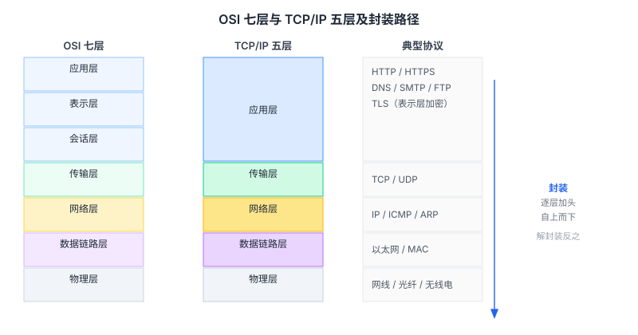
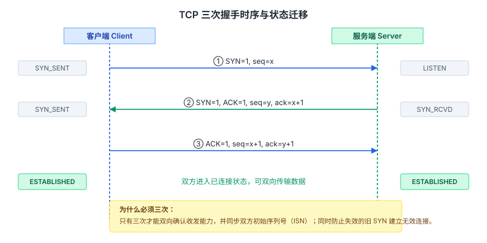
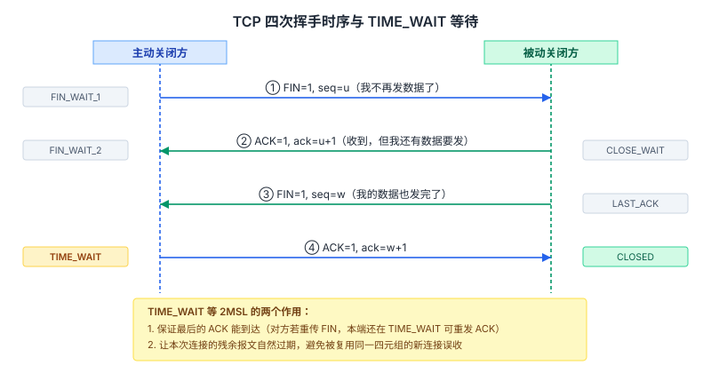
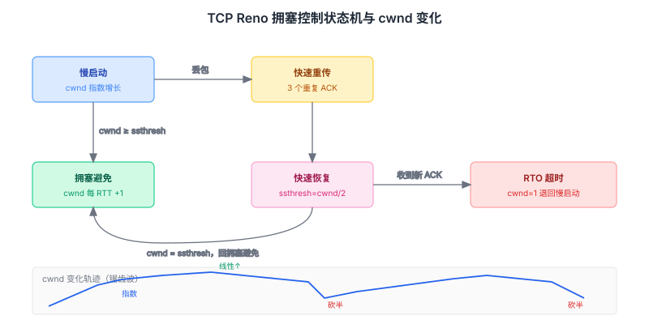
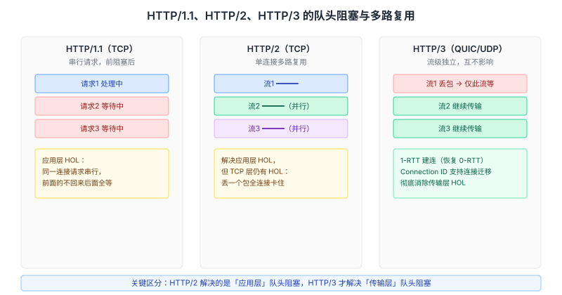
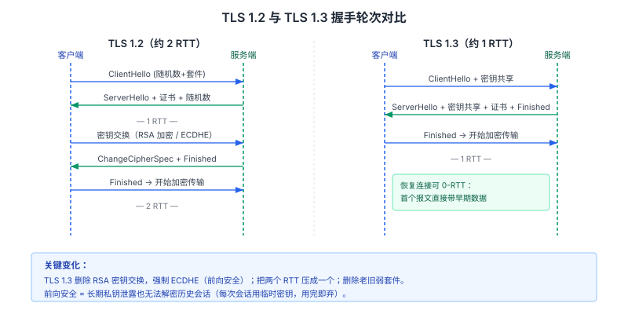
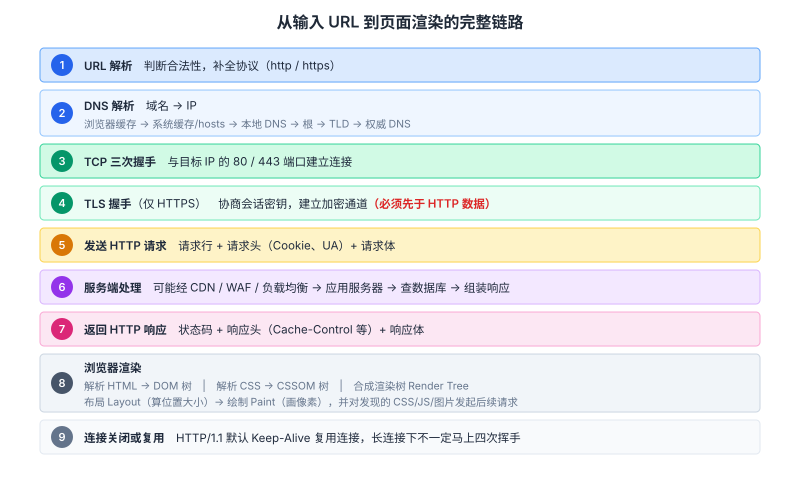

# 计算机网络面试知识体系

整理日期：2026-10-13。本文面向客户端/后端校招与社招面试，按「从输入 URL 到页面展示」的主线组织网络知识，覆盖分层模型、TCP/UDP、TCP 连接管理与可靠性、拥塞控制、HTTP 演进、HTTPS/TLS、DNS 与 ARP。所有结论均标注依据；厂商自测数据显式标注。

## 结论

网络面试的题面千变万化，但考查的能力集中在三条主线：

1. **一条报文的完整旅程**——「从输入 URL 到页面展示发生了什么」是最高频的开场题，能把这题讲透，等于把分层模型、DNS、TCP 握手、TLS、HTTP、渲染串成了一根链。
2. **可靠性是怎么造出来的**——TCP 用序号、确认、重传、滑动窗口、拥塞控制五套机制，在不可靠的 IP 之上造出可靠字节流。面试官追问的几乎每个问题，本质都在问「这一层为什么需要它、它解决了什么代价」。
3. **代价与权衡**——三次握手 vs 四次挥手、慢启动 vs 拥塞避免、HTTP/2 vs HTTP/3、select vs epoll，每一个对比题考的都是「在什么条件下选哪个」。

准备策略：先能背出完整流程（口述 5 分钟版本），再对每个环节准备 2 到 3 层追问。真正拉开差距的是第二层追问，而不是第一层的名词解释。

## 一、分层模型与数据封装

### OSI 七层与 TCP/IP 五层

| OSI 七层 | TCP/IP 五层 | 典型协议 | 核心职责 |
| --- | --- | --- | --- |
| 应用层 / 表示层 / 会话层 | 应用层 | HTTP、HTTPS、DNS、SMTP、FTP | 面向应用的数据交换 |
| 传输层 | 传输层 | TCP、UDP | 端到端通信、流量控制、差错校验 |
| 网络层 | 网络层 | IP、ICMP、ARP、路由协议 | 路由寻址、跨网段转发、分片 |
| 数据链路层 | 数据链路层 | 以太网、PPP、MAC | 相邻节点成帧、MAC 寻址、差错检测 |
| 物理层 | 物理层 | 网线、光纤、无线电 | 比特流传输 |

OSI 是理论参考模型（ISO 制定），TCP/IP 五层是工程实际落地的模型。面试时通常两个都要能画：OSI 用于讲清「表示层做加解密」这类职责划分，TCP/IP 用于讲真实协议栈。也有说法把 TCP/IP 归为四层（把链路层和物理层合并为网络接口层），面试里被问到只需说明这是一种划分口径。

### 数据封装与解封装

发送方自上而下逐层加头（encapsulation），接收方自下而上逐层去头（decapsulation）：

- 应用层数据 → 传输层加 TCP/UDP 头（含端口号）→ 网络层加 IP 头（含源/目的 IP）→ 链路层加帧头帧尾（含 MAC）→ 物理层转成比特流。
- 接收方按相反顺序剥离，每层只看自己那一层要的头，这叫「对等层通信」——逻辑上同层对话，物理上数据穿过下层。

**MTU 与分片**：链路层单帧有最大长度限制，以太网 MTU 默认 1500 字节。IP 层数据超过 MTU 就要分片，接收端重组。分片会放大丢包代价（丢一片要重传整包），所以 TCP 会用 MSS（Maximum Segment Size）协商，让每个 TCP 段装得下，从源头避免 IP 分片。MSS = MTU − IP 头 − TCP 头，以太网下典型值 1460 字节。

## 二、TCP 与 UDP

| 维度 | TCP | UDP |
| --- | --- | --- |
| 连接 | 面向连接，先握手 | 无连接，直接发 |
| 可靠性 | 确认、重传、排序、去重 | 不保证到达、不保证顺序 |
| 传输单位 | 字节流（无消息边界） | 数据报（保留边界） |
| 首部开销 | 20 字节起（含选项可到 60） | 8 字节 |
| 流量/拥塞控制 | 有 | 无 |
| 通信模式 | 全双工 | 全双工 |
| 典型场景 | HTTP/1.1、HTTP/2、SSH、文件传输 | DNS、视频直播、游戏、HTTP/3(QUIC 承载体) |

「字节流」这个特性直接带来经典的**粘包/拆包**问题：TCP 不保留消息边界，接收方一次 `read` 可能拿到半个消息或两个半消息。解法是在应用层定协议，常见三种：定长消息、分隔符（如 `\r\n`）、长度字段（先读固定长度头拿 body 长度，再按长度读 body）。

**UDP 为什么快**：省掉了握手、确认、重传、拥塞控制的开销，也不需要维护连接状态。它的不可靠不是缺点而是设计取舍——DNS 一次问答足够快、直播丢几帧无所谓、游戏宁可丢包也不要为等重传而卡顿。

## 三、TCP 连接管理：三次握手与四次挥手

### 三次握手

报文交互与状态迁移：

| 次序 | 方向 | 报文 | 客户端状态 | 服务端状态 |
| --- | --- | --- | --- | --- |
| 1 | C → S | SYN=1, seq=x | SYN_SENT | LISTEN |
| 2 | S → C | SYN=1, ACK=1, seq=y, ack=x+1 | SYN_SENT | SYN_RCVD |
| 3 | C → S | ACK=1, seq=x+1, ack=y+1 | ESTABLISHED | ESTABLISHED |

**为什么是三次而不是两次**：两次只能确认「客户端能发、服务端能收」这一个方向，服务端无法确认自己的发送能力和客户端的接收能力是否正常。用三次才能双向确认收发能力都正常，并同步双方的初始序列号（ISN）。另一个理由是防止**失效的连接请求**：一个滞留在网络里的旧 SYN 迟到后到达服务端，若只有两次握手，服务端会直接建立连接并分配资源；三次握手下客户端会用 RST 拒绝这个莫名其妙的连接，不浪费服务端资源。

**ISN 为什么随机**：ISN 是字节编号的原点。如果固定或可预测，攻击者能猜出后续确认号，伪造 RST 或注入数据。随机化 ISN 是安全需要。

**SYN 泛洪攻击（SYN Flood）**：攻击者伪造大量源 IP 发 SYN，服务端回复 SYN+ACK 后进入半连接状态并占用半连接队列，伪造的 IP 永不回 ACK，队列被占满导致正常用户连不上。防御手段：SYN Cookie（不维护半连接表，用源地址+端口+时间戳算出 cookie 放进 seq，收到 ACK 再校验）、限制半连接数量、缩短超时、IP 黑名单。

**半连接队列与全连接队列**：服务端收到 SYN 放入半连接队列（SYN 队列），三次握手完成后移入全连接队列（accept 队列），等待应用层 `accept` 取走。两个队列任一满都会丢包或拒绝新连接。

### 四次挥手

| 次序 | 方向 | 报文 | 主动方状态 | 被动方状态 |
| --- | --- | --- | --- | --- |
| 1 | C → S | FIN=1, seq=u | FIN_WAIT_1 | ESTABLISHED |
| 2 | S → C | ACK=1, ack=u+1 | FIN_WAIT_2 | CLOSE_WAIT |
| 3 | S → C | FIN=1, seq=w | FIN_WAIT_2 | LAST_ACK |
| 4 | C → S | ACK=1, ack=w+1 | TIME_WAIT | CLOSED |

**为什么断开要四次而建立只要三次**：TCP 全双工，两个方向的关闭相互独立。收到对方的 FIN 只表示「对方不再发数据」，本方向可能还有数据要发。所以被动方必须先回 ACK（不能把 ACK 和自己稍后的 FIN 合并，因为数据还没发完），等数据发完再单独发 FIN。建立连接时服务端可以把 SYN 和 ACK 合并成一个报文，所以少一次。

**TIME_WAIT 与 2MSL**：主动关闭方在收到对方 FIN、回完最后 ACK 后进入 TIME_WAIT，等待 2MSL（Maximum Segment Lifetime，报文最大生存时间）才真正 CLOSED。两个作用：

1. **保证最后的 ACK 能到达**。若这个 ACK 丢了，被动方会重传 FIN，此时主动方还在 TIME_WAIT 就能重发 ACK。若已 CLOSED，就会对重传的 FIN 回 RST，被动方以为出错。
2. **让本次连接的残余报文自然消亡**。2MSL 足以让本次连接的所有报文在网络中过期，避免它们被下一个复用了相同四元组的新连接误收。

Linux 下 MSL 默认 30 秒，所以 TIME_WAIT 约 60 秒（TCP 是基于内核实现，具体值随内核版本与 `net.ipv4.tcp_fin_timeout` 等参数变化）。

**大量 TIME_WAIT**：说明本机在大量主动关闭连接（爬虫、压测端常见）。危害是占用本地端口，可能耗尽。缓解：`tcp_tw_reuse` 允许在安全前提下复用 TIME_WAIT 端口建新连接（仅对客户端有效）、调低 `tcp_fin_timeout`、使用连接池复用长连接。

**大量 CLOSE_WAIT**：被动关闭方收到 FIN 后回了 ACK 就停在 CLOSE_WAIT，等应用层调用 `close`。堆积说明**应用层忘了关连接**（IO 流未关、线程池泄漏），这是代码 bug，要从应用层修，调内核参数无效。

## 四、TCP 可靠传输与流量控制

### 可靠性五件套

1. **序号与确认**：每个字节有编号，接收方用累积确认告知「我已连续收到 x 之前的全部数据」。
2. **超时重传**：发出去的数据启动重传定时器 RTO，超时未确认就重传。RTO 由 RTT 动态估算。
3. **快速重传**：收到三个重复 ACK 就立刻重传丢失的段，不必等 RTO 超时。
4. **校验和**：检测比特错误，错的丢弃让对方重传。
5. **滑动窗口**：允许连续发送多个段而不逐个等待确认。

**超时重传 vs 快速重传**：超时重传是最重的信号（可能丢了很多包），会大幅降速；快速重传只丢个别包，代价小。面试常问「为什么要快速重传」——因为它省掉了等 RTO 超时的那段时间，在只丢一个包时能显著加快恢复。

### 滑动窗口与流量控制

发送窗口 = min(接收方通告窗口 rwnd, 拥塞窗口 cwnd)。rwnd 由接收方根据自己的缓冲区剩余空间在 ACK 中通告，发送方据此不发出超过接收方处理能力的数据，这就是**流量控制**——防止发送太快把接收缓冲区撑爆。

- **零窗口**：接收方缓冲区满时通告 Window=0，发送方停止发送，并周期性发窗口探测报文，等对方腾出空间。
- **糊涂窗口综合症（Silly Window Syndrome）**：接收方每次只腾出一点点空间就通告，发送方发很小的段，效率极低。解法是接收方等空间够一个 MSS 或达到缓冲区一半才通告，发送方用 Nagle 算法攒够一个 MSS 再发。
- **Nagle 算法**：攒小包成大包再发，减少小包数量，但会增加延迟，对实时交互不友好，所以有 `TCP_NODELAY` 选项关掉它。

## 五、TCP 拥塞控制

拥塞控制管的是「网络能不能承受」，跟流量控制（接收方能不能承受）是两回事。经典 Reno 算法四阶段：

| 阶段 | 触发进入 | cwnd 增长方式 | 退出条件 |
| --- | --- | --- | --- |
| 慢启动 | 连接建立时 / 超时后 | 每收到一个 ACK 加 1 MSS，指数增长（每 RTT 翻倍） | cwnd ≥ ssthresh（转拥塞避免）或丢包 |
| 拥塞避免 | cwnd ≥ ssthresh | 每 RTT 加 1 MSS，线性增长 | 超时或收到 3 个重复 ACK |
| 快速重传 | 收到 3 个重复 ACK | — | 立即重传丢失段，进入快速恢复 |
| 快速恢复 | 快速重传后 | ssthresh = cwnd/2，cwnd = ssthresh + 3，每收一个重复 ACK 再 +1 | 收到新数据的 ACK，cwnd = ssthresh，回拥塞避免 |

**超时 vs 快速重传的处理差异**（高频追问）：

- **RTO 超时**：认为网络严重拥塞。`ssthresh = cwnd/2`，`cwnd = 1`，**退回慢启动**，这是最严厉的惩罚。
- **3 个重复 ACK**：只丢个别包。`ssthresh = cwnd/2`，`cwnd = ssthresh + 3`，**跳过慢启动直接进入快速恢复/拥塞避免**。因为重复 ACK 说明后续包还在到达，网络没有完全堵死，不该退回慢启动。

**AIMD**：加性增加（线性涨）、乘性减少（砍半），这就是 cwnd 呈锯齿波的原因，也是多连接能公平分享带宽的基础。

**算法演进**：Reno → NewReno（改进多包丢失）→ CUBIC（Linux 默认，用三次函数增长，对高带宽长延迟网络更友好）→ BBR（Google，不把丢包当拥塞信号，而是主动探测瓶颈带宽和最小 RTT 建模）。BBR 在高丢包但带宽充足的链路上表现明显更好，但也存在与 CUBIC 共享带宽时挤占公平性的争议。

## 六、HTTP 协议与演进

### HTTP/1.0 → 1.1 → 2 → 3

| 维度 | HTTP/1.0 | HTTP/1.1 | HTTP/2 | HTTP/3 |
| --- | --- | --- | --- | --- |
| 传输层 | TCP | TCP | TCP | QUIC（UDP 之上） |
| 连接 | 短连接，一请求一连接 | 默认长连接 Keep-Alive | 单连接多路复用 | 单连接多路复用 |
| 报文格式 | 文本 | 文本 | 二进制分帧 | 二进制分帧 |
| 队头阻塞 | 应用层 HOL | 应用层 HOL（管线化未普及） | 解决应用层，仍有 TCP 层 HOL | 彻底解决（流级独立） |
| 头部压缩 | 无 | 无 | HPACK | QPACK |
| 服务器推送 | 无 | 无 | Server Push | 无（被移除，改 103 Early Hints） |
| 连接迁移 | 不支持 | 不支持 | 不支持 | 支持（Connection ID） |
| 握手延迟 | TCP+TLS 多 RTT | 同左 | 同左 | 1-RTT，恢复 0-RTT |

**队头阻塞（HOL Blocking）的两个层次**，这是面试最容易被追问的点：

- **应用层 HOL**：HTTP/1.1 一个 TCP 连接上请求串行，前面的响应不回来后面的就排队。HTTP/2 用「二进制分帧 + 多路复用」解决：同一连接上多个流（Stream）通过 Stream ID 并行传输，乱序到达也能各自重组。
- **传输层 HOL**：HTTP/2 的所有流挤在一个 TCP 连接里，TCP 要求按序交付，只要有一个包丢了，后面的包即使到了也要在内核缓冲区等着，**所有流一起被卡住**。HTTP/3 改用 QUIC（基于 UDP），每个流独立管理重传，一个流丢包不影响其它流，这才彻底解决。

**HTTP/2 头部压缩 HPACK**：用静态表（61 个常见头）+ 动态表 + 哈夫曼编码，把重复的头字段压成索引，`method: GET` 这类可以压到 1 字节。

**QUIC 的额外优势**：传输握手和 TLS 1.3 握手合并，新建连接约 1 RTT、恢复连接可 0-RTT 带数据；用 Connection ID 标识连接而非四元组，Wi-Fi 切 4G 时连接不断（连接迁移）。代价是 QUIC 在用户态实现、加解密有 CPU 开销，且需要 UDP 能通（部分防火墙拦 UDP）。

### HTTPS 与 TLS

HTTPS = HTTP + TLS/SSL，默认 443 端口，解决明文传输的窃听、篡改、冒充三类问题。

**TLS 1.2 完整握手（约 2 RTT）**：

1. ClientHello：客户端支持的版本、一个随机数、密码套件列表。
2. ServerHello：选定版本与套件、一个随机数、**服务器证书**。
3. 客户端验证证书（CA 签名、有效期、域名匹配、吊销状态）。
4. 密钥交换（两种方式见下）。
5. 双方用两个随机数 + Pre-Master Secret 派生出会话密钥，之后对称加密通信。

**TLS 1.3（约 1 RTT）**：删掉老旧弱套件，握手里的 ServerHello 之后直接带密钥交换，把两个 RTT 压成一个；恢复连接支持 0-RTT（但 0-RTT 数据可被重放，需谨慎）。

**RSA 密钥交换 vs ECDHE**：

| 维度 | RSA 密钥交换 | ECDHE |
| --- | --- | --- |
| 前向安全 | 无。服务端私钥一旦泄露，历史流量可解密 | 有。每次会话临时密钥，私钥泄露也解不了历史流量 |
| 计算开销 | 大（尤其 2048 位以上） | 相对小 |
| 地位 | TLS 1.3 已删除 | TLS 1.3 强制（含前向安全） |

「前向安全（Forward Secrecy）」是高频考点：指长期私钥泄露不影响历史会话密钥的安全性。ECDHE 每次握手生成临时密钥对，用完即弃，所以具备前向安全。这是 TLS 1.3 强制 ECDHE 的原因。

**为什么 HTTPS 用对称加密传数据、非对称只用来协商**：非对称加密计算开销大几个数量级，只适合交换密钥；对称加密（AES）快得多，适合大量数据。

## 七、DNS 解析与完整请求流程

### DNS 解析

域名到 IP 的查询，逐级缓存优先：

1. 浏览器 DNS 缓存
2. 操作系统缓存（含 hosts 文件）
3. 本地 DNS 服务器（运营商/公共 DNS，如 8.8.8.8、1.1.1.1）缓存
4. 递归查询：根域名服务器 → 顶级域（TLD，如 .com）服务器 → 权威域名服务器
5. 拿到 IP 后逐级回填缓存

DNS 默认用 UDP 53 端口（快、无连接），报文超 512 字节或做区域传送时用 TCP。DNS 也支持 TCP 兜底。

### 从输入 URL 到页面展示

这是网络部分的「总纲题」，按下面的顺序讲，每一层都能被追问：

1. **URL 解析**：判断合法性，补全协议（http/https）。
2. **DNS 解析**：域名 → IP，走上述缓存与递归链路。
3. **TCP 三次握手**：与目标 IP 的 80/443 端口建立连接。
4. **TLS 握手**（仅 HTTPS）：协商会话密钥，建立加密通道，**必须先于 HTTP 数据**。
5. **发送 HTTP 请求**：请求行、请求头（Cookie、User-Agent 等）、请求体。
6. **服务端处理**：可能经 CDN、WAF、负载均衡，再到应用服务器、查数据库、组装响应。
7. **返回 HTTP 响应**：状态码 + 响应头（Cache-Control 等）+ 响应体。
8. **浏览器渲染**：解析 HTML 建 DOM 树，解析 CSS 建 CSSOM 树，合成渲染树 Render Tree，布局 Layout（算位置大小），绘制 Paint（画像素），并对发现的 CSS/JS/图片发起后续请求。
9. **连接关闭或复用**：HTTP/1.1 默认 Keep-Alive 复用连接，长连接下不一定马上四次挥手。

**常见追问**：

- **为什么 TLS 在 HTTP 之前**：加密通道要先建好，HTTP 数据才能在通道里传。答错顺序是常见失分点。
- **CDN 的作用**：把内容缓存到离用户近的边缘节点，减少 RTT 和回源压力。CDN 还能承担 TLS 终结、静态资源加速。
- **DNS 用 UDP 还是 TCP**：默认 UDP，超过 512 字节或区域传送用 TCP。

### ARP

同一局域网内，知道 IP 但要知道 MAC 才能发帧。ARP 用广播问「谁的 IP 是 x.x.x.x」，对应主机单播回复自己的 MAC，双方缓存到 ARP 表。跨网段时，主机把包发给网关，用网关的 MAC。ARP 表有老化时间，过期重新查询。

## 八、高频对比速查

| 对比项 | 要点 |
| --- | --- |
| TCP vs UDP | 连接、可靠性、开销、场景，见第二节表格 |
| 三次握手 vs 四次挥手 | 建立时 SYN+ACK 可合并，断开时 ACK 与 FIN 因数据未发完不能合并 |
| 流量控制 vs 拥塞控制 | 前者管接收方能力（rwnd），后者管网络能力（cwnd），发送窗口取两者较小值 |
| 超时重传 vs 快速重传 | 前者是最重惩罚退回慢启动，后者只丢个别包进快速恢复 |
| HTTP/2 vs HTTP/3 | 前者解决应用层 HOL，后者用 QUIC 解决 TCP 层 HOL |
| RSA vs ECDHE | 后者有前向安全，TLS 1.3 强制 |
| 短连接 vs 长连接 | 1.0 短连接，1.1 起默认 Keep-Alive |
| GET vs POST | 参数位置（URL vs Body）、幂等性、缓存、长度语义 |
| 半连接队列 vs 全连接队列 | 前者存 SYN_RCVD，后者存已完成握手待 accept |
| TIME_WAIT vs CLOSE_WAIT | 前者在主动关闭方（正常），后者堆积是被动方忘 close（bug） |

## 建议

- **背流程，但更要背代价**。每个机制都问自己「它解决什么问题、付出什么代价」，这是面试官追第二层、第三层时想听的。
- **准备一张自己的图**。手画三次握手、四次挥手、拥塞控制状态机、TLS 握手，讲的时候边画边说，比干背名词可信度高得多。
- **把「从输入 URL 到页面」练到 5 分钟流利版 + 15 分钟展开版**，几乎每场网络面试都会用到。
- **对每个高频对比准备一句「什么条件下选哪个」**，不要只给优劣表。

## 待核实

- 各内核参数默认值（MSL、TIME_WAIT 时长、Nagle 行为）随 Linux 发行版与内核版本变化，正文给出的是常见值，具体环境需以 `sysctl` 实际读数为准。
- HTTP/3 的 0-RTT 重放防护细节、QUIC 具体实现（quiche、ngtcp2、msquic）的性能差异未逐项核实，需要时可补充实测。
- BBR 与 CUBIC 在共享链路上的公平性结论来自公开论文与工程讨论，不同版本的 BBR 行为有差异，未做本地实测。

## 来源清单

| 内容 | 来源 | 日期 |
| --- | --- | --- |
| TCP 三次握手/四次挥手、TIME_WAIT、半连接队列、保活机制 | 51CTO《面试官竟然把TCP三次握手、四次挥手问的这么详细？》 https://www.51cto.com/article/717289.html | 2022-08-28（2026-10-13 核实） |
| TCP 状态迁移、SYN Flood、零窗口、CLOSE_WAIT 排查 | E-COM-NET《计算机网络核心知识点全解析（面试通关版）》 http://e-com-net.com/article/1915941106873331712.htm | 2026-10-13 核实 |
| 拥塞控制四阶段、AIMD | 科普中国 TCP 词条 https://www.kepuchina.cn/article/articleinfo?business_type=100&classify=0&ar_id=361969 | 2026-10-13 核实 |
| Reno 状态机、超时 vs 快速重传的差异、算法演进 | CSDN《从 Reno 慢启动到 BBR 带宽探测》 https://nioer.blog.csdn.net/article/details/163355209 | 2026-10-13 核实 |
| TCP 拥塞控制状态机（NewReno 参考） | NDSS 2018 论文 *Automated Attack Discovery in TCP Congestion Control* https://www.ndss-symposium.org/wp-content/uploads/2018/02/ndss2018_02A-1_Jero_paper.pdf | 2018（2026-10-13 核实） |
| HTTP/1.1、2、3 差异与队头阻塞 | 前端面试指南《网络与安全相关精选面试题集锦》 http://guide.aifeir.com/network.html | 2026-10-13 核实 |
| QUIC vs TCP 握手轮次、连接迁移、流级 HOL | Geek Workbench《HTTP and HTTPS Protocol》 https://geekworkbench.com/blog/technical/http-https-protocol | 2026-10-13 核实 |
| TLS 握手、RSA vs ECDHE、前向安全、HSTS | 同上前端面试指南；Sycope HTTP/HTTPS 词条 https://www.sycope.com/post/dictionary-item/http-https | 2026-10-13 核实 |
| OSI/TCP-IP 分层、从输入 URL 到页面展示全流程 | CSDN《【计算机网络】面试全解|OSI/TCPIP、HTTP全版本、HTTPS、DNS一站式梳理》 https://devpress.csdn.net/v1/article/detail/161716208 | 2026-10-13 核实 |
| 从输入 URL 到渲染的分步流程与常见错误 | Skillveris《What Happens When You Type a URL in a Browser?》 https://www.skillveris.com/interview-questions/computer-networks/what-happens-when-you-type-a-url-in-a-browser | 2026-10-13 核实 |
