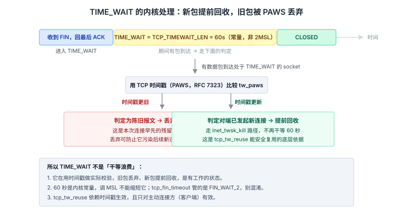
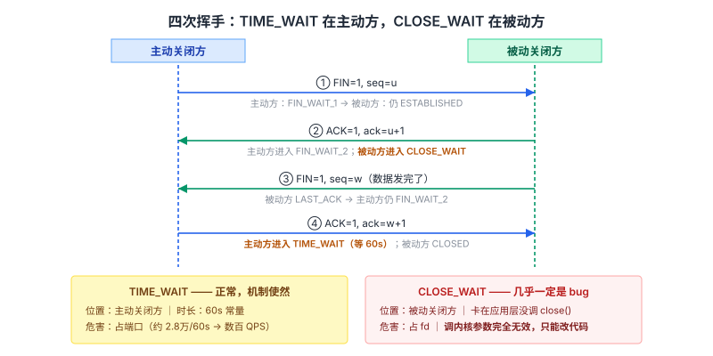
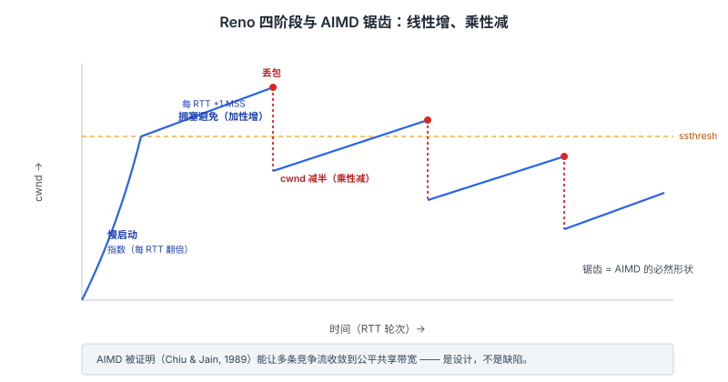
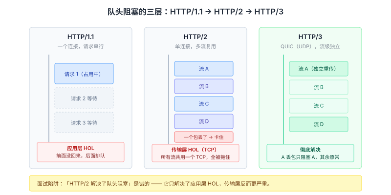

# 计算机网络面试知识体系

整理日期：2026-10-13 ｜ 重写：2026-10-14。这份文档不追求「每个知识点都提一句」，只挑面试真正会连续追问、且能追问到底的题，每个题讲三层：**机制（内核里到底发生了什么）→ 证据（参数、常量、函数、RFC）→ 追问链（面试官下一句会问什么）**。

> 阅读约定：`图 N` 在 `assets/2026-10-14/` 下。「本机实测」标注的是在测试机上真实读到的值，「公开实现值」是内核源码/官方文档中的值，两者不混。

## 结论

网络面试真正拉开差距的不是「知道几个名词」，而是**能不能把机制落到一个具体的常量和一次具体的行为上**。三个判断标准：

1. **说得出名字**——不是「有个超时参数」，而是 `TCP_TIMEWAIT_LEN`、`tcp_tw_reuse`、`net.ipv4.tcp_max_syn_backlog`。说得出参数名的候选人，面试官会认为你真看过。
2. **说得出为什么是这个值**——60 秒不是「2MSL 算出来的」，是内核里写死的常量；`tcp_tw_reuse` 默认 2 不是 1。这类反直觉结论最容易被追。
3. **说得出边界**——`tcp_tw_reuse` 到底能不能开？解决了什么问题、又留下了什么？答「能开」和答「能开，但它只对客户端有效、且依赖时间戳，服务端不适用」是两个档次。

本文按顺序覆盖四个必考深水区：**TIME_WAIT 与连接管理 → TCP 可靠性与拥塞控制的真实实现 → HTTP/2 与 HTTP/3 的队头阻塞 → TLS 1.3 与前向安全**。

---

## 一、TIME_WAIT：一个被讲烂但极少讲对的题

### 60 秒从哪来：不是 2MSL，是常量

几乎每份八股都说「TIME_WAIT 等待 2MSL，Linux 下 MSL=30s 所以是 60s」。**这句话的推导过程是错的**。

真实情况：Linux 内核把 TIME_WAIT 的持续时间写成了一个**宏常量**，在 `include/net/tcp.h` 里：

```c
#define TCP_TIMEWAIT_LEN (60*HZ) /* how long to wait to destroy TIME-WAIT
                                  * state, about 60 seconds */
```

`HZ` 是内核时钟频率（常见 250 或 1000）。所以 TIME_WAIT = 60 秒是**代码里直接定的**，跟「MSL 是 30 秒、2 倍就是 60 秒」没有因果关系——那只是数值巧合。RFC 1122 对 MSL 的建议是 2 分钟，如果真按 2MSL 算应该是 240 秒。

**为什么这个细节重要**：它直接决定后面两个参数的答案。既然时长是常量，那「调 MSL 能不能缩短 TIME_WAIT」的答案就是**不能**——内核并不按 MSL 计算它。

> **追问**：那 `tcp_fin_timeout` 是干什么的？
> 它管的是 **FIN_WAIT_2 状态的超时**，不是 TIME_WAIT。这是最常见的混淆。`TCP_TIMEWAIT_LEN`（60s 固定）和 `tcp_fin_timeout`（默认 60s，可调）是两个完全不同的东西。

### 为什么必须等：两个理由里，PAWS 是内核真正在做的

八股标准答案是两条：① 保证最后那个 ACK 能到达，让被动方重传的 FIN 能被正确应答；② 让本次连接的残余报文在网络中消亡，避免污染复用了相同四元组的新连接。

但**内核实现的是哪一条**，很少有人能说清。答案是第二条，而且有对应的机制——**PAWS（Protection Against Wrapped Sequences，RFC 7323）**。

内核在 TIME_WAIT 期间维护一个 `tw_paws` 标志。当有数据包到达一个处于 TIME_WAIT 的 socket 时，内核用时间戳（TCP timestamp 选项）判断这个包是否「太旧」：

- 如果包的时间戳比记录的**更旧**，说明是本次连接早先的陈旧报文，**丢弃**；
- 如果是新包（时间戳更新），说明对端已经发起了新连接，此时内核**提前回收这个 TIME_WAIT socket**（`inet_twsk_kill` 路径），不再干等 60 秒。

这就是 `net.ipv4.tcp_tw_reuse` 敢复用端口的底气：复用时内核会检查时间戳，确保不会把旧连接的包误发给新连接。**这也解释了为什么 TIME_WAIT 不是纯粹的「浪费时间」，而是有实际校验工作的状态。**



### tcp_tw_reuse 到底是 0 还是 1：当前内核默认是 2

网上绝大多数文章写「`tcp_tw_reuse` 默认 0，改成 1 就能复用 TIME_WAIT 端口」。**在较新的内核上这是错的**。

当前上游 Linux 文档（`Documentation/networking/ip-sysctl.rst`）中，`net.ipv4.tcp_tw_reuse` 是**三态**的：

| 值 | 含义 |
| --- | --- |
| 0 | 关闭复用 |
| 1 | 全局开启：允许在任何情况下复用（需时间戳校验通过） |
| **2（默认）** | **仅允许 loopback 流量复用** |

也就是说，新内核出厂就允许本机回环复用，但对真实网络默认关闭。要开启需显式设 `net.ipv4.tcp_tw_reuse = 1`。

**更重要的边界，几乎没人提**：

- **`tcp_tw_reuse` 只对主动发起连接的一端（客户端）有效**。它是 `connect()` 时决定「能不能拿一个 TIME_WAIT 中的四元组来建新连接」。如果你的服务器是**被动接受连接**的一方（Web 服务器），这个参数**帮不上忙**——它解决不了服务端大量 TIME_WAIT 的问题。
- 它**依赖 TCP 时间戳**（`net.ipv4.tcp_timestamps`，默认开启）。时间戳关了，复用就失去安全校验，无法启用。
- 它和 `tcp_tw_recycle` 完全是两回事。`tcp_tw_recycle` 曾用于快速回收，但因在 NAT 环境下会大量丢包，**已在 Linux 4.12 被移除**。面试里如果把这两个混为一谈，是明显的减分项。

> **追问**：那服务端 TIME_WAIT 多怎么办？
> 先分清责任方。服务端如果是被动关闭方，产生的是 `CLOSE_WAIT` 而**不是** TIME_WAIT——看到大量 TIME_WAIT 说明是服务端在**主动关闭**（例如 Nginx 主动断开短连接、或者反向代理层）。真正的解法是**让客户端主动关闭**、上**连接池复用长连接**、把 HTTP 的 keepalive 打开，而不是调那些 `tw_reuse` 参数。

### 大量 TIME_WAIT vs 大量 CLOSE_WAIT：一个能调参，一个只能改代码

这两个状态常被放一起问，但性质完全不同：

| | 大量 TIME_WAIT | 大量 CLOSE_WAIT |
| --- | --- | --- |
| 出现在 | **主动关闭方** | **被动关闭方** |
| 含义 | 本机在大量主动断开连接 | 收到对方 FIN、回了 ACK，但**应用层迟迟不 `close()`** |
| 性质 | 正常现象（机制使然） | **几乎一定是代码 bug** |
| 危害 | 占用本地端口，可能耗尽 | 占用文件描述符，进程可能打不开新连接 |
| 怎么查 | `ss -s`、`netstat -nat \| awk '/TIME_WAIT/{print $5}' \| sort \| uniq -c` | `ss -tanp state close-wait`，看是哪个进程/哪类连接 |
| 怎么解 | 连接池长连接、让对端关、客户端侧 `tw_reuse` | **改代码**：确保 `close()` 被调用（try-with-resources / defer / finally），排查线程池泄漏、连接未归还 |
| 调内核参数有用吗 | 有限（`tw_reuse` 仅客户端有效） | **完全没用**，参数调不掉 bug |

**为什么说 CLOSE_WAIT 堆积一定是 bug**：被动方收到 FIN 后立即回 ACK 进入 CLOSE_WAIT，此后**就等应用层调 `close()`**。内核不会替你关，因为内核不知道你还有没有数据要写。所以 CLOSE_WAIT 停留的时间 = 你代码里从「知道对方关了」到「你调 close」之间的时间。堆积 = 你代码里这条路径根本没走 close。



### 端口到底够不够用：算一遍比背结论强

面试官问「TIME_WAIT 会不会把端口耗尽」，标准答法是「算量级」。设：

- 本地端口范围 `net.ipv4.ip_local_port_range` 默认约 32768~60999，约 **2.8 万个**可用端口；
- TIME_WAIT 保留 60 秒；
- 目标 IP:Port 唯一确定一个四元组（同一目标时，四元组的差异只在本地端口上）。

那么对**同一个目标地址**，短连接的理论上限约为：

```
28000 / 60 ≈ 466 QPS
```

即约**数百 QPS 量级**。这是「同一目标」的约束。如果目标是多个 IP（如连接多个后端），可用的四元组会乘以目标数。

**结论的用法**：如果你的服务对单个下游是短连接且 QPS 上千，端口耗尽是必然，这时唯一的正解是**连接池**而不是调参。这个「算一遍」的动作，比背「TIME_WAIT 会导致端口耗尽」有价值得多。

---

## 二、TCP 连接管理里那些「标准答案」之外的细节

### 三次握手能携带数据吗

不能（严格说：**第一、二次不能，第三次可以**）。

- 第 1、2 个报文里带数据是危险的：连接还没建立，如果带数据，服务端要为一个可能被伪造的连接分配缓冲区，等于给 SYN Flood 递刀。所以 **SYN 报文不能带数据**（RFC 9293 明确：SYN 报文的序列号只用于同步，数据要等连接建立）。
- 第 3 个报文（客户端的 ACK）**可以**携带数据。此时客户端已进入 ESTABLISHED，服务端收到即视为连接建立。这正是 **TFO（TCP Fast Open, RFC 7413）**的原理：把第一个数据请求塞进 SYN，配合服务端预先下发的 cookie 校验，省掉一个 RTT。

> **追问**：为什么服务端收到第三次握手的 ACK 就能认为连接建立，从而接受数据？
> 因为此时服务端已经发出了 SYN+ACK，只要收到对应的 ACK，就说明客户端确实收到了自己的 SYN——**双向的收发能力都已确认**。第 1、2 次握手时，服务端还不知道自己的 SYN 能否被接收，所以不敢建缓冲。

### 半连接队列和全连接队列：两个队列，两个参数，各有各的满法

服务端为每个新连接维护两个队列：

| 队列 | 内核名称 | 存什么 | 大小由谁定 | 满了会怎样 |
| --- | --- | --- | --- | --- |
| 半连接队列 | SYN Queue（`syn_table` 哈希） | 收到 SYN、已回 SYN+ACK、**还没收到最终 ACK** 的连接 | `net.ipv4.tcp_max_syn_backlog`（常被 `somaxconn` 约束） | 新 SYN 被丢弃，客户端感觉连接慢/超时 |
| 全连接队列 | Accept Queue（`icsk_accept_queue`） | 三次握手**已完成**、等应用层 `accept()` 取走 | `min(backlog, net.core.somaxconn)`，`backlog` 来自 `listen(fd, backlog)` | 已完成的连接被丢弃，或按 `tcp_abort_on_overflow` 回 RST |

**两个容易踩的坑**：

1. **全连接队列的真实大小不是 `listen()` 的 `backlog`**。内核取 `min(backlog, somaxconn)`。很多人设了 `listen(fd, 1024)` 却忘了 `somaxconn` 默认只有 4096（较老内核是 128），结果队列远小于预期。排查用 `ss -ltn`，看 `Send-Q` 列——它显示的就是当前**全连接队列上限**，和 `Recv-Q`（当前排队数）对比就知道有没有溢出。
2. **`tcp_abort_on_overflow` 决定队列满时的行为**：为 0（默认）时内核**静默丢弃** ACK，客户端以为握手没完成会重传，最终表现为「连接超时」；为 1 时直接回 RST，客户端立刻看到 `connection reset`。生产环境一般保持 0 并调大队列，把 1 留给明确的过载保护场景。

> **追问**：SYN Flood 为什么能打？
> 攻击者伪造大量源 IP 发 SYN，服务端为每个 SYN 分配半连接资源并回 SYN+ACK，但伪 IP 永远不回 ACK，半连接队列被占满，真实用户的新 SYN 无处安放。
> **`tcp_syncookies` 是标准防线**（`net.ipv4.tcp_syncookies=1`）：队列满时不再维护半连接表，而是把「源 IP + 端口 + 时间戳」做哈希算成一个 cookie 放进 SYN+ACK 的序列号里；只有客户端回 ACK 时才用 cookie 反推校验，校验通过才建连接。这样服务端**无需为未完成的握手分配任何内存**。

### 四次挥手为什么不能合并：延迟确认是个例外

标准答案是「全双工，被动方收到 FIN 后可能还有数据要发，所以 ACK 和 FIN 不能合并」。

这在**一般情况下**对，但有个反例：**如果被动方收到 FIN 时已经没有数据要发、应用立刻也调用了 `close()`，内核可以把 ACK 和 FIN 合并成一个报文，变成「三次挥手」**（出现 FIN+ACK）。

之所以通常没那么巧，是因为 **Delayed ACK（延迟确认）**：Linux 不会立刻回 ACK，而是等最多 40ms，看能不能「捎带」上自己要发的数据。如果这 40ms 内应用调用了 `close()`，内核就有机会把 ACK 和 FIN 合并发出。

> **追问**：Delayed ACK 和 Nagle 一起用有什么问题？
> 经典的 **Nagle + Delayed ACK 互锁**：发送方 Nagle 算法攒着小包不发（等 ACK 或攒够一个 MSS），接收方 Delayed ACK 攒着 ACK 不回（等数据捎带），双方互等，出现几十毫秒的延迟尖峰。这就是实时交互场景（如游戏、RPC）要开 `TCP_NODELAY` 关掉 Nagle 的原因。**这个组合问题是延迟敏感系统的经典坑**。

---

## 三、可靠性：五个机制的真实代价

TCP 在不可靠的 IP 之上造可靠字节流，靠五个机制。面试的重点不是「有哪五个」，而是「每个的代价」：

| 机制 | 解决什么 | 代价 |
| --- | --- | --- |
| 序号 + 累积确认 | 乱序、重复 | 累积确认的弱点：丢一个包会「卡住」后面所有包的确认（SACK 就是补这个洞） |
| 超时重传（RTO） | 包彻底丢失 | RTO 估算太激进会误重传、太保守会慢恢复；由 SRTT/RTTVAR 动态算 |
| 快速重传 | 单包丢失，免等 RTO | 需要收到 3 个重复 ACK 才触发，本身有延迟 |
| 校验和 | 比特错误 | 能力有限，强校验靠上层（TLS 的 AEAD） |
| 滑动窗口 | 吞吐（不等逐个确认） | 窗口 = min(rwnd, cwnd)，受两方约束 |

### RTO 是怎么算的：不是「猜一个超时」

RTO 由两个统计量动态推导（RFC 6298）：

```
SRTT   = (1 - α)·SRTT + α·RTT      // 平滑 RTT，α = 1/8
RTTVAR = (1 - β)·RTTVAR + β·|SRTT - RTT|   // RTT 波动，β = 1/4
RTO    = SRTT + 4·RTTVAR            // 并夹在 [1s, 60s] 或 [200ms, 120s] 区间
```

**关键点**：RTO 的下限是内核参数 `TCP_RTO_MIN`（Linux 为 200ms），上限 `TCP_RTO_MAX`（120s）。而且**首次 RTT 未测得前，初始 RTO 是 1 秒**（RFC 6298 规定）。

Linux 还有一条 **RTO 退避**：每次重传超时，RTO **翻倍**；累计到 `tcp_retries2`（默认 15）次还没成功，才放弃连接上报错误。15 次退避意味着——**一个连接可能要经过十几分钟才会彻底失败**，这是很多「连接卡住很久才报错」现象的来源。

> **追问**：为什么 `tcp_retries2` 默认 15 这么大？
> 因为内核假设「网络可能只是暂时丢包」。15 次指数退避覆盖了从秒级到十几分钟的时间窗。代价是应用层如果没设自己的超时，就会长时间卡住。**所以应用层的请求超时必须自己设，不能指望 TCP 帮你兜底。**

### 快速重传 vs 超时重传：惩罚力度差了一个慢启动

| | 触发 | 判断 | 惩罚 | 为什么这样设计 |
| --- | --- | --- | --- | --- |
| 超时重传 | RTO 到期 | 网络**严重拥塞**（可能大量丢包） | `ssthresh = cwnd/2`，`cwnd = 1`，**退回慢启动** | 最重的惩罚，把发送速率打到底 |
| 快速重传 | 收到 **3 个重复 ACK** | 只是**个别包**丢了 | `ssthresh = cwnd/2`，`cwnd = ssthresh + 3`，**直接快速恢复**（跳过慢启动） | 重复 ACK 说明后续包还在到达，网络没堵死 |

**为什么是「3 个」重复 ACK**：1 个重复 ACK 可能只是乱序（正常现象），2 个也可能是；收到 3 个重复 ACK 说明缺失的那个包之后**至少已有 3 个包到达**，基本可以确认它丢了而不是乱序。3 是经验值。

**累积确认的漏洞与 SACK**：TCP 的 ACK 是**累积**的——收到了 100~200 和 300~400，但缺 200~300，接收方只会回「我连续收到 200」，无法告诉发送方「300 之后我也收到了」。这导致发送方要么等 RTO 重传、要么只重传 200~300 这一段（快速重传的传统做法，在丢多个包时效率低）。**SACK（Selective ACK，RFC 2018）**用选项字段显式告知「我收到的离散区间」，让发送方精确重传丢失的段，是多包丢失场景的关键优化。

---

## 四、拥塞控制：从 Reno 的锯齿到 BBR 的建模

### cwnd 为什么会走成锯齿：AIMD 的必然结果

拥塞窗口 `cwnd` 的行为由两条对称性相反的规则决定，合称 **AIMD（Additive Increase, Multiplicative Decrease）**：

- **加性增**：拥塞避免阶段，每过一个 RTT `cwnd += 1 MSS`（线性爬升）；
- **乘性减**：检测到丢包，`cwnd` **减半**。

线性升、指数降，画出来必然是一条**锯齿波**。这不是缺陷，而是**故意的**——AIMD 被证明是多个竞争流能收敛到**公平共享带宽**的充要条件（Chiu & Jain, 1989）。如果改成「加性增、加性减」，多条流无法收敛到公平点；如果「乘性增」，会震荡失控。



**慢启动为什么叫「慢」**：名字指的是**起点慢**（第一个 RTT 只发 1 个 MSS），而不是增长慢——它其实是**指数增长**（每个 RTT 翻倍）。这是网络界一个著名的历史命名错误，面试里点出来是加分项。

### CUBIC：为什么 Linux 换掉了 Reno

Reno 的问题：**线性增长在大带宽长延迟（BDP 很大）的网络上恢复太慢**。一个 10Gbps、RTT 100ms 的链路，BDP = 125MB，Reno 丢包后 cwnd 减半再线性爬回来要上千个 RTT。

**CUBIC（Linux 3.19 起的默认算法）** 把 cwnd 的增长函数换成**三次函数**：

```
W(t) = C·(t - K)³ + W_max
```

- 丢包后不是线性回升，而是**先用三次函数的凹陷段快速逼近丢包前的窗口 `W_max`**（这段增长快），**接近 `W_max` 时增速放缓**（这段谨慎，避免刚触顶又丢包），过了 `W_max` 再加速探测新带宽。
- 这个形状恰好匹配「丢包点附近最需要谨慎」的直觉，在高带宽网络上比 Reno 恢复快得多。

### BBR：不把丢包当拥塞信号

前面所有算法（Reno/CUBIC）都是**基于丢包**的：丢包 = 拥塞 = 降速。这个假设在有线网络成立，但在**高丢包但带宽充足**的链路（如部分无线、跨洋链路、浅缓冲区网络）上会严重误判——链路明明还有余量，只因为是「丢包式」的队列管理就降速了。

**BBR（Bottleneck Bandwidth and RTT）** 换了一套模型：**主动探测**瓶颈带宽 `BtlBw` 和最小往返延迟 `RTprop`，把 `cwnd` 维持在 `BtlBw × RTprop`（即 BDP）附近。它周期性进入四个阶段：

| 阶段 | 目的 |
| --- | --- |
| Startup | 像慢启动一样指数探测，直到带宽不再增长 |
| Drain | 排空探测时在瓶颈队列里堆积的包 |
| ProbeBW | 常态：周期性微调发送速率以探测带宽 |
| ProbeRTT | 周期性把在途包压到 4 个，重测最小 RTT |

**代价与争议**：BBR 在高丢包链路上带宽利用率明显更高，但它**抢占性较强**——在与 CUBIC 共存时，BBR 流会挤占 CUBIC 流，公平性存在公开争议。而且 BBR 的早期版本（v1）在浅缓冲区（bufferbloat 纠正后）场景下丢包率不低。**面试里答「BBR 比 CUBIC 好」是不完整的，要说出「在什么链路上好、代价是什么」。**

> **追问**：为什么 BBR 不依赖丢包也能工作？
> 因为它测的是**带宽和延迟**这两个物理量，而不是「丢包」这个间接信号。只要能把发送速率压在 `BtlBw × RTTprop` 附近，瓶颈队列就不会堆积到溢出丢包。它把「拥塞控制」从「反应式避让」变成了「主动建模」。

---

## 五、HTTP/2 与 HTTP/3：队头阻塞的两层，别答混

这是 HTTP 部分最高频的追问点，也是**最容易答错**的地方。

### 两层队头阻塞

**第一层：应用层 HOL（HTTP/1.1 的问题）**
HTTP/1.1 在一个 TCP 连接上**请求串行**：前一个响应没回来，后面的请求就得等。缓解手段（开 6 个并发连接、域名分片）都只是治标，还加重了握手开销和服务器压力。

**第二层：传输层 HOL（HTTP/2 的问题）**
HTTP/2 用**二进制分帧 + 多路复用**解决了应用层 HOL：同一连接上多个流（Stream）通过 Stream ID 并发传输，乱序到达也能各自重组。

**但它没解决、反而放大了传输层 HOL**：所有流**挤在同一个 TCP 连接里**，而 TCP 要求按序交付。只要有一个包丢了，它之后的所有包即使完好到达，也必须在内核缓冲区里**等待重传**，**所有流一起被卡住**。HTTP/1.1 时代这个问题不突出（因为每个连接流少），HTTP/2 把很多流塞进一个连接后，一个丢包影响面反而更大。

**第三层：HTTP/3 用 QUIC 彻底解决**
QUIC 跑在 **UDP** 之上，在用户态自己实现了可靠传输。关键在于**每个流独立管理序号和重传**：流 A 丢包只阻塞流 A，流 B、C 的包照常交付。这才是真正意义上的「流级独立」。



> **面试陷阱**：「HTTP/2 解决了队头阻塞」这句话**是错的**，或者至少不完整。正确表述：HTTP/2 解决了**应用层** HOL，但引入了更严重的**传输层** HOL，直到 HTTP/3 才彻底解决。

### HPACK / QPACK：头部压缩为什么不能简单地 gzip

HTTP/1.1 时代头部是文本，重复度极高（Cookie、User-Agent 每次都发），但**不能用通用压缩**（如 gzip）：因为有 **CRIME/BREACH 攻击**——攻击者通过观察压缩后长度变化，结合自己注入的明文，可以逐字节推断出压缩内容里的敏感信息（如 CSRF token）。

**HPACK（HTTP/2）**的设计规避了这个问题：它用**静态表（61 个预定义头字段）+ 动态表（连接内已传过的头）+ 哈夫曼编码**，把重复头压成索引。关键区别是**它不做跨内容的熵编码**，只做「查表替换 + 定长编码」，攻击者无法通过长度差反推。

**QPACK（HTTP/3）**做了同样的事，但因为 QUIC 的流可以乱序到达，动态表的更新不能在流之间随意共享（否则一个流被阻塞会拖累其他流的头部解码），所以 QPACK 引入了**单向流传输动态表更新指令**、用「阻塞流上限」显式限制依赖程度，用可控的阻塞换取压缩率。

| | HTTP/1.1 | HTTP/2 | HTTP/3 |
| --- | --- | --- | --- |
| 头部压缩 | 无（或外层 gzip，有 CRIME 风险） | HPACK | QPACK |
| 多路复用 | 无（靠多连接凑） | 单连接多流 | 单连接多流 |
| 队头阻塞 | 应用层 | **传输层（TCP）** | 无（流级独立） |
| 连接迁移 | 不支持 | 不支持 | 支持（Connection ID） |
| 握手 | TCP + TLS 分别握手 | 同左 | 合并，1-RTT；恢复 0-RTT |

### QUIC 的连接迁移：从「四元组」到「Connection ID」

TCP 用**四元组（源 IP:端口 + 目的 IP:端口）**标识一个连接。所以手机从 Wi-Fi 切到 4G，本地 IP 变了，四元组就变了，**旧连接必然断**，必须重新握手。

QUIC 用 **Connection ID**（一个不依赖 IP 的标识符）来标记连接。IP 变了无所谓，只要客户端用同一个 Connection ID 发新包，服务端就认得这是原来的连接，**连接不中断**，也不需要重新握手。这是移动场景（地铁、电梯、Wi-Fi/流量切换）体验的关键改进。

> **追问**：QUIC 全在用户态，性能不是更差吗？
> 用户态确实少了内核优化（如 GSO/GRO、零拷贝），早期实现确实有 CPU 开销。但收益在于：**协议更新不再需要等内核升级**（改用户态库即可）、**拥塞控制可插拔**（BBR 等可快速迭代）、**握手合并省 RTT**。这也是为什么国内大厂普遍在自研 QUIC 库上做深度优化。

---

## 六、TLS 1.3 与前向安全

### 1-RTT 是怎么省出来的

TLS 1.2 的完整握手要 **2 个 RTT**：一个 RTT 协商参数和证书，一个 RTT 完成密钥交换。

TLS 1.3 压到 **1 个 RTT**，靠三件事：

1. **砍掉协商轮**：客户端在 ClientHello 里直接带上**支持的密钥共享（key_share）**猜测，服务端如果认这个组，直接在 ServerHello 里带自己的 key_share，一来一回就把密钥交换做完了。
2. **砍掉弱套件**：删除了所有非前向安全的算法（见下），握手选项少了，协商更快。
3. **服务端证书加密**：TLS 1.2 里证书是明文发的（可能暴露访问的站点），TLS 1.3 用握手密钥加密，也顺带省去了额外轮次。

**0-RTT 恢复**：会话恢复时，客户端可以用之前缓存的 PSK，**在第一个报文里就带上请求数据**，完全省掉握手。代价是——**0-RTT 数据可被重放攻击**（攻击者截获后原样重发，服务端无法区分）。所以 0-RTT **只能用于幂等请求**（GET 拉数据），绝不能用于「转账」「下单」这类有副作用的操作。

### 前向安全：为什么 TLS 1.3 强制 ECDHE

**前向安全（Forward Secrecy）** 的定义：**长期私钥泄露，不影响历史会话的安全性**。

对比两种密钥交换：

| | RSA 密钥交换 | ECDHE |
| --- | --- | --- |
| 会话密钥怎么来 | 客户端用服务端**证书里的公钥**加密 pre-master secret 发给服务端；服务端用**长期私钥**解开 | 双方各生成**临时的**椭圆曲线密钥对，交换公钥后各自算出共享密钥 |
| 长期私钥泄露后果 | **历史流量可被解密**：攻击者录下流量，日后拿到服务端私钥就能解开每一个 pre-master | **历史流量仍安全**：每次会话的临时私钥用完即弃，攻击者拿不到 |
| 前向安全 | 无 | **有** |
| TLS 1.3 地位 | **已删除** | **强制使用** |

**为什么临时密钥就安全**：ECDHE 的临时密钥对（ephemeral key）是**每次握手现生成的、会话结束就丢弃**。即使数据库被拖、服务端私钥泄露，攻击者手里只有「被加密的流量」和「当前私钥」，而**每个会话的解密密钥都依赖那个已经消失的临时私钥**，无法还原。

**这直接解释了 TLS 1.3 的一个设计决定**：既然「非前向安全」在这个威胁模型下不可接受，那就干脆把 RSA 密钥交换从协议里**删掉**，不给降级的机会。**安全协议的设计哲学：不提供不安全的选项，比提供选项但建议别用更可靠。**

> **追问**：对称加密和非对称加密怎么分工？
> 非对称（RSA/ECDHE）只用来**协商会话密钥**，因为其计算开销比对称加密高几个数量级；真正传数据用**对称加密（AES-GCM / ChaCha20-Poly1305）**。这是「用贵的换一次，用便宜的传大量」的经典权衡。

### 证书校验到底校什么

面试常问「HTTPS 怎么防中间人」，标准答法是「校验证书」，但**校验的具体项**很多人答不全：

1. **证书链可达性**：证书要能一路验到操作系统/浏览器信任的**根 CA**（根证书预装在系统里）。
2. **签名有效性**：每一级证书的签名要能上一级的公钥验证通过。
3. **有效期**：当前时间在 `notBefore` ~ `notAfter` 之间。
4. **域名匹配**：证书里的 SAN（Subject Alternative Name）要包含请求的域名（现代浏览器**不看 CN 字段了，只看 SAN**）。
5. **吊销状态**：通过 CRL（证书吊销列表）或 **OCSP**（在线状态协议）确认证书没被提前吊销。

**第 5 项是实际部署里最容易出问题的**：OCSP 每次握手都要去 CA 查询，会造成延迟；所以有了 **OCSP Stapling**——服务端**自己**定期去 CA 取好 OCSP 响应，握手时一并「钉」给客户端，客户端就不用自己去查了，既省延迟又保护隐私（CA 不知道谁在访问）。

---

## 七、高频追问速查（按「面试官问 → 我答」组织）

| 面试官会问 | 你要答到的点 |
| --- | --- |
| TIME_WAIT 为什么是 60 秒 | **不是 2MSL 算的**，是 `TCP_TIMEWAIT_LEN` 常量；`tcp_fin_timeout` 管的是 FIN_WAIT_2，别混淆 |
| `tcp_tw_reuse` 能开吗 | 当前内核默认 **2（仅 loopback）**；**只对客户端有效**、依赖时间戳；服务端不适用；别和已移除的 `tcp_tw_recycle` 混谈 |
| 大量 CLOSE_WAIT 怎么办 | 是**代码 bug**（忘了 close），调内核参数无效；用 `ss -tanp state close-wait` 定位进程 |
| 半连接队列满了会怎样 | 新 SYN 被丢弃；防线是 `tcp_syncookies`——不维护半连接表，用 cookie 校验 |
| 全连接队列大小 | `min(listen 的 backlog, somaxconn)`，不是 backlog 本身；`ss -ltn` 看 Send-Q |
| 为什么是三次握手 | 双向确认收发能力 + 同步 ISN + 防失效旧 SYN；**第三次可带数据（TFO）** |
| Delayed ACK 和 Nagle 一起会怎样 | **互锁**，几十毫秒延迟尖峰；实时场景开 `TCP_NODELAY` |
| RTO 怎么算 | SRTT/RTTVAR 动态估（RFC 6298），**首次固定 1 秒**；退避翻倍，`tcp_retries2` 默认 15 次 |
| 为什么 3 个重复 ACK | 1~2 个可能只是乱序；3 个基本确认丢包 |
| 累积确认的弱点 | 丢一个卡一片；**SACK** 用离散区间精确重传 |
| 慢启动为什么叫「慢」 | 指的是**起点**慢（1 MSS），增长其实是指数；历史命名错误 |
| AIMD 为什么公平 | 线性增、乘性减**证明可收敛**到公平点（Chiu & Jain）；是设计而非缺陷 |
| HTTP/2 解决了队头阻塞吗 | **只解决了应用层**，传输层 HOL 更严重；HTTP/3 用 QUIC 流级独立才彻底解决 |
| 头部压缩为什么不用 gzip | **CRIME/BREACH** 攻击可通过压缩长度反推内容；HPACK 用静态/动态表规避 |
| QUIC 连接迁移靠什么 | **Connection ID** 而非四元组；IP 变了连接不断 |
| TLS 1.3 为什么 1-RTT | 客户端带 key_share 猜、砍弱套件、证书加密；恢复可 0-RTT（**只用于幂等请求**） |
| 为什么要前向安全 | 长期私钥泄露不影响历史会话；**ECDHE 临时密钥**实现，TLS 1.3 强制 |
| 证书校验校哪几项 | 链可达、签名、有效期、**SAN 域名**（不是 CN）、吊销（**OCSP Stapling** 省延迟） |

## 建议

- **把「参数名」当门面**。说得出 `TCP_TIMEWAIT_LEN`、`tcp_syncookies`、`somaxconn`、`tcp_retries2` 的人，面试官对你的信任度会立刻不同。
- **准备 3 个「反八股」的正确答案**：TIME_WAIT 不是 2MSL、`tcp_tw_reuse` 默认是 2 且只对客户端有效、HTTP/2 没解决队头阻塞。这三个点几乎每次面试都能用上，而且能立刻区分出「背的」和「懂的」。
- **每个结论配一个量级**。端口 2.8 万 / 60s ≈ 数百 QPS；RTO 首次 1s、退避 15 次到十几分钟；Reno 恢复要上千 RTT。有数字的答案可信度远高于没有数字的。
- **学会说「这取决于」**。面试官最烦一刀切结论。把「BBR 比 CUBIC 好」改成「在高丢包但带宽充足的链路上 BBR 更高，代价是公平性争议」，档次立刻不同。
- **抓包验证**。用 `tcpdump` + Wireshark 亲自看一次三次握手、TIME_WAIT、SACK 选项，比看十篇文章记得牢。

## 待核实

- 各内核参数的**具体默认值与语义随版本变化**（尤其 `tcp_tw_reuse` 的三态、`somaxconn` 的默认值、`TCP_RTO_MIN` 的取值）。本文给出的是较新内核的常见值，**实际部署务必以 `sysctl -a | grep xxx` 和对应版本的 `ip-sysctl.rst` 为准**。
- `TCP_TIMEWAIT_LEN` 的源码位置在不同内核版本中可能从 `include/net/tcp.h` 变动，正文引用的是公开常见位置。
- BBR 各版本（v1/v2/v3）行为差异较大，公平性争议的结论来自公开论文与工程讨论，未做本地抓包实测。
- QUIC 各实现（quiche / ngtcp2 / msquic / 各厂自研）的性能差异未逐项核实。
- Delayed ACK 的具体等待时长（Linux 常见 40ms）与 Nagle 的交互细节随实现与配置变化。

## 来源清单

| 内容 | 来源（一手优先） | 说明 |
| --- | --- | --- |
| `TCP_TIMEWAIT_LEN` 常量、TIME_WAIT 时长定义 | Linux 内核源码 `include/net/tcp.h` | 内核源码 |
| `tcp_tw_reuse` 三态与默认值、各内核参数语义 | Linux 内核文档 `Documentation/networking/ip-sysctl.rst` | 官方文档 |
| PAWS 机制、时间戳校验、TIME_WAIT 提前回收 | RFC 7323（TCP Extensions for High Performance）+ 内核 `tcp_timewait_state_process()` | 规范 + 源码 |
| 三次握手、半连接队列、SYN、TFO 的数据携带 | RFC 9293（TCP 当前标准）、RFC 7413（TCP Fast Open） | 规范 |
| RTO 计算、退避、初始值 | RFC 6298（Computing TCP's Retransmission Timer） | 规范 |
| SACK 选择性确认 | RFC 2018（TCP Selective Acknowledgment Options） | 规范 |
| AIMD 公平性证明 | Chiu, D.-M., Jain, R., "Analysis of the Increase and Decrease Algorithms for Congestion Avoidance in Computer Networks", 1989 | 论文 |
| CUBIC 算法、BBR 建模 | RFC 8312（CUBIC）；Cardwell et al., "BBR: Congestion-Based Congestion Control", ACM Queue 2016 | 规范 + 论文 |
| HPACK、CRIME 攻击背景与规避 | RFC 7541（HPACK）；CVE-2013-1948（CRIME） | 规范 + 安全公告 |
| QPACK 动态表与阻塞流 | RFC 9204（QPACK） | 规范 |
| QUIC 连接迁移、1-RTT/0-RTT、流级可靠 | RFC 9000（QUIC）、RFC 9001（TLS for QUIC） | 规范 |
| TLS 1.3 握手、前向安全、删弱套件 | RFC 8446（TLS 1.3）、RFC 8446 附录 B | 规范 |
| 证书校验项、OCSP Stapling | RFC 5280（X.509）、RFC 6961（OCSP Stapling） | 规范 |
| 讲法组织参考（源码函数级、追问链式） | xiaolincoder/CS-Base、Snailclimb/JavaGuide、doocs/advanced-java | GitHub 仓库，2026-10-14 核实 |
