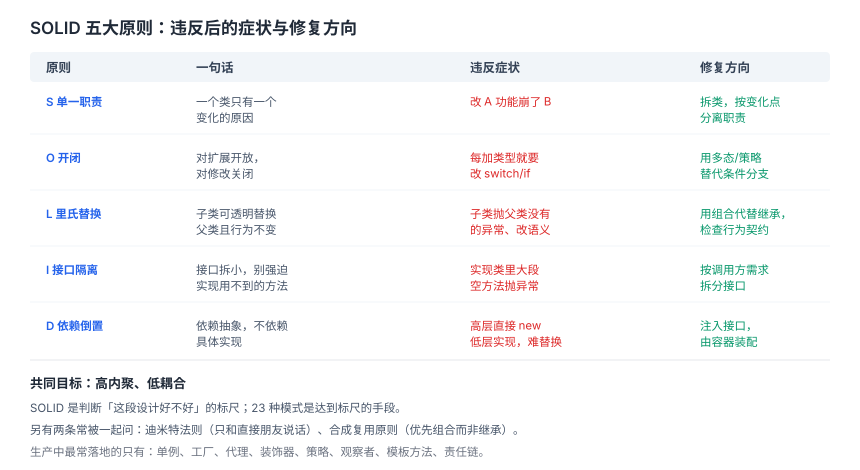
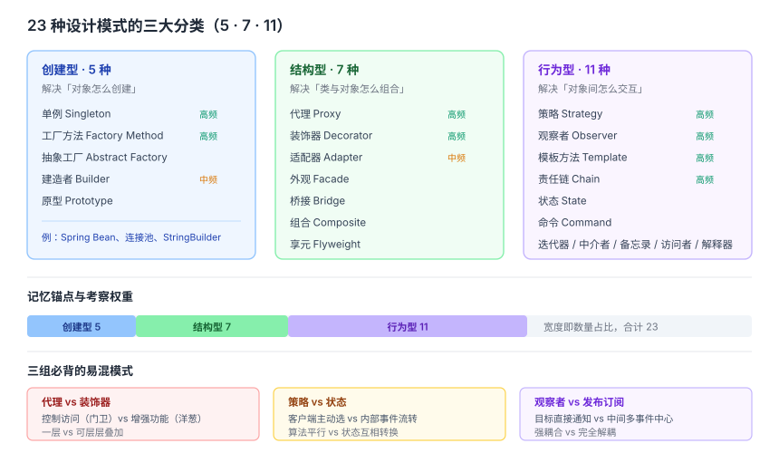

# 面向对象与设计模式面试知识体系

> 整理日期：2026-10-13 ｜ 定位：对标 CS-Notes「面向对象」与 coding-interview-university「Design Patterns」章节，补齐前五篇（网络/OS/数据结构/组成原理/数据库）未覆盖的软件设计维度。

## 结论

- 面试问设计模式，**考的不是你能不能背出 23 个名字，而是两件事**：能不能说出「这个模式解决什么问题」，以及「在哪个框架/项目里真见过」。前者是概念，后者是可信度。
- 六大原则是**判断标准**，23 种模式是**落地手段**。先把 SOLID 讲清楚，再谈模式，逻辑才立得住。
- 真正高频的只有 **7~8 个**：单例、工厂、代理、装饰器、策略、观察者（发布订阅）、模板方法、责任链。其余的能举出场景即可，不必逐个背。
- 回答套路固定为三段：**它解决什么耦合问题 → 结构怎么分工 → 真实例子（Spring/JDK/前端框架）**。三段缺一段就显得在背书。

## 一、设计原则（判断标准）

### SOLID 五大原则

| 原则 | 全称 | 一句话 | 违反后的典型症状 |
|---|---|---|---|
| **S** 单一职责 | Single Responsibility | 一个类只有一个引起它变化的原因 | 改 A 功能崩了 B 功能 |
| **O** 开闭 | Open-Closed | 对扩展开放，对修改关闭 | 每加一种类型就要改 switch |
| **L** 里氏替换 | Liskov Substitution | 子类能透明替换父类，且行为不异常 | 子类抛父类没有的异常、重写改变语义 |
| **I** 接口隔离 | Interface Segregation | 接口拆小，别强迫实现用不到的方法 | 实现类里有大段空方法抛异常 |
| **D** 依赖倒置 | Dependency Inversion | 依赖抽象，不依赖具体实现 | 高层模块直接 `new` 低层实现 |

### 其他常被追问的原则

- **迪米特法则（LoD，最少知识）**：只和直接朋友说话。`a.getB().getC().doX()` 违反它。
- **合成复用 > 继承**：继承是白箱复用、编译期绑定、破坏封装；组合是黑箱复用、运行期可换。
- **DRY / KISS / YAGNI**：不重复、保持简单、别写「以后可能用到」的代码。
- **高内聚低耦合**：这是所有原则的**共同目标**，被追问「为什么要有这些原则」时，答这一句最稳。

### 高频追问：里氏替换为什么难做到

继承的陷阱在于「is-a 关系在语义上不总成立」。经典反例是正方形继承长方形：数学上正方形是长方形，但长方形的 `setWidth/setHeight` 各自独立，正方形必须联动，于是替换后行为被破坏。**判断标准是行为契约（前置条件不能加强、后置条件不能减弱），不是名词上的父子关系。**



## 二、23 种模式分类（落地手段）

按**意图**分三类，这是必须记住的骨架：

| 类别 | 解决什么 | 模式 |
|---|---|---|
| **创建型**（5） | 对象**怎么创建** | 单例、工厂方法、抽象工厂、建造者、原型 |
| **结构型**（7） | 类与对象**怎么组合** | 代理、装饰器、适配器、外观、桥接、组合、享元 |
| **行为型**（11） | 对象间**怎么交互/分配职责** | 策略、观察者、模板方法、责任链、状态、命令、迭代器、中介者、备忘录、访问者、解释器 |

> 记忆锚点：**5-7-11**，创建 5、结构 7、行为 11，合计 23。



### 高频模式清单（按考察频率排序）

| 模式 | 意图 | 真实例子 | 易混对象 |
|---|---|---|---|
| **单例** | 全局唯一实例 | Spring Bean 默认单例、配置类、连接池 | — |
| **工厂方法/抽象工厂** | 创建逻辑收口，调用方不关心具体类 | `BeanFactory`、`Calendar.getInstance` | 两者区别见下 |
| **代理** | 不改原对象，加一层控制 | Spring AOP、MyBatis Mapper、JDK 动态代理 | **装饰器** |
| **装饰器** | 运行时叠加增强，可层层套 | Java `BufferedInputStream`、Python `@decorator` | **代理** |
| **策略** | 算法可插拔，替代大段 if-else | 支付方式、排序策略、`Comparator` | **状态** |
| **观察者** | 一变多通知，解耦发布订阅 | 事件总线、Vue 响应式、`ApplicationEvent` | **发布订阅** |
| **模板方法** | 固定骨架，延迟具体步骤到子类 | `AbstractList`、`JdbcTemplate`、Servlet `service` | — |
| **责任链** | 请求沿链传递，各自决定处理或放行 | Filter/Interceptor、Netty Pipeline | — |
| **适配器** | 接口转换，让不兼容的两方协同 | `InputStreamReader`、SLF4J 绑定 | — |
| **建造者** | 分步装配复杂对象 | `StringBuilder`、`Lombok @Builder`、OKHttp | — |

## 三、几组高频易混模式

这几组是面试**最爱的追问点**，能分清就超过大多数人。

### 代理 vs 装饰器

| 维度 | 代理 Proxy | 装饰器 Decorator |
|---|---|---|
| **目的** | **控制访问**（能不能进） | **增强功能**（进去后多做点） |
| **层次** | 通常一层，客户端不感知原对象 | 可多层叠加，逐层包裹 |
| **关系** | 代理与原对象常是同一接口，代理自己管生杀 | 装饰器持有被装饰对象，递归调用 |
| **例子** | 权限校验、懒加载、远程代理、AOP | IO 流套娃、压缩+加密+缓冲 |

一句话：**代理是「门卫」，装饰器是「洋葱」**。

### 策略 vs 状态

两者都用对象映射消灭 if-else，区别在**谁驱动切换**：

- **策略**：算法之间**平行无关**，由**客户端**主动选择，选定后不变。例：用户选微信还是支付宝支付。
- **状态**：各状态之间**会相互流转**，由**内部事件**驱动切换。例：订单从待支付 → 已支付 → 已发货。

### 工厂方法 vs 抽象工厂

- **工厂方法**：一个产品等级，**一个**创建方法，子类决定造哪个具体类。
- **抽象工厂**：**一族**相关产品，**多个**创建方法，保证同一产品族一起换。例：换数据库时，连接、命令、事务对象要成套更换。

### 观察者 vs 发布订阅

- **观察者**：目标**直接持有**观察者列表并通知，两者**互相知道**（强耦合）。
- **发布订阅**：中间多一个**事件中心/调度器**，发布方与订阅方**互不感知**（完全解耦）。

严格说发布订阅是观察者的一种解耦变体，面试时把这层差异说出来是加分项。

## 四、单例的几种写法（高频手写题）

```text
饿汉式    —— 类加载即创建。简单、线程安全，但可能浪费（没用到也创建）
懒汉+锁   —— 用到才创建，但每次 getInstance 都加锁，性能差
双重检查  —— 推荐。两次判空 + volatile 防指令重排，兼顾性能与安全
静态内部类 —— 推荐。借类加载机制保证线程安全，且天然延迟加载
枚举      —— 最推荐。防反射、防反序列化破坏，写法最简
```

**双重检查为什么必须加 `volatile`**：`instance = new Singleton()` 在字节码层面是三步（分配内存 → 初始化 → 引用赋值），2 和 3 可能重排，导致别的线程拿到**半初始化**对象。`volatile` 禁止这个重排。

**枚举为什么最安全**：反射 `newInstance` 对枚举会抛 `IllegalArgumentException`，反序列化也保证返回同一实例。这是《Effective Java》的明确推荐。

## 五、设计模式的边界（面试加分项）

- **不要为了用模式而用模式**。如果一行代码能解决，不要引入五个类。这是绝大多数面试官想听到的答案。
- **很多模式已被语言/框架内建**：ES Module 天然单例、`@decorator` 语法糖、RxJS 内建观察者。说得出这层，说明你用的是现代工程而不是背 1994 年的书。
- **模式的成本是间接层**。每加一层抽象，调试链路就长一段。选型时要能说出「收益 > 成本」的判断依据。
- **并发场景要额外考虑**：单例要线程安全，享元要注意共享状态的可见性，观察者要注意通知时的锁范围。

## 六、高频对比速查

| 问题 | 一句话答案 |
|---|---|
| 设计模式的六大原则？ | SOLID 五条 + 迪米特法则，目标是高内聚低耦合 |
| 三大分类？ | 创建型 5、结构型 7、行为型 11 |
| 生产最常用的？ | 单例、工厂、代理、策略、观察者 |
| 代理和装饰器区别？ | 控制访问 vs 增强功能；一层 vs 可套娃 |
| 策略和状态区别？ | 客户端选 vs 内部流转 |
| 单例最安全写法？ | 枚举；次选静态内部类 / 双重检查 + volatile |
| 双重检查为什么要 volatile？ | 禁止「分配 → 初始化 → 赋值」的重排，防半初始化对象 |
| 里氏替换的判断标准？ | 行为契约，不是名词父子关系 |
| 什么时候不该用模式？ | 一行代码能解决时；抽象层成本大于收益时 |

## 建议

- **回答用三段式**：解决什么问题 → 结构如何分工 → 真实例子。缺最后一段最容易被追问到哑口。
- **主攻 8 个高频模式**，其余了解意图即可，别在冷门模式上花时间。
- **准备 2~3 个「我在项目里用过」的故事**，比背定义有效得多。例如：用策略模式替掉了 200 行的支付 if-else。
- **被问到不会的模式**，诚实说「这个我没在生产用过，我的理解是……」，然后用意图推断，比硬编强。

## 待核实

- 各框架版本对模式的实现细节（如 Spring AOP 默认代理方式随版本从 JDK 动态代理切换为 CGLIB）会变化，引用时宜标注版本。
- 枚举单例「绝对防反射」的前提是未被特殊绕过，极少数场景下仍有争议，面试中按主流结论表述即可。

## 来源清单

- CyC2018/CS-Notes —「面向对象：设计模式、面向对象思想」章节（仓库知识框架）
- jwasham/coding-interview-university —「Design Patterns」学习清单
- Snailclimb/JavaGuide — 设计模式与 Spring 应用相关章节
- iluwatar/java-design-patterns — 23 种模式的参考实现
- 本文结论基于上述公开仓库的知识框架整理，具体项目细节以官方文档为准。
