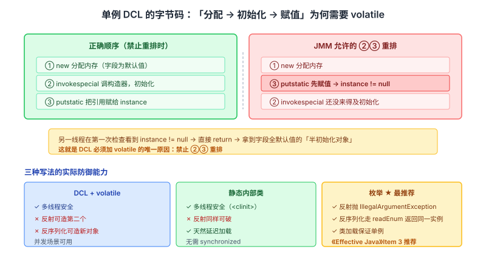
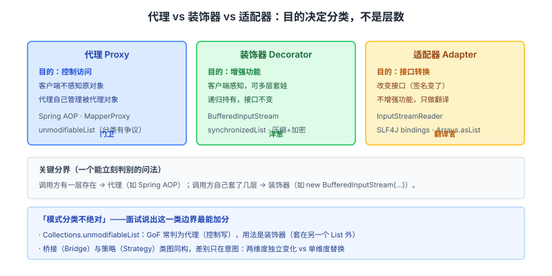

# 面向对象与设计模式面试知识体系

> 整理日期：2026-10-13 ｜ 重写：2026-10-14。这份文档不铺广度，只挑面试官会**连问三层**的点。每个点讲三层：**机制（语言/框架里到底怎么实现）→ 证据（类名、注解、字节码、官方文档）→ 追问链**。

> 阅读约定：标注「待核实」的地方是本次未拿到一手依据的，不硬写。设计模式是四门基础课里最软的一门，**恰恰因此最容易讲空**——它的深度只能靠「落到具体类名和框架源码」来体现。

## 结论

设计模式面试的深度，不在于背 23 个名字，而在于**三段式答到底**：

1. **它解决什么耦合问题 → 结构怎么分工 → 真实例子（给出类名/注解/源码位置）**。第三段是可信度的分水岭。
2. **单例的 DCL 为什么要 `volatile`**——要说得出字节码的三步（分配→初始化→赋值）与重排，而不是「加 volatile 更安全」。
3. **代理 vs 装饰器的分界不是「一层 vs 多层」**，而是**控制访问 vs 增强功能**；前者客户端不感知原对象，后者递归持有。
4. **模式的成本是间接层**——能说出「一行代码能解决就别引入五个类」，是绝大多数面试官最想听的答案。

本文按「原则 → 创建型 → 结构型 → 行为型 → 边界」组织，每个模式都落到具体框架里的实现。

---

## 一、设计原则：SOLID 与「过度设计的代价」

### SOLID 五原则

| 原则 | 一句话 | 违反症状 |
| --- | --- | --- |
| **S** 单一职责 | 一个类只有一个引起变化的原因 | 改 A 崩 B |
| **O** 开闭 | 对扩展开放，对修改关闭 | 每加一种类型就改 switch |
| **L** 里氏替换 | 子类可透明替换父类，行为不异常 | 子类抛父类没有的异常 |
| **I** 接口隔离 | 接口拆小，别强迫实现用不到的方法 | 实现类里大段空方法 |
| **D** 依赖倒置 | 依赖抽象不依赖实现 | 高层直接 `new` 低层 |

### 里氏替换的判断标准是行为契约

**不是名词上的父子关系。** 判断依据（来自 Liskov 1987 的原始定义）：

- **前置条件不能加强**：子类不能要求比父类更多的输入约束
- **后置条件不能减弱**：子类不能保证比父类更少的输出
- **不变量必须保持**、**子类型方法不能抛出父类未声明的受检异常**

**经典反例：正方形继承长方形**。数学上正方形是长方形，但长方形的 `setWidth`/`setHeight` 各自独立，正方形必须联动——替换后行为契约被破坏。

**另一个更实用的反例（Java 里的真实问题）**：
```java
List<String> list = Arrays.asList("a", "b");
list.add("c");   // UnsupportedOperationException
```
`Arrays.asList` 返回的是固定大小的 List，它的 `add` 抛异常——**违反了父接口的可替换性**。这就是为什么 `Collections.unmodifiableList` 的做法是「包装 + 所有写操作抛异常」而不是「继承并覆盖」：**继承会假装自己可替换**，而包装明确表达「这不是一个完整实现」。

### 《Effective Java》的两条工程原则

**优先使用组合而非继承**（Item 18）：

| | 继承 | 组合 |
| --- | --- | --- |
| 复用方式 | 白箱（暴露父类实现细节） | 黑箱（只通过接口交互） |
| 绑定时机 | 编译期 | 运行期可换 |
| 封装 | 破坏（父类变化会影响子类） | 保持 |

**经典的继承陷阱**（《Effective Java》原文例子）：`HashSet` 的「自增计数器」子类。父类 `addAll` 内部调用 `add`，子类的 `add` 也被调用，于是**加了两次**——因为子类不知道 `addAll` 的实现细节（自用性 self-use）。**组合版本**（持有 `HashSet` + 转发）就没有这个问题。

**接口优先于抽象类**（Item 20）：接口允许多实现、不占继承位、更易演化（Java 8 后还能加 default 方法）。

### 过度设计的代价（面试加分项）

**SOLID 不是免费的**。每引入一层抽象就多一层间接：

- **可读性下降**：一个简单逻辑被拆成 5 个类，新人必须跳 5 次才能看懂
- **调试链路变长**：调用栈里全是代理/装饰器/拦截器
- **性能开销**：动态代理有反射/字节码开销（虽然通常可忽略）

**判断标准**（KISS / YAGNI）：**只有当变化的可能性已被证实存在时，才为它引入抽象。** 不要为「以后可能要用 MySQL 或 PostgreSQL」就写抽象工厂——真到那天再重构，重构成本通常低于提前设计的维护成本。

> **追问链**
> 1. 里氏替换的判断标准？→ 行为契约（前置不能加强、后置不能减弱），不是名词父子。
> 2. `Arrays.asList` 违反了 LSP 吗？→ 是，`add` 抛异常，无法透明替换 List。
> 3. 继承 `HashSet` 做计数器有什么坑？→ 父类 `addAll` 自用调用 `add`，子类被调两次。
> 4. 什么时候不该用设计模式？→ 变化尚未被证实，或抽象成本 > 收益。

---

## 二、创建型：单例的字节码与工厂的收口

### 单例：DCL 为什么必须有 `volatile`

**这是最经典的高频手写题，也是最能看出「懂不懂」的地方。**

```java
public class Singleton {
    private static volatile Singleton instance;   // ← volatile 不可省

    private Singleton() {}

    public static Singleton getInstance() {
        if (instance == null) {                   // 第一次检查（避免每次都加锁）
            synchronized (Singleton.class) {
                if (instance == null) {           // 第二次检查（避免重复创建）
                    instance = new Singleton();
                }
            }
        }
        return instance;
    }
}
```

**`instance = new Singleton()` 在字节码层面是三步**：

```
1. new         # 分配内存（此时对象字段都是默认值）
2. invokespecial <init>   # 调用构造器，初始化
3. putstatic   # 把引用赋给 instance
```

**JMM 允许 2 和 3 重排**（只要不违反 happens-before）。重排后变成：

```
1. 分配内存
3. instance = 引用          ← 此时 instance 已非 null
2. 初始化                   ← 还没执行
```

**后果**：另一个线程在第一次检查看到 `instance != null`，直接返回——**拿到一个字段全是默认值的「半初始化」对象**。

**`volatile` 的作用**：禁止这个重排（volatile 写之前的操作不能排到 volatile 写之后），并保证可见性。

**注意**：**`volatile` 只修好了 DCL 这条路**。它不解决「反射创建第二个实例」和「反序列化创建新对象」两个问题。



### 枚举单例：为什么最安全

```java
public enum Singleton {
    INSTANCE;
    public void doSomething() { ... }
}
```

**它同时防住三件事**（《Effective Java》Item 3 的明确推荐）：

| 攻击 | 枚举的防御 |
| --- | --- |
| **反射** | `Constructor.newInstance()` 对枚举类型直接抛 `IllegalArgumentException`（JDK 源码里显式判断 `Reflection.verifyMemberAccess` 之前有 `Modifier.isEnum` 检查） |
| **反序列化** | `ObjectInputStream` 对枚举走 `readEnum`，按名字查回**同一个**实例，不调用构造器 |
| **多线程** | 类加载机制保证 `INSTANCE` 只被初始化一次 |

**这是「语言特性比手写代码更可靠」的最佳例证**——《Effective Java》原文：「a single-element enum type is often the best way to implement a singleton」。

**静态内部类方案**（次优）：

```java
public class Singleton {
    private static class Holder {
        static final Singleton INSTANCE = new Singleton();
    }
    public static Singleton getInstance() { return Holder.INSTANCE; }
}
```

**原理**：JVM 保证类初始化是**线程安全的**（`<clinit>` 加锁），且内部类**在被首次使用时才加载**——天然实现延迟加载，不需要 `synchronized` 也不需要 `volatile`。

> **待核实**：枚举单例的「绝对防反射」有边界讨论——**通过 `Unsafe.allocateInstance` 或修改 `Constructor` 的 `accessCheck` 等非常规手段理论上可绕过**，但这些手段已在较新 JDK 中被逐步限制。面试按「枚举是最安全的常规方案」表述即可，正文不展开这些边界。

### 工厂方法 vs 抽象工厂

| | 工厂方法 | 抽象工厂 |
| --- | --- | --- |
| 产品数量 | **一个**产品等级 | **一族**相关产品 |
| 创建方法 | **一个** | **多个** |
| 子类职责 | 决定造哪个具体类 | 保证同族产品成套 |

**真实例子**：
- **工厂方法**：`Calendar.getInstance()`（按 Locale/时区返回不同 Calendar 子类）、`BeanFactory.getBean()`、`NumberFormat.getInstance()`
- **抽象工厂**：`javax.xml.parsers.DocumentBuilderFactory`、Spring 的 `AbstractBeanFactory` 体系（不同 Bean 类型取不同实现）、JDBC 的 `Connection`/`Statement`/`ResultSet` 成套切换

**判断口诀**：**「加一个产品」用工厂方法；「加一整套产品族」用抽象工厂。**

**开闭原则的落点**：工厂方法把「具体类的选择」集中到一个地方。**新增实现时只改工厂，调用方不动**——这才是「对扩展开放、对修改关闭」的实际体现。

### 建造者：为什么需要它

**问题**：一个对象有 10 个可选参数，构造器怎么写？
- 重叠构造器（telescoping）——参数一多就没法看
- JavaBean setter——**对象可能处于不一致状态**（少设一个字段）

**建造者的解**：分步装配，`build()` 时一次性校验并构造**不可变对象**。

**真实例子**：`StringBuilder`（严格说是可变字符串构建器，不是 GoF 建造者）、`Lombok @Builder`、`OkHttpClient.Builder`、`Retrofit.Builder`、Spring 的 `WebClient.builder()`。

**与 GoF 原版建造者的差别**（加分点）：GoF 版有 `Director` 角色指挥构建流程，产出不同表示；**Java 工程里更常见的是简化版**——省略 Director，链式调用直接产出对象。

> **追问链**
> 1. DCL 为什么加 `volatile`？→ 禁止「分配→初始化→赋值」重排，防半初始化对象。
> 2. 加 volatile 就万无一失了吗？→ 不，反射和反序列化仍能造第二个。
> 3. 那最稳的写法？→ **枚举**，反射抛异常、反序列化返回同一实例。
> 4. 静态内部类为什么不需要锁？→ JVM 保证 `<clinit>` 线程安全，且内部类延迟加载。
> 5. 工厂方法和抽象工厂怎么选？→ 一个产品等级 vs 一族产品。

---

## 三、结构型：代理、装饰器、适配器的分界

### 代理 vs 装饰器：核心是「目的」不是「层数」

| 维度 | 代理 Proxy | 装饰器 Decorator |
| --- | --- | --- |
| **目的** | **控制访问**（能不能进） | **增强功能**（进去后多做点） |
| **客户端视角** | 不感知原对象（代理自己管理它） | **感知**（装饰器由客户端显式套上） |
| **组合方式** | 通常一层 | **可多层叠加**，递归包裹 |
| **对象关系** | 代理持有/创建被代理对象 | 装饰器被别人装饰，也装饰别人 |
| **典型用途** | 权限、懒加载、远程、AOP | IO 流、压缩+加密+缓冲 |

**一句话**：**代理是「门卫」，装饰器是「洋葱」。**

**关键区分是「客户端知不知道」**：用 Spring AOP 给 `UserService` 加日志，调用方**根本不知道**代理存在——这是代理。而 `new BufferedInputStream(new FileInputStream(f))`，调用方**明确知道**自己套了几层——这是装饰器。

**真实例子**：
- **代理**：Spring AOP、MyBatis Mapper 接口（`MapperProxy`）、JDK 动态代理 `Proxy.newProxyInstance`、CGLIB、`Collections.unmodifiableList`
- **装饰器**：`java.io` 的流体系（`BufferedInputStream`、`DataInputStream`、`GZIPOutputStream`）、`Collections.synchronizedList`、Python `@decorator`、Servlet 的 `HttpServletRequestWrapper`

**注意 `Collections.unmodifiableList` 的归属争议**（加分点）：它在**GoF 分类里常被判为代理**（控制写访问），但用法上完全是装饰器风格（套在另一个 List 外面）。**面试时说出这个「分类不唯一」的事实，比背结论更有说服力。**



### 适配器：接口转换，不是功能增强

**适配器不增强功能**，它只做**接口翻译**——让不兼容的两方能协作。

**真实例子**：
- `InputStreamReader`：`InputStream`（字节流）→ `Reader`（字符流）
- `Arrays.asList`：数组 → List
- SLF4J 的 bindings：把统一 API 桥接到 Log4j/Logback/JUL
- `java.util.Collections.enumeration()`：Iterator → 老 Enumeration

**vs 装饰器的分界**：适配器**改变接口**（签名变了），装饰器**保持接口**（签名不变，只是行为增强）。

**第三个易混：外观（Facade）vs 代理**。外观是**简化**一组子系统为单一入口（如 `SLF4J` 的 `Logger` 接口、Spring 的 `JdbcTemplate` 屏蔽 JDBC 细节）；代理是**控制对单个对象的访问**。

### 桥接与策略的「同构」

**桥接（Bridge）和策略（Strategy）在类图上是同构的**——都是「抽象持有实现接口」。差别在**意图**：

| | 桥接 | 策略 |
| --- | --- | --- |
| 意图 | 让**抽象和实现独立变化**（两个维度） | 让**算法可替换**（一个维度） |
| 场景 | 图形 × 渲染 API、跨平台窗口 × 系统 API | 支付方式、排序算法 |
| 变化方向 | 两个维度都要变 | 只有算法这一维变 |

**面试能说出「结构同构、意图不同」是深度信号**——这也是「设计模式分类不绝对」的又一个例证。

> **追问链**
> 1. 代理和装饰器怎么分？→ 控制访问 vs 增强功能；客户端感知不感知。
> 2. `unmodifiableList` 是代理还是装饰器？→ 分类有争议，用法是装饰器。
> 3. 适配器改变什么？→ **接口**（签名变了），不改变功能。
> 4. 桥接和策略的区别？→ 类图同构，意图不同（两维度独立变化 vs 单维度替换）。

---

## 四、行为型：策略、状态、观察者

### 策略 vs 状态：谁驱动切换

| | 策略 Strategy | 状态 State |
| --- | --- | --- |
| 算法/状态间关系 | **平行无关** | **互相流转** |
| 谁驱动切换 | **客户端**主动选择 | **内部事件**驱动 |
| 切换后 | 一般不再变 | 会继续流转 |
| 典型 | 支付方式、`Comparator`、限流算法 | 订单状态机、TCP 状态机、工作流 |

**判断口诀**：**「选好就不变」是策略，「会自己往下走」是状态。**

**真实例子**：
- **策略**：`java.util.Comparator`（排序策略）、`ThreadPoolExecutor` 的 `RejectedExecutionHandler`（拒绝策略）、Spring `Resource` 的不同实现、限流算法的 `RateLimiter`
- **状态**：Spring StateMachine、订单状态流转、TCP 连接状态、工作流的节点状态

**为什么用它们代替 if-else**：不是「更优雅」这种空话，而是 **① 消除长分支（可读性）② 新增分支不改原有代码（开闭）③ 每个分支可独立单测（可测性）**。这三条才是实际收益。

### 观察者 vs 发布订阅

| | 观察者 Observer | 发布订阅 Pub/Sub |
| --- | --- | --- |
| 耦合 | 目标**直接持有**观察者列表，**互相知道** | 中间有**事件中心**，两边**互不感知** |
| 同步性 | 通常同步通知 | 通常异步（可跨进程/跨网络） |
| 例子 | Java `EventListener`、Vue 响应式、`Observer`/`Observable` | MQ、EventBus、Redis Pub/Sub、Kafka |

**严格说发布订阅是观察者的一种解耦变体**——GoF 里没有「发布订阅」这个模式，它是观察者在分布式场景的演进。**面试把这层差异说出来是加分项。**

**真实例子**：
- **观察者（进程内、同步）**：`java.util.Observer`（已废弃）、Spring `ApplicationEvent` + `@EventListener`、`PropertyChangeListener`、前端的事件监听
- **发布订阅（跨进程、异步）**：Kafka、RabbitMQ、Redis Pub/Sub、`Node.js EventEmitter`（其实是观察者，但常被当 pub/sub 讲）

**一个必须提的坑**：**观察者通知时的锁范围**。如果在持锁状态下同步通知所有观察者，观察者里的耗时操作会**长时间持锁**，甚至因为观察者反向调用导致**死锁**。工程解法：**通知前先拷贝监听器列表、通知时不持锁、或改为异步派发**（Spring `ApplicationEvent` 的 `@Async`）。

### 模板方法与责任链

**模板方法**：父类定义骨架，子类填步骤。
- 真实例子：`AbstractList`（`get`/`size` 抽象，`addAll` 等骨架）、`JdbcTemplate`（`execute` 管连接/事务，`RowMapper` 管映射）、`HttpServlet.service()`（分派到 `doGet`/`doPost`）
- **钩子方法（hook）**：父类给了个空实现，子类可选择性覆盖——这是模板方法的「可选步骤」

**责任链**：请求沿链传递，各自决定处理或放行。
- 真实例子：Servlet `Filter` 链、Spring MVC `HandlerInterceptor`、Netty `ChannelPipeline`、Sentinel 的 `ProcessorSlotChain`
- **关键设计**：链上的节点**可以终止传递，也可以放行**（`chain.doFilter()` 就是放行的显式调用）

> **追问链**
> 1. 策略和状态怎么分？→ 客户端选（平行）vs 内部事件驱动（流转）。
> 2. 用它们代替 if-else 的**实际**收益？→ 消长分支、开闭、可单测（不是「优雅」）。
> 3. 观察者有什么坑？→ 持锁同步通知可能导致长时间持锁甚至死锁。
> 4. 责任链怎么「放行」？→ `chain.doFilter()`；不调就是终止。

---

## 五、Spring 里用到的模式（可信度最高的例子）

面试里最能证明「真用过」的，是**说出框架里对应的类名**：

| 模式 | Spring/JDK 里的落点 |
| --- | --- |
| **单例** | Spring Bean 默认 `singleton` scope；`BeanFactory` 的 `singletonObjects` 缓存 |
| **工厂方法** | `BeanFactory.getBean()`、`FactoryBean.getObject()` |
| **抽象工厂** | `AbstractBeanFactory`、`ApplicationContext` 体系 |
| **代理** | `AopProxy`（JDK 动态代理 / CGLIB）、`AnnotationAwareAspectJAutoProxyCreator` |
| **装饰器** | `HttpServletRequestWrapper`、Spring `ServerHttpRequestDecorator` |
| **适配器** | `HandlerAdapter`（把各种 Controller 适配成统一调用）、`MessageConverter` |
| **策略** | `Resource` 实现族、`PlatformTransactionManager`、`HandlerMapping` |
| **模板方法** | `JdbcTemplate`、`RedisTemplate`、`AbstractApplicationContext.refresh()` |
| **观察者** | `ApplicationEventMulticaster`、`@EventListener` |
| **责任链** | `HandlerExecutionChain`、`FilterChain` |
| **外观** | `JdbcTemplate` 对 JDBC 的封装、`RestTemplate` |

**JDK 里的落点**：

| 模式 | JDK 类 |
| --- | --- |
| 装饰器 | `java.io` 流体系、`Collections.synchronizedList` |
| 代理 | `java.lang.reflect.Proxy`、`Collections.unmodifiableList` |
| 适配器 | `InputStreamReader`、`Arrays.asList` |
| 建造者 | `StringBuilder`、`Stream.Builder` |
| 迭代器 | `java.util.Iterator` |
| 观察者 | `java.util.EventListener`、`PropertyChangeListener` |
| 享元 | `Integer.valueOf(-128..127)` 缓存、`String` 常量池 |

**面试怎么用这张表**：被问「你实际用过什么模式」，不要泛泛而谈，直接说「我在项目里用 `HandlerAdapter` 那套思路把三种支付渠道统一成了一个接口」——**有类名、有场景，可信度立刻不同**。

> **待核实**：Spring AOP 的**默认代理方式**随版本/配置变化（Spring Boot 2.x 起默认 `proxyTargetClass=true`，即优先 CGLIB），本文未逐版本核实具体版本号与切换点。引用时宜标注 Spring 版本。

---

## 六、高频追问速查（按「面试官问 → 我答」组织）

| 面试官会问 | 你要答到的点 |
| --- | --- |
| DCL 为什么必须加 `volatile` | 字节码三步（分配→初始化→赋值）中 2、3 可重排，会出**半初始化对象** |
| 加 volatile 就够了吗 | 不够，**反射**和**反序列化**仍能造第二个 |
| 最安全的单例写法 | **枚举**：反射抛 `IllegalArgumentException`、反序列化返回同一实例 |
| 静态内部类为什么不用锁 | JVM 保证 `<clinit>` 线程安全 + 内部类延迟加载 |
| 里氏替换的判断标准 | **行为契约**（前置不能加强、后置不能减弱），不是名词父子 |
| `Arrays.asList` 有什么问题 | `add` 抛异常，违反 LSP；它是固定大小视图 |
| 优先组合还是继承 | 组合（《Effective Java》Item 18）；继承会因父类自用而失控 |
| 代理 vs 装饰器 | 控制访问 vs 增强功能；**客户端感知不感知** |
| `unmodifiableList` 算哪个 | 分类有争议（GoF 常判代理），用法是装饰器 |
| 适配器改变什么 | **接口**（签名变了），不增强功能 |
| 桥接 vs 策略 | 类图同构，意图不同（两维度独立 vs 单维度替换） |
| 策略 vs 状态 | 客户端选（平行）vs 内部事件驱动（流转） |
| 观察者 vs 发布订阅 | 互相知道（直接持有）vs 中间有事件中心（互不感知） |
| 观察者的坑 | 持锁同步通知 → 长时间持锁 / 死锁 |
| 用模式替代 if-else 的实际收益 | 消长分支、开闭、**可单测**（不是「优雅」） |
| Spring 用了哪些模式 | 尽量给类名：`BeanFactory`、`AopProxy`、`HandlerAdapter`、`JdbcTemplate` |
| 什么时候不该用模式 | 变化尚未证实；抽象成本 > 收益；一行代码能解决 |

## 建议

- **三段式答到底**：解决什么问题 → 结构怎么分工 → **真实类名/注解/源码位置**。第三段是可信度分水岭。
- **准备两个「手写级」细节**：DCL 的字节码三步 + volatile 的作用；枚举单例防反射/反序列化的机制。这两个最能区分「背的」和「懂的」。
- **准备一个「我项目里的故事」**：例如「用策略模式替掉了 200 行支付 if-else，并因此把每个渠道都能单独单测」。**有量化收益的故事最有说服力。**
- **主动说「模式分类不绝对」**：`unmodifiableList`、桥接/策略同构——这类「知道边界」的回答，比多背几个模式更能加分。
- **主动说「不要过度设计」**：面试官几乎一定会问「什么时候不该用」，准备一个「我用简单方案解决、而不是硬套模式」的例子。

## 待核实

- **Spring AOP 默认代理方式**（JDK 动态代理 vs CGLIB）**随版本与配置变化**，Spring Boot 2.x 起默认 `proxyTargetClass=true`；本文未逐版本核实切换点。
- **枚举单例的「绝对防反射」有边界**：`Unsafe.allocateInstance`、反射修改 `Constructor` 访问检查等非常规手段理论上可绕过，新 JDK 已在限制；本文按主流结论表述，未展开绕过细节。
- **`java.util.Observer` 的废弃版本**（Java 9 标记废弃）与替代方案（`PropertyChangeListener`、`Flow` API）的具体版本号未逐版本核实。
- **`Collections.unmodifiableList` 的 GoF 分类**属学界/工程界的表述差异，本文标注为「有争议」而非给唯一结论。
- **各框架源码中的类名与包路径**随版本变化（如 Spring 5 与 6 的包结构调整），引用时宜标注版本。

## 来源清单

| 内容 | 来源（一手优先） | 说明 |
| --- | --- | --- |
| SOLID 五原则、里氏替换的行为契约定义 | Liskov 1987, *Data Abstraction and Hierarchy*；Martin 的 SOLID 系列 | 论文 + 一手论述 |
| 优先组合而非继承、`HashSet` 计数器反例、枚举单例推荐 | Joshua Bloch《Effective Java》Item 3/18/20 | 一手著作 |
| DCL 的字节码三步与 `volatile` 重排 | JMM（JSR-133）内存模型规范；《Java 并发编程实战》相关章节 | 规范 + 著作 |
| 枚举反射被拒、枚举反序列化走 `readEnum` | OpenJDK `java.lang.reflect.Constructor#newInstance`、`ObjectInputStream#readEnum` 源码 | 源码 |
| 静态内部类的类初始化线程安全 | JVM 规范（JVMS §5.5 类初始化） | 规范 |
| 代理/装饰器/适配器/桥接/策略/状态/观察者/模板方法/责任链的 GoF 定义与意图 | Gamma et al. 1994, *Design Patterns: Elements of Reusable Object-Oriented Software* | 一手著作 |
| `java.io` 装饰器体系、`Proxy`、`InputStreamReader`、`StringBuilder` | OpenJDK `java.base` 源码与 Javadoc | 源码 + 官方文档 |
| Spring 的模式落点（`BeanFactory`、`AopProxy`、`HandlerAdapter`、`JdbcTemplate`、`ApplicationEventMulticaster`） | Spring Framework 官方文档与源码（引用时宜标版本） | 官方文档 + 源码 |
| `InputStreamReader` 适配器、`Arrays.asList` 固定大小 | OpenJDK Javadoc（`Arrays.asList` 明确说明是 fixed-size view） | 官方文档 |
| 讲法组织参考（三段式、给类名、说边界与成本） | iluwatar/java-design-patterns、Snailclimb/JavaGuide、doocs/advanced-java | GitHub 仓库，2026-10-14 核实 |
