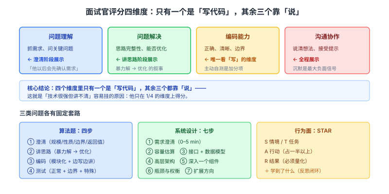

# 面试方法论与答题框架

> 整理日期：2026-10-13 ｜ 重写：2026-10-14。前面八篇讲「知识是什么」，这一篇讲**怎么把知识用出来**。方法论本身也要讲机制：**为什么这个框架有效、它对应面试官在评估什么**。

> 阅读约定：标注「待核实」的地方是本次未拿到一手依据的，不硬写。**这一篇的可验证性最低**——方法论不是物理常数，所以本文刻意把「可核实的一手依据」（如 tech-interview-handbook 的原始框架、STAR 的出处）与「经验总结」明确分开。

## 结论

面试是**双向的信息交换**，不是知识测验。同样的知识点，**有框架地表达**能显著提高通过率。三条主线：

1. **澄清永远排第一**。面试官**故意留模糊点**，就是看你问不问。问出来就是分。
2. **先说结构再说内容**。即使你知道答案，也要先说「我打算从 A、B、C 三方面回答」——这是「会想」和「会用」的分界。
3. **主动说边界和代价**。答完一个方案后补一句「这个方案的代价是 X，如果场景变了我会换成 Y」——**这一句是高分信号**。

三类问题各有固定套路：算法题「澄清 → 思路 → 编码 → 测试」；系统设计「澄清 → 估算 → 架构 → 权衡」；行为面 **STAR**。

---

## 一、为什么框架重要：面试官在评估什么

**理解这一层，所有套路都自洽了。** 面试官手里通常有四个维度的评分表（各公司表述不同，但维度高度重合）：

| 维度 | 对应行为 | 你怎么展示 |
| --- | --- | --- |
| **问题理解** | 是否抓住了需求、是否问了关键问题 | 澄清阶段 |
| **问题解决** | 思路是否完整、能否优化、卡住时怎么办 | 讲思路阶段 |
| **编码能力** | 代码是否正确、清晰、边界处理 | 编码阶段 |
| **沟通协作** | 是否能把想法说清、能否接受提示 | 全程 |

**核心结论**：**这四个维度里，只有一个是「写代码」，其余三个都靠「说」。** 这就是为什么「技术很强但讲不清」的人容易挂——他只在 1/4 的维度上得分。

**所以「多说」不是话多，而是**：
- 澄清 = 展示「问题理解」
- 讲思路（含暴力解→优化）= 展示「问题解决」
- 边写边解释 = 展示「沟通」
- 主动测试 = 展示「工程严谨」

**每多说一句有信息量的话，都在往评分表上补一个勾。**



---

## 二、算法题：四步应答法

### 第一步：澄清（最容易被跳过，也最容易加分）

开口就问，不要默默假设：

| 要澄清的 | 为什么关键 |
| --- | --- |
| **输入规模 n** | n=10 和 n=10⁶ 决定 O(n²) 能不能用 |
| **数据性质** | 是否有序、有无重复、值域多大 |
| **边界** | 空输入？单元素？全相同？会溢出吗？ |
| **返回值** | 返回索引还是值？找不到返回什么？ |
| **是否可改原数组** | 决定能不能原地操作 |

> **面试官故意留模糊点，就是为了看你问不问。** 一个真实的心理学机制：**主动澄清的人，面试官会默认「他以后写代码前会确认需求」**——这是工程上极其重要的品质。

### 第二步：讲思路（Think Out Loud）

**在写代码前，先用例子手推一遍**，并主动比较至少两种解法：

```text
暴力解法：两层循环枚举，O(n²)，好处是简单直观、不容易写错
优化方向：用哈希表把「查找配对」降到 O(1)，时间 O(n)，代价是 O(n) 空间
我倾向第二种，因为刚才确认了 n 可能到 10⁵，O(n²) 会超时
```

**为什么要先说暴力解**（这是最容易被误解的一点）：

1. **保证你至少有一个解**——如果最优解写不出来，还有保底
2. **展示完整性**——说明你看清了问题全貌，而不是背了一招
3. **给优化提供基线**——「从 O(n²) 优化到 O(n)」是清晰的进步叙事

### 第三步：编码

- **模块化**：先写函数签名和主流程，再填细节
- **命名清晰**：`i/j` 只用于循环下标，业务变量用有意义的名字
- **边写边解释**，保持沟通
- **主动处理边界**：空输入、单元素、越界

### 第四步：测试

写完**主动**手推例子跑一遍，不要等面试官发现 bug：

```
① 正常用例（澄清阶段确认的典型输入）
② 边界用例（空、单元素、全相同）
③ 特殊用例（能触发算法分支的，如重复元素、已排序）
```

**「能自己发现并修复 bug」比「一次写对」更能体现工程能力**——因为真实工作里，代码是你自己测出来的，不是一次写对的。

### 卡住了怎么办（高频追问）

**最差的应对是沉默。** 正确做法：

1. **说出当前思路和卡在哪**：「我目前在考虑用 DP，但状态转移里有个情况没想清楚，就是……」
2. **主动请求提示**：「能给我一个提示吗？是关于数据结构还是关于优化方向？」
3. **退一步讲可行性**：「如果我暂时想不出最优解，我可以先写一个 O(n²) 的版本，然后我们再看怎么优化」

**面试官给提示是正常的**——他要评估的是**你能否在指导下推进**，不是「你是否全知」。**拒绝提示硬扛，反而是负面信号。**

### 复杂度必须主动说

每道题结尾补一句：「时间 O(?) 空间 O(?)」——**这是标准动作，不说会显得不专业**。

**更进一步的加分回答**：**主动说取舍**。
> 「最优解是时间 O(n) 空间 O(n)。如果空间受限，也可以用一个排序把空间降到 O(1)，代价是时间变 O(n log n)。看这个场景更在意哪个。」

**这一句让面试官知道你不只会背最优解，还懂工程权衡。**

---

## 三、模式识别：按模式刷，不按题号刷

**刷题的正确方式是「按模式归类」，不是按题号顺序。** 理由：面试考的是**识别信号 → 选对工具**的能力，而同一模式的题共享同一个识别信号——**练的是同一个技能**。

| 模式 | 识别信号 | 典型题 |
| --- | --- | --- |
| **双指针** | 有序数组、两数之和、去重 | 两数之和 II、三数之和、盛水容器 |
| **滑动窗口** | 连续子数组/子串的极值 | 最长无重复子串、最小覆盖子串 |
| **快慢指针** | 链表环、找中点、倒数第 K | 环形链表、找重复数 |
| **二分查找** | 有序或 **答案域单调** | 搜索旋转数组、二分答案 |
| **哈希表** | 需要 O(1) 查找、计数 | 两数之和、字母异位词分组 |
| **单调栈** | 「下一个更大/更小」、区间极值 | 每日温度、接雨水 |
| **BFS/DFS** | 网格、图、树遍历 | 岛屿数量、层序遍历 |
| **回溯** | 求所有方案、排列组合 | 全排列、子集、N 皇后 |
| **动态规划** | 求最值、可拆子问题、计数 | 背包、LIS、编辑距离 |
| **贪心** | 局部最优可推全局 | 跳跃游戏、区间调度 |
| **堆** | Top K、流式中位数 | 第 K 大、合并 K 个链表 |
| **前缀和** | 区间求和、子数组和 | 和为 K 的子数组 |
| **并查集** | 连通性、分组 | 朋友圈、冗余连接 |
| **Trie** | 前缀匹配、词表 | 实现 Trie、单词搜索 II |

**方法**：每刷完一题，问自己「**这题属于哪个模式**」，而不是记住题解。同一模式的题会越做越快。

**为什么「按模式」比「按题号」有效**：题号顺序是随机的，同一模式的题分散在各处，你得反复「重新发现」同一个模式；按模式刷则是**刻意练习**——同一技能连续命中，形成条件反射。

> **待核实**：**「Blind 75」等题单的原始出处与当前推荐度**（如 Blind 75、Grind 75、NeetCode 150）属于社区经验总结，**不是权威研究结论**；不同来源的题单内容有差异。本文只按「模式」组织，不绑定具体题单与题号。

---

## 四、系统设计题：七步模板与时间分配

详细方法论在《系统设计与分布式面试知识体系》中，此处给**45 分钟的时间分配**：

| 时段 | 动作 | 目的 |
| --- | --- | --- |
| 0–5 min | **需求澄清**：功能范围 + 非功能指标 | 不建错东西 |
| 5–10 min | **容量估算**：QPS、存储、带宽 | 让设计有量级依据 |
| 10–15 min | **接口设计 + 数据模型** | 明确边界 |
| 15–30 min | **高层架构图 + 数据流** | 主干成型 |
| 30–40 min | **深入一个组件**（面试官通常指定） | 展示深度 |
| 40–45 min | **瓶颈与权衡 + 扩展方向** | 展示成熟度 |

**两条铁律**：

1. **必须先澄清再画图**。直接画架构 = 没搞清需求就动手，是最大的失分点。
2. **每个决策都主动说代价**。「用 Redis 缓存」→ 补「代价是数据可能不一致，所以只缓存可容忍短暂陈旧的读场景」。

**为什么容量估算不能跳**：它把设计从「拍脑袋」变成「有量级依据」。算了 QPS 是 10 万/s，才知道要不要分片；没算，后面的架构选择全是猜的。

---

## 五、行为面：STAR 框架

**STAR 的出处**：来源于行为面试（behavioral interview）的结构化回答方法，被开发行为面试法（如 BEI, Behavioral Event Interview）广泛采用。**核心假设是「过去的行为是未来行为的最好预测」（past behavior is the best predictor of future behavior）**——所以面试官要的是**具体发生过的事**，不是「我一般会怎么做」。

- **S**ituation（情境）：背景、约束
- **T**ask（任务）：你要解决什么、目标是什么
- **A**ction（行动）：**你**具体做了什么——**重点，应占一半以上篇幅**
- **R**esult（结果）：**量化**结果 + 你学到了什么

### 高频行为问题与准备要点

| 问题 | 考察点 | 准备方向 |
| --- | --- | --- |
| 最有挑战的项目？ | 技术深度与解决能力 | 选技术难点清晰的，讲「难在哪、你怎么破的」 |
| 与同事意见冲突？ | 协作与沟通 | 展示「用数据/实验说服」，而非「谁声音大」 |
| 线上事故处理？ | 应急与责任心 | 讲清「**止血 → 定位 → 根因 → 改进**」闭环 |
| 失败的项目？ | 反思能力 | 诚实讲失败，重点在**学到了什么、之后怎么改** |
| 为什么离职/选我们？ | 动机与匹配度 | 绑定对方业务与你成长方向，**不谈前东家坏话** |
| 你最大的缺点？ | 自我认知 | 讲**真实但可控**的缺点 + 你的改进动作 |

### 关键技巧（按重要性排序）

1. **多用「我」少用「我们」**——面试官要评估的是你。团队项目里要能清晰说出**你负责的那部分**。
2. **量化结果**：「把 P99 从 800ms 降到 120ms」比「优化了性能」有力十倍。
3. **准备 5~6 个可复用的故事**——覆盖：技术难点、协作冲突、事故处理、失败反思、主动改进。**同一个故事可以按不同角度回答多个问题。**
4. **讲清「为什么」而不只是「做了什么」**——「我当时选 A 而不是 B，因为……」这才是判断力的证据。

### 一个具体的 STAR 示例（对照看结构）

> **S**：我们订单服务在大促时 P99 涨到 2s，超时率 5%。
> **T**：我负责在两周内把 P99 降到 500ms 以内。
> **A**：我先用 Arthas 抓火焰图，定位到 60% 的时间花在一个**逐条查询用户信息**的循环上（N+1 查询）。我改成**批量查询 + 本地缓存**；同时发现连接池只有 20，改成 100 并加了监控告警。
> **R**：P99 从 2s 降到 320ms，超时率从 5% 降到 0.1%。**我学到的**：性能问题一定要先**量化定位**，我最初想直接扩机器，但火焰图告诉我瓶颈是 N+1 而不是容量。

**注意这个例子的结构**：Action 最长（说清了「怎么做」和「为什么这么做」），Result 有**具体数字**，最后有**反思**。

---

## 六、向面试官提问（反向面试）

面试是**双向选择**。提问环节既是礼貌，也是你评估公司的机会。**不问问题会被视为不感兴趣**。

**推荐的问法**（体现你在认真考虑）：

| 方向 | 具体问题 |
| --- | --- |
| 团队挑战 | 团队目前最大的技术挑战是什么？ |
| 工作节奏 | 日常工作节奏如何？代码评审流程是什么？ |
| 技术决策 | 团队怎么做技术决策？有没有技术债的规划？ |
| 新人融入 | 新人入职前三个月通常做什么？ |
| 评价标准 | 团队怎么衡量工作成果？ |

**避免的问题**：能一搜就有的（如「公司做什么业务」——说明你没做功课）、过于关注福利（第一轮就问年假）。

---

## 七、全流程时间线

以 4~8 周准备期为例：

```text
第 1 周    摸底 + 定目标：明确目标岗位，做一套模拟题定位短板
第 2~4 周  基础补强：每天 2~3 道算法（按模式刷）+ 1 个知识专题
第 5~6 周  系统设计 + 项目梳理：把项目改写成 STAR 故事
第 7 周    模拟面试：找人真实模拟，练表达与节奏
第 8 周    冲刺 + 投递：复习错题，准备提问清单
```

**节奏的三条原则**（对应三种不同的学习机制）：

| 内容 | 节奏 | 为什么 |
| --- | --- | --- |
| **算法** | **持续**（每天少量） | 模式识别靠**肌肉记忆**，突击无用 |
| **知识专题** | **集中**（一次吃透一个主题） | 知识体系靠**结构建立**，碎片化没有体系 |
| **行为面** | **提前写稿** | 故事靠**打磨**，现编必然零散 |

---

## 八、高频追问速查（按「面试官问 → 我答」组织）

| 面试官会问（或你想知道） | 要点 |
| --- | --- |
| 算法题第一步做什么 | **澄清**：输入规模、数据性质、边界、返回值 |
| 先写暴力解还是最优解 | **先暴力再优化**：保证有解 + 展示完整性 + 给优化基线 |
| 卡住了怎么办 | 说出思路和卡点、**主动请求提示**；**绝不沉默** |
| 写完代码做什么 | 主动手推测试：正常 + 边界 + 特殊用例 |
| 复杂度要主动说吗 | **要**，每题结尾必说；更进一步**主动说取舍** |
| 系统设计第一步 | **需求澄清**，绝不能直接画架构 |
| 系统设计怎么拿高分 | 每个决策**主动说代价与权衡** |
| 行为面用什么框架 | **STAR**，Action 占一半以上 |
| 讲项目多用「我」还是「我们」 | 多用「我」，面试官评估的是你 |
| 行为面的底层假设 | 「过去行为是未来行为的最好预测」，所以要具体事例 |
| 结尾要提问吗 | 要，且要问体现你在认真考虑的问题 |
| 刷题靠量还是靠模式 | 靠**模式**，同一模式共享识别信号，练的是同一技能 |
| 面试在评估哪几个维度 | 问题理解 / 问题解决 / 编码 / 沟通——**三个靠说** |
| 技术强但讲不清会怎样 | 容易挂，因为只在 1/4 维度得分 |

## 建议

- **把「说」当成能力的一部分来练**。评分维度里三个靠说，不是靠写代码。
- **把每个知识专题练到「能讲 3 分钟」**。懂和能讲清楚是两层，面试考的是后者。
- **录音复盘**。讲一遍录下来回听，立刻能发现「嗯啊」口头禅和逻辑跳跃。
- **准备一张「项目速查表」**：每个项目一行——难点、你的角色、**量化结果**、可延伸的问答点。面试前 5 分钟扫一遍。
- **准备三个「反八股」时刻**：主动说边界、主动说代价、主动说「如果场景变了我会换成 Y」。这三个是区分度最高的回答。

## 待核实

- **各公司面试流程**（轮次、是否有笔试/HR 面、是否有 design round）差异很大，且逐年变化，**具体以目标公司当年公告为准**；本文给的是通用模式。
- **「Blind 75 / Grind 75 / NeetCode 150」等题单**属社区经验总结，**不是权威研究结论**，不同来源内容有差异；本文只按「模式」组织，不绑定题单。
- **STAR 的原始出处**常被追溯到行为面试方法学（BEI / 结构化面试），**本文未取得其最初提出的单一一手文献**，按「被广泛采用的结构化回答方法」表述。
- **各公司评分维度名称**（如 Amazon 的 Leadership Principles、Google 的 hiring committee 维度）不同，本文的四维度是**归纳**，非某家公司的官方评分表。
- **准备周期的周数分配**是经验建议，非统计结论；实际应按个人基础调整。

## 来源清单

| 内容 | 来源（一手优先） | 说明 |
| --- | --- | --- |
| 面试全流程、算法策略、行为面、反向面试问题清单 | yangshun/tech-interview-handbook | GitHub 仓库（一手框架） |
| 学习计划与「面试流程与通用准备」 | jwasham/coding-interview-university | GitHub 仓库 |
| 数据结构/算法与面试资源索引 | kdn251/interviews | GitHub 仓库 |
| 模式化刷题、题单（Blind 75 / Top Interview） | ashishps1/awesome-leetcode-resources 等社区整理 | GitHub 仓库（社区经验） |
| STAR 与行为面试的结构化回答方法 | 行为面试方法学（BEI / structured interview）的通用实践 | 方法学实践 |
| 「过去行为预测未来行为」的面试假设 | 行为面试的通用理论基础（结构化面试研究文献） | 文献综述结论 |
| 系统设计的时间分配与铁律 | 本文按「系统设计与分布式」篇的方法论细化 | 内部一致 |
| 讲法组织参考（说清「为什么」、给数字、反思闭环） | xiaolincoder/CS-Base、Snailclimb/JavaGuide、doocs/advanced-java | GitHub 仓库，2026-10-14 核实 |
