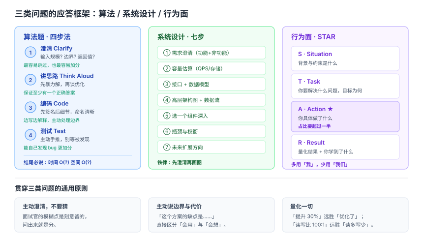

# 面试方法论与答题框架

> 整理日期：2026-10-13 ｜ 定位：对标 yangshun/tech-interview-handbook 与 jwasham/coding-interview-university 的「面试流程与准备」章节。前面几篇讲知识，这一篇讲**怎么把知识用出来**。

## 结论

- 面试是**一场结构化的沟通**，不是知识测验。同样的知识点，**有框架地表达**能显著提高通过率。
- 三类问题各有固定套路：**算法题**考「澄清 → 思路 → 编码 → 测试」；**系统设计**考「澄清 → 估算 → 架构 → 权衡」；**行为面**考 **STAR**（情境-任务-行动-结果）。
- 最容易被低估的一环是**主动澄清需求**与**主动说出边界**。这两点直接决定面试官把你归到「会用」还是「会想」。
- 算法题的真正门槛是**模式识别**，不是刷题量。Blind 75 覆盖的题型模式比 Random 500 题更有效。

## 一、算法题：四步应答法

### 第一步：澄清（Clarify）—— 最容易被跳过，也最容易加分

开口就问，不要默默假设：

- **输入规模**？n 是 10 还是 10⁶？——直接决定 O(n²) 能不能用。
- **数据范围与边界**？是否为空？是否有序？是否有重复？是否可能溢出？
- **返回值要求**？返回索引还是值？找不到返回什么？
- **是否允许修改原数组**？

> 面试官故意留模糊点，就是为了看你问不问。**问出来就是分**。



### 第二步：讲思路（Think Out Loud）

在写代码前，**先用例子手推一遍**，并主动比较至少两种解法：

```text
暴力解法：两层循环，O(n²)，好处是简单直观
优化方向：用哈希表把查找降到 O(1)，时间 O(n)，空间 O(n)
我倾向第二种，因为 n 可能到 10⁵，O(n²) 会超时
```

**关键**：先说暴力解，再说优化。这既展示了思维的完整性，也保证你至少有解。**不要一上来就闷头写最优解**。

### 第三步：编码

- **模块化**：先写函数签名和主流程，再填细节。
- **命名清晰**：`i/j` 只用于循环，业务变量用有意义的名字。
- **边写边解释**，保持沟通。
- **主动处理边界**：空输入、单元素、越界。

### 第四步：测试

写完**主动**用手推例子跑一遍，不要等面试官发现 bug：

- 用澄清阶段确认的边界用例。
- 用一个正常用例。
- 用一个特殊用例（空、单元素、全相同）。

**能自己发现并修复 bug，比一次写对更能体现工程能力。**

### 复杂度必须主动说

每道题结尾都补一句：「时间 O(?) 空间 O(?)」——这是标准动作，不说会显得不专业。

## 二、模式识别：Blind 75 的核心题型

刷题的正确方式是**按模式归类**，而不是按题号顺序。以下是最常见的模式：

| 模式 | 识别信号 | 典型题 |
|---|---|---|
| **双指针** | 有序数组、两数之和、去重 | 两数之和 II、三数之和、盛水容器 |
| **滑动窗口** | 连续子数组/子串的极值 | 最长无重复子串、最小覆盖子串 |
| **快慢指针** | 链表环、找中点 | 环形链表、找重复数 |
| **二分查找** | 有序或「可行域单调」 | 搜索旋转数组、二分答案 |
| **哈希表** | 需要 O(1) 查找、计数 | 两数之和、字母异位词分组 |
| **栈** | 括号匹配、单调性 | 有效括号、每日温度 |
| **BFS/DFS** | 网格、图、树遍历 | 岛屿数量、层序遍历 |
| **回溯** | 求所有方案、排列组合 | 全排列、子集、N 皇后 |
| **动态规划** | 求最值、可拆子问题 | 背包、LIS、编辑距离 |
| **贪心** | 局部最优可推全局 | 跳跃游戏、区间调度 |
| **堆** | Top K、流式中位数 | 数组中第 K 大、合并 K 个链表 |
| **前缀和** | 区间求和、子数组和 | 和为 K 的子数组 |
| **并查集** | 连通性、分组 | 朋友圈、冗余连接 |
| **Trie** | 前缀匹配、词表 | 实现 Trie、单词搜索 II |

**方法**：每刷完一题，问自己「这题属于哪个模式」，而不是记住题解。同一模式的题会越做越快。

## 三、系统设计题：七步模板

已在《系统设计与分布式面试知识体系》中详述，此处给**时间分配**（以 45 分钟计）：

| 时段 | 动作 | 目的 |
|---|---|---|
| 0–5 min | **需求澄清**：功能范围 + 非功能指标 | 不建错东西 |
| 5–10 min | **容量估算**：QPS、存储、带宽 | 让设计有量级依据 |
| 10–15 min | **接口设计** + 数据模型 | 明确边界 |
| 15–30 min | **高层架构图** + 数据流 | 主干成型 |
| 30–40 min | **选一个组件深入**（面试官通常指定） | 展示深度 |
| 40–45 min | **瓶颈与权衡** + 扩展方向 | 展示成熟度 |

**两条铁律**：
1. **必须先澄清再画图**。
2. **每个决策都主动说代价**。

## 四、行为面：STAR 框架

几乎所有行为问题都可以用 **STAR** 回答：

- **S**ituation（情境）：背景是什么，约束是什么。
- **T**ask（任务）：你要解决什么问题，目标是什么。
- **A**ction（行动）：**你**具体做了什么（重点，要占一半以上篇幅）。
- **R**esult（结果）：**量化**的结果 + 你学到了什么。

### 高频行为问题与准备要点

| 问题 | 考察点 | 准备方向 |
|---|---|---|
| 最有挑战的项目？ | 技术深度与解决能力 | 选一个技术难点清晰的，讲清「难在哪、你怎么破的」 |
| 与同事意见冲突？ | 协作与沟通 | 展示「用数据/实验说服」而非「谁声音大」 |
| 线上事故处理？ | 应急与责任心 | 讲清「止血 → 定位 → 根因 → 改进」闭环 |
| 失败的项目？ | 反思能力 | 诚实讲失败，重点在**学到了什么、之后怎么改** |
| 为什么离职/选我们？ | 动机与匹配度 | 绑定对方业务与你的成长方向，不谈前东家坏话 |

**关键技巧**：
- **多用「我」少用「我们」**——面试官要评估的是你。
- **量化结果**：「提升 30% 性能」比「优化了性能」有力十倍。
- **准备 5~6 个可复用的故事**，能覆盖绝大多数问题。

## 五、向面试官提问（反向面试）

面试是**双向选择**。结尾的提问环节既是礼貌，也是你评估公司的机会。**不问问题会被视为不感兴趣**。

**推荐的问题**（体现你在认真考虑）：

- 团队目前最大的技术挑战是什么？
- 这个岗位的日常工作节奏是怎样的？代码评审流程如何？
- 团队如何做技术决策？有没有技术债的规划？
- 新人入职前三个月通常做什么？
- 团队怎么衡量工作成果？

**避免的问题**：能一搜就有的（如「公司做什么业务」）、过于关注福利（第一轮就问年假）。

## 六、全流程时间线

以校招/社招常见的 4~8 周准备期为例：

```text
第 1 周    摸底 + 定目标：明确目标岗位，做一套模拟题定位短板
第 2~4 周  基础补强：每天 2~3 道算法（按模式刷）+ 1 个知识专题
第 5~6 周  系统设计 + 项目梳理：把项目改写成 STAR 故事
第 7 周    模拟面试：找人真实模拟，练表达与节奏
第 8 周    冲刺 + 投递：复习错题，准备提问清单
```

**节奏建议**：算法靠**持续**（每天少量）而非突击；知识专题靠**集中**（一次把一个主题吃透）；行为面靠**提前写稿**。

## 七、高频对比速查

| 问题 | 一句话答案 |
|---|---|
| 算法题第一步做什么？ | 澄清输入规模、边界、返回值 |
| 先写暴力解还是最优解？ | 先讲暴力解再优化，保证有解且完整 |
| 卡住了怎么办？ | 说出当前思路和卡点，请求提示，而不是沉默 |
| 写完代码做什么？ | 主动手推测试用例并跑边界 |
| 复杂度要主动说吗？ | 要，每题结尾必说时间/空间复杂度 |
| 系统设计第一步？ | 需求澄清，绝不能直接画架构 |
| 系统设计怎么拿高分？ | 每个决策主动说代价与权衡 |
| 行为面用什么框架？ | STAR，Action 部分要占一半以上 |
| 讲项目多用「我」还是「我们」？ | 多用「我」，面试官评估的是你 |
| 结尾要提问吗？ | 要，且要问体现你在认真考虑的问题 |
| 刷题靠量还是靠模式？ | 靠模式，按模式归类比按题号刷更有效 |

## 建议

- **把每个知识专题都练到「能讲 3 分钟」**。懂和能讲清楚是两个层次，面试考的是后者。
- **录音复盘**。自己讲一遍录下来回听，能立刻发现「嗯啊」口头禅和逻辑跳跃。
- **准备一张「项目速查表」**：每个项目一行——难点、你的角色、量化结果、可延伸的问答点。面试前 5 分钟扫一遍。
- **不要背题解，要背思路**。面试官稍改条件，背题解的人立刻露馅。
- **心态**：面试是概率游戏，被拒不代表能力差。保持节奏比一次成败重要。

## 待核实

- 各公司面试流程（轮次、是否有笔试/HR 面）差异较大，具体以目标公司当年校招/社招公告为准。
- 刷题平台题目编号与题面会更新，本文只提模式不绑题号，引用时请以平台当前题目为准。

## 来源清单

- yangshun/tech-interview-handbook — 面试全流程、算法策略、行为面与 offer 谈判
- jwasham/coding-interview-university — 学习计划与「面试流程与通用准备」章节
- kdn251/interviews — 数据结构/算法讲解与面试资源索引
- ashishps1/awesome-leetcode-resources — 模式化刷题与 Blind 75 / Top Interview 题单
- 本文方法论基于上述公开仓库的框架整理，具体流程以目标公司为准。
