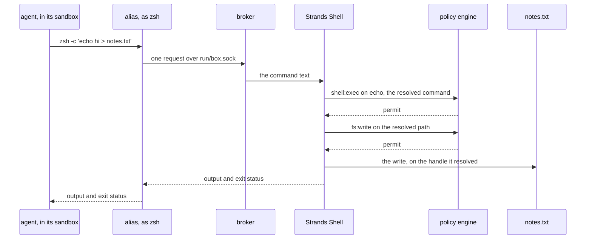

# Strands Box 设计与架构调研

<!-- AI:BEGIN -->
## 问题与范围

用户已确认：用通俗中文解释当前 Box 项目的目的、设计思想和架构，再压缩成入门笔记并归档。此次核实基于本地文档、关键执行代码和测试源码阅读，不涉及代码修改。

## 实际读取的资料

- 来源项目：`/Users/dudongxu/Desktop/codex/box`。
- Git origin：`git@github.com:strands-agents/box.git`，从本地 Git 配置读取；本次没有访问远程仓库。
- HEAD：`331d563e8599b4359f9578ea377fc4f2d0dccce7`；归档前 `git status --short` 未输出变更。
- Box 包声明版本：`0.1.0`；策略依赖 `dogwood-language` 与 `dogwood-local-engine` 均固定为 `1.0.0`。版本依据为本地 Cargo.toml，不代表远程最新发布版本。
- 文档与代码核实日期：2026-10-09。
- 下列摘录来自本地实际文件，保留原路径与行号，归档后可直接复查；英文摘录为原始证据，知识解释使用中文。

## 发现与证据

### S1：项目定位与预览平台

支持项目定位、配置入口、沙箱外执行策略，以及 macOS Apple silicon 预览声明。

- 原始文件：`/Users/dudongxu/Desktop/codex/box/README.md`
- 位置：第 26–49 行
- 源码快照：`331d563e8599b4359f9578ea377fc4f2d0dccce7`

```text
## Overview

Strands Box is an open source sandbox for AI agents.
It combines operating-system isolation with semantic policies
written in [Dogwood](https://dogwood-policy.github.io/dogwood/), so you can control
what agents can access and the conditions under which they can act.

Box is harness-agnostic. You choose the agent program or binary to run, configure
its access in `box.toml`, and write its policies in `policy.dw`.

The host OS enforces the direct access restrictions in `box.toml`. Strands Shell,
Monty for Python, the egress gateway, and the MCP broker send the operations
they handle to the embedded Dogwood Local Engine, which evaluates the rules in
`policy.dw`. Box enforces its allow or deny decisions outside the agent process.

Dogwood uses `permit` and `forbid` rules. Operations checked by the engine are
denied by default: a matching `permit` must allow the operation, and a matching
`forbid` overrides that permission.

Box's interpreters and gateways share an event history, so rules can use earlier
actions and elapsed time to decide what is allowed next. For example, a file read
through Shell or Python can cause the gateway to deny a later outbound HTTP request.

**Preview:** Box currently supports local execution on macOS with Apple silicon.
```

### S2：不可信 Agent 的设计前提

支持假定 Agent 已受攻击、边界持有凭证，以及记录决定的设计原则。

- 原始文件：`/Users/dudongxu/Desktop/codex/box/docs/design/tenets.md`
- 位置：第 1–18 行
- 源码快照：`331d563e8599b4359f9578ea377fc4f2d0dccce7`

```text
# Tenets (unless you know better ones)

*In priority order: when tenets conflict, higher wins.*

1. **Assume the agent is compromised.** Enforcement fails closed and sits beyond the agent's reach; controls inside the boundary are floors, not walls. Defense in depth: no single mechanism is assumed foolproof, and every prior-art system we studied broke by failing open or by trusting its own glue.

2. **The agent never holds the secret.** Credentials are injected at the boundary and scoped to the destination; requests are authorized by who is asking, not just where they're going. An allowlisted endpoint is still an exfiltration channel if anything in the sandbox can use it.

3. **Secure by default, workable by default.** A developer brings the framework of their choice and gets an agent that is contained out of the box and still does its job; major frameworks work without adaptation. We never buy convenience with fail-open defaults.

4. **Log the decision, not just the event.** Every allow and deny is reconstructable: what was asked, by whom, and why it was decided that way. We are honest about limits: traffic we don't terminate is logged at connection level, and telemetry never becomes a credential hole inside the boundary.

5. **Portable in definition, honest in guarantees.** The same agent definition runs on a laptop, in a container, and inside a MicroVM, over open standards and multiple protocols. Each platform gets its highest security posture, never the lowest common denominator; we surface the per-platform differences and refuse to run silently degraded.

6. **Extensible at the edges, fixed at the core.** Backends are pluggable behind honest capability reporting; the policy engine is part of the trusted core and is never swappable.

7. **Performance is a constraint, not an afterthought.** Security is additive, never the reason an agent fails to do its job. Enforcement stays local, minimizing latency and external dependencies.

```

### S3：直接访问与代办请求分工

支持两条访问路径、直接访问不进入策略，以及过宽文件规则可触及凭证文件。

- 原始文件：`/Users/dudongxu/Desktop/codex/box/docs/design/policy.md`
- 位置：第 23–44 行
- 源码快照：`331d563e8599b4359f9578ea377fc4f2d0dccce7`

```text
A box has two enforcement tiers. The sandbox grants come from `box.toml`, and Box fixes
them before the first process starts. They bound the system calls the workload makes itself. Policy
comes from `policy.dw`, written in Dogwood, a superset of Cedar that adds history rules ([the policy
language is Dogwood](decisions.md#the-engine-is-dogwood)). It decides each request the workload
makes through the box's trusted process: a command or file operation in Strands Shell, the box's shell; an
`os` call in Monty, the box's Python; an outbound connection or HTTP request through the egress
gateway; and a message to an MCP server.

Each tier covers its own route. When a list in `[agent.filesystem]` grants a path, the workload
reaches it directly, and policy never sees that access ([a direct grant replaces the policy
decision](decisions.md#a-direct-grant-replaces-the-policy-decision)). The same goes for what a tool or a
local MCP server does on its own, inside its own sandbox ([a tool reaches only the paths its own
lists name](decisions.md#a-tool-reaches-only-the-paths-its-own-lists-name), [a stdio MCP server runs
contained](decisions.md#a-stdio-mcp-server-runs-contained)). In the other direction, a
`permit` never changes what the workload's own system calls reach.

Reach through the box's trusted process is wide, though. The two interpreters, the Shell and Monty, can
name anything under the operator's home, so one `fs:read` permit with no path condition reads
`~/.ssh` and `~/.aws` through either of them. This is the widest exposure in the product, and the
one floor beneath policy, the reachable paths check described below, never names those paths ([no credential
floor sits beneath the
interpreters](decisions.md#no-credential-floor-sits-beneath-the-interpreters)).
```

### S4：统一授权与默认拒绝

支持每个 Box 一个引擎、共享历史、默认拒绝与禁止规则优先。

- 原始文件：`/Users/dudongxu/Desktop/codex/box/docs/design/policy.md`
- 位置：第 48–66 行
- 源码快照：`331d563e8599b4359f9578ea377fc4f2d0dccce7`

```text
Each box runs exactly one policy engine, inside its own trusted process, and every caller asks that
engine ([a box has exactly one policy engine](decisions.md#one-policy-engine-per-box)). One engine
means one history, so a rule can key a network decision on something the workload read through the
Shell. With two engines, that rule would load in both and fire in neither. Every decision runs
in-process, behind one lock, with no network call ([every decision is local and
in-process](decisions.md#every-decision-is-local-and-in-process)). The engine itself is the
published Dogwood engine, pinned to an exact version, and everything Box adds around it sits behind
one facade ([the policy crate exposes one
facade](decisions.md#the-policy-crate-exposes-one-facade)).

The policy is the only thing that can say yes. Nothing is compiled into the engine, so an empty or
absent policy denies everything. Rules compose under deny-overrides: a `forbid` beats a `permit`,
and a request no `permit` matches is denied. So a `permit` can only widen, and every restriction,
including a cap or a rate limit, has to be a `forbid` ([composition is
deny-overrides](decisions.md#deny-overrides-composition-with-no-compiled-rule-tier)).

Every other check on a mediated path is a deny-only floor. A floor can refuse what policy permits,
and it can never permit what policy refused ([the policy is the only decision
authority](decisions.md#the-authored-policy-is-the-only-decision-authority)):
```

### S5：受信任进程与处理组件

支持一个 run 管一个 Box、请求分发、Shell 与 Monty 的职责，以及解释器状态不跨请求。

- 原始文件：`/Users/dudongxu/Desktop/codex/box/docs/design/architecture.md`
- 位置：第 18–79 行
- 源码快照：`331d563e8599b4359f9578ea377fc4f2d0dccce7`

```text

The box's trusted process is `strands-box run` itself. The operator starts it, it starts everything
else, and it never runs inside a sandbox. It holds the policy engine and the four enforcement points
that ask it: Strands Shell, Monty, the egress gateway, and the MCP broker. Beside them, the broker
routes each request from the agent to the right enforcement point, and the collector records each
decision. Two more parts sit at the boundary: the trampoline, which applies a sandbox and then
becomes the contained program, and the alias, the one Box program inside the agent's sandbox.

One `run` is one box. It holds that box's policy engine, its interpreters, its gateway, its
certificate authority, and only that box's secrets. A shared process would hold every box's
plaintext secrets and signing keys in one address space, where one memory-safety failure reaches them
all ([each box has one trusted process](decisions.md#one-trusted-process-per-box)). It holds an
exclusive lock on a file inside the box directory for its whole life, so a second `run` against the
same box directory refuses rather than opening a second engine ([one `run` owns one box
directory](decisions.md#one-run-owns-one-box-directory)). Box needs no verb to stop or delete a box:
the caller ends the process, and removes the directory.

### The policy engine

The policy engine decides every request the workload makes through the trusted process, and it is the
only authorizer. No other part holds a verdict of its own ([the authored policy is the only decision
authority](decisions.md#the-authored-policy-is-the-only-decision-authority)). A box whose policy
grants nothing starts, and then refuses every effect.

There is exactly one engine per box, and every enforcement point shares it ([a box has exactly one
policy engine](decisions.md#one-policy-engine-per-box)). That one shared history is what lets a rule
connect a file read through the Shell with a later request through the gateway. The history belongs
to the box rather than to the run, so it carries across runs ([history is durable per
box](decisions.md#history-is-durable-per-box-and-has-no-rewind)). [Policy](policy.md) covers how a
request is decided and what a history rule can see.

### The broker

The broker accepts the alias's connections on `run/box.sock`, in the box directory, and it
authorizes nothing itself. It has three legs, one for each kind of request: Strands Shell takes a
shell command, Monty takes a Python script, and the MCP broker takes a request to a local MCP server.
The broker checks the protocol version, reads which leg the request named, and hands the request
over.

The alias is part of the workload, so the broker treats every alias as hostile ([an interpreter runs
beside the workload](decisions.md#interpreters-are-brokered-aliases)).

### Strands Shell

[Strands Shell](shell.md) runs every shell command the agent issues, and it is where a command
becomes a decision. It raises `shell:exec` on the resolved command, then an `fs:*` action for each
file that command touches. A program the Shell does not implement raises `shell:spawn` and runs in
its own sandbox, separate from the agent's ([the sandboxes](#the-sandboxes)).

### Monty

[Monty](monty.md) runs Python, and it performs no I/O of its own. Each file operation a script makes
pauses the interpreter, Box decides it, and Box performs only what policy permits. A script reaches
the network through one function.

Neither interpreter keeps state across a call, so a variable exported in one command is unset in the
next ([no interpreter state crosses a call
boundary](decisions.md#no-state-crosses-a-call-boundary)). Both run in the trusted process, beside
the policy engine, the certificate authority key, and the resolved secrets. That placement is stated
residual risk: what makes it acceptable is mediation rather than memory safety, so a memory defect in
either interpreter is code execution in the trusted process ([both interpreters run in the trusted
process](decisions.md#the-interpreters-run-in-the-trusted-process)).
```

### S6：网关、MCP 与记录

支持网络默认经网关、凭证注入、网络例外、本地 MCP 启动与调用检查，以及决定记录。

- 原始文件：`/Users/dudongxu/Desktop/codex/box/docs/design/architecture.md`
- 位置：第 81–125 行
- 源码快照：`331d563e8599b4359f9578ea377fc4f2d0dccce7`

```text
### The egress gateway

The gateway is the box's only route out. Box points every sandboxed process at it with the standard
proxy environment variables (`HTTPS_PROXY` and its siblings), and the sandbox holds each process to
it, so a client that ignores those variables reaches nothing. A tool or a stdio MCP server for which
the operator declares a network exception is the one way past it, and that exception is stated
residual risk ([a declared network
exception](decisions.md#native-egress-is-an-operator-declared-leaf-escape)). The gateway terminates
each connection, which is why no tunnel is opaque to the boundary ([the gateway terminates every
connection](decisions.md#no-connection-is-opaque-to-the-boundary)). It raises `net:connect` for each
destination and `http:request` for each request, and it holds no allow list of its own.

The gateway is also where a credential is added, because the workload never holds one. The workload
gets a placeholder, and the gateway swaps in the real secret on a permitted request to the destination
the operator bound it to ([the workload holds a phantom
token](decisions.md#the-workload-holds-a-phantom-and-the-gateway-holds-the-secret),
[how Box keeps credentials out of the box](credentials.md)). A binding reaches nothing by itself:
policy still decides the connection and the request, so each destination needs its own permit ([a
credential binding is
configuration](decisions.md#a-credential-binding-is-configuration-not-a-policy-action)).
[How Box controls outbound traffic](egress.md) covers the route and the decisions.

### The MCP broker

The MCP broker is the broker's third leg. The other two legs are interpreters. The MCP broker is the
broker's own code, and it is the enforcement point for a request to a local MCP server. Each stdio
server runs in its own sandbox, separate from the agent's, and it starts only when the agent runs
the server's alias and a `shell:spawn` permit admits it ([every MCP server is one configuration
table](decisions.md#an-mcp-server-is-one-configuration-table)). After that, the MCP broker raises
`mcp:call` on each request the agent sends to the server. A permit on `mcp:call` covers every tool
on that server, and a rule on a tool's own action can narrow it ([an MCP tool call passes two
gates](decisions.md#mcp-authorization-is-two-gates)). A remote MCP server takes the gateway's route
instead, and the gateway raises the same `mcp:call`. [How Box runs MCP servers](mcp.md) covers both
routes.

### The collector

Every box records each decision it takes, by default, to a file the workload cannot reach ([the
default target](decisions.md#every-box-records-by-default)). The enforcement point submits the
record, not the engine, so what the record names is the decision as it was enforced, including a
reachable paths check that overrode a permit ([the canonical
record](decisions.md#the-effective-decision-is-the-canonical-record)).

The collector also receives the agent's own spans, which makes it the one part of the trusted process
the workload can post to. [Telemetry](telemetry.md) covers what that costs and why the workload can
```

### S7：工具的独立沙箱

支持工具各自的访问范围、启动授权，以及工具内部文件操作没有逐次 fs 策略决定。

- 原始文件：`/Users/dudongxu/Desktop/codex/box/docs/design/architecture.md`
- 位置：第 138–158 行
- 源码快照：`331d563e8599b4359f9578ea377fc4f2d0dccce7`

```text
### The sandboxes

A box has two kinds of sandbox, and the trampoline applies both.

**The agent's sandbox** starts with the run, and no policy decision admits it. It's the narrowest:
the agent can run its own `command` and each program its `exec` list names, and nothing else. It's
also the only sandbox with a route back to the box's trusted process, through the aliases and
`run/box.sock`.

**A tool's sandbox, or a local MCP server's sandbox,** starts only when a `shell:spawn` permit admits
the program. It takes its filesystem grants from its own `[tool.<name>]` or `[mcp.<name>]` table,
never from the agent's, and it's wider than the agent's sandbox. It gets no alias and no route to
`run/box.sock`, so the program inside it can't ask Box to act for it. Its own file operations raise
no `fs:*` decision, so its filesystem grants are what bound them, and one `shell:spawn` decision
covers the whole process tree. Its network traffic still goes through the egress gateway, unless
the operator declares a network exception for it ([a host
binary runs in its own
sandbox](decisions.md#a-host-binary-runs-in-a-leaf-box-and-the-policy-is-the-only-allowlist)).
[How Box contains a process](containment.md#the-agents-box-and-leaf-boxes) covers how the two
differ.

```

### S8：凭证持有与使用

支持真实秘密保存在受信任进程、占位值和网关注入，以及同一 Box 内共享凭证路线。

- 原始文件：`/Users/dudongxu/Desktop/codex/box/docs/design/credentials.md`
- 位置：第 1–27 行
- 源码快照：`331d563e8599b4359f9578ea377fc4f2d0dccce7`

```text
# How Box keeps credentials out of the box

An agent needs credentials to do useful work: a model key, a GitHub token, an AWS identity. Box
assumes the workload is hostile, so it never gives a real credential to any process inside a box.
The box's trusted process keeps each secret. The egress gateway adds it to a request on the way out, and
only to a request that goes to a destination the operator bound the secret to.

| A process in the box holds | The box's trusted process holds |
|---|---|
| A placeholder for each `env://` secret, or placeholder AWS keys for a signed route | The real secret, or the means to sign with it |
| The proxy variables and the box's certificate authority | The vault, the egress gateway, and the policy engine |

**A credential is not an authorization.** An `[egress.<name>]` route says which secret rides on a
request to its destinations. It permits nothing. Policy decides each connection and each request,
and a route adds its secret only to a request that policy permits
([a credential binding is configuration, not a policy action](./decisions.md#a-credential-binding-is-configuration-not-a-policy-action)).

**The box is the credential boundary.** Every process in a box gets every route. The gateway can't
tell which process sent a request, so it can't keep a credential from one process and give it to
another ([the box is the credential boundary](./decisions.md#the-box-is-the-credential-boundary)).
A process that must not use a credential belongs in a separate box.

[How Box controls outbound traffic](./egress.md) covers how a request reaches the gateway and how
policy decides it. This page covers what happens to the credential.

## Routes and their sources

```

### S9：允许操作与历史覆盖的局限

支持写入真实文件、不自动撤销、允许目标可能接收可读数据，以及策略看不见直接读取。

- 原始文件：`/Users/dudongxu/Desktop/codex/box/docs/design/limitations.md`
- 位置：第 11–50 行
- 源码快照：`331d563e8599b4359f9578ea377fc4f2d0dccce7`

```text
## Allowed actions can still cause harm

Suppose `hello.txt` holds your notes, and the agent has a grant to write it. The agent replaces the
notes with an empty file. The write succeeds, because it's allowed, even though you wanted the notes
kept. Box restricts what a process can do. It can't tell whether an allowed action matches your
intent.

That plays out in three ways:

- **Allowed writes change real files:** Box doesn't undo them when the agent exits. A broad write
  grant can also change files that other programs read later
  ([a direct grant replaces the policy decision](decisions.md#a-direct-grant-replaces-the-policy-decision)).
- **An allowed destination can receive anything the program can read:** permitting a destination
  doesn't limit what's sent there, so private data the program can read can leave through it. The
  [security tenets](tenets.md) name this risk.
- **An interpreter runs whatever it's handed:** if the agent's `command` is an interpreter such as
  `python3`, the box still bounds what it reaches, but nothing checks that the script does what you
  meant.

## Policy sees only requests that reach it

Policy can make one decision depend on an earlier one. For example, a rule can make the egress
gateway refuse a connection after Strands Shell reads a private file. That only works when the
earlier event reaches the policy engine and enters its history.

Many file reads never do:

- **The agent's own reads:** when the agent reads a file with its own system call, operating system enforcement
  decides, and policy never sees it. The [two paths to a file](containment.md#two-kinds-of-enforcement)
  show the difference.
- **A tool's or a local MCP server's file operations:** inside its sandbox, they raise no policy
  decision.

So a history rule can't account for a read that took one of those routes. The
[policy page](policy.md#durable-history) explains why policy history isn't a complete audit record.

The other direction matters too. Strands Shell and Monty run outside every box, so a broad
filesystem permit lets them reach paths the agent's own grants never could, including credential
stores ([no credential floor sits beneath the interpreters](decisions.md#no-credential-floor-sits-beneath-the-interpreters)).
Keep filesystem permits to the paths the task needs.
```

### S10：保护范围的其他局限

支持资源、内核、受信任组件与日志交付方面的边界。

- 原始文件：`/Users/dudongxu/Desktop/codex/box/docs/design/limitations.md`
- 位置：第 67–90 行
- 源码快照：`331d563e8599b4359f9578ea377fc4f2d0dccce7`

```text
## Protections Box doesn't provide

Box doesn't provide seven protections:

- **Resource limits:** a box doesn't bound process creation, CPU, or disk use, so a program can
  exhaust them while staying inside its grants
  ([children inherit the boundary](decisions.md#children-inherit-the-boundary)).
- **Isolation between tenants:** separating tenants on a shared machine is the hosting platform's
  job ([non-goals](tenets.md#non-goals)).
- **Protection from operating system exploits:** Box relies on the kernel to enforce the sandbox, so
  an exploit that defeats the kernel defeats the box. The same tenets exclude kernel exploits.
- **Isolation of remote servers:** Box decides the requests it forwards to a remote MCP server, but
  it can't contain the server or control what it does with an allowed request.
- **Defects in the box's trusted process:** Strands Shell, Monty, the gateway, and
  Dogwood run outside every box. No sandbox contains their defects.
  Box still owns failures of its enforcement
  ([responsibility for enforcement](security.md#box-owns-enforcement)).
- **Protection from side channels:** hardware and timing side channels never reach operating system enforcement or
  policy ([some channels never reach enforcement](decisions.md#some-channels-never-reach-enforcement)).
- **A tamper-proof audit trail:** a box records every decision it makes, but nothing signs a record or
  chains one to the next, so anything that can write the records file can edit it afterwards. A record
  can also be lost without notice ([delivery is best effort](decisions.md#delivery-is-best-effort)).
  [Telemetry](telemetry.md#limits) states what a box does keep out.

```

### S11：源码中的统一策略实例

HostedBox::prepare_policy 打开持久历史并返回 Arc<PolicyEngine>；HostedBox::open 接受该实例。

- 原始文件：`/Users/dudongxu/Desktop/codex/box/crates/box/src/run/hosted.rs`
- 位置：第 484–509 行
- 源码快照：`331d563e8599b4359f9578ea377fc4f2d0dccce7`

```text
impl HostedBox {
    pub(crate) fn prepare_policy(
        root: &BoxRoot,
        operator: &policy::Operator,
        sources: Vec<policy::Policy>,
    ) -> Result<Arc<PolicyEngine>, BoxError> {
        let database_path = root.dogwood_database();
        let database = root.open_dogwood_database()?;
        Ok(Arc::new(
            PolicyEngine::open_staged_file(operator, sources, database, database_path)?
                .observed_by(Arc::new(telemetry::PolicyDecisionObserver)),
        ))
    }

    /// Open this box's trusted half, or refuse. `workspace` and `home` are the agent's effective
    /// working directory and `HOME`, which the interpreters share.
    #[allow(clippy::too_many_arguments)]
    pub(crate) fn open(
        root: &BoxRoot,
        record: &Record,
        policy: Arc<PolicyEngine>,
        collector: Arc<telemetry::Collector>,
        protected_sources: &[AuthoritySource],
        owned: Lock,
        workspace: &Path,
        home: &Path,
```

### S12：策略依赖版本

支持 Dogwood language 与 local engine 固定为 1.0.0。

- 原始文件：`/Users/dudongxu/Desktop/codex/box/crates/policy/Cargo.toml`
- 位置：第 28–44 行
- 源码快照：`331d563e8599b4359f9578ea377fc4f2d0dccce7`

```text
# The policy engine (docs/design/decisions.md#the-engine-is-dogwood). Pinned to
# EXACTLY 4.11.0 — a *security* pin: schema-directed context parsing differs across
# 4.x minors, so the pin is part of the fail-closed contract, not a convenience floor.
cedar-policy = "=4.11.0"
# Generates typed Cedar action schemas from raw MCP tools/list responses.
cedar-policy-mcp-schema-generator = "=0.6.1"
# Parses raw MCP tools/list responses into the generator's server description.
mcp-tools-sdk = "=0.4.1"
# The policy engine. The ONLY decision engine.
# NOTE: `cedar-policy` above stays a DIRECT exact pin even though the Cedar authorizer is
# gone — the schema and the request gate are Cedar types, and Dogwood's own constraint on
# cedar is a caret range, so removing our pin would silently widen it.
dogwood-language = "=1.0.0"
# The single-machine temporal engine. Its durable assembly appends each event before
# evaluation and recovers monitor state from the box's private history file.
dogwood-local-engine = "=1.0.0"
# Fail-closed, typed error model shared by the workspace crates (house style).
```

### S13：Linux 后端存在

仅证明代码中存在 Linux 后端；不证明平台能力一致或运行验证已完成。

- 原始文件：`/Users/dudongxu/Desktop/codex/box/crates/containment/src/backend/mod.rs`
- 位置：第 1–10 行
- 源码快照：`331d563e8599b4359f9578ea377fc4f2d0dccce7`

```text
//! Backend trait and platform-specific implementations.

pub(crate) mod macos;

#[cfg(target_os = "linux")]
pub(crate) mod linux;

use crate::ContainmentConfig;
use crate::error::ContainmentError;
use crate::platform::Platform;
```

### S14：写文件请求的完整示例

支持 echo 重定向需要命令及文件写入决定；此示例来自文档，没有在本次运行。

- 原始文件：`/Users/dudongxu/Desktop/codex/box/docs/design/architecture.md`
- 位置：第 215–267 行
- 源码快照：`331d563e8599b4359f9578ea377fc4f2d0dccce7`

```text
## One command, from the agent to the file

Suppose policy permits `shell:exec` and `fs:write` in the workspace, and the agent runs
`zsh -c 'echo hi > notes.txt'`.



Four things in that path carry the design.

**One command raises more than one decision.** The decision is on `echo`, the command the Shell
resolved, and not on the `zsh` the agent typed. Then each effect that command has raises its own
decision. The redirect is a write, so a policy that permits the command and refuses the write fails
the command before `echo` runs.

**The path is resolved before it is judged.** The Shell resolves `notes.txt` against the working
directory, follows each symlink, and raises the decision on what it resolved. Then it performs the
effect on the object it resolved rather than on the name, so swapping a symlink between the decision
and the effect diverts nothing ([a resolved token binds the object it
names](decisions.md#a-resolved-token-binds-the-object-it-names)).

**A deny-only check runs after the permit.** On the interpreter path the reachable paths check runs
after policy and can only subtract ([a deny-only check cannot be
widened](decisions.md#the-authored-policy-is-the-only-decision-authority)). It refuses a path
outside the operator's home, the agent's home, and the workspace, a path inside the box directory,
and the configuration and policy this run loaded, whatever a permit says. It does not protect
credentials: the Shell can name anything under the operator's home, so an `fs:read` permit with no
path condition reads `~/.ssh` ([nothing beneath the interpreters protects
credentials](decisions.md#no-credential-floor-sits-beneath-the-interpreters)). Scope every rule by
path. [How Box runs shell commands](shell.md) covers what the check refuses.

**The trusted process performs the effect.** The workload holds a socket and nothing else. That is
what puts the file operation on a path a decision can cover, and it is also why the interpreters are
part of what you have to trust.

```

## 冲突与限制

- 资料支持架构说明；本次未启动 Box，未运行构建、测试或性能基准，不能把源码阅读写成运行验收。
- README 声明 macOS Apple silicon 本地预览；代码有 Linux 后端。这两条事实并不相互否定，也不能据此推断两平台能力一致。[S1、S13]
- “门锁”“办事窗口”是便于理解的比喻，属于解释方式，不是项目接口或组件名称。
- 本地终端 Python 与 Codex 附带 Python 运行知识库校验时，均报告缺少 PyYAML。未安装依赖；结构校验与派生索引更新尚未完成。

## 已整理的知识

新增 [[02-Frameworks/Strands Box|Strands Box]] 中文入门笔记。归档前已搜索标题、文件名、aliases 和正文，未发现同主题旧节点。本次未建立结构化技术关系，避免为没有独立笔记的组件制造关系目标。

## 尚待解决的问题

- [[06-Learning-Gaps/Strands Box 平台保护差异|平台保护差异]]：Linux 与 macOS 的实际保证、已测范围和支持状态需要单独核实。
- 知识库校验需要已有 Python 环境具备 PyYAML；未完成校验前，不声称链接和索引验收通过。
<!-- AI:END -->

## 人工笔记

