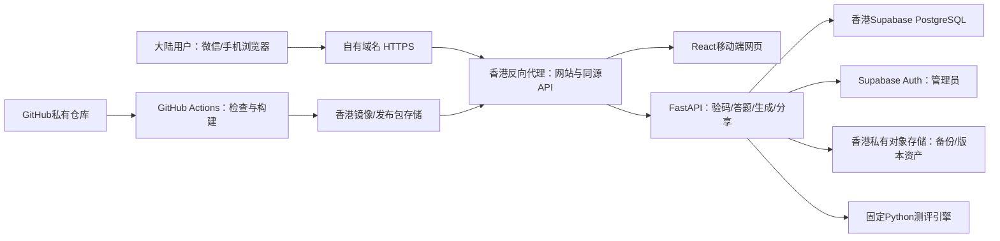

# 四款测评网站技术方案 · V1

日期：2026-10-11。阶段：技术设计，尚未创建GitHub仓库、购买云资源、上线网站或向数据库发放有效测评码。

## 1. 已确认需求与默认规则

用户已确认：**一个码只对应一款测评；每码可成功生成3次结果；没有备案域名，先采用无需VPN的香港部署。** “superbase”按Supabase理解。

| 项目 | 本方案确定规则 |
|---|---|
| 四款内容 | 沿用《四款趣味测评完整方案》V1.1：各24题、96个具体身份版本 |
| 进入测评 | 先输入测评码，通过后展示开始按钮及剩余额度 |
| 使用范围 | 一个码绑定past/next/cat/end其中一个，不能跨款使用 |
| 使用次数 | 上限3次，只有结果快照与扣次事务成功提交才消耗1次 |
| 不扣次数 | 验码、开始、返回上一题、改选、刷新、草稿恢复、查看旧结果、保存图片、复制分享链接 |
| 再测 | 完成后主动开始新一轮；新一轮成功生成结果再扣1次，即使答案与上次相同 |
| 时间有效期 | 暂不设置日历到期日；“3次”按次数理解。后台保留可选expires_at，今后可设置截止日期 |
| 共用规则 | 默认允许同一码被持有者共用，但全码合计只有3次；不同设备不会看见彼此的私有报告 |
| 分享 | 持有结果链接即可只读查看分享快照，无需测评码，不消耗次数 |
| 保存图片 | 手机生成/展示结果海报；支持系统分享、下载和长按保存三种能力分级 |
| 管理端 | 管理员选择一款，一次创建100个码，每码3次；批次最多可支持300次成功测评 |
| 网站可用性 | 大陆无需VPN为验收目标，必须多地区多运营商实测；不声称香港部署天然保证所有人可访问 |

默认有效期、共用与草稿期限可在实现前调整；不是新增短信、支付或用户实名流程。这里的码是商家发放的访问凭证，不是短信验证码，也不等同图形人机验证码。

## 2. 推荐架构：GitHub＋香港应用＋香港自托管Supabase

**GitHub用于私有代码库、版本管理和CI/CD；用户浏览网站时不访问GitHub。Supabase采用香港自托管，数据与API留在香港同一部署环境。**

截至本次核实，Supabase官方托管区域列表未列香港或中国大陆，亚洲选项包括新加坡、东京、首尔等。因此，不能设计成“在Supabase Cloud控制台直接选择香港”。官方支持Docker自托管，香港方案据此搭建。[Supabase托管区域](https://supabase.com/docs/guides/platform/regions)、[Supabase自托管](https://supabase.com/docs/guides/self-hosting)

GitHub Pages有商业网站使用限制；本项目也需要动态扣次和私有管理。采用GitHub仓库配合云服务器部署，不用GitHub Pages承担生产运行。[GitHub Pages限制](https://docs.github.com/en/pages/getting-started-with-github-pages/github-pages-limits)



所有用户运行时资源同源提供：HTML、JS、字体、插画、海报、二维码和API；不引入Google字体、GitHub Raw、jsDelivr、unpkg、国外统计脚本、在线生成模型或必须加载的外部人机验证。API调用Supabase走内网，浏览器无需访问Supabase官方域名。

### 2.1 技术栈与资源建议

| 层 | 选择 | 理由 |
|---|---|---|
| 前端 | React＋TypeScript＋Vite | 手机单题交互，静态资源可本地打包 |
| API | Python FastAPI | 复用已经完成的确定性Python引擎，避免首版跨语言重写产生结果差异 |
| 分享HTML | FastAPI模板渲染公开摘要，并附React入口 | 打开分享链接先看到结果摘要；不依赖社交平台执行JS才能识别页面标题 |
| 数据 | Supabase PostgreSQL，自托管 | 事务、唯一约束、版本快照、码与批次记录 |
| 管理登录 | Supabase Auth＋服务端管理员白名单 | 普通测评用户不必注册；管理后台单独鉴权 |
| 反向代理 | Nginx或Caddy，生产固定其中一种 | 同域HTTPS、静态文件、接口代理与限流 |
| 部署 | Docker Compose，固定镜像版本或摘要 | 可复现部署；不能跟随latest自动变化 |
| 图片 | 专用Canvas海报模板，资产同源 | 版式可控，避免整页DOM截图与超长画布 |
| 备份 | 香港对象存储，私有与加密 | 自托管备份由项目负责 |

一期可采用单台香港服务器运行应用与Supabase，降低部署复杂度，但属于单点部署；后续按实际并发拆分应用与数据库，不把单台称为高可用。Supabase官方给出的完整组件推荐起点是4核、8GB以上内存、80GB以上SSD；本项目拟按至少这个级别试配，再根据海报、API和备份负载调整，采购成本等待预算与云厂商确认。[Docker部署要求](https://supabase.com/docs/guides/self-hosting/docker)

服务必须使用自有域名。香港路线的备案要求与大陆部署不同；云厂商资料说明大陆以外服务器（含香港）不要求其大陆ICP备案。本文只用该资料解释本次部署选择，不对经营资质作全面判断。[阿里云部署地区与备案说明](https://help.aliyun.com/en/icp-filing/basic-icp-service/user-guide/icp-filing-application-overview)

## 3. 页面与用户流程

### 3.1 路由

| 路由 | 功能 | 权限 |
|---|---|---|
| `/` | 四款入口与简介 | 公开 |
| `/t/:slug` | 测评封面＋输入测评码 | 公开封面，题目需授权 |
| `/t/:slug/start` | 剩余次数、开始/继续草稿 | 有效访问授权 |
| `/t/:slug/a/:attemptId` | 单题、进度、上一题、下一题、提交 | 本设备匿名会话且拥有本轮 |
| `/r/:resultId` | 私有完整报告、保存图片、复制结果链接 | 拥有本轮的匿名会话 |
| `/s/:shareToken` | 分享结果摘要、小剧场与海报 | 有效分享凭证，只读 |
| `/admin` | 管理登录 | 管理员 |
| `/admin/codes` | 一次100码、批次列表、导出、停用 | 管理员 |

分享页显示“我也测一测”，跳到对应测评封面；朋友想自己测仍需自己的有效码。公开分享内容包含身份、副标题、金句、文学片段与结果类型，不展示完整原始回答、回答依据题号、访问码、剩余次数、设备或会话数据。

### 3.2 主流程

1. 用户打开测评封面，输入码；服务器验证并建立HttpOnly授权会话。
2. 界面显示“本码可用于：上一世测评”“剩余可生成3次结果”，点击“开始测评”。
3. 服务器建立一轮attempt并暂时预留名额，返回绑定版本的24题。
4. 用户单选后点下一题；上一题能改选，原答案高亮，进度不能误算成已完成题数。
5. 所有24题答完后显示“生成我的结果”；可在提交前返回改选。
6. 服务器验证答案、按固定引擎生成报告，再在一个数据库事务中保存快照、记账、扣次和完成本轮。
7. 返回报告，显示“结果已生成；本码剩余2次”。断网时重复提交本轮只返回原结果。
8. 点击“保存结果图片”或“复制结果链接”；这两类操作无扣次副作用。
9. “再测一次”明确提示将新建一轮，完成后消耗一次。不能在已完成报告上回改答案并覆盖旧结果。

码属于其他测评时，提示该码对应的测评并提供前往按钮；一码只生成一种测评的授权。浏览器会话丢失后可重新验码继续使用剩余额度，但不能借“知道同一码”查询其他设备此前的私有报告。已经复制的分享链接可直接打开。

## 4. 访问码与额度：防超用、防重复扣次

### 4.1 码格式与存储

采用密码学安全随机源生成16位内容码，字符表为`ABCDEFGHJKLMNPQRSTUVWXYZ23456789`（32字符，共80位随机熵），展示为4组、每组4位，方便复制。输入允许大小写与分隔符规范化；服务器只接受规范化后的固定长度字符。不可采用连续数字、自增ID、生日、时间戳或仅4位数字。

数据库用于查找的值为`HMAC-SHA256(server_pepper, normalized_code)`，唯一约束；pepper只在后端秘密配置，版本化保留旧密钥以支持已发放码。访问码明文不进GitHub、公开JSON、日志、监控或前端打包。批量导出的明文由管理员显式下载，短期可用服务端独立密钥进行AES-GCM加密保存，以支持首次响应丢失后的同批次重下；不是在库里存普通明文码。

验证码仅证明持有人有使用资格。禁止把访问码加入URL、二维码、分享链接或浏览器历史。匿名会话用256位随机令牌，数据库只保存令牌摘要；Cookie设置Secure、HttpOnly、SameSite=Lax，状态变更请求校验Origin与CSRF令牌。一码共享不等于报告共享。

### 4.2 不消耗次数的临时预留

如果3个人已经在答题，第4个人不能同时开始，否则可能做完后才发现没额度。开始时预留一个名额，**预留不是扣次**。可开始额度=3－成功扣次－未过期预留；用户界面区分“剩余可生成次数”和“其中几次正在进行”。

默认预留60分钟，正常答题保存或继续时可续期，单轮最长24小时；所有续期均重新检查码状态与预留有效性。主动退出可释放预留。清理按数据库时间判断，登录/开始/提交时懒处理过期记录；定时清理用于收拾状态，不作为安全正确性的必需条件。

过期草稿仍可保存在本地；恢复时在同一码锁内重新申请预留。额度已被其他轮完成占用时，说明原因并保留答案，不能超出3次强行出新结果。停用码不再验码/开始/续期/提交，已成功生成的私有或分享快照仍可查看，除非管理员另行明确撤销分享。

### 4.3 数据库不变量

- `0 <= used_count <= max_uses`，本次`max_uses=3`。
- 成功使用账本每个attempt只有一条，结果每个attempt只有一份。
- 新建或恢复预留必须满足`used_count + live_reservations < max_uses`。
- 提交完成必须属于有效预留；在同一事务中将一个预留变为一次已使用，不能先扣次再写结果。
- 同一匿名会话、同一码已有有效草稿时优先继续，不新建第二个预留。
- 所有修改额度与预留的路径，统一先锁码行再锁attempt行，避免不同锁序产生死锁。

### 4.4 完成事务与幂等

请求包括`attempt_id`、完整内容答案、固定提交幂等键。服务器先验证所有权、题库版本和24题内容键，生成确定性结果候选。数据库事务再次检验权限与额度；客户端不能传入自己选择的身份或分数作为可信结果。

以下为实现约定的事务伪代码，不是已部署RPC：

```text
BEGIN
  锁定 access_codes 对应行 FOR UPDATE
  锁定 attempts 对应行 FOR UPDATE
  验证该attempt归当前会话，测评产品与码一致
  IF attempt已完成:
      若提交答案摘要相同 -> 返回原result；不扣次
      若摘要不同 -> 409，已完成本轮不可改写
  检查码未停用/未到期，attempt仍有有效预留
  检查 used_count < 3
  插入 results（attempt_id唯一）与私有/分享两种固定快照
  插入 usage_ledger（attempt_id唯一）
  UPDATE access_codes SET used_count = used_count + 1
  UPDATE attempts SET status='completed', final_answers_hash=..., result_id=...
COMMIT
返回已保存快照
```

先锁行再检查是为避免并发先读到相同余额；PostgreSQL提供`FOR UPDATE`行锁。服务端事务仍须绑定数据库约束、鉴权和统一调用路径，单有按钮禁用或行锁口号不能防超用。[PostgreSQL行锁说明](https://www.postgresql.org/docs/17/explicit-locking.html)

若数据库提交后HTTP响应丢失，用户重试得到同一result；不能再次扣次。重复幂等键若请求正文不同返回409；即使攻击者换键重放，attempt级唯一账本仍限制只扣一次。校验失败、生成失败或数据库事务回滚均不扣次。海报不是扣次事务的一部分：报告成功后图片失败可重试，无需再付一次额度。

## 5. 数据模型与权限

| 表 | 核心字段 | 约束/索引 |
|---|---|---|
| `assessment_products` | slug、name、active_version、enabled | slug唯一；4款固定slug |
| `assessment_versions` | product_id、question_version、result_version、engine_version、content_digest、asset_manifest、frozen | 产品与版本组合唯一；发布后只新增版本 |
| `code_batches` | id、product_id、count、max_uses、expires_at、created_by、request_key、payload_digest、encrypted_export、export_expires_at | 管理员＋request_key唯一；本次count=100 |
| `access_codes` | id、batch_id、product_id、code_hmac、pepper_version、masked_tail、max_uses、used_count、enabled、expires_at | code_hmac唯一；次数CHECK；产品绑定 |
| `browser_sessions` | id、token_digest、expires_at、created_at | token_digest唯一；不收集手机号 |
| `access_grants` | session_id、code_id、expires_at | 会话与码唯一；只能授权码所属产品 |
| `attempts` | id、code_id、session_id、version_id、status、answers_draft、draft_revision、reservation_expires_at、hard_expires_at、final_answers_hash、result_id | 码＋状态＋期限索引；session索引 |
| `results` | id、attempt_id、version_id、answer_key、report_snapshot、share_snapshot、render_manifest、created_at | attempt_id唯一；snapshot发布后不可覆盖 |
| `usage_ledger` | attempt_id、code_id、result_id、operation、created_at | attempt_id唯一；账本不因报告删除而删 |
| `result_shares` | id、result_id、token_hash、token_ciphertext、enabled、created_at | token_hash唯一；每result一个有效分享入口 |
| `admin_members` | auth_user_id、role、enabled | 只允许后台受权账户 |
| `admin_audit_logs` | actor_id、operation、object_id、request_id、created_at | 禁止保存码明文与答案原文 |

`results`私有快照含可解释回答依据；`share_snapshot`独立投影，不是先返回全部私有JSON再由前端隐藏。答题草稿包含隐私，按实际提供功能配置最短合理保留期；拟草稿7天、匿名会话30天，报告与分享长期保留至撤销或主动删除。历史报告不依赖会话永不过期，丢失私有会话时以已保存的图片或主动分享链接保留公开摘要，产品上线前在界面明确这个匿名访问边界。

核心写操作走后端数据库事务或仅后端可调用的RPC；不在浏览器暴露`service_role`、数据库连接串或码生成函数。业务表关闭anon/authenticated直接读写并启用RLS；普通用户通过同源API按匿名会话与所有权访问。后端使用专用最小权限数据库角色，写操作收敛到受控函数。管理员登录成功不等于管理员授权，还必须通过`admin_members`白名单。

若采用`SECURITY DEFINER`函数，需要固定`search_path`、对象全限定名、内部所有权检查，并撤销PUBLIC/anon/authenticated的默认EXECUTE权限，只给业务角色执行权限。RLS不自动保护绕过RLS的高权限服务密钥。[Supabase RLS](https://supabase.com/docs/guides/database/postgres/row-level-security)、[数据库函数权限](https://supabase.com/docs/guides/database/functions)

Supabase Studio与数据库端口不对普通用户开放，运维管理入口限制访问；网站管理端只开放必要的批次与码操作，不能直接连接Studio执行任意SQL。

## 6. 答题状态与结果一致性

题库由封面授权后API返回，不把全部96个结果文案打入公开前端JS。浏览器保存`question_id -> content_option_key`，正反排列不改变内容键。服务器保留题库/结果/引擎版本；attempt开始时绑定版本，中途发布新版本不改变正在答的题。

前端使用明确状态机：`locked -> verified -> answering -> submitting -> completed`。草稿可处于`expired/cancelled`，完成态不可回写。第一页上一题禁用；未选不能下一题；返回时已选内容保持，重新选立即覆盖草稿。修改某题不会误删其他题，也不会增加次数。已完成后点浏览器返回只读或转到完成页，需要改答就明确新建一轮。

每次选择立即写本机草稿，约300—500毫秒合并保存到服务器。`PATCH`使用`expected_revision`进行乐观锁检查；旧请求晚到返回409，不能覆盖较新草稿。回退只移动游标，答案不丢。客户端显示“已保存/等待网络”，不把网络慢误当额度不足。

提交前冻结当前前端答案、停止并等待草稿保存；若存在多标签页冲突要求重新确认，不盲目覆盖。完成请求以用户确认的24题完整答案为最终输入，服务器验证并写成不可变final答案摘要。提交后任何晚到草稿PATCH都被完成态拒绝。正式扣次不依赖draft PATCH是否最后成功，因为完整答案已随提交发送。

复用`确定性结果生成参考.py`与`测评结果内容库-v1.1.json`，以当前参考引擎作为首版服务端权威。API映射层只处理权限与存储，不重写分类逻辑。依据产品、题库/引擎/结果版本、规范化答案与内容摘要生成`answer_key`。相同输入的身份、副标题、正文、引用依据与候选顺序固定；零分、临界分和并列顺序沿用原方案。

报告正文、分享正文和海报文案保存快照，旧结果读取快照，不按最新文案重新解释。结果ID、生成时间、匿名会话、分享凭证是访问元数据，可能因测评轮次不同而不同；它们不能参与身份选择。安全随机分享链接并不意味着随机测评结果。若海报包含二维码，二维码只对应该报告的访问链接，故事与身份仍固定。

现有本地校验已验证1024组答案重复/重排/重载/展示映射及四款跨进程一致性；网站开发仍须补API与页面端到端验证，不能拿本地通过代替网站已上线。

## 7. API契约与异常反馈

均为同源HTTPS路径，所有JSON错误带`error_code`、用户可读消息与脱敏`request_id`，不返回数据库内部异常。敏感响应`Cache-Control: no-store`。

| 方法/路径 | 请求要点 | 响应与约束 |
|---|---|---|
| `POST /api/access/verify` | code、product_slug | HttpOnly会话＋product＋used/remaining/reserved；不扣次 |
| `GET /api/access/status` | 会话授权 | 当前码额度与本设备草稿，不列他人结果 |
| `POST /api/attempts` | product_slug、客户端request_key | 在码锁内预留；同会话有效草稿优先返回；重试同键不多占 |
| `GET /api/attempts/:id` | 本轮所有权 | 固定版本24题、展示顺序、草稿、revision、预留期限 |
| `PATCH /api/attempts/:id` | expected_revision、答案变化、游标 | 原子比较revision；成功返回新revision；不扣次 |
| `POST /api/attempts/:id/resume` | 本轮所有权 | 续有效预留或重新预留；不足时409且不丢草稿 |
| `POST /api/attempts/:id/cancel` | 本轮所有权 | 释放预留；完成态不能取消扣次 |
| `POST /api/attempts/:id/complete` | 24题完整答案、Idempotency-Key | 服务端生成＋一个事务提交；重放返回原result |
| `GET /api/results/:id` | 本轮所有权 | 私有快照和海报模型，查看不扣次 |
| `POST /api/results/:id/share` | 本轮所有权、CSRF | 显式创建/返回当前分享链接；重复点击返回同一有效链接 |
| `DELETE /api/results/:id/share` | 本轮所有权、CSRF | 撤销分享，不撤销扣次 |
| `GET /api/public-results/:token` | 分享凭证 | 仅公开投影；无答案、无code、无owner数据 |
| `GET /api/results/:id/poster` | 本轮所有权 | 可选服务端海报降级，按结果/模板版本缓存；不扣次 |
| `POST /api/admin/code-batches` | product_slug、count=100、max_uses=3、可选expires_at、Idempotency-Key | 管理员；一次原子建批；重试返回同批次 |
| `GET /api/admin/code-batches` | 管理员，分页/产品筛选 | 批次统计，不能无界导出 |
| `GET /api/admin/code-batches/:id/export` | 管理员，审计 | 下载CSV；短期加密导出有效，超期不重发另一批冒充 |
| `PATCH /api/admin/codes/:id` | 管理员、enabled、原因 | 停用/恢复，已用次数不归零 |

错误规则：无会话401；所有权不匹配用404或统一无权限；非法答案422；草稿冲突、额度占用或已完成改答409；猜码/超速429；数据库故障503且不得假装成功。码不存在/码格式错误对普通用户统一“测评码无效，请检查”；已知合法码的过期、停用、用尽给明确说明。余额不只按前端缓存判断。

## 8. 保存图片到相册与复制链接

### 8.1 海报内容与输出

默认生成便于手机分享的竖版PNG，建议1080×1920像素；短句、身份插画、副标题、小剧场与品牌标记组成一张海报，不把24题或整份长报告挤进去。混合结果使用固定“多面身份”布局，保留候选名称；多候选超出一张可用固定2页，不偷偷随机选一个。

前端通过独立Canvas模板绘制，等同源字体与图片加载完成再`toBlob('image/png')`。插画资源和版式绑定render_manifest，不能只给旧报告引用一个会被覆盖的最新图片URL。图片尺寸、最大候选数与绘制流程固定，避免高DPR手机放大到巨大画布；字体允许加载失败时采用明确降级并提示重试。[Canvas toBlob](https://developer.mozilla.org/en-US/docs/Web/API/HTMLCanvasElement/toBlob)

### 8.2 能力分级

普通H5网页不能跨所有手机静默写入系统相册。按钮文案可以是“保存结果图片”，操作反馈必须真实，不在未保存时弹“已保存到相册”。

1. 结果页预先准备图片Blob；用户点击时检查`navigator.canShare({files})`，支持则调用系统文件分享，用户选择保存图片等目标。
2. 不支持文件分享则通过Blob URL与下载链接提供PNG；成功触发下载只提示“已打开下载，请在下载记录查看”。
3. 微信内置浏览器或下载失败时弹出真实图片预览，提示“长按图片保存到相册”；另提供“在浏览器打开”的操作指引。
4. 客户端绘制失败或内存不足，保留报告并提供服务端固定模板海报降级；海报重试不能再扣次。

Web Share需HTTPS、用户操作且浏览器支持，目标由系统决定，不保证一定出现“保存到相册”。若需要等网络生成文件，先准备好图片再让用户点分享，避免异步等待使用户激活失效。[MDN Web Share](https://developer.mozilla.org/en-US/docs/Web/API/Navigator/share)、[W3C Web Share](https://www.w3.org/TR/web-share/)

### 8.3 分享凭证与复制

用户点击复制链接时，先创建唯一分享记录，再准备可读的链接。分享token使用256位密码学随机值；数据库以token摘要查找，以独立密钥加密保存明文供同一结果重复复制。不能用自增result_id、访问码或可计算的答案哈希作为公开凭证。

链接形式`https://<网站域名>/s/<随机token>`，不含答案、用户名、测评码与剩余次数。持链接可看公开快照，无需验证码；链接不是编辑权限。分享页`noindex`、`Referrer-Policy: no-referrer`，不加载第三方分析脚本，访问日志对token脱敏；有二维码时只嵌入分享链接。

复制优先`navigator.clipboard.writeText(url)`，失败则显示只读文本框与手动选中复制。首次异步创建分享后如果浏览器不允许自动剪贴板写入，提供清楚的二次“点击复制”按钮；仅当API确认写入成功才提示“已复制”。剪贴板接口要求安全上下文并可能被浏览器拒绝。[MDN Clipboard](https://developer.mozilla.org/en-US/docs/Web/API/Clipboard/writeText)

公开结果支持标题、描述和缩略图元信息，但不承诺微信一定显示自定义分享卡片；浏览器直接复制的URL不等于完成微信JS-SDK配置。微信SDK、认证公众号、短信与支付不属于首版依赖。

## 9. 管理后台一次生成100个码

流程：管理员登录→选测评→数量默认100→每码3次→可选截止日期→确认生成→查看批次→下载CSV。四款分别生成各自批次；一次选一款生成100码，不默认一个批次混入四款。需要四款各100时操作4批，共400码。

后台仅允许白名单管理员，建议管理员启用第二因素；登录不依赖用户连接GitHub。生成前后显示绑定测评、数量、总额度和有效期，不让选错产品后靠前端临时改码归属。

批次RPC流程：验证管理员与Idempotency-Key→检查请求正文摘要→生成100个安全随机码→碰撞重试→一个数据库事务插入批次、100码与审计→提交后提供下载。任何一条失败整批回滚；响应丢失后同键重试返回同批次加密导出，同键不同正文409。导出失败不自动再建一批。CSV含批次号、测评名称、测评码、最大次数、已使用、截止日期；以UTF-8 BOM输出便于中文Excel打开，文本字段按CSV格式转义并防公式注入。

建议首次导出副本最多保留24小时、只限受权管理员重下，后删除服务器加密导出载荷，保留码摘要、脱敏尾号与审计。超过导出有效期，不能恢复明文，也不能把新生成的100码当作原批次；界面提示导出期已过。运营人员自行保存和发放下载文件；本阶段不自动给用户发送消息。

管理页可查询已用/剩余、停用单码与整批码、按产品筛选。不通过重置used_count补额度；误扣等售后流程另记有依据的调整账本，由明确的管理员动作执行，避免破坏“每码3次”审计。首版不自动退款、不关联支付订单。

**本次只设计批量发码能力，尚未接入生产数据库，不交付冒充可用的100个本地随机码。** 实施后由后台事务生成，才能作为有效凭证发放。

## 10. 移动端适配与体验验收

- 手机优先，内容区最大宽度约480px，桌面居中；支持320—430px常见宽度及横屏，不以单一手机截图写死页面。
- 选项点击区域至少44px，整块可选；题干与选项保持可读，长中文自然换行，不依赖悬浮提示。
- 一题一屏但不强制固定屏高；长题可滚动，底部操作适配`safe-area-inset-bottom`，输入键盘展开不遮住验码按钮。
- 图片加载显示占位，验证/提交按钮有处理中状态；连续点击不新建多轮或多扣次数。
- 存储按attempt分区，多个测评/多个标签页不共用同一个草稿键；返回前一题、刷新和网络恢复都有清楚状态。
- 弱网下本地草稿可继续改，但离线不能服务端验码或正式提交；恢复网络后同步，不能离线伪造完成结果。
- 微信iOS/Android、Safari、Chrome及常见Android浏览器实机测试。分享、下载与长按保存分别验收，不只在桌面模拟器看效果。

## 11. GitHub、部署与大陆访问保障

### 11.1 仓库与发布

建议新建私有GitHub仓库，名字在真正创建时确定，本轮不猜测用户账户或远程仓库。目录：

```text
web/                   React页面与海报组件
api/                   FastAPI、权限与同源API
engine/                冻结Python引擎与结果库
content/questions/     题库内容键与展示顺序
content/releases/      不可变内容/插画/字体清单
supabase/migrations/   表、约束、权限与事务RPC
ops/                   固定Compose、反向代理、备份说明
tests/                 单元、事务并发、端到端与golden fixtures
.github/workflows/     构建与发布
docs/                  本技术方案及操作手册
```

CI执行类型检查、引擎一致性、数据库迁移与并发测试、前端构建；产物按Git提交摘要发布。生产仅接受受保护分支与明确发布版本，自动部署可以有环境审批，配置由实施阶段的发布授权决定。依赖锁定、动作固定可信版本/提交，密钥用GitHub Secrets或服务器秘密配置，不提交`.env`、码CSV、数据库备份、cookie或service_role。[GitHub Actions秘密配置](https://docs.github.com/en/actions/how-tos/write-workflows/choose-what-workflows-do/use-secrets)

运行中的网站不能靠访问GitHub或拉取GitHub镜像才能处理请求。发布包与运行镜像准备到香港可访问的仓库，固定资产部署到本机/本区域对象存储；GitHub暂时不可用应只影响发布，不影响已上线访问。数据库迁移采取兼容旧应用的增量步骤；回滚应用使用旧镜像与资产，不能随意回滚已发生扣次的账本。

### 11.2 大陆访问验证

香港部署减少前端与跨区域后台的外部依赖，是架构选择，不是所有中国网络一定可用的证据。正式域名、运营商路由、服务器线路与带宽均会影响访问。若香港方案无法通过验收，需要更换线路/云资源或后续备案后迁移大陆，不能只换一个“加速”宣传名。

验收样本至少覆盖北京、上海、广州/深圳、成都/重庆及一处县城/非核心城市；每地区电信、联通、移动，Wi-Fi与移动网络，跨高峰/非高峰、多次测试。采用有明确大陆测点的探测与真实手机访问，记录DNS、TLS、首屏、验码、开始、每次保存、完成、图片、分享页面的成功与耗时。

拟定上线门槛：样本中全部核心链路无需VPN；连续一周核心探测成功率≥99.5%、首页P95≤3秒、验码/提交P95≤2秒，具体门槛需结合真实线路与负载修订。它们是本项目拟验收目标，尚未测得，样本通过也不等于所有人永远可访问。峰值负载以实施前预计流量定义，不把100个码等同100并发用户。

CDN仅在确认区域、域名与回源策略后接入：静态版本资产可长缓存，验码、草稿、私有报告、管理和额度接口不可缓存；公开分享撤销需失效缓存。首版可不依赖CDN，让所有核心流程先在同源香港服务上工作。若以后使用大陆CDN或大陆服务器，重新核查接入及备案要求，不把香港配置照搬。

### 11.3 运维与恢复

TLS自动续期，数据库仅内网访问；验码失败按IP与会话联合限流，合法码使用按码摘要细分，避免共享出口IP把正常用户全部封掉。攻击增强验证也须先检查大陆加载可靠性，不能引入一项被挡就无法测评的必需外部验证。

备份至少每日数据库加密备份＋版本资产与码密钥备份，副本在独立香港存储；上线前实测恢复账本、报告和码余额。每日备份初期意味着RPO最多约24小时，而不是零丢失；若运营要求更低RPO，追加WAL连续归档并演练，不能声称默认自托管已有托管PITR。RTO由恢复演练记录确定，不先承诺数分钟恢复。自托管的升级、备份与安全运维由项目承担。[自托管与托管平台差异](https://supabase.com/docs/guides/self-hosting)

监控接口错误、数据库容量、预留过期、扣次账本一致性、分享可用与证书；应用日志只含脱敏标识、状态和请求号。内容与访问数据在香港，页面需提供简洁隐私说明、保留与撤销机制；本方案不收集身份证、姓名、手机号等额外身份信息。

## 12. 开发阶段与必须通过的测试

| 阶段 | 交付 | 验收重点 |
|---|---|---|
| 1 基础工程 | GitHub私库、香港预发布、Supabase、4款内容导入 | 正式运行时无需GitHub域名，部署可回退 |
| 2 码与会话 | 管理登录、原子100码、验码授权、次数账本 | 100个唯一有效码；重复生成请求只建一批 |
| 3 答题与结果 | 24题、回退改选、草稿、预留、固定报告 | 结果与Python基准一致，重试不重复扣次 |
| 4 图片与分享 | PNG、分享快照、复制、撤销 | 真机保存降级，分享不泄露答案或码 |
| 5 上线验收 | 大陆多线路、并发、备份恢复、监控 | 符合样本门槛，未达标先调整部署 |

事务与权限测试必须使用真实PostgreSQL，不用只测内存计数器：

1. 同码连续成功3轮，第4轮不可完成；每轮有一份结果和一条账本。
2. 同一码10个同时开始，最多3个有效预留；并发成功总数永远≤3。
3. 同attempt同时提交20次，包括不同幂等键，最终只扣1次；同轮不同答案不能覆盖成功报告。
4. 事务写结果/记账中途注入失败，完全回滚不扣次；提交成功但响应丢失，重试返回同result。
5. 刷新、上一题改选、图片保存、复制/读取链接不动余额；新一轮即使同答案仍按约扣一次。
6. 草稿PATCH乱序/重复、多标签冲突、完成后迟到PATCH均不能覆盖新答案或报告。
7. 预留过期、续期、主动取消、码停用、码到期和额度已被他人占用有明确行为。
8. 非管理员不能生成/导出码，普通用户不能读取他人私有报告，公开接口不含私有字段。
9. 100码同请求并发重放只产生一个100码批次，生成半途失败全回滚，导出丢失可在期限内重下。
10. 96种结果、零分/并列/边界与原参考引擎一致；内容升级不改变已有快照、老分享与老插画。
11. 微信/Safari/Android保存流程有真实反馈；拒绝剪贴板权限后能手动复制；分享撤销后不可继续读缓存。
12. 重启、恢复备份与应用版本回退后，已用额度与结果一致；观察并说明备份时间点后的数据缺口。

## 13. 本阶段完成与待实施事项

本阶段完成技术设计与官方资料核实，没有把设计目标记成上线事实。题库及确定性内容库已在本地存在；管理后台、API、数据库事务、正式域名、香港服务和100个有效码尚未实施。

已确认的选项足够开展下一步开发。真正部署前需要用户提供或授权选择：GitHub目标账户/私库、香港云账户与预算、域名、管理员账户与生产秘密配置；凭据通过受支持的安全方式接入，不在聊天里粘贴数据库密码。这里不把这些实施材料当作本次技术设计的阻碍，也不擅自购买、创建外部资源或发放未入库访问码。
